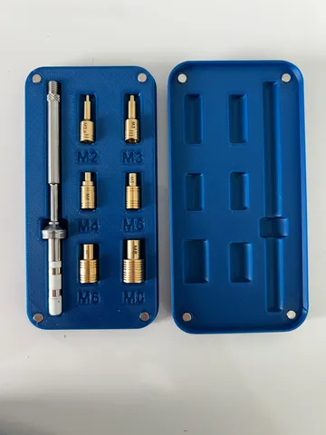
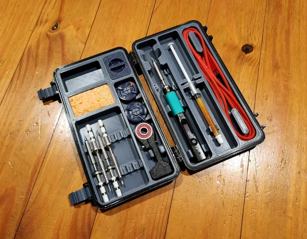
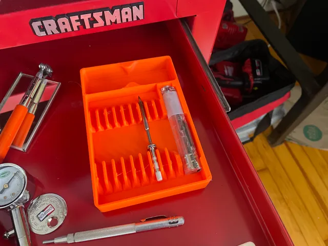
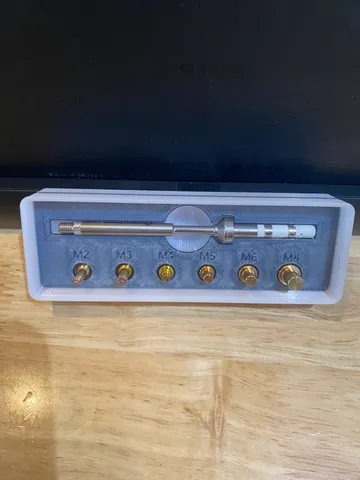

# Pinecil

<!-- Generated by scripts/Update-Readmes.ps1 (Linux: scripts/update_readmes.py) - edit scripts/readme-sources.json and rerun instead of editing by hand. -->

[Home](../../README.md) / [Storage](../README.md) / **Pinecil**

4 builds &middot; 4 Printables &middot; 2 collections (7 more builds)

## Collections

- [Gridfinity](gridfinity/README.md) - 4 builds
- [Portable](portable/README.md) - 3 builds

## Pinecil

<table>
<tr>
<td width="33%" align="center" valign="top">
 
<b>CNC Kitchen TS100 Solder Tips Case</b> 
by Layers Studio 
<a href="https://www.printables.com/model/611977-cnc-kitchen-ts100-solder-tips-case">Printables</a> &middot; <a href="cnc-kitchen-ts100-solder-tips-case-model_files">Repo folder</a>
</td>
<td width="33%" align="center" valign="top">
 
<b>PINECIL &amp; TS100/101 ALL-IN-ONE CASE</b> 
by TheCafeRacer 
<a href="https://www.printables.com/model/555123-pinecil-ts100101-all-in-one-case">Printables</a> &middot; <a href="pinecil-all-in-one-ts100101-beta-testing-model_files">Repo folder</a>
</td>
<td width="33%" align="center" valign="top">
 
<b>Pinecil organizer (iron, tips, and cable only)</b> 
by Will 
<a href="https://www.printables.com/model/348442-pinecil-organizer-iron-tips-and-cable-only">Printables</a> &middot; <a href="pinecil-organizer-iron-tips-and-cable-only-model_files">Repo folder</a>
</td>
</tr>
<tr>
<td width="33%" align="center" valign="top">
 
<b>TS100 CNC Kitchen Heatset Insert Fixed Sizing</b> 
by Devin Gearing 
<a href="https://www.printables.com/model/775217-ts100-cnc-kitchen-heatset-insert-fixed-sizing">Printables</a> &middot; <a href="ts100-cnc-kitchen-heatset-insert-fixed-sizing-model_files">Repo folder</a>
</td>
</tr>
</table>

