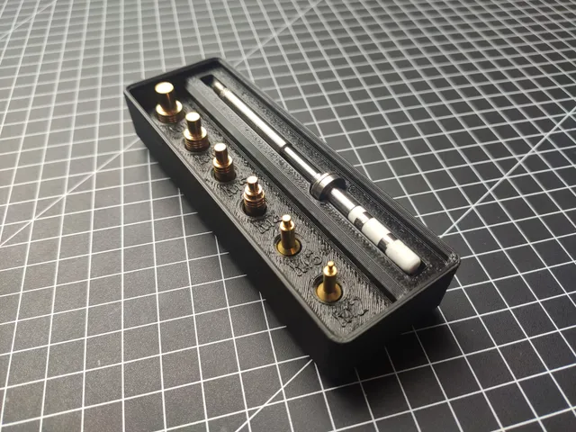
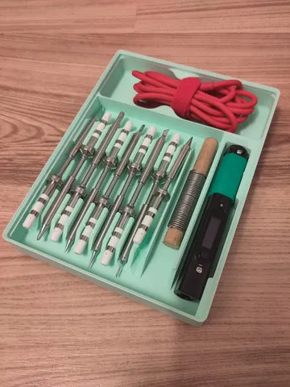
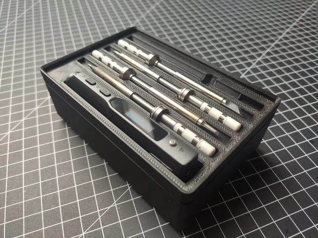
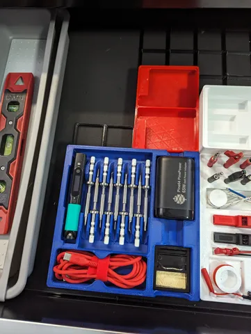

# Gridfinity

<!-- Generated by scripts/Update-Readmes.ps1 (Linux: scripts/update_readmes.py) - edit scripts/readme-sources.json and rerun instead of editing by hand. -->

[Home](../../../README.md) / [Storage](../../README.md) / [Pinecil](../README.md) / **Gridfinity**

4 builds &middot; 4 Printables

## Gridfinity

<table>
<tr>
<td width="33%" align="center" valign="top">
 
<b>Gridfinity CNC Kitchen Threaded Insert Tray</b> 
by Thorou 
<a href="https://www.printables.com/model/775281-gridfinity-cnc-kitchen-threaded-insert-tray">Printables</a> &middot; <a href="gridfinity-cnc-kitchen-threaded-insert-tray-model_files">Repo folder</a>
</td>
<td width="33%" align="center" valign="top">
 
<b>Gridfinity Pinecil Case</b> 
by Johannes 
<a href="https://www.printables.com/model/471373-gridfinity-pinecil-case">Printables</a> &middot; <a href="gridfinity-pinecil-case-model_files">Repo folder</a>
</td>
<td width="33%" align="center" valign="top">
 
<b>Gridfinity TS100 Tray</b> 
by Thorou 
<a href="https://www.printables.com/model/775224-gridfinity-ts100-tray">Printables</a> &middot; <a href="gridfinity-ts100-tray-model_files">Repo folder</a>
</td>
</tr>
<tr>
<td width="33%" align="center" valign="top">
 
<b>Pinecil organizer with Gridfinity support</b> 
by Kieran E 
<a href="https://www.printables.com/model/525429-pinecil-organizer-with-gridfinity-support">Printables</a> &middot; <a href="pinecil-organizer-with-gridfinity-support-model_files">Repo folder</a>
</td>
</tr>
</table>

