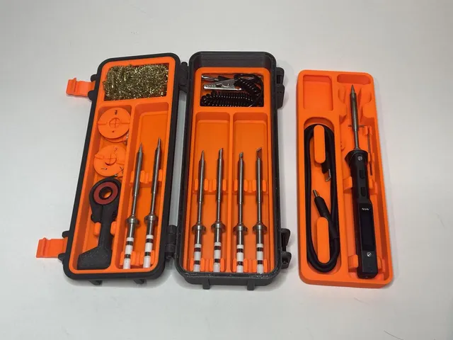
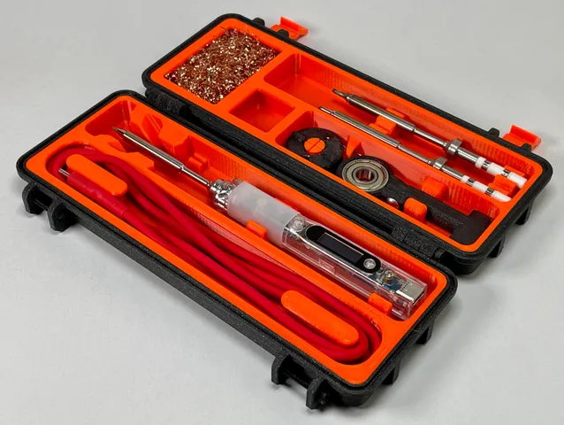
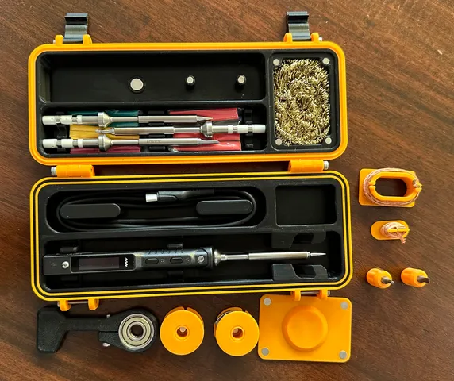

# Portable

<!-- Generated by scripts/Update-Readmes.ps1 (Linux: scripts/update_readmes.py) - edit scripts/readme-sources.json and rerun instead of editing by hand. -->

[Home](../../../README.md) / [Storage](../../README.md) / [Pinecil](../README.md) / **Portable**

3 builds &middot; 3 Printables

## Portable

<table>
<tr>
<td width="33%" align="center" valign="top">
 
<b>Double Layer Rugged Multipart Pinecil/TS100/TS80 Case (V2)</b> 
by Aikano9 
<a href="https://www.printables.com/model/427403-double-layer-rugged-multipart-pinecilts100ts80-cas">Printables</a> &middot; <a href="double-layer-rugged-multipart-pinecilts100ts80-case-v2-model_files">Repo folder</a>
</td>
<td width="33%" align="center" valign="top">
 
<b>Rugged Multipart Pinecil/TS100/TS80 Case (V2)</b> 
by PjotrStrog 
<a href="https://www.printables.com/model/345083-rugged-multipart-pinecilts100ts80-case-v2">Printables</a> &middot; <a href="rugged-multipart-pinecilts100ts80-case-v2-model_files">Repo folder</a>
</td>
<td width="33%" align="center" valign="top">
 
<b>TS101 Rugged Box (Magnetic Version)</b> 
by FrostyTheClownMan 
<a href="https://www.printables.com/model/479937-ts101-rugged-box-magnetic-version">Printables</a> &middot; <a href="ts101-rugged-box-magnetic-version-model_files">Repo folder</a>
</td>
</tr>
</table>

