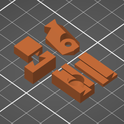
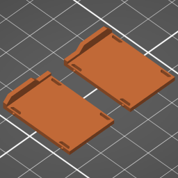
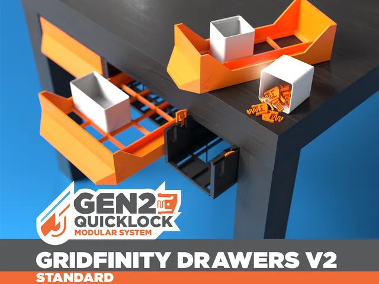
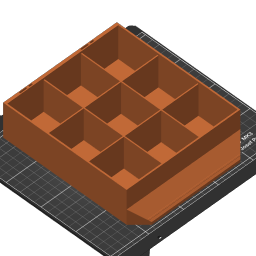
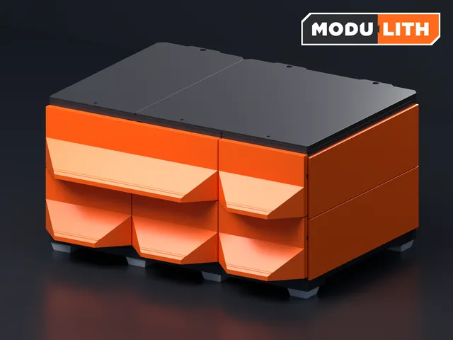

# Gen2 Drawers

<!-- Generated by scripts/Update-Readmes.ps1 (Linux: scripts/update_readmes.py) - edit scripts/readme-sources.json and rerun instead of editing by hand. -->

[Home](../../../README.md) / [Storage](../../README.md) / [Systems](../README.md) / **Gen2 Drawers**

9 builds &middot; 2 Printables &middot; 7 unknown source

## Gen2 Drawers

<table>
<tr>
<td width="33%" align="center" valign="top">
 
<b>GEN2 Adjustable Steel Sheet Holder - Large</b> 
Source unknown &middot; <a href="GEN2%20Adjustable%20Steel%20Sheet%20Holder%20-%20Large">Repo folder</a>
</td>
<td width="33%" align="center" valign="top">
 
<b>GEN2 Drawers - Medium</b> 
Source unknown &middot; <a href="GEN2%20Drawers%20-%20Medium">Repo folder</a>
</td>
<td width="33%" align="center" valign="top">
 
<b>GEN2 Drawers - Standard</b> 
Source unknown &middot; <a href="GEN2%20Drawers%20-%20Standard">Repo folder</a>
</td>
</tr>
<tr>
<td width="33%" align="center" valign="top">
<i>no preview</i> 
<b>GEN2 Gridfinity Drawers V2 - Extended Sizes</b> 
Source unknown &middot; <a href="GEN2%20Gridfinity%20Drawers%20V2%20-%20Extended%20Sizes">Repo folder</a>
</td>
<td width="33%" align="center" valign="top">
 
<b>GEN2 Gridfinity Drawers V2 - STANDARD</b> 
by Jerrari 
<a href="https://www.printables.com/model/883243-gen2-gridfinity-drawers-v2-standard">Printables</a> &middot; <a href="GEN2%20Gridfinity%20Drawers%20V2%20-%20Standard">Repo folder</a>
</td>
<td width="33%" align="center" valign="top">
 
<b>GEN2 Parts Drawers - Standard</b> 
Source unknown &middot; <a href="GEN2%20Parts%20Drawers%20-%20Standard">Repo folder</a>
</td>
</tr>
<tr>
<td width="33%" align="center" valign="top">
 
<b>GEN2 Slim Drawers</b> 
Source unknown &middot; <a href="GEN2%20Slim%20Drawers">Repo folder</a>
</td>
<td width="33%" align="center" valign="top">
 
<b>GEN2 Small Drawers</b> 
Source unknown &middot; <a href="GEN2%20Small%20Drawers">Repo folder</a>
</td>
<td width="33%" align="center" valign="top">
 
<b>MODULITH 185 Tabletop Starter Kit</b> 
by Jerrari 
<a href="https://www.printables.com/model/1118906-modulith-185-tabletop-starter-kit">Printables</a> &middot; <a href="gen2-table-top-kit-v2-standard-model_files">Repo folder</a>
</td>
</tr>
</table>

