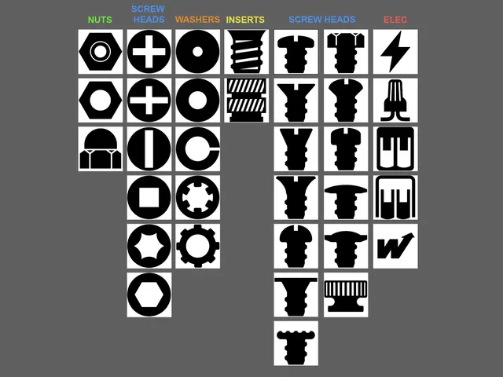
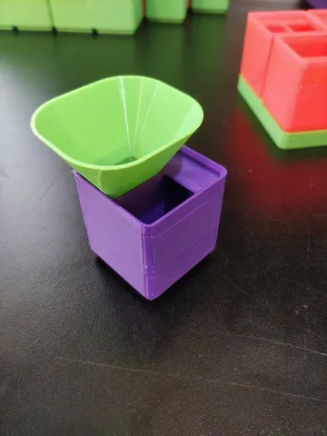
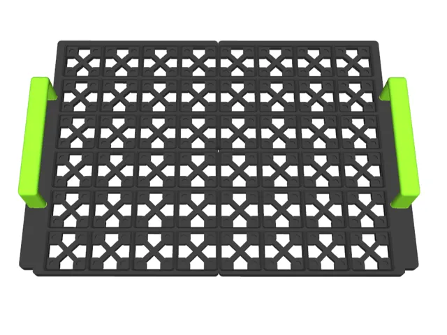

# Gridfinity

<!-- Generated by scripts/Update-Readmes.ps1 (Linux: scripts/update_readmes.py) - edit scripts/readme-sources.json and rerun instead of editing by hand. -->

[Home](../../../README.md) / [Storage](../../README.md) / [Systems](../README.md) / **Gridfinity**

6 builds &middot; 3 MakerWorld &middot; 2 Printables &middot; 1 unknown source &middot; 10 collections (323 more builds)

## Collections

- [Baseplate Spacers](baseplate-spacers/README.md) - 3 builds
- [Baseplates](baseplates/README.md) - 26 builds
- [Boxes](boxes/README.md) - 13 builds
- [Collections](collections/README.md) - 22 builds
- [Drawers](drawers/README.md) - 9 builds
- [Jigs](jigs/README.md) - 5 builds
- [Labels](labels/README.md) - 2 builds
- [Parts Bins](parts-bins/README.md) - 37 builds
- [Templates](templates/README.md) - 11 builds
- [Tool Holders](tool-holders/README.md) - 195 builds

## Gridfinity

<table>
<tr>
<td width="33%" align="center" valign="top">
<i>no preview</i> 
<b>1U gridfinity draver</b> 
<a href="https://makerworld.com/en/search/models?keyword=1U%20gridfinity%20draver">Search MakerWorld</a> &middot; <a href="1U%2Bgridfinity%2Bdraver_stls">Repo folder</a>
</td>
<td width="33%" align="center" valign="top">
<i>no preview</i> 
<b>Gridfinity Adapters</b> 
<a href="https://makerworld.com/en/search/models?keyword=Gridfinity%20Adapters">Search MakerWorld</a> &middot; <a href="Gridfinity%2BAdapters">Repo folder</a>
</td>
<td width="33%" align="center" valign="top">
 
<b>Gridfinity Bin Label Icons</b> 
by Joe Jankowiak 
<a href="https://www.printables.com/model/621771-gridfinity-bin-label-icons">Printables</a> &middot; <a href="gridfinity-bin-label-icons-other_files">Repo folder</a>
</td>
</tr>
<tr>
<td width="33%" align="center" valign="top">
 
<b>gridfinity funnel</b> 
by Jools 
<a href="https://www.printables.com/model/188075-gridfinity-funnel">Printables</a> &middot; <a href="gridfinity-funnel-model_files">Repo folder</a>
</td>
<td width="33%" align="center" valign="top">
 
<b>Gridfinity Makpac stackable tray (magnetic)</b> 
by TmDvd 
<a href="https://makerworld.com/en/models/568924-gridfinity-makpac-stackable-tray-magnetic">MakerWorld</a> &middot; <a href="Gridfinity%2BMakpac%2Bstackable%2Btray%2B(magnetic)">Repo folder</a>
</td>
</tr>
</table>

Other files in this folder (1)

- [parametric-gridfinity-trays-model_files.zip](parametric-gridfinity-trays-model_files.zip)

