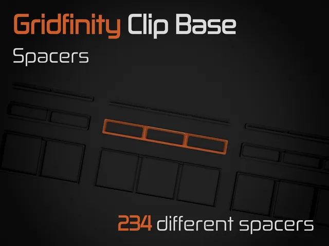
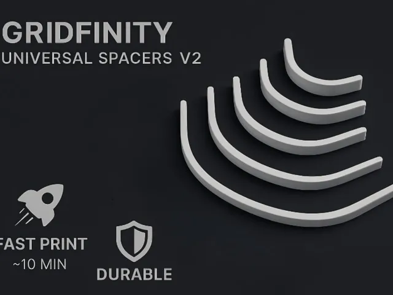

# Baseplate Spacers

<!-- Generated by scripts/Update-Readmes.ps1 (Linux: scripts/update_readmes.py) - edit scripts/readme-sources.json and rerun instead of editing by hand. -->

[Home](../../../../README.md) / [Storage](../../../README.md) / [Systems](../../README.md) / [Gridfinity](../README.md) / **Baseplate Spacers**

3 builds &middot; 2 MakerWorld &middot; 1 Printables

## Baseplate Spacers

<table>
<tr>
<td width="33%" align="center" valign="top">
 
<b>Gridfinity Base with Clip - Spacers</b> 
by HuMa 
<a href="https://www.printables.com/model/625523-gridfinity-base-with-clip-spacers">Printables</a> &middot; <a href="gridfinity-clip-base-spacers-model_files">Repo folder</a>
</td>
<td width="33%" align="center" valign="top">
 
<b>Gridfinity Universal base Spacers V2</b> 
by Rebel3D 
<a href="https://makerworld.com/en/models/1917674-gridfinity-universal-base-spacers-v2">MakerWorld</a> &middot; <a href="Gridfinity%2BUniversal%2Bbase%2BSpacers%2BV2">Repo folder</a>
</td>
<td width="33%" align="center" valign="top">
 
<b>universal spacers V2</b> 
<a href="https://makerworld.com/en/search/models?keyword=universal%20spacers%20V2">Search MakerWorld</a> &middot; <a href="universal%2Bspacers%2BV2">Repo folder</a>
</td>
</tr>
</table>

