# Baseplates

<!-- Generated by scripts/Update-Readmes.ps1 (Linux: scripts/update_readmes.py) - edit scripts/readme-sources.json and rerun instead of editing by hand. -->

[Home](../../../../README.md) / [Storage](../../../README.md) / [Systems](../../README.md) / [Gridfinity](../README.md) / **Baseplates**

26 builds &middot; 8 MakerWorld &middot; 13 Printables &middot; 1 Thingiverse &middot; 4 unknown source

## Baseplates

<table>
<tr>
<td width="33%" align="center" valign="top">
<a href="4x4%2Bsuperlight%2B4%2B8%2Bstack%2BNEW%2BAND%2BIMPROVED.3mf">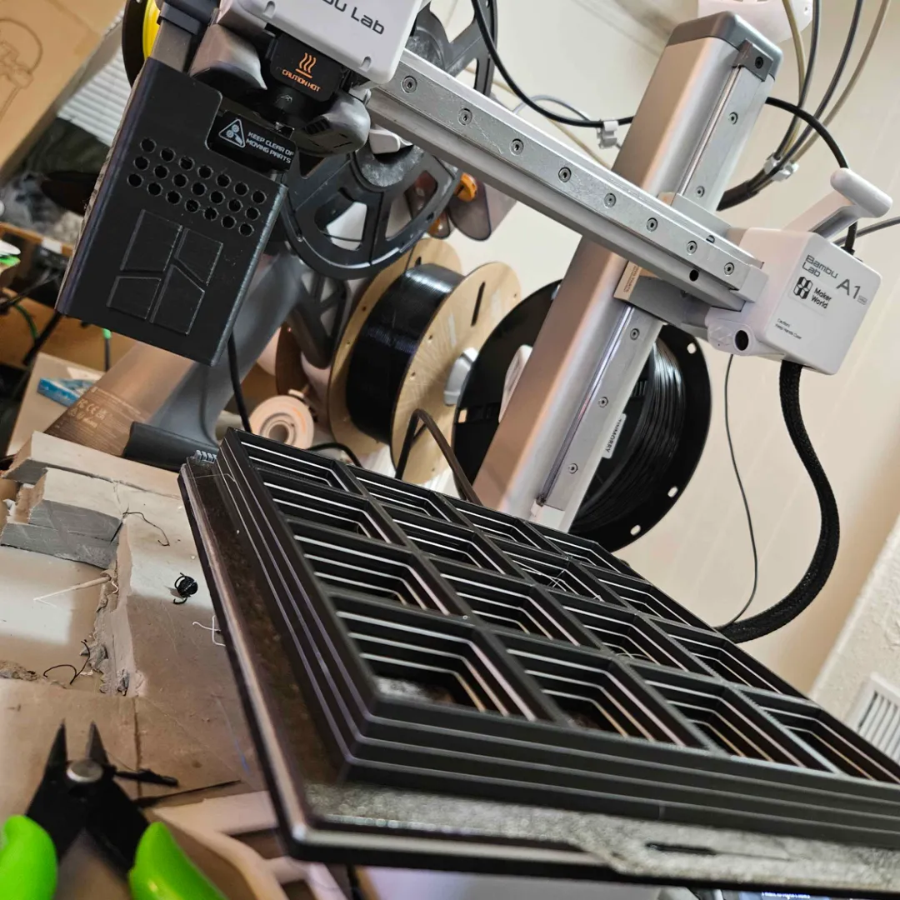</a> 
<b>4x4 superlight 4 8 stack NEW AND IMPROVED</b> 
<a href="https://makerworld.com/en/search/models?keyword=4x4%20superlight%204%208%20stack%20NEW%20AND%20IMPROVED">Search MakerWorld</a> &middot; <a href="4x4%2Bsuperlight%2B4%2B8%2Bstack%2BNEW%2BAND%2BIMPROVED.3mf">4x4+superlight+4+8+stack+NEW+AND+IMPROVED.3mf</a>
</td>
<td width="33%" align="center" valign="top">
<a href="Base%2BGrid%2B5x5%2B16-STACK-makerworld.3mf">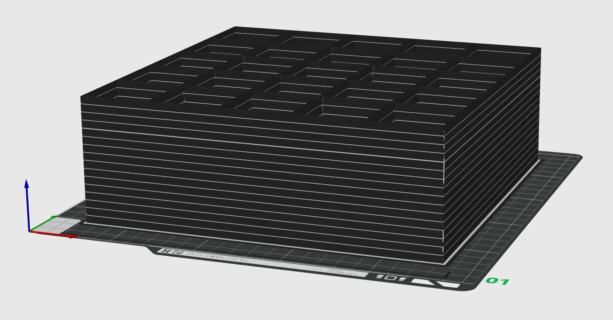</a> 
<b>Base Grid 5x5 16-STACK-makerworld</b> 
<a href="https://makerworld.com/en/search/models?keyword=Base%20Grid%205x5%2016-STACK-makerworld">Search MakerWorld</a> &middot; <a href="Base%2BGrid%2B5x5%2B16-STACK-makerworld.3mf">Base+Grid+5x5+16-STACK-makerworld.3mf</a>
</td>
<td width="33%" align="center" valign="top">
<a href="Base%2BGrid%2B5x5%2B8-STACK-makerworld.3mf">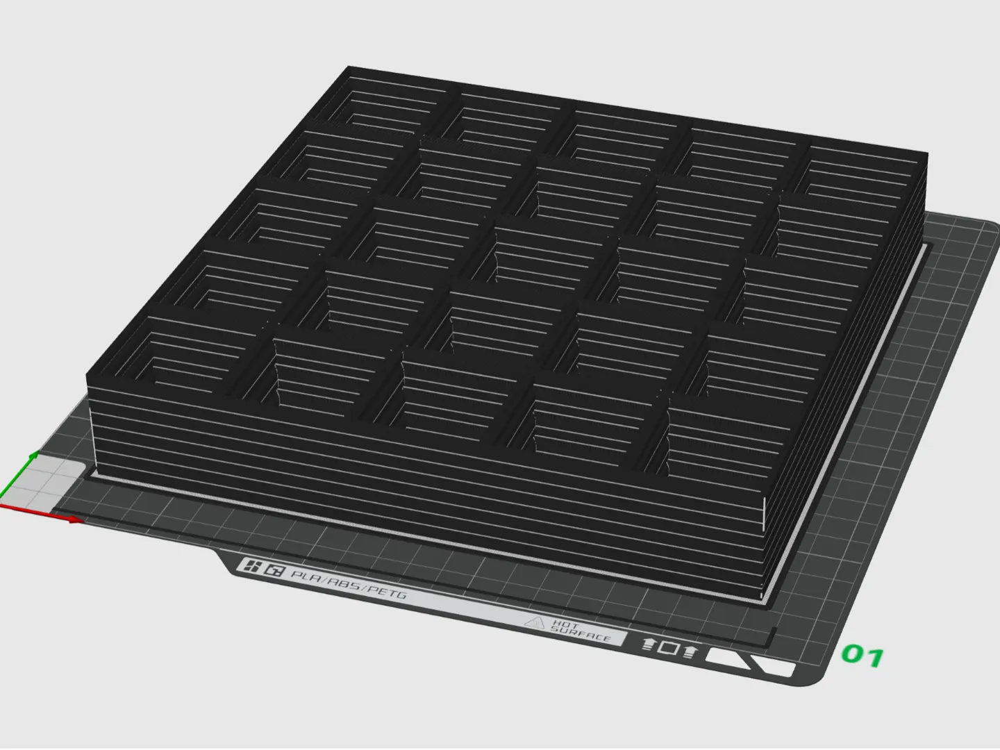</a> 
<b>Base Grid 5x5 8-STACK-makerworld</b> 
<a href="https://makerworld.com/en/search/models?keyword=Base%20Grid%205x5%208-STACK-makerworld">Search MakerWorld</a> &middot; <a href="Base%2BGrid%2B5x5%2B8-STACK-makerworld.3mf">Base+Grid+5x5+8-STACK-makerworld.3mf</a>
</td>
</tr>
<tr>
<td width="33%" align="center" valign="top">
<a href="Baseplate%2B-%2BSL%2BH%2B-%2B256x256%2BBed.3mf">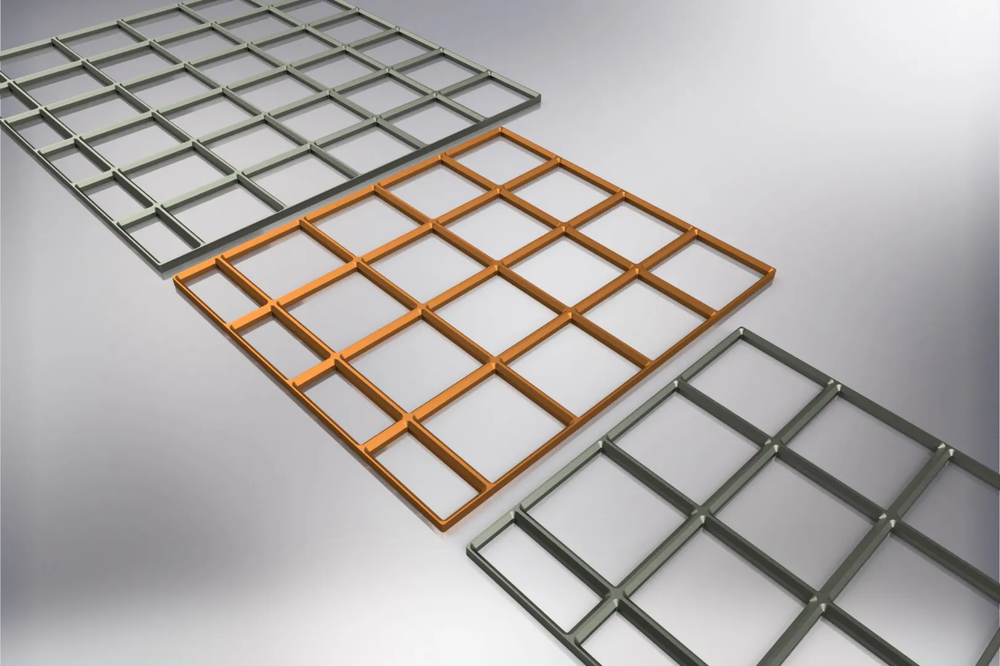</a> 
<b>Baseplate - SL H - 256x256 Bed</b> 
<a href="https://makerworld.com/en/search/models?keyword=Baseplate%20-%20SL%20H%20-%20256x256%20Bed">Search MakerWorld</a> &middot; <a href="Baseplate%2B-%2BSL%2BH%2B-%2B256x256%2BBed.3mf">Baseplate+-+SL+H+-+256x256+Bed.3mf</a>
</td>
<td width="33%" align="center" valign="top">
<a href="Baseplate%20-%20Superlight%20-%205x5%20-%20Stacked%208%20Levels.3mf">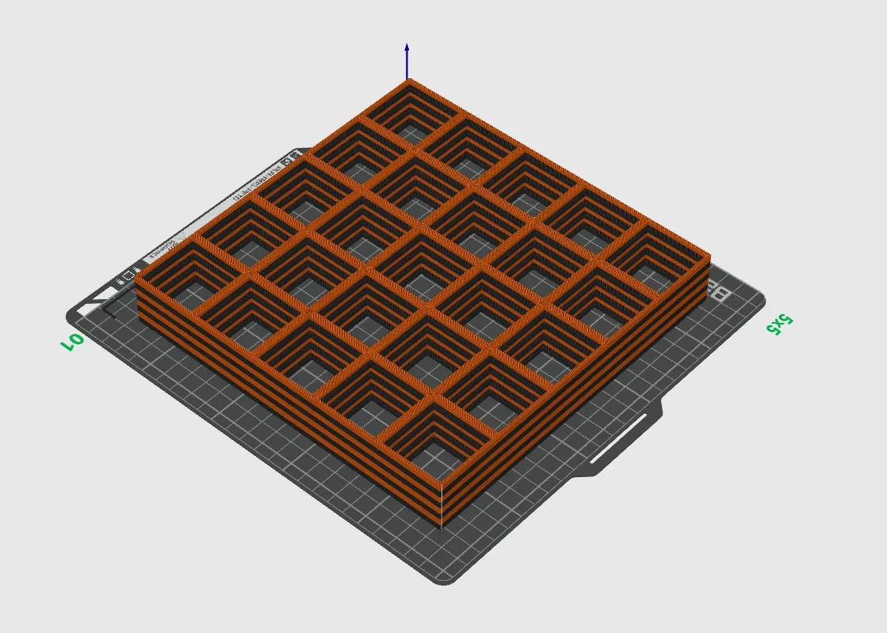</a> 
<b>Baseplate - Superlight - 5x5 - Stacked 8 Levels</b> 
Source unknown &middot; <a href="Baseplate%20-%20Superlight%20-%205x5%20-%20Stacked%208%20Levels.3mf">Baseplate - Superlight - 5x5 - Stacked 8 Levels.3mf</a>
</td>
<td width="33%" align="center" valign="top">
<a href="Baseplate%2B-%2BSuperlight%2B-%2BAll%2BSizes%2B-%2BUpdated.3mf">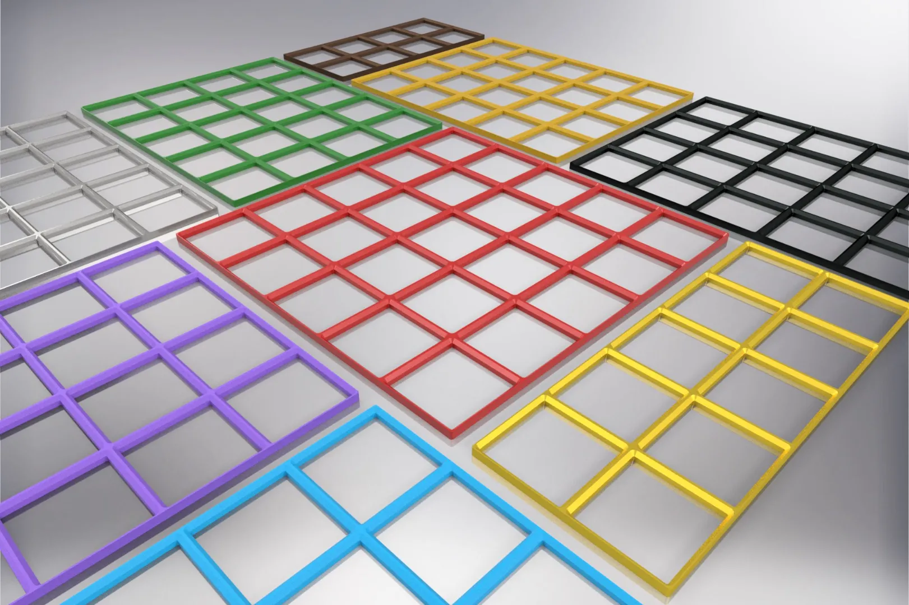</a> 
<b>Baseplate - Superlight - All Sizes - Updated</b> 
<a href="https://makerworld.com/en/search/models?keyword=Baseplate%20-%20Superlight%20-%20All%20Sizes%20-%20Updated">Search MakerWorld</a> &middot; <a href="Baseplate%2B-%2BSuperlight%2B-%2BAll%2BSizes%2B-%2BUpdated.3mf">Baseplate+-+Superlight+-+All+Sizes+-+Updated.3mf</a>
</td>
</tr>
<tr>
<td width="33%" align="center" valign="top">
<a href="clickfinity-refined-baseplates-for-use-with-gridfinity-now-with-step-files-model_files">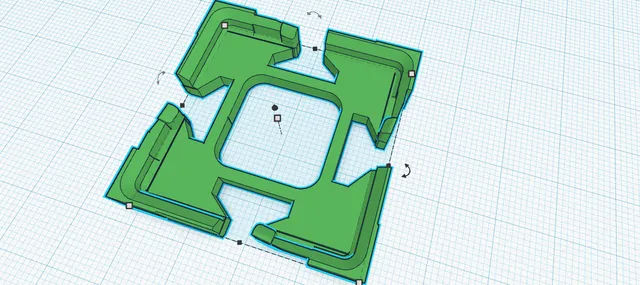</a> 
<b>Clickfinity Refined Baseplates for use with Gridfinity (now with STEP files)</b> 
by FPV Smitty 
<a href="https://www.printables.com/model/506105-clickfinity-refined-baseplates-for-use-with-gridfi">Printables</a> &middot; <a href="clickfinity-refined-baseplates-for-use-with-gridfinity-now-with-step-files-model_files">Repo folder</a>
</td>
<td width="33%" align="center" valign="top">
 
<b>Clickfinity Refined Baseplates for use with Gridfinity (now with STEP files)</b> 
by FPV Smitty 
<a href="https://www.printables.com/model/506105-clickfinity-refined-baseplates-for-use-with-gridfi">Printables</a> &middot; <a href="clickfinity-refined-baseplates-model_files">Repo folder</a>
</td>
<td width="33%" align="center" valign="top">
<a href="gridfinity-press-fit-magnet-light-baseplates-model_files">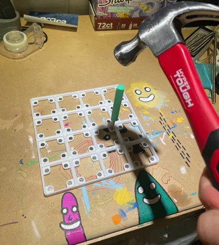</a> 
<b>Gridfinity - press-fit magnet light baseplates</b> 
by plomdawg 
<a href="https://www.printables.com/model/414298-gridfinity-press-fit-magnet-light-baseplates">Printables</a> &middot; <a href="gridfinity-press-fit-magnet-light-baseplates-model_files">Repo folder</a>
</td>
</tr>
<tr>
<td width="33%" align="center" valign="top">
<a href="gridfinity-base-for-ikea-alex-model_files">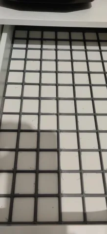</a> 
<b>Gridfinity Base for Ikea Alex</b> 
by Pey3D 
<a href="https://www.printables.com/model/213778-gridfinity-base-for-ikea-alex">Printables</a> &middot; <a href="gridfinity-base-for-ikea-alex-model_files">Repo folder</a>
</td>
<td width="33%" align="center" valign="top">
<i>no preview</i> 
<b>Gridfinity Baseplates stl</b> 
Source unknown &middot; <a href="Gridfinity%20Baseplates%20stl">Repo folder</a>
</td>
<td width="33%" align="center" valign="top">
<a href="gridfinity-clickfinity-baseplate-no-magnets-universally-compatible-with-all-bins-minimal-filament-usage-model_files">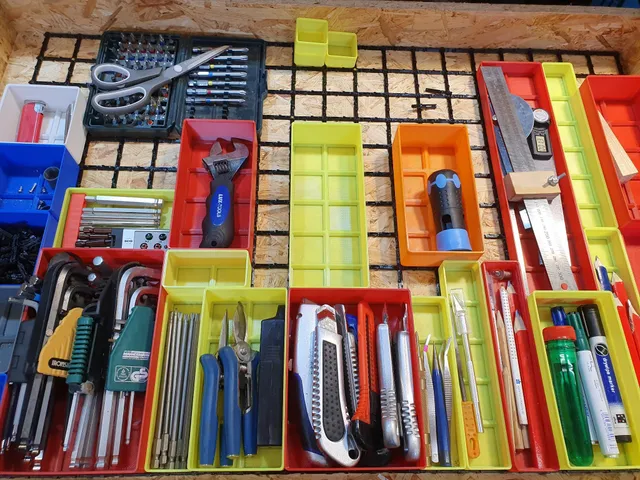</a> 
<b>Gridfinity Clickfinity Baseplate - No magnets, universally compatible with all bins, minimal filament usage.</b> 
by NoWarrenty 
<a href="https://www.printables.com/model/452675-gridfinity-clickfinity-baseplate-no-magnets-univer">Printables</a> &middot; <a href="gridfinity-clickfinity-baseplate-no-magnets-universally-compatible-with-all-bins-minimal-filament-usage-model_files">Repo folder</a>
</td>
</tr>
<tr>
<td width="33%" align="center" valign="top">
<a href="gridfinity-desktop-baseplates-model_files">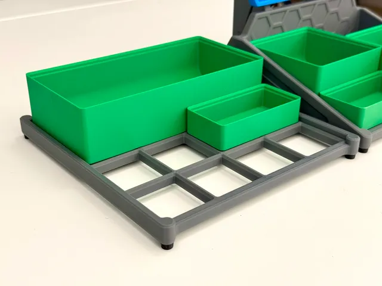</a> 
<b>Gridfinity Desktop Baseplates</b> 
by KYZ Design 
<a href="https://www.printables.com/model/1123454-gridfinity-desktop-baseplates">Printables</a> &middot; <a href="gridfinity-desktop-baseplates-model_files">Repo folder</a>
</td>
<td width="33%" align="center" valign="top">
<a href="gridfinity-magnet-light-baseplate-model_files">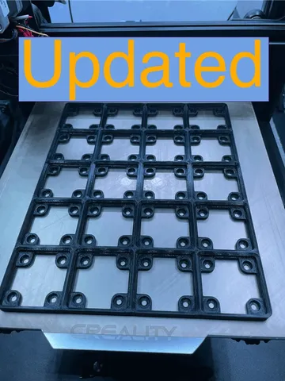</a> 
<b>Gridfinity Magnet Light Baseplate</b> 
by RIP_Plo-Koon 
<a href="https://www.printables.com/model/250550-gridfinity-magnet-light-baseplate">Printables</a> &middot; <a href="gridfinity-magnet-light-baseplate-model_files">Repo folder</a>
</td>
<td width="33%" align="center" valign="top">
<a href="gridfinity-screw-together-baseplate-model_files">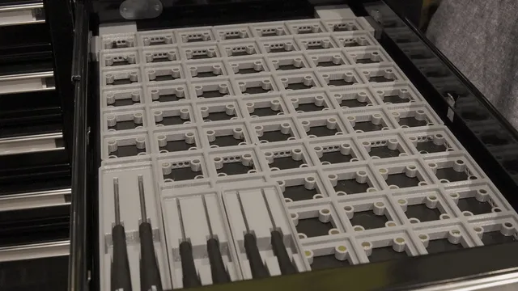</a> 
<b>Gridfinity Screw Together baseplate</b> 
by Kyle Warren 
<a href="https://www.printables.com/model/300603-gridfinity-screw-together-baseplate">Printables</a> &middot; <a href="gridfinity-screw-together-baseplate-model_files">Repo folder</a>
</td>
</tr>
<tr>
<td width="33%" align="center" valign="top">
<a href="gridfinity-skadis-print_files">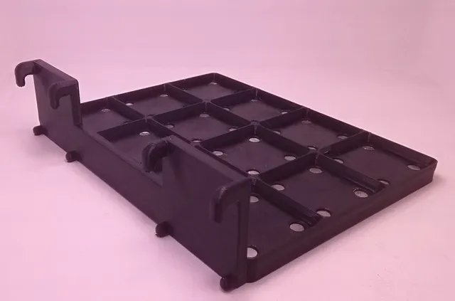</a> 
<b>Gridfinity Sk&#229;dis</b> 
by SeqSEE 
<a href="https://www.printables.com/model/253507-gridfinity-skadis">Printables</a> &middot; <a href="gridfinity-skadis-print_files">Repo folder</a>
</td>
<td width="33%" align="center" valign="top">
<a href="gridfinity-snap-together-baseplate-with-captured-magnets-model_files">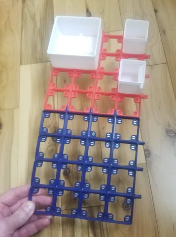</a> 
<b>Gridfinity Snap Together Baseplate with Captured Magnets</b> 
by jack_hmr 
<a href="https://www.printables.com/model/356890-gridfinity-snap-together-baseplate-with-captured-m">Printables</a> &middot; <a href="gridfinity-snap-together-baseplate-with-captured-magnets-model_files">Repo folder</a>
</td>
<td width="33%" align="center" valign="top">
<i>no preview</i> 
<b>Gridfinity Superlight Baseplates</b> 
<a href="https://makerworld.com/en/search/models?keyword=Gridfinity%20Superlight%20Baseplates">Search MakerWorld</a> &middot; <a href="Gridfinity%2BSuperlight%2BBaseplates">Repo folder</a>
</td>
</tr>
<tr>
<td width="33%" align="center" valign="top">
<i>no preview</i> 
<b>gridfinity-eco-ClickPlates</b> 
Source unknown &middot; <a href="gridfinity-eco-ClickPlates">Repo folder</a>
</td>
<td width="33%" align="center" valign="top">
<i>no preview</i> 
<b>Gridfinity-Step Storage</b> 
Source unknown &middot; <a href="Gridfinity-Step%20Storage">Repo folder</a>
</td>
<td width="33%" align="center" valign="top">
<a href="ikea-alex-wide-gridfinity-baseplate-model_files">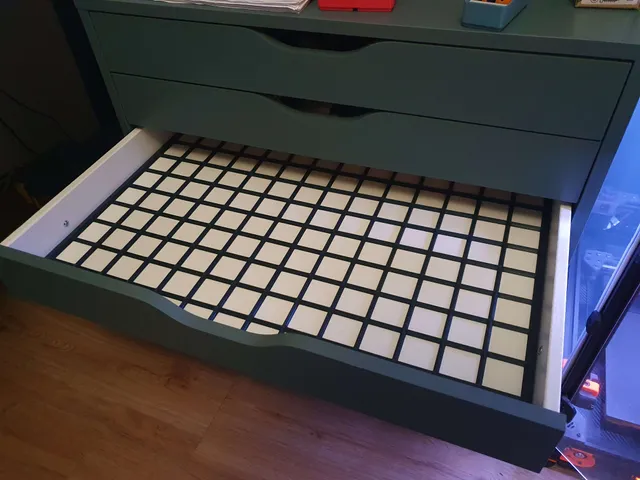</a> 
<b>IKEA ALEX (wide) Gridfinity Baseplate</b> 
by Mino 
<a href="https://www.printables.com/model/366128-ikea-alex-wide-gridfinity-baseplate">Printables</a> &middot; <a href="ikea-alex-wide-gridfinity-baseplate-model_files">Repo folder</a>
</td>
</tr>
<tr>
<td width="33%" align="center" valign="top">
<a href="ikea-alex-gridfinity-spacers-model_files">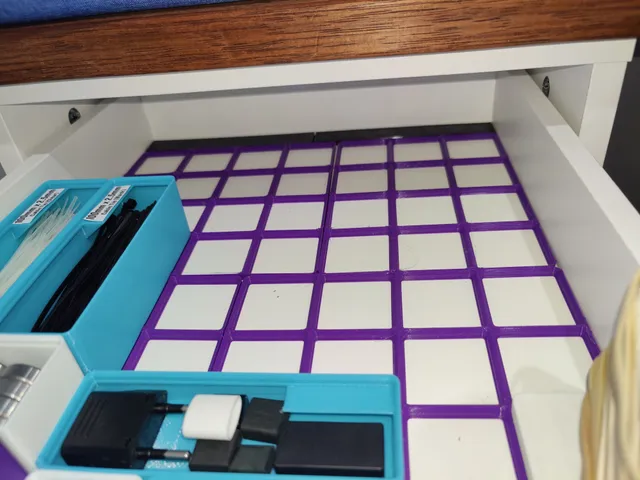</a> 
<b>Ikea Alex Gridfinity Spacers</b> 
by Tomie M 
<a href="https://www.printables.com/model/303068-ikea-alex-gridfinity-spacers">Printables</a> &middot; <a href="ikea-alex-gridfinity-spacers-model_files">Repo folder</a>
</td>
<td width="33%" align="center" valign="top">
<a href="Lightest%2BGridfinity%2BBase%2BEver%2B-%2BCustomizable">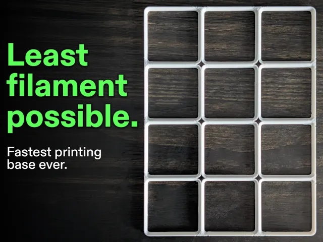</a> 
<b>Lightest Gridfinity Base Ever - Customizable</b> 
by Sparky 
<a href="https://makerworld.com/en/models/1685835-lightest-gridfinity-base-ever-customizable">MakerWorld</a> &middot; <a href="Lightest%2BGridfinity%2BBase%2BEver%2B-%2BCustomizable">Repo folder</a>
</td>
<td width="33%" align="center" valign="top">
 
<b>Optimized Gridfinity Base: Faster, Smarter, Better!</b> 
by J-Max 
<a href="https://www.thingiverse.com/thing:6837189">Thingiverse</a> &middot; <a href="Optimized%20Gridfinity%20Base_%20Faster%2C%20Smarter%2C%20Better!%20-%206837189">Repo folder</a>
</td>
</tr>
<tr>
<td width="33%" align="center" valign="top">
<a href="optimized-gridfinity-base-faster-smarter-better-model_files">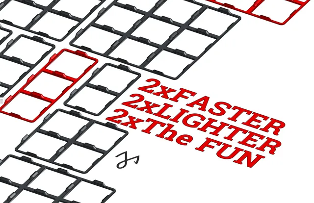</a> 
<b>Optimized Gridfinity Base: Faster, Smarter, Better!</b> 
by JMAW 
<a href="https://www.printables.com/model/1078733-optimized-gridfinity-base-faster-smarter-better">Printables</a> &middot; <a href="optimized-gridfinity-base-faster-smarter-better-model_files">Repo folder</a>
</td>
<td width="33%" align="center" valign="top">
<a href="STACK%2B4.3mf">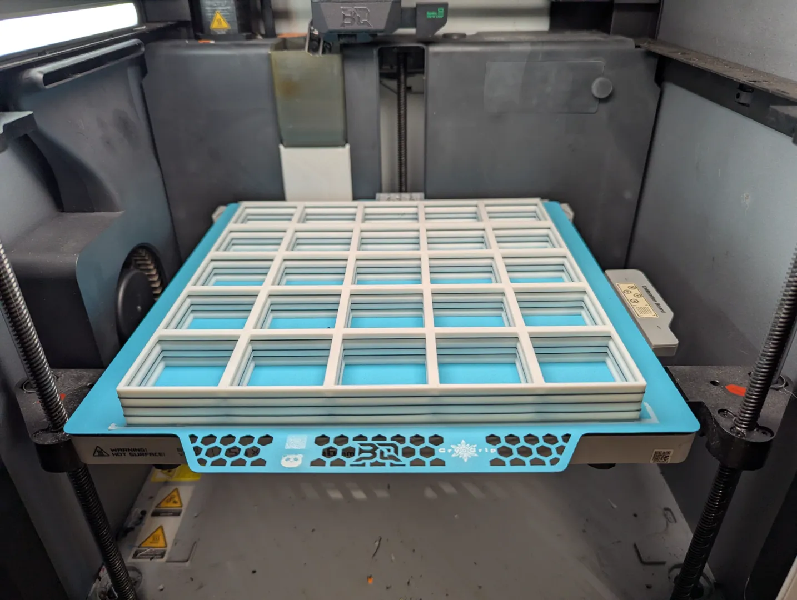</a> 
<b>STACK 4</b> 
<a href="https://makerworld.com/en/search/models?keyword=STACK%204">Search MakerWorld</a> &middot; <a href="STACK%2B4.3mf">STACK+4.3mf</a>
</td>
</tr>
</table>

