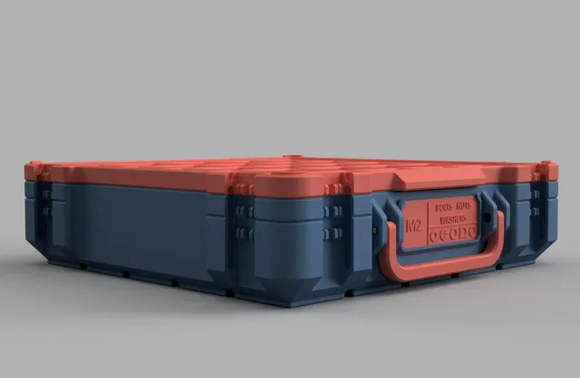
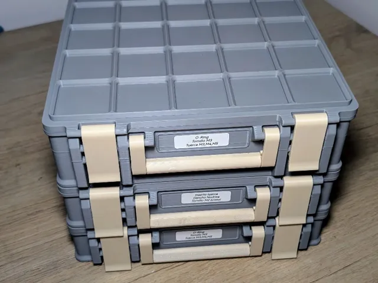
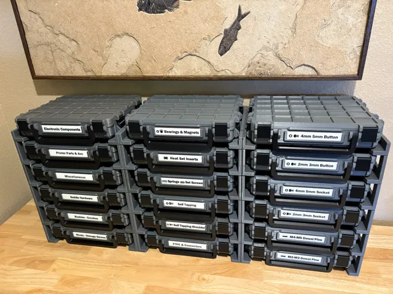
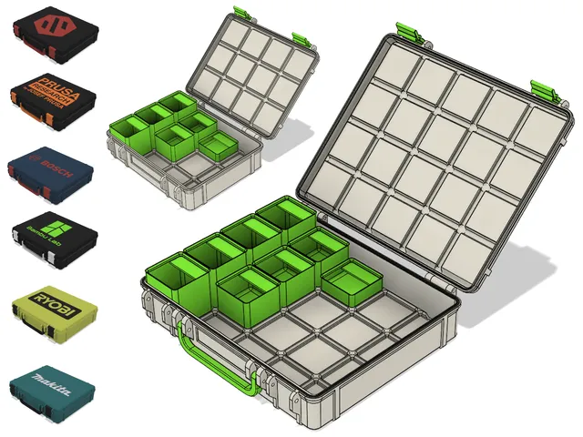
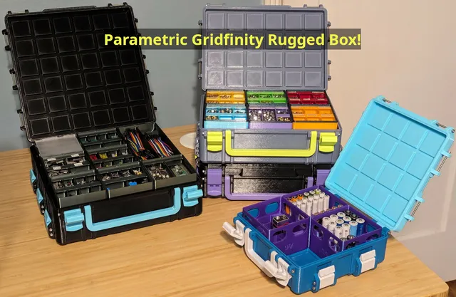
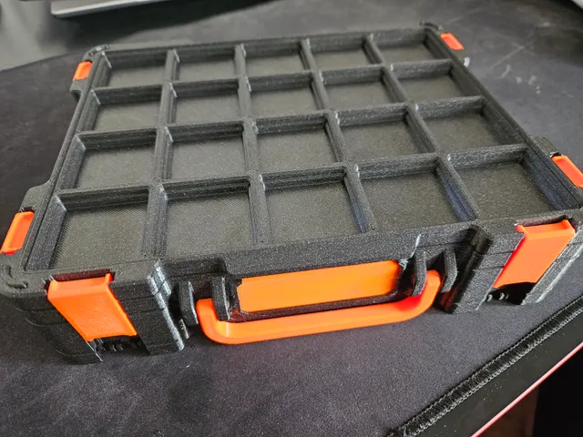
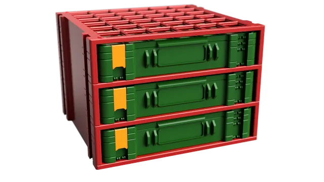
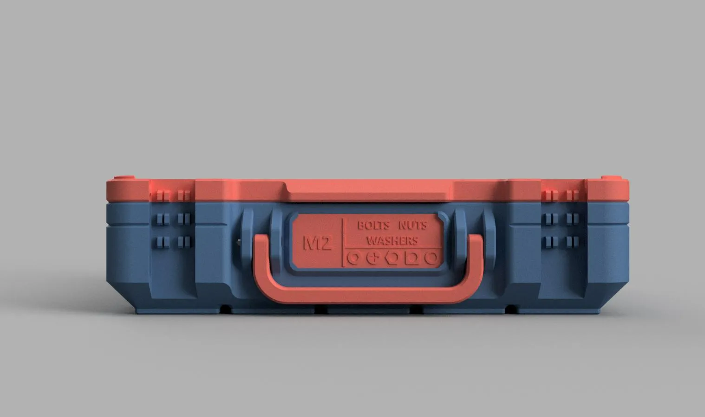
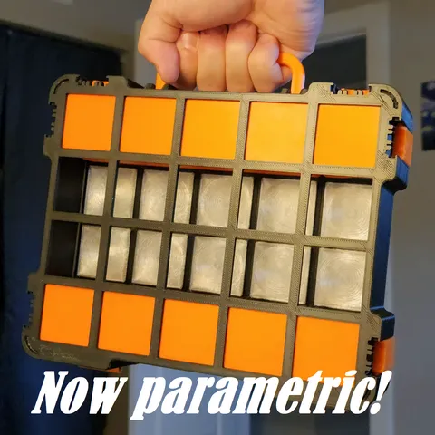

# Boxes

<!-- Generated by scripts/Update-Readmes.ps1 (Linux: scripts/update_readmes.py) - edit scripts/readme-sources.json and rerun instead of editing by hand. -->

[Home](../../../../README.md) / [Storage](../../../README.md) / [Systems](../../README.md) / [Gridfinity](../README.md) / **Boxes**

10 builds &middot; 4 MakerWorld &middot; 6 Printables &middot; 1 collections (3 more builds)

## Collections

- [Gridfinity Shelves For Boxes](gridfinity-shelves-for-boxes/README.md) - 3 builds

## Boxes

<table>
<tr>
<td width="33%" align="center" valign="top">
 
<b>Gridfinity Base Storage Box by Pred Remix</b> 
by VersusMakes 
<a href="https://makerworld.com/en/models/788692-gridfinity-base-storage-box-by-pred-remix">MakerWorld</a> &middot; <a href="Gridfinity%2BBase%2BStorage%2BBox%2Bby%2BPred%2BRemix">Repo folder</a>
</td>
<td width="33%" align="center" valign="top">
 
<b>Gridfinity Box</b> 
by deagudeloj 
<a href="https://makerworld.com/en/models/1559322-gridfinity-box">MakerWorld</a> &middot; <a href="gridfinity-box">Repo folder</a>
</td>
<td width="33%" align="center" valign="top">
 
<b>Gridfinity Rugged Box &amp; Modular Expandable Shelves</b> 
by Stormwalker 
<a href="https://makerworld.com/en/models/2124702-gridfinity-rugged-box-modular-expandable-shelves">MakerWorld</a> &middot; <a href="Gridfinity%2BRugged%2BBox%2B%26%2BModular%2BExpandable%2BShelves">Repo folder</a>
</td>
</tr>
<tr>
<td width="33%" align="center" valign="top">
 
<b>Gridfinity Rugged Case &quot;Light&quot; R3 - 150+ SIZES</b> 
by suit 
<a href="https://www.printables.com/model/873932-gridfinity-rugged-case-light-r3-150-sizes">Printables</a> &middot; <a href="gridfinity-rugged-case-light-r3-new-sizes-parametric-model_files">Repo folder</a>
</td>
<td width="33%" align="center" valign="top">
 
<b>Gridfinity Rugged Storage Box, Parametric and Customizable</b> 
by bulbasaur0 
<a href="https://www.printables.com/model/757297-gridfinity-rugged-storage-box-parametric-and-custo">Printables</a> &middot; <a href="gridfinity-rugged-storage-box-parametric-and-customizable-model_files">Repo folder</a>
</td>
<td width="33%" align="center" valign="top">
 
<b>Gridfinity Rugged Storage Box, Parametric and Customizable</b> 
by bulbasaur0 
<a href="https://www.printables.com/model/757297-gridfinity-rugged-storage-box-parametric-and-custo">Printables</a> &middot; <a href="gridfinity-rugged-storage-box-parametric-and-customizable-other_files">Repo folder</a>
</td>
</tr>
<tr>
<td width="33%" align="center" valign="top">
 
<b>Gridfinity Storage Box by Pred (now parametric)</b> 
by Pred 
<a href="https://www.printables.com/model/543553-gridfinity-storage-box-by-pred-now-parametric">Printables</a> &middot; <a href="gridfinity-storage-box-by-pred-now-parametric-model_files">Repo folder</a>
</td>
<td width="33%" align="center" valign="top">
 
<b>Gridfinity Storage Box Shelves (Parametric)</b> 
by Aleks Plewinski 
<a href="https://www.printables.com/model/1023055-gridfinity-storage-box-shelves-parametric">Printables</a> &middot; <a href="gridfinity-storage-box-shelves-parametric-model_files">Repo folder</a>
</td>
<td width="33%" align="center" valign="top">
 
<b>GridfinityStorageBox_Parametric v1.1_Stackable base_20250127</b> 
<a href="https://makerworld.com/en/search/models?keyword=GridfinityStorageBox_Parametric%20v1.1_Stackable%20base_20250127">Search MakerWorld</a> &middot; <a href="GridfinityStorageBox_Parametric%2Bv1.1_Stackable%2Bbase_20250127.3mf">GridfinityStorageBox_Parametric+v1.1_Stackable+base_20250127.3mf</a>
</td>
</tr>
<tr>
<td width="33%" align="center" valign="top">
 
<b>Lite Base for Gridfinity Storage Box by Pred *Now Parametric!*</b> 
by theLolrus 
<a href="https://www.printables.com/model/561688-lite-base-for-gridfinity-storage-box-by-pred-now-p">Printables</a> &middot; <a href="lite-base-for-gridfinity-storage-box-by-pred-now-parametric-model_files">Repo folder</a>
</td>
</tr>
</table>

