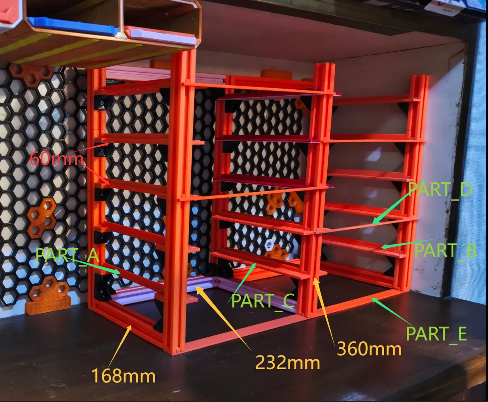

# Gridfinity Shelves For Boxes

<!-- Generated by scripts/Update-Readmes.ps1 (Linux: scripts/update_readmes.py) - edit scripts/readme-sources.json and rerun instead of editing by hand. -->

[Home](../../../../../README.md) / [Storage](../../../../README.md) / [Systems](../../../README.md) / [Gridfinity](../../README.md) / [Boxes](../README.md) / **Gridfinity Shelves For Boxes**

3 builds &middot; 3 MakerWorld

## Gridfinity Shelves For Boxes

<table>
<tr>
<td width="33%" align="center" valign="top">
<i>no preview</i> 
<b>Box Storage</b> 
<a href="https://makerworld.com/en/search/models?keyword=Box%20Storage">Search MakerWorld</a> &middot; <a href="box%2Bstorage_stls">Repo folder</a>
</td>
<td width="33%" align="center" valign="top">
 
<b>box storage All Size</b> 
<a href="https://makerworld.com/en/search/models?keyword=box%20storage%20All%20Size">Search MakerWorld</a> &middot; <a href="box%2Bstorage%2BAll%2BSize.3mf">box+storage+All+Size.3mf</a>
</td>
<td width="33%" align="center" valign="top">
<i>no preview</i> 
<b>box storage All Size</b> 
<a href="https://makerworld.com/en/search/models?keyword=box%20storage%20All%20Size">Search MakerWorld</a> &middot; <a href="box%2Bstorage%2BAll%2BSize_stls">Repo folder</a>
</td>
</tr>
</table>

