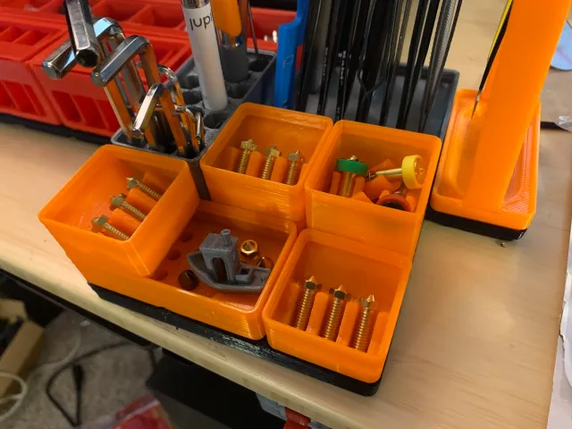
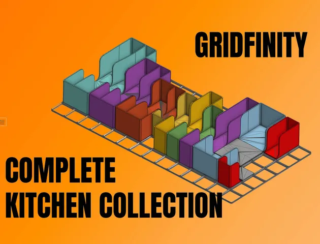
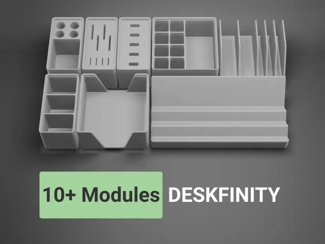
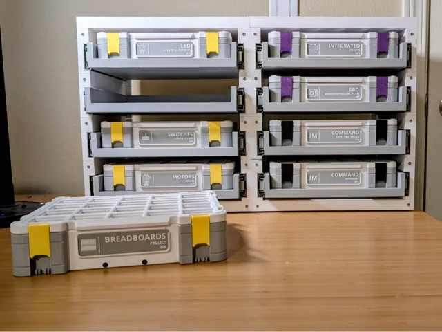
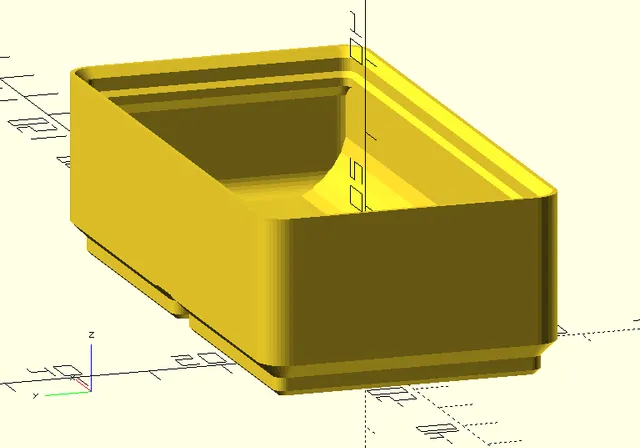
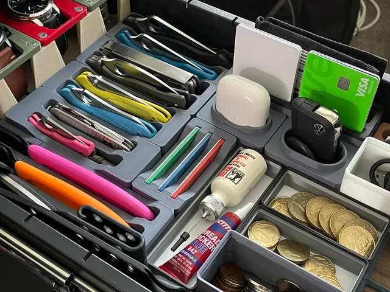
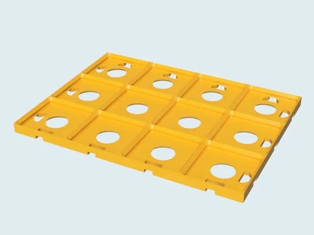
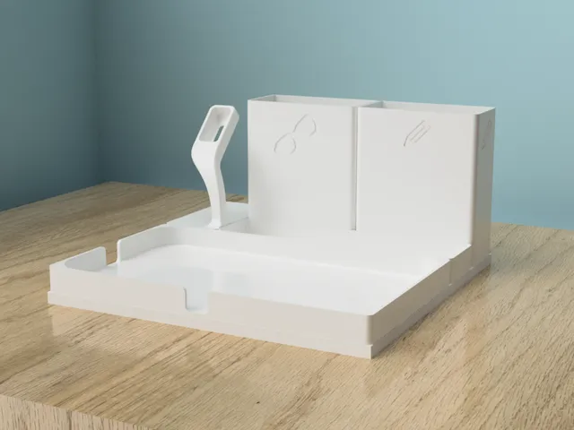
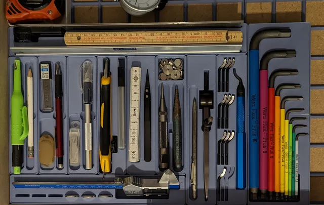
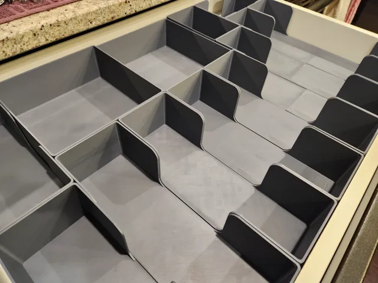

# Collections

<!-- Generated by scripts/Update-Readmes.ps1 (Linux: scripts/update_readmes.py) - edit scripts/readme-sources.json and rerun instead of editing by hand. -->

[Home](../../../../README.md) / [Storage](../../../README.md) / [Systems](../../README.md) / [Gridfinity](../README.md) / **Collections**

13 builds &middot; 2 MakerWorld &middot; 10 Printables &middot; 1 unknown source &middot; 1 collections (9 more builds)

## Collections

- [Rugged Collection](rugged-collection/README.md) - 9 builds

## Collections

<table>
<tr>
<td width="33%" align="center" valign="top">
 
<b>Gridfinity 3D Printing Bundle for nerds</b> 
by CmdrMoto 
<a href="https://www.printables.com/model/170479-gridfinity-3d-printing-bundle-for-nerds">Printables</a> &middot; <a href="Gridfinity%203D%20Printing%20Bundle%20for%20Nerds">Repo folder</a>
</td>
<td width="33%" align="center" valign="top">
 
<b>Gridfinity Complete Kitchen Collection (w/ Modular Expansion Pieces)</b> 
by The Next Layer 
<a href="https://www.printables.com/model/719729-gridfinity-complete-kitchen-collection-w-modular-e">Printables</a> &middot; <a href="gridfinity-complete-kitchen-collection-w-modular-expansion-pieces-model_files">Repo folder</a>
</td>
<td width="33%" align="center" valign="top">
 
<b>Gridfinity Desk Organizer System - Deskfinity</b> 
by ethanthompson 
<a href="https://www.printables.com/model/376580-gridfinity-desk-organizer-system-deskfinity">Printables</a> &middot; <a href="gridfinity-desk-organizer-system-deskfinity-model_files">Repo folder</a>
</td>
</tr>
<tr>
<td width="33%" align="center" valign="top">
 
<b>Gridfinity Encyclopedia</b> 
by Stefano Andrianopoli 
<a href="https://www.printables.com/model/565495-gridfinity-encyclopedia">Printables</a> &middot; <a href="gridfinity-encyclopedia-model_files">Repo folder</a>
</td>
<td width="33%" align="center" valign="top">
 
<b>Gridfinity Hardware Storage System - BETA</b> 
by Tailor F. Glad 
<a href="https://makerworld.com/en/models/1005658-gridfinity-hardware-storage-system-beta">MakerWorld</a> &middot; <a href="Gridfinity%2BHardware%2BStorage%2BSystem%2B-%2BBETA.zip">Gridfinity+Hardware+Storage+System+-+BETA.zip</a>
</td>
<td width="33%" align="center" valign="top">
<i>no preview</i> 
<b>Gridfinity Kitchen Drawer Organizers Collection</b> 
Source unknown &middot; <a href="Gridfinity%20Kitchen%20Drawer%20Organizers%20Collection">Repo folder</a>
</td>
</tr>
<tr>
<td width="33%" align="center" valign="top">
<i>no preview</i> 
<b>Gridfinity Master Collection</b> 
<a href="https://www.printables.com/model/242711">Printables</a> &middot; <a href="gridfinity-master-collection-model_files">Repo folder</a>
</td>
<td width="33%" align="center" valign="top">
 
<b>Gridfinity OpenSCAD Model</b> 
by Jamie 
<a href="https://www.printables.com/model/174346-gridfinity-openscad-model">Printables</a> &middot; <a href="gridfinity-openscad-model-model_files">Repo folder</a>
</td>
<td width="33%" align="center" valign="top">
 
<b>Gridfinity Pocket Knife Storage and Others!</b> 
by KYZ Design 
<a href="https://www.printables.com/model/434747-gridfinity-pocket-knife-storage-and-others">Printables</a> &middot; <a href="gridfinity-pocket-knife-storage-and-others-model_files">Repo folder</a>
</td>
</tr>
<tr>
<td width="33%" align="center" valign="top">
 
<b>Gridfinity Refined</b> 
by grizzie17 
<a href="https://www.printables.com/model/413761-gridfinity-refined">Printables</a> &middot; <a href="gridfinity-refined-model_files">Repo folder</a>
</td>
<td width="33%" align="center" valign="top">
 
<b>Gridfinity Refined (Valet)</b> 
by grizzie17 
<a href="https://www.printables.com/model/414626-gridfinity-refined-valet">Printables</a> &middot; <a href="gridfinity-refined-valet-model_files">Repo folder</a>
</td>
<td width="33%" align="center" valign="top">
 
<b>Gridfinity tool holder collection</b> 
by Barebaric 
<a href="https://www.printables.com/model/301673-gridfinity-tool-holder-collection">Printables</a> &middot; <a href="gridfinity-tool-holder-collection-model_files">Repo folder</a>
</td>
</tr>
<tr>
<td width="33%" align="center" valign="top">
 
<b>Ultimate Gridfinity Kitchen Drawer Organizer</b> 
by Valorian 
<a href="https://makerworld.com/en/models/608048-ultimate-gridfinity-kitchen-drawer-organizer">MakerWorld</a> &middot; <a href="Ultimate%2BGridfinity%2BKitchen%2BDrawer%2BOrganizer">Repo folder</a>
</td>
</tr>
</table>

