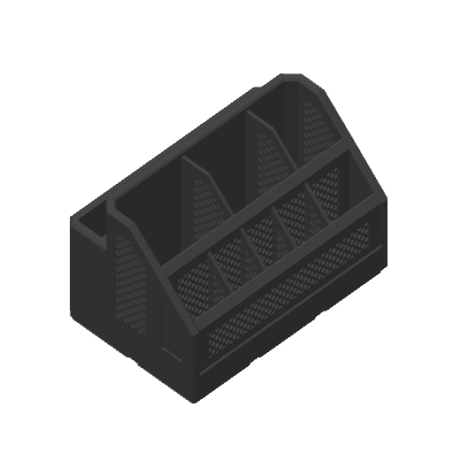
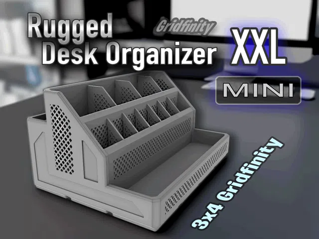
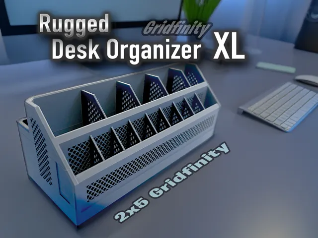
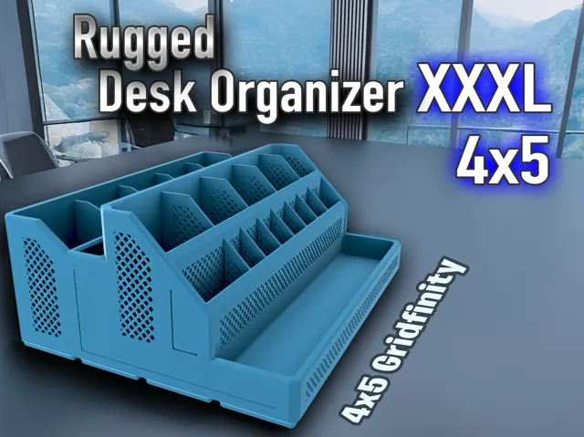
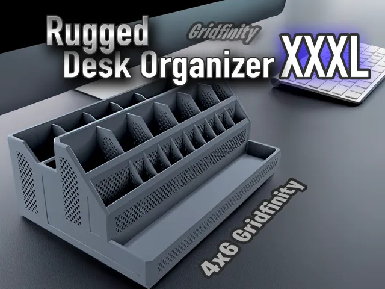

# Rugged Collection

<!-- Generated by scripts/Update-Readmes.ps1 (Linux: scripts/update_readmes.py) - edit scripts/readme-sources.json and rerun instead of editing by hand. -->

[Home](../../../../../README.md) / [Storage](../../../../README.md) / [Systems](../../../README.md) / [Gridfinity](../../README.md) / [Collections](../README.md) / **Rugged Collection**

9 builds &middot; 9 MakerWorld

## Rugged Collection

<table>
<tr>
<td width="33%" align="center" valign="top">
<i>no preview</i> 
<b>25mm Rugged Bin 1C 2C</b> 
<a href="https://makerworld.com/en/search/models?keyword=25mm%20Rugged%20Bin%201C%202C">Search MakerWorld</a> &middot; <a href="25mm_Rugged_Bin_1C%2B2C_stls">Repo folder</a>
</td>
<td width="33%" align="center" valign="top">
<i>no preview</i> 
<b>Rugged Cable Organizer - Gridfinity</b> 
<a href="https://makerworld.com/en/search/models?keyword=Rugged%20Cable%20Organizer%20-%20Gridfinity">Search MakerWorld</a> &middot; <a href="Rugged%2BCable%2BOrganizer%2B-%2BGridfinity">Repo folder</a>
</td>
<td width="33%" align="center" valign="top">
 
<b>Rugged Organizer Large Gridfinity</b> 
<a href="https://makerworld.com/en/search/models?keyword=Rugged%20Organizer%20Large%20Gridfinity">Search MakerWorld</a> &middot; <a href="Rugged%2BOrganizer%2BLarge%2BGridfinity">Repo folder</a>
</td>
</tr>
<tr>
<td width="33%" align="center" valign="top">
 
<b>Rugged Organizer Mini&#39;s - 3x4 &amp; 4x4 Gridfinity</b> 
by K2_Kevin 
<a href="https://makerworld.com/en/models/788835-rugged-organizer-mini-s-3x4-4x4-gridfinity">MakerWorld</a> &middot; <a href="Rugged%2BOrganizer%2BMini's%2B-%2B3x4%2B%26%2B4x4%2BGridfinity">Repo folder</a>
</td>
<td width="33%" align="center" valign="top">
 
<b>Rugged Organizer XL - 2x4 &amp; 2x5 Gridfinity</b> 
by K2_Kevin 
<a href="https://makerworld.com/en/models/733348-rugged-organizer-xl-2x4-2x5-gridfinity">MakerWorld</a> &middot; <a href="Rugged%2BOrganizer%2BXL%2B-%2B2x4%2B%26%2B2x5%2BGridfinity">Repo folder</a>
</td>
<td width="33%" align="center" valign="top">
<i>no preview</i> 
<b>Rugged Organizer XXL - 3x5 Gridfinity</b> 
<a href="https://makerworld.com/en/search/models?keyword=Rugged%20Organizer%20XXL%20-%203x5%20Gridfinity">Search MakerWorld</a> &middot; <a href="Rugged%2BOrganizer%2BXXL%2B-%2B3x5%2BGridfinity">Repo folder</a>
</td>
</tr>
<tr>
<td width="33%" align="center" valign="top">
 
<b>Rugged Organizer XXXL - 4x5 Gridfinity</b> 
by K2_Kevin 
<a href="https://makerworld.com/en/models/918691-rugged-organizer-xxxl-4x5-gridfinity">MakerWorld</a> &middot; <a href="Rugged%2BOrganizer%2BXXXL%2B-%2B4x5%2BGridfinity">Repo folder</a>
</td>
<td width="33%" align="center" valign="top">
 
<b>Rugged Organizer XXXL - 4x6 Gridfinity</b> 
by K2_Kevin 
<a href="https://makerworld.com/en/models/855046-rugged-organizer-xxxl-4x6-gridfinity">MakerWorld</a> &middot; <a href="Rugged%2BOrganizer%2BXXXL%2B-%2B4x6%2BGridfinity">Repo folder</a>
</td>
<td width="33%" align="center" valign="top">
 
<b>Rugged Tray Toppers - Gridfinity Trays</b> 
by K2_Kevin 
<a href="https://makerworld.com/en/models/1006433-rugged-tray-toppers-gridfinity-trays">MakerWorld</a> &middot; <a href="Rugged%2BTray%2BToppers%2B-%2BGridfinity%2BTrays">Repo folder</a>
</td>
</tr>
</table>

