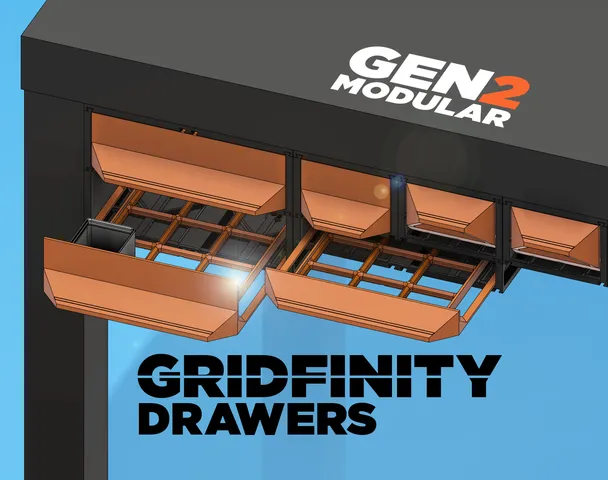
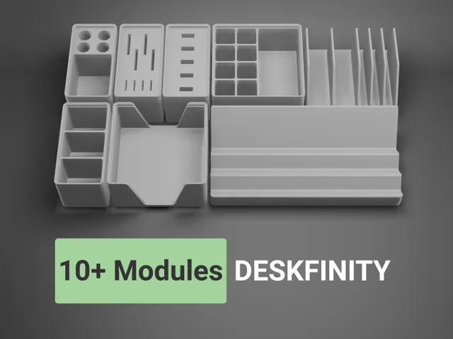
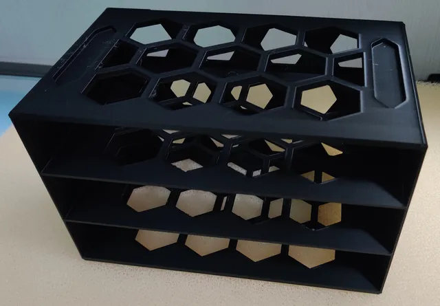
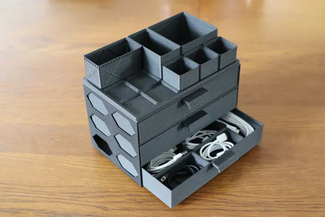
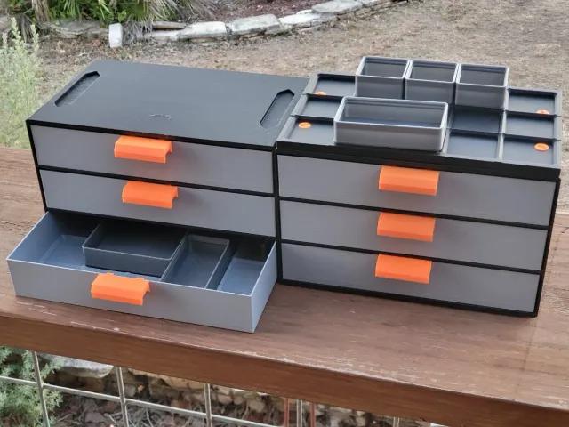
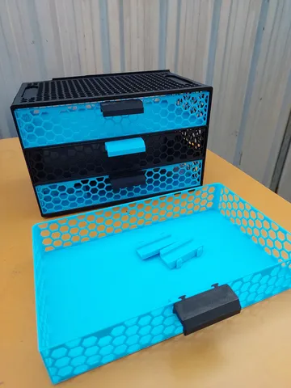
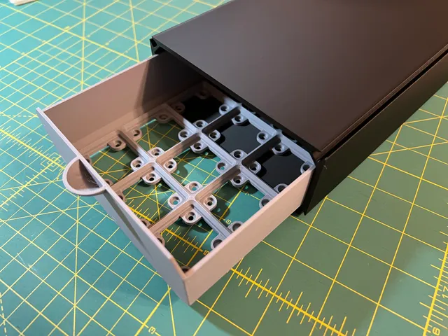

# Drawers

<!-- Generated by scripts/Update-Readmes.ps1 (Linux: scripts/update_readmes.py) - edit scripts/readme-sources.json and rerun instead of editing by hand. -->

[Home](../../../../README.md) / [Storage](../../../README.md) / [Systems](../../README.md) / [Gridfinity](../README.md) / **Drawers**

9 builds &middot; 8 Printables &middot; 1 unknown source

## Drawers

<table>
<tr>
<td width="33%" align="center" valign="top">
 
<b>GEN2 Gridfinity Drawers - STANDARD (LEGACY)</b> 
by Jerrari 
<a href="https://www.printables.com/model/284027-gen2-gridfinity-drawers-standard-legacy">Printables</a> &middot; <a href="gen2-gridfinity-drawers-for-lack-enclosures-model_files">Repo folder</a>
</td>
<td width="33%" align="center" valign="top">
 
<b>Gridfinity Desk Organizer System - Deskfinity</b> 
by ethanthompson 
<a href="https://www.printables.com/model/376580-gridfinity-desk-organizer-system-deskfinity">Printables</a> &middot; <a href="gridfinity-desk-organizer-system-deskfinity-model_files">Repo folder</a>
</td>
<td width="33%" align="center" valign="top">
<i>no preview</i> 
<b>Gridfinity Light Modular Drawer</b> 
<a href="https://www.printables.com/model/665996">Printables</a> &middot; <a href="gridfinity-light-modular-drawer-model_files">Repo folder</a>
</td>
</tr>
<tr>
<td width="33%" align="center" valign="top">
 
<b>Gridfinity Modular Drawer Honeycomb Remix</b> 
by Pitax 
<a href="https://www.printables.com/model/619916-gridfinity-modular-drawer-honeycomb-remix">Printables</a> &middot; <a href="gridfinity-modular-drawer-honeycomb-remix-model_files">Repo folder</a>
</td>
<td width="33%" align="center" valign="top">
 
<b>Gridfinity Modular Drawer Remix</b> 
by Viermalbe 
<a href="https://www.printables.com/model/536326-gridfinity-modular-drawer-remix">Printables</a> &middot; <a href="gridfinity-modular-drawer-remix-model_files">Repo folder</a>
</td>
<td width="33%" align="center" valign="top">
 
<b>Gridfinity Modular Drawer System</b> 
by Chipp Walters 
<a href="https://www.printables.com/model/300896-gridfinity-modular-drawer-system">Printables</a> &middot; <a href="gridfinity-modular-drawer-system-model_files">Repo folder</a>
</td>
</tr>
<tr>
<td width="33%" align="center" valign="top">
 
<b>Gridfinity Modular Drawer System by Chipp Walters modded for filasavings</b> 
by soulbrotherb 
<a href="https://www.printables.com/model/510525-gridfinity-modular-drawer-system-by-chipp-walters-">Printables</a> &middot; <a href="gridfinity-modular-drawer-system-by-chipp-walters-modded-for-filasavings-model_files">Repo folder</a>
</td>
<td width="33%" align="center" valign="top">
 
<b>Linkable gridfinity drawers in various sizes</b> 
by cjs 
<a href="https://www.printables.com/model/458846-linkable-gridfinity-drawers-in-various-sizes">Printables</a> &middot; <a href="modular-gridfinity-drawers-in-various-sizes-model_files">Repo folder</a>
</td>
<td width="33%" align="center" valign="top">
<i>no preview</i> 
<b>Screwfinity Unit 2U Medium - The Gridfinity Storage Unit</b> 
Source unknown &middot; <a href="Screwfinity%20Unit%202U%20Medium%20-%20The%20Gridfinity%20Storage%20Unit">Repo folder</a>
</td>
</tr>
</table>

