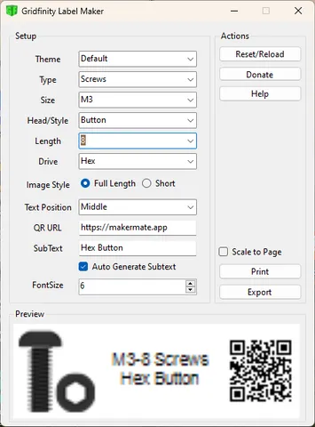
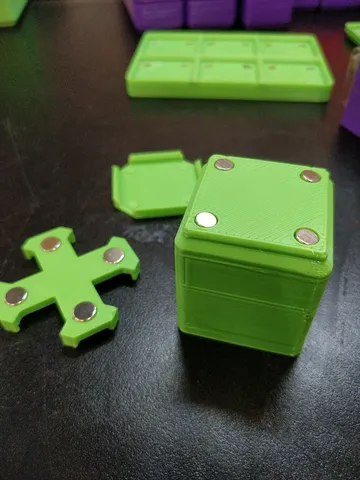
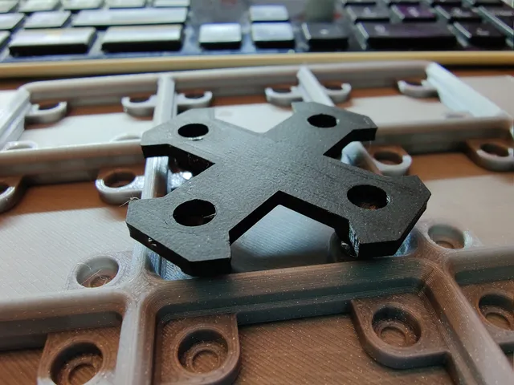
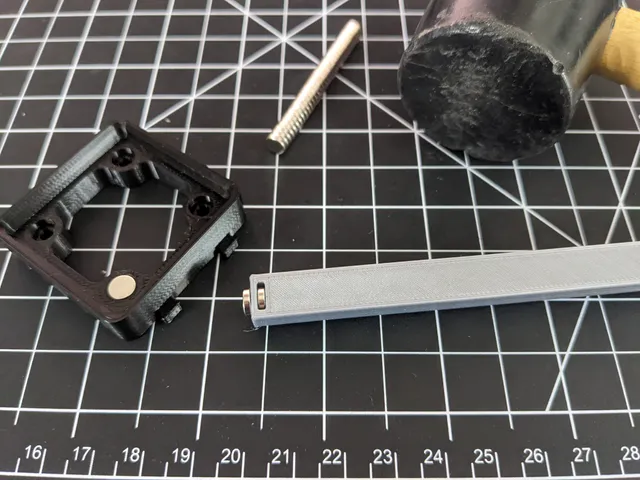
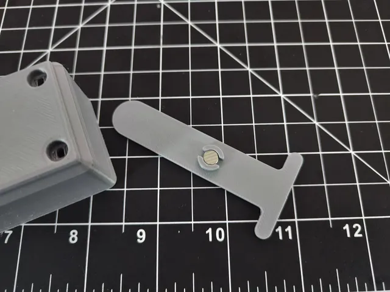

# Jigs

<!-- Generated by scripts/Update-Readmes.ps1 (Linux: scripts/update_readmes.py) - edit scripts/readme-sources.json and rerun instead of editing by hand. -->

[Home](../../../../README.md) / [Storage](../../../README.md) / [Systems](../../README.md) / [Gridfinity](../README.md) / **Jigs**

5 builds &middot; 5 Printables

## Jigs

<table>
<tr>
<td width="33%" align="center" valign="top">
 
<b>Gridfinity Label Maker</b> 
by mikedmor 
<a href="https://www.printables.com/model/525297-gridfinity-label-maker">Printables</a> &middot; <a href="gridfinity-label-maker-other_files">Repo folder</a>
</td>
<td width="33%" align="center" valign="top">
 
<b>gridfinity magnet glue up jig</b> 
by Jools 
<a href="https://www.printables.com/model/188559-gridfinity-magnet-glue-up-jig">Printables</a> &middot; <a href="gridfinity-magnet-glue-up-jig-model_files">Repo folder</a>
</td>
<td width="33%" align="center" valign="top">
 
<b>Gridfinity magnetic baseplate jig</b> 
by owar 
<a href="https://www.printables.com/model/329110-gridfinity-magnetic-baseplate-jig">Printables</a> &middot; <a href="gridfinity-magnetic-baseplate-jig-model_files">Repo folder</a>
</td>
</tr>
<tr>
<td width="33%" align="center" valign="top">
 
<b>Gridfinity Pressure Fit Magnet Jig</b> 
by Software2 
<a href="https://www.printables.com/model/374624-gridfinity-pressure-fit-magnet-jig">Printables</a> &middot; <a href="gridfinity-pressure-fit-magnet-jig-model_files">Repo folder</a>
</td>
<td width="33%" align="center" valign="top">
 
<b>Simple Glue Jig for Gridfinity Magnets</b> 
by Software2 
<a href="https://www.printables.com/model/429481-simple-glue-jig-for-gridfinity-magnets">Printables</a> &middot; <a href="simple-glue-jig-for-gridfinity-magnets-model_files">Repo folder</a>
</td>
</tr>
</table>

