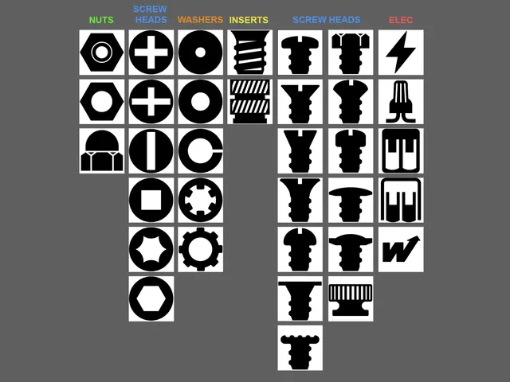

# Labels

<!-- Generated by scripts/Update-Readmes.ps1 (Linux: scripts/update_readmes.py) - edit scripts/readme-sources.json and rerun instead of editing by hand. -->

[Home](../../../../README.md) / [Storage](../../../README.md) / [Systems](../../README.md) / [Gridfinity](../README.md) / **Labels**

2 builds &middot; 1 Printables &middot; 1 unknown source

## Labels

<table>
<tr>
<td width="33%" align="center" valign="top">
 
<b>Gridfinity Bin Label Icons</b> 
by Joe Jankowiak 
<a href="https://www.printables.com/model/621771-gridfinity-bin-label-icons">Printables</a> &middot; <a href="gridfinity-bin-label-icons-other_files">Repo folder</a>
</td>
<td width="33%" align="center" valign="top">
<i>no preview</i> 
<b>Printed Labels</b> 
Source unknown &middot; <a href="printed-labels">Repo folder</a>
</td>
</tr>
</table>

