# Parts Bins

<!-- Generated by scripts/Update-Readmes.ps1 (Linux: scripts/update_readmes.py) - edit scripts/readme-sources.json and rerun instead of editing by hand. -->

[Home](../../../../README.md) / [Storage](../../../README.md) / [Systems](../../README.md) / [Gridfinity](../README.md) / **Parts Bins**

37 builds &middot; 3 MakerWorld &middot; 29 Printables &middot; 5 unknown source

## Parts Bins

<table>
<tr>
<td width="33%" align="center" valign="top">
<a href=".my-custom-divided-bins">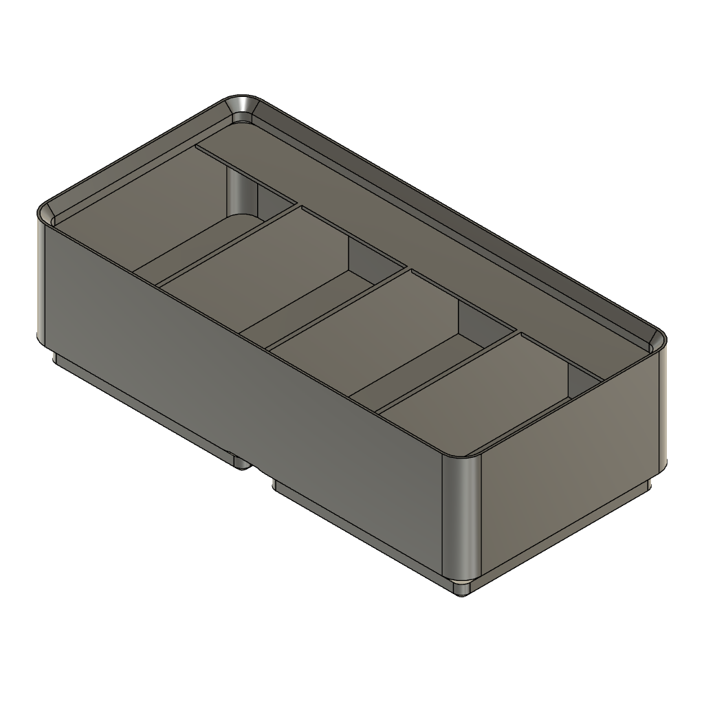</a> 
<b>.my-custom-divided-bins</b> 
Source unknown &middot; <a href=".my-custom-divided-bins">Repo folder</a>
</td>
<td width="33%" align="center" valign="top">
<a href="Gridfinity%2B2x%2B(6U%2C9U%2B%2612U)%2BLidded%2BBins%2Bversion%2B2.2">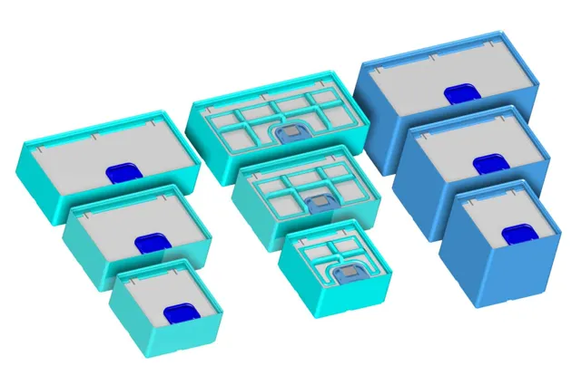</a> 
<b>Gridfinity 2x (6U,9U &amp;12U) Lidded Bins version 2.2</b> 
by mystoopidstuff 
<a href="https://makerworld.com/en/models/405004-gridfinity-2x-6u-9u-12u-lidded-bins-version-2-2">MakerWorld</a> &middot; <a href="Gridfinity%2B2x%2B(6U%2C9U%2B%2612U)%2BLidded%2BBins%2Bversion%2B2.2">Repo folder</a>
</td>
<td width="33%" align="center" valign="top">
<i>no preview</i> 
<b>Gridfinity Bin 1x2 Divided Into 3 Compartments With Covers Remix</b> 
<a href="https://www.printables.com/model/747515">Printables</a> &middot; <a href="gridfinity-bin-1x2-divided-into-3-compartments-with-covers-remix-model_files">Repo folder</a>
</td>
</tr>
<tr>
<td width="33%" align="center" valign="top">
<a href="gridfinity-bin-1x4-divided-into-6-compartments-with-covers-remix-model_files">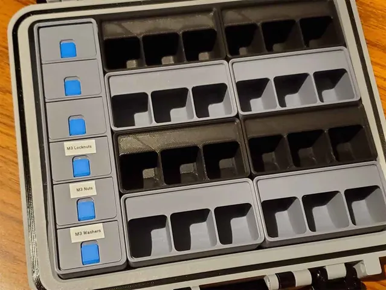</a> 
<b>Gridfinity Bin 1x4 divided into 6 compartments with covers (REMIX) Version 1.0</b> 
by MyStoopidStuff 
<a href="https://www.printables.com/model/742954-gridfinity-bin-1x4-divided-into-6-compartments-wit">Printables</a> &middot; <a href="gridfinity-bin-1x4-divided-into-6-compartments-with-covers-remix-model_files">Repo folder</a>
</td>
<td width="33%" align="center" valign="top">
<a href="gridfinity-bin-with-printable-label-by-pred-parametric-model_files">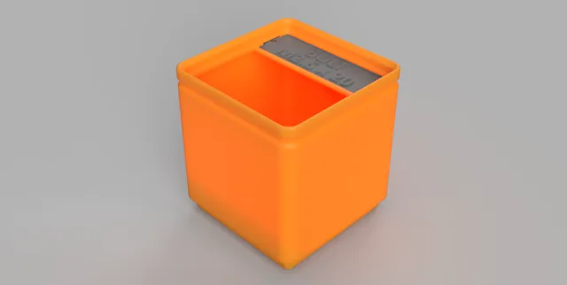</a> 
<b>Gridfinity Bin with Printable Label by Pred (parametric)</b> 
by Pred 
<a href="https://www.printables.com/model/592545-gridfinity-bin-with-printable-label-by-pred-parame">Printables</a> &middot; <a href="gridfinity-bin-with-printable-label-by-pred-parametric-model_files">Repo folder</a>
</td>
<td width="33%" align="center" valign="top">
<a href="gridfinity-bin-with-printable-label-economic-model_files">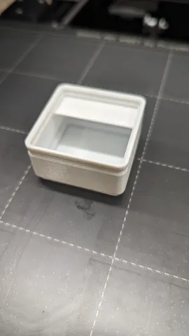</a> 
<b>Gridfinity Bin with Printable Label Economic</b> 
by Brice Hoogenboom 
<a href="https://www.printables.com/model/684275-gridfinity-bin-with-printable-label-economic">Printables</a> &middot; <a href="gridfinity-bin-with-printable-label-economic-model_files">Repo folder</a>
</td>
</tr>
<tr>
<td width="33%" align="center" valign="top">
<a href="gridfinity-bins-for-small-parts-model_files">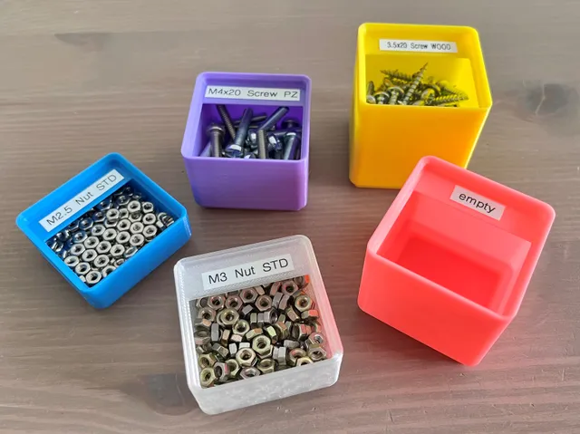</a> 
<b>Gridfinity Bins for small parts</b> 
by Plastic Flow 
<a href="https://www.printables.com/model/514480-gridfinity-bins-for-small-parts">Printables</a> &middot; <a href="gridfinity-bins-for-small-parts-model_files">Repo folder</a>
</td>
<td width="33%" align="center" valign="top">
<a href="gridfinity-bins-with-labels-configurable-contenant-avec-etiquettes-configurable-model_files">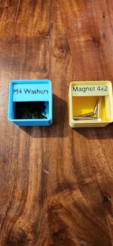</a> 
<b>Gridfinity bins with labels (configurable) / Contenant avec etiquettes (configurable)</b> 
by Dany 
<a href="https://www.printables.com/model/522794-gridfinity-bins-with-labels-configurable-contenant">Printables</a> &middot; <a href="gridfinity-bins-with-labels-configurable-contenant-avec-etiquettes-configurable-model_files">Repo folder</a>
</td>
<td width="33%" align="center" valign="top">
<a href="gridfinity-bins-with-lids-parametric-remix-model_files">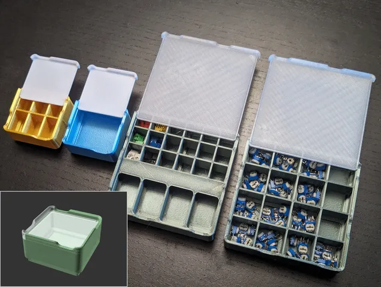</a> 
<b>Gridfinity Bins with Lids (parametric remix)</b> 
by bulbasaur0 
<a href="https://www.printables.com/model/751715-gridfinity-bins-with-lids-parametric-remix">Printables</a> &middot; <a href="gridfinity-bins-with-lids-parametric-remix-model_files">Repo folder</a>
</td>
</tr>
<tr>
<td width="33%" align="center" valign="top">
<a href="gridfinity-bowls-model_files">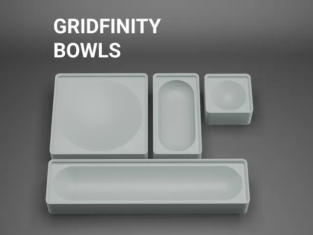</a> 
<b>Gridfinity Bowls</b> 
by ethanthompson 
<a href="https://www.printables.com/model/447389-gridfinity-bowls">Printables</a> &middot; <a href="gridfinity-bowls-model_files">Repo folder</a>
</td>
<td width="33%" align="center" valign="top">
<a href="gridfinity-deep-1x1-bin-model_files">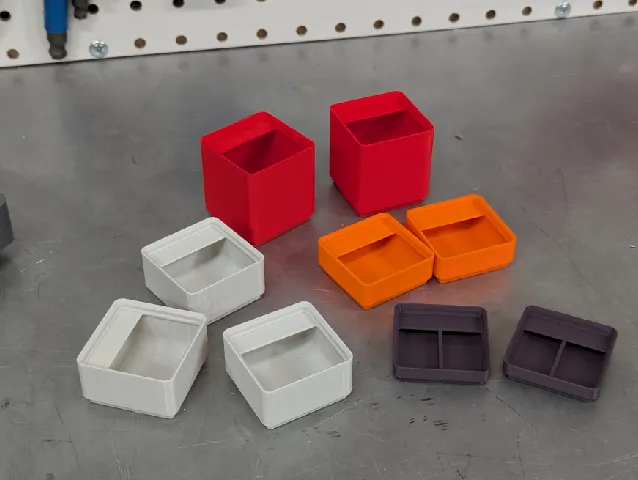</a> 
<b>Gridfinity Deep 1x1 Bin</b> 
by Matthew 
<a href="https://www.printables.com/model/1008395-gridfinity-deep-1x1-bin">Printables</a> &middot; <a href="gridfinity-deep-1x1-bin-model_files">Repo folder</a>
</td>
<td width="33%" align="center" valign="top">
<i>no preview</i> 
<b>Gridfinity Divider Bins - comprehensive height options</b> 
Source unknown &middot; <a href="Gridfinity%20Divider%20Bins%20-%20comprehensive%20height%20options">Repo folder</a>
</td>
</tr>
<tr>
<td width="33%" align="center" valign="top">
<i>no preview</i> 
<b>Gridfinity Height Adaptive Spacers</b> 
Source unknown &middot; <a href="Gridfinity%20Height%20Adaptive%20Spacers">Repo folder</a>
</td>
<td width="33%" align="center" valign="top">
<a href="gridfinity-labeled-divider-bin-more-compartments-model_files">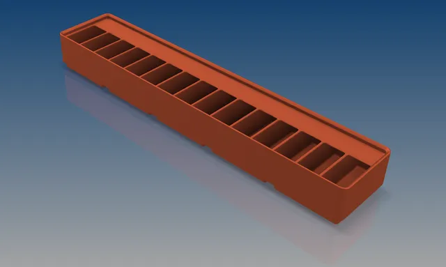</a> 
<b>Gridfinity Labeled Divider Bin - More Compartments</b> 
by NeonDevil 
<a href="https://www.printables.com/model/719828-gridfinity-labeled-divider-bin-more-compartments">Printables</a> &middot; <a href="gridfinity-labeled-divider-bin-more-compartments-model_files">Repo folder</a>
</td>
<td width="33%" align="center" valign="top">
<a href="gridfinity-labels-for-metric-bolts-model_files">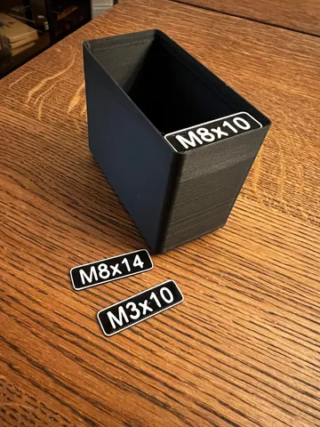</a> 
<b>Gridfinity labels for metric bolts</b> 
by Sebastian Musser 
<a href="https://www.printables.com/model/646859-gridfinity-labels-for-metric-bolts">Printables</a> &middot; <a href="gridfinity-labels-for-metric-bolts-model_files">Repo folder</a>
</td>
</tr>
<tr>
<td width="33%" align="center" valign="top">
<a href="gridfinity-lite-economical-plain-storage-bins-model_files">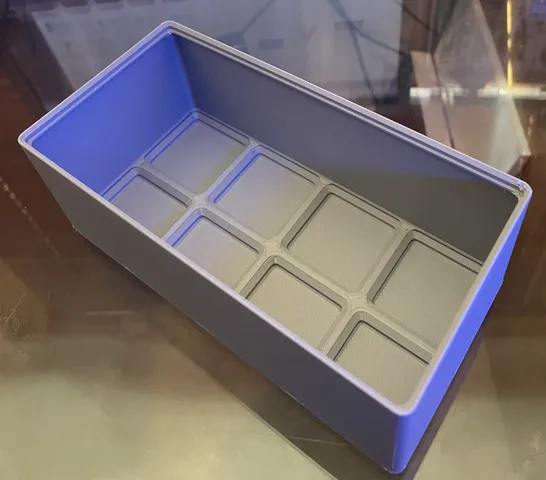</a> 
<b>Gridfinity lite - economical plain storage bins</b> 
by Jake 
<a href="https://www.printables.com/model/265271-gridfinity-lite-economical-plain-storage-bins">Printables</a> &middot; <a href="gridfinity-lite-economical-plain-storage-bins-model_files">Repo folder</a>
</td>
<td width="33%" align="center" valign="top">
<a href="gridfinity-lite-ultra-blocks-template-model_files">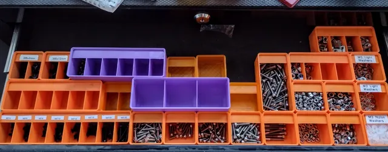</a> 
<b>Gridfinity LITE Ultra Blocks &amp; Template</b> 
by Masibu 
<a href="https://www.printables.com/model/353224-gridfinity-lite-ultra-blocks-template">Printables</a> &middot; <a href="gridfinity-lite-ultra-blocks-template-model_files">Repo folder</a>
</td>
<td width="33%" align="center" valign="top">
<a href="gridfinity-lite-ultra-boxes-improved-version-with-stls-model_files">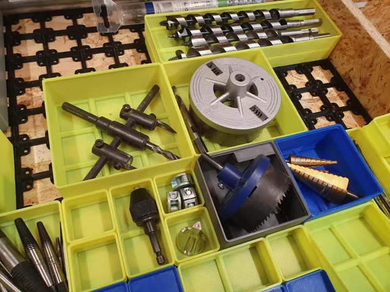</a> 
<b>Gridfinity LITE Ultra boxes, improved version with STLs</b> 
by NoWarrenty 
<a href="https://www.printables.com/model/435429-gridfinity-lite-ultra-boxes-improved-version-with-">Printables</a> &middot; <a href="gridfinity-lite-ultra-boxes-improved-version-with-stls-model_files">Repo folder</a>
</td>
</tr>
<tr>
<td width="33%" align="center" valign="top">
 
<b>Gridfinity Parametric Divider Bin Fusion360 File</b> 
by MarcusInCo 
<a href="https://www.printables.com/model/281210-gridfinity-parametric-divider-bin-fusion360-file">Printables</a> &middot; <a href="gridfinity-parametric-divider-bin-fusion360-file-model_files">Repo folder</a>
</td>
<td width="33%" align="center" valign="top">
<a href="gridfinity-plain-bin-model_files">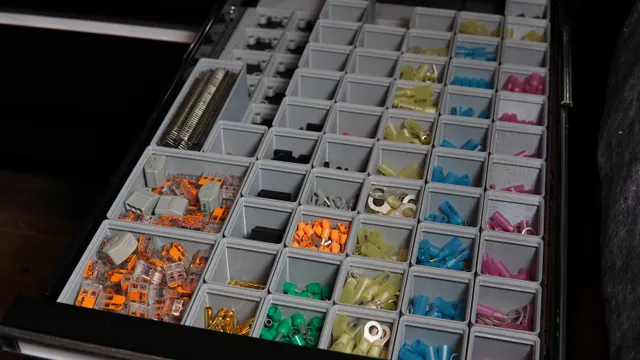</a> 
<b>Gridfinity Plain Bin</b> 
by Kyle Warren 
<a href="https://www.printables.com/model/321606-gridfinity-plain-bin">Printables</a> &middot; <a href="gridfinity-plain-bin-model_files">Repo folder</a>
</td>
<td width="33%" align="center" valign="top">
<a href="gridfinity-small-parts-containment-tray-model_files">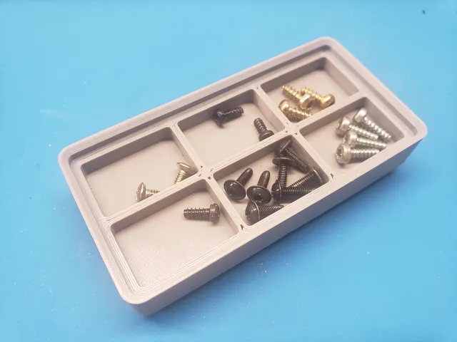</a> 
<b>Gridfinity Small Parts Containment Tray</b> 
by LogoiLab 
<a href="https://www.printables.com/model/238511-gridfinity-small-parts-containment-tray">Printables</a> &middot; <a href="gridfinity-small-parts-containment-tray-model_files">Repo folder</a>
</td>
</tr>
<tr>
<td width="33%" align="center" valign="top">
<a href="gridfinity-standard-bins-with-label-parametric-file-model_files">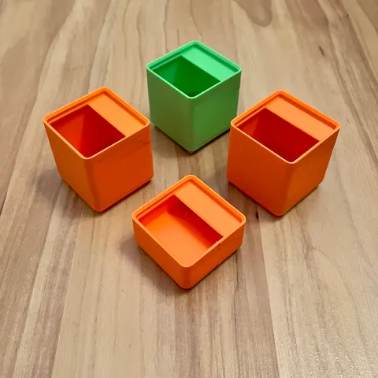</a> 
<b>Gridfinity standard bins with label + parametric file</b> 
by Akio 
<a href="https://www.printables.com/model/366532-gridfinity-standard-bins-with-label-parametric-fil">Printables</a> &middot; <a href="gridfinity-standard-bins-with-label-parametric-file-model_files">Repo folder</a>
</td>
<td width="33%" align="center" valign="top">
<a href="gridfinity-ultra-light-bins-divider-edition-model_files">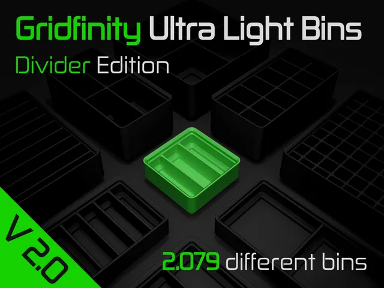</a> 
<b>Gridfinity Ultra Light Bins - Divider Edition</b> 
by HuMa 
<a href="https://www.printables.com/model/640799-gridfinity-ultra-light-bins-divider-edition">Printables</a> &middot; <a href="gridfinity-ultra-light-bins-divider-edition-model_files">Repo folder</a>
</td>
<td width="33%" align="center" valign="top">
<a href="gridfinity-ultra-light-bins-plain-edition-model_files">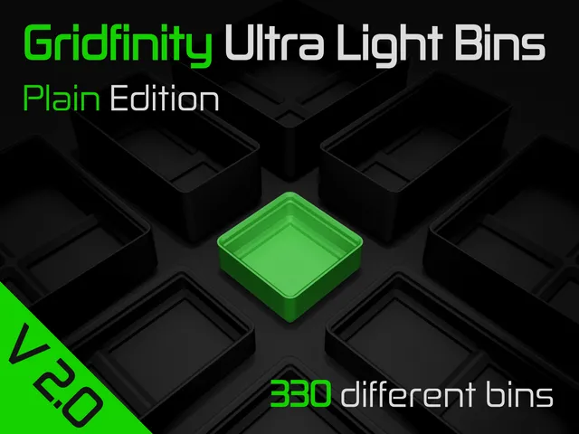</a> 
<b>Gridfinity Ultra Light Bins - Plain Edition</b> 
by HuMa 
<a href="https://www.printables.com/model/627719-gridfinity-ultra-light-bins-plain-edition">Printables</a> &middot; <a href="gridfinity-ultra-light-bins-plain-edition-model_files">Repo folder</a>
</td>
</tr>
<tr>
<td width="33%" align="center" valign="top">
<a href="gridfinity-ultra-light-bins-plain-lable-edition-model_files">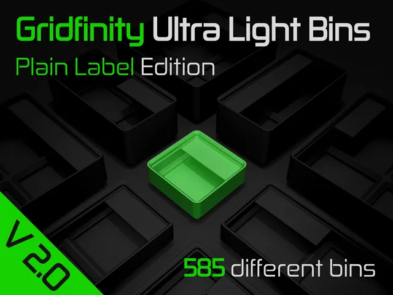</a> 
<b>Gridfinity Ultra Light Bins - Plain Lable Edition</b> 
by HuMa 
<a href="https://www.printables.com/model/640800-gridfinity-ultra-light-bins-plain-lable-edition">Printables</a> &middot; <a href="gridfinity-ultra-light-bins-plain-lable-edition-model_files">Repo folder</a>
</td>
<td width="33%" align="center" valign="top">
<i>no preview</i> 
<b>Gridfinity Ultra Light Bins Label Divider Edition</b> 
<a href="https://www.printables.com/search/models?q=Gridfinity%20Ultra%20Light%20Bins%20Label%20Divider%20Edition">Search Printables</a> &middot; <a href="gridfinity-ultra-light-bins-label-divider-edition-model_files">Repo folder</a>
</td>
<td width="33%" align="center" valign="top">
<a href="Gridfinity%20Window%20Divider%20Bin">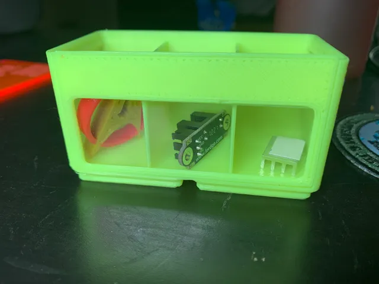</a> 
<b>Gridfinity Window Divider Bin</b> 
by CmdrMoto 
<a href="https://www.printables.com/model/170488-gridfinity-window-divider-bin">Printables</a> &middot; <a href="Gridfinity%20Window%20Divider%20Bin">Repo folder</a>
</td>
</tr>
<tr>
<td width="33%" align="center" valign="top">
<a href="Gridfinity%20Tiered%20Bins">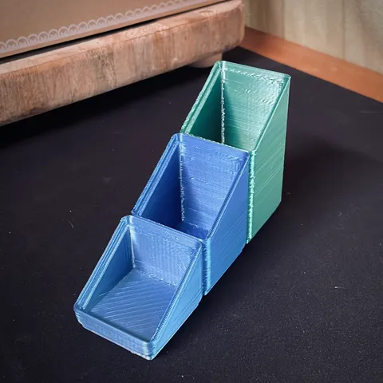</a> 
<b>Gridfinity | Tiered Bins</b> 
by Machenna56k 
<a href="https://www.printables.com/model/247302-gridfinity-tiered-bins">Printables</a> &middot; <a href="Gridfinity%20Tiered%20Bins">Repo folder</a>
</td>
<td width="33%" align="center" valign="top">
<a href="Gridfinity%20Wide%20Tiered%20Bins">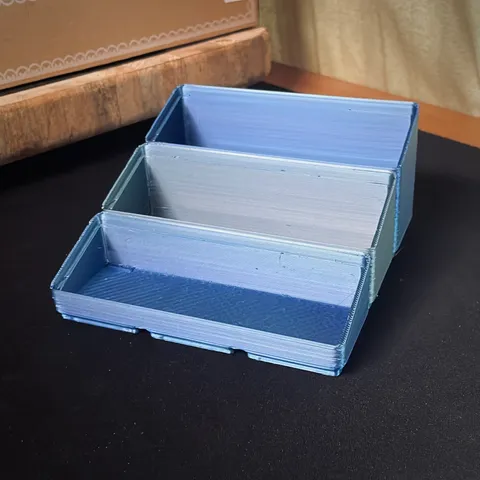</a> 
<b>Gridfinity | Wide Tiered Bins</b> 
by Machenna56k 
<a href="https://www.printables.com/model/269851-gridfinity-wide-tiered-bins">Printables</a> &middot; <a href="Gridfinity%20Wide%20Tiered%20Bins">Repo folder</a>
</td>
<td width="33%" align="center" valign="top">
 
<b>Gridfinity | Wide Tiered Bins</b> 
by Machenna56k 
<a href="https://www.printables.com/model/269851-gridfinity-wide-tiered-bins">Printables</a> &middot; <a href="gridfinity-wide-tiered-bins-model_files">Repo folder</a>
</td>
</tr>
<tr>
<td width="33%" align="center" valign="top">
<a href="gridfinity-eco-PartsBinV2">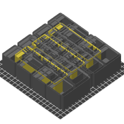</a> 
<b>gridfinity-eco-PartsBinV2</b> 
Source unknown &middot; <a href="gridfinity-eco-PartsBinV2">Repo folder</a>
</td>
<td width="33%" align="center" valign="top">
<i>no preview</i> 
<b>Latching Gridfinity Bins Ver9v</b> 
<a href="https://makerworld.com/en/search/models?keyword=Latching%20Gridfinity%20Bins%20Ver9v">Search MakerWorld</a> &middot; <a href="latching-gridfinity-bins_ver9v_stls">Repo folder</a>
</td>
<td width="33%" align="center" valign="top">
<a href="reinforced-economical-gridfinity-bins-no-vase-mode-w-half-grid-model_files">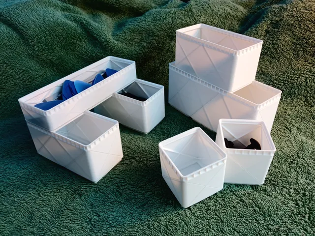</a> 
<b>Reinforced Economical Gridfinity Bins - No vase mode (w/ half grid)</b> 
by Equbuxu 
<a href="https://www.printables.com/model/517479-reinforced-economical-gridfinity-bins-no-vase-mode">Printables</a> &middot; <a href="reinforced-economical-gridfinity-bins-no-vase-mode-w-half-grid-model_files">Repo folder</a>
</td>
</tr>
<tr>
<td width="33%" align="center" valign="top">
<a href="removable-gridfinity-lids-lidfinity-model_files">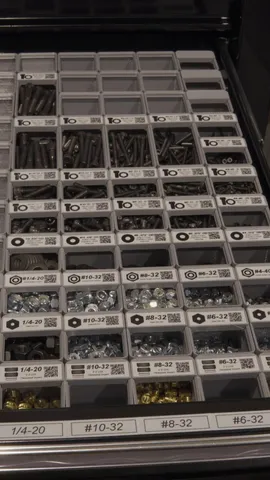</a> 
<b>Removable Gridfinity Lids (Lidfinity)</b> 
by Kyle Warren 
<a href="https://www.printables.com/model/330764-removable-gridfinity-lids-lidfinity">Printables</a> &middot; <a href="removable-gridfinity-lids-lidfinity-model_files">Repo folder</a>
</td>
<td width="33%" align="center" valign="top">
 
<b>Removable Gridfinity Lids (Lidfinity)</b> 
by Kyle Warren 
<a href="https://www.printables.com/model/330764-removable-gridfinity-lids-lidfinity">Printables</a> &middot; <a href="removable-gridfinity-lids-lidfinity-other_files">Repo folder</a>
</td>
<td width="33%" align="center" valign="top">
<a href="Striped%2BGridfinity%2BBins">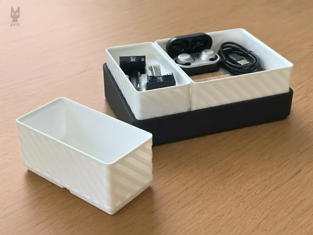</a> 
<b>Striped Gridfinity Bins</b> 
by jorm 
<a href="https://makerworld.com/en/models/1877255-striped-gridfinity-bins">MakerWorld</a> &middot; <a href="Striped%2BGridfinity%2BBins">Repo folder</a>
</td>
</tr>
</table>

Other files in this folder (1)

- [gridfinity-rebuilt-bins.stl](gridfinity-rebuilt-bins.stl)

