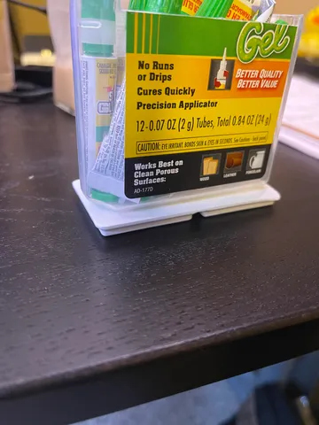
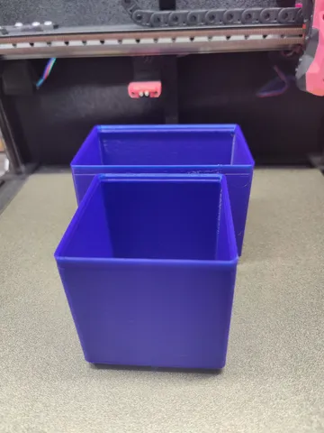
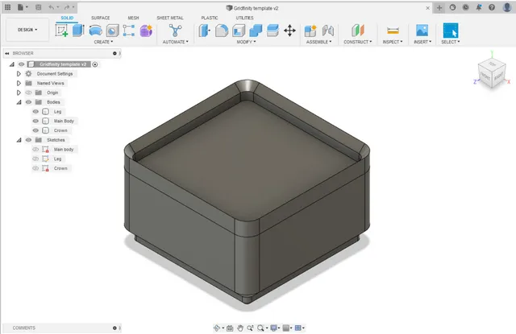
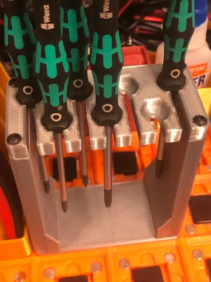
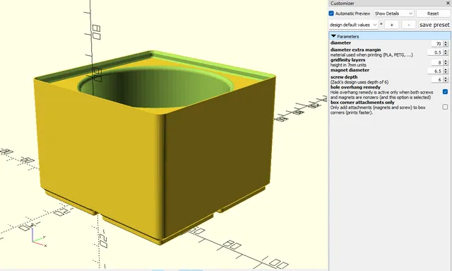
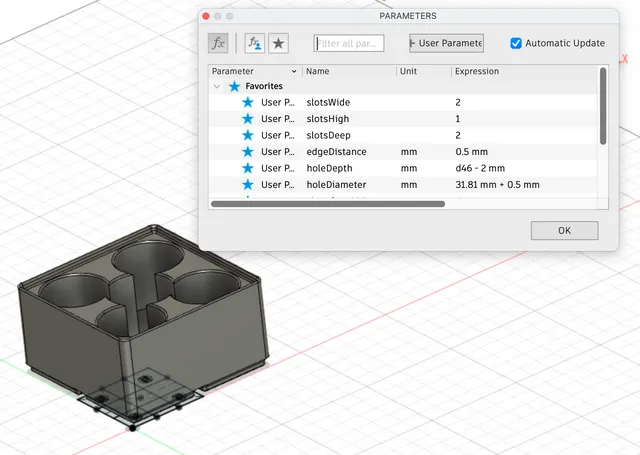
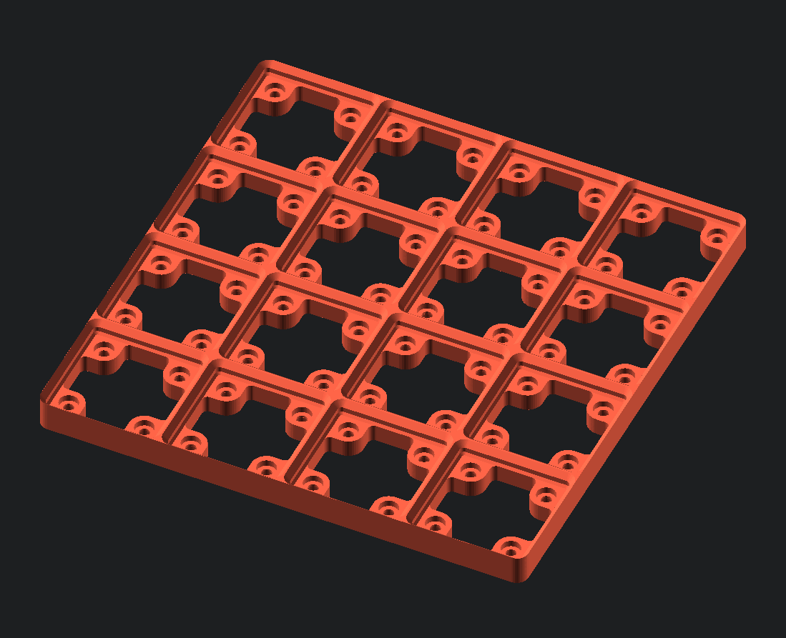
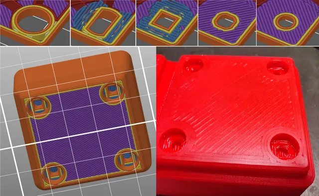

# Templates

<!-- Generated by scripts/Update-Readmes.ps1 (Linux: scripts/update_readmes.py) - edit scripts/readme-sources.json and rerun instead of editing by hand. -->

[Home](../../../../README.md) / [Storage](../../../README.md) / [Systems](../../README.md) / [Gridfinity](../README.md) / **Templates**

11 builds &middot; 7 Printables &middot; 4 unknown source

## Templates

<table>
<tr>
<td width="33%" align="center" valign="top">
 
<b>Gridfinity Adapters</b> 
by atucom 
<a href="https://www.printables.com/model/226535-gridfinity-adapters">Printables</a> &middot; <a href="Gridfinity%20Adapters">Repo folder</a>
</td>
<td width="33%" align="center" valign="top">
 
<b>Gridfinity Basic boxes</b> 
by WT 
<a href="https://www.printables.com/model/420222-gridfinity-basic-boxes">Printables</a> &middot; <a href="Gridfinity%20Basic%20Boxes">Repo folder</a>
</td>
<td width="33%" align="center" valign="top">
 
<b>Gridfinity block template - Easy to use! (For Fusion 360)</b> 
by pogofcz 
<a href="https://www.printables.com/model/286722-gridfinity-block-template-easy-to-use-for-fusion-3">Printables</a> &middot; <a href="gridfinity-block-template-easy-to-use-for-fusion-360-model_files">Repo folder</a>
</td>
</tr>
<tr>
<td width="33%" align="center" valign="top">
<i>no preview</i> 
<b>Gridfinity Height Adaptive Spacers</b> 
Source unknown &middot; <a href="Gridfinity%20Height%20Adaptive%20Spacers">Repo folder</a>
</td>
<td width="33%" align="center" valign="top">
 
<b>Gridfinity Lifted</b> 
by PenguinPrints 
<a href="https://www.printables.com/model/300982-gridfinity-lifted">Printables</a> &middot; <a href="gridfinity-lifted-model_files">Repo folder</a>
</td>
<td width="33%" align="center" valign="top">
 
<b>Gridfinity Parametric Bottle Bin</b> 
by Utopioneer 
<a href="https://www.printables.com/model/441631-gridfinity-parametric-bottle-bin">Printables</a> &middot; <a href="gridfinity-parametric-bottle-bin-model_files">Repo folder</a>
</td>
</tr>
<tr>
<td width="33%" align="center" valign="top">
 
<b>Gridfinity Parametric Multiple bottle holder w/hole fix</b> 
by schneems 
<a href="https://www.printables.com/model/484636-gridfinity-parametric-multiple-bottle-holder-whole">Printables</a> &middot; <a href="gridfinity-parametric-multiple-bottle-holder-whole-fix-model_files">Repo folder</a>
</td>
<td width="33%" align="center" valign="top">
 
<b>Gridfinity Rebuilt Openscad Main</b> 
Source unknown &middot; <a href="gridfinity-rebuilt-openscad-main">Repo folder</a>
</td>
<td width="33%" align="center" valign="top">
 
<b>Gridfinity Template (modified for mid-air holes)</b> 
by desaster 
<a href="https://www.printables.com/model/269834-gridfinity-template-modified-for-mid-air-holes">Printables</a> &middot; <a href="gridfinity-template-modified-for-mid-air-holes-model_files">Repo folder</a>
</td>
</tr>
<tr>
<td width="33%" align="center" valign="top">
<i>no preview</i> 
<b>KptnAutismus-main</b> 
Source unknown &middot; <a href="KptnAutismus-main">Repo folder</a>
</td>
</tr>
</table>

Other files in this folder (1)

- [GridfinityGenerator-v1.4.0.0.zip](GridfinityGenerator-v1.4.0.0.zip)

