# Tool Holders

<!-- Generated by scripts/Update-Readmes.ps1 (Linux: scripts/update_readmes.py) - edit scripts/readme-sources.json and rerun instead of editing by hand. -->

[Home](../../../../README.md) / [Storage](../../../README.md) / [Systems](../../README.md) / [Gridfinity](../README.md) / **Tool Holders**

106 builds &middot; 11 MakerWorld &middot; 69 Printables &middot; 1 Thingiverse &middot; 25 unknown source &middot; 6 collections (89 more builds)

## Collections

- [Batteries](batteries/README.md) - 7 builds
- [Computer](computer/README.md) - 5 builds
- [Electrical](electrical/README.md) - 14 builds
- [Hand Tools](hand-tools/README.md) - 47 builds
- [Label Printer](label-printer/README.md) - 5 builds
- [Soldering](soldering/README.md) - 11 builds

## Contents

- [Collections](#collections)
- [Tool Holders](#tool-holders) (105)
- [3d Printing](#3d-printing) (1)

## Tool Holders

<table>
<tr>
<td width="33%" align="center" valign="top">
<a href="1kg-solder-spool-gridfinity-holder-model_files">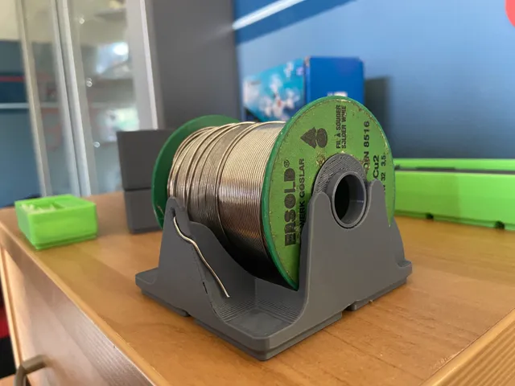</a> 
<b>1Kg solder spool #Gridfinity holder</b> 
by Bram 
<a href="https://www.printables.com/model/261286-1kg-solder-spool-gridfinity-holder">Printables</a> &middot; <a href="1kg-solder-spool-gridfinity-holder-model_files">Repo folder</a>
</td>
<td width="33%" align="center" valign="top">
<a href="2-x-2-gridfinity-nippers-rack-model_files">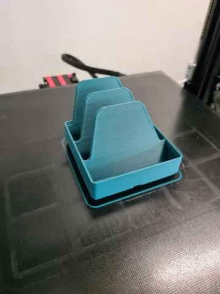</a> 
<b>2 x 2 Gridfinity Nippers Rack</b> 
by mindfest 
<a href="https://www.printables.com/model/237185-2-x-2-gridfinity-nippers-rack">Printables</a> &middot; <a href="2-x-2-gridfinity-nippers-rack-model_files">Repo folder</a>
</td>
<td width="33%" align="center" valign="top">
<a href="Bitfinity_%E2%80%93_Infinitely_Expandable_Drill_Bit_Storage_System_">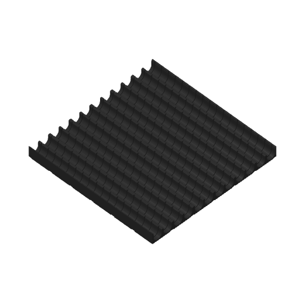</a> 
<b>Bitfinity – Infinitely Expandable Drill Bit Storage System</b> 
Source unknown &middot; <a href="Bitfinity_%E2%80%93_Infinitely_Expandable_Drill_Bit_Storage_System_">Repo folder</a>
</td>
</tr>
<tr>
<td width="33%" align="center" valign="top">
<a href="brother-p-touch-tze-label-tape-gridfinity-storage-box-model_files">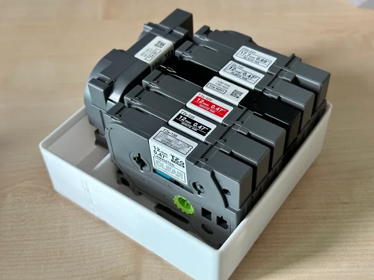</a> 
<b>Brother P-touch TZe Label Tape Gridfinity Storage Box</b> 
by serialx 
<a href="https://www.printables.com/model/302028-brother-p-touch-tze-label-tape-gridfinity-storage-">Printables</a> &middot; <a href="brother-p-touch-tze-label-tape-gridfinity-storage-box-model_files">Repo folder</a>
</td>
<td width="33%" align="center" valign="top">
<a href="caliper-stand-for-gridfinity-model_files">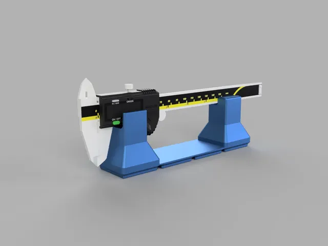</a> 
<b>Caliper Stand for Gridfinity</b> 
by Clay 
<a href="https://www.printables.com/model/335654-caliper-stand-for-gridfinity">Printables</a> &middot; <a href="caliper-stand-for-gridfinity-model_files">Repo folder</a>
</td>
<td width="33%" align="center" valign="top">
<a href="ESP32%2BGridfinity">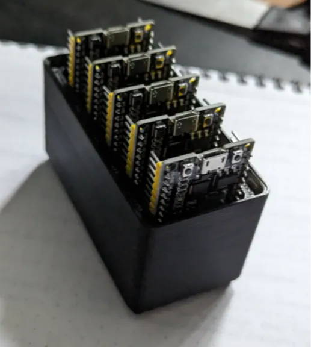</a> 
<b>ESP32 Gridfinity</b> 
by BasementCNC 
<a href="https://makerworld.com/en/models/619282-esp32-gridfinity">MakerWorld</a> &middot; <a href="ESP32%2BGridfinity">Repo folder</a>
</td>
</tr>
<tr>
<td width="33%" align="center" valign="top">
<a href="Fast%2B-%2BALL%2BScrewdriver%2Bv6.3mf">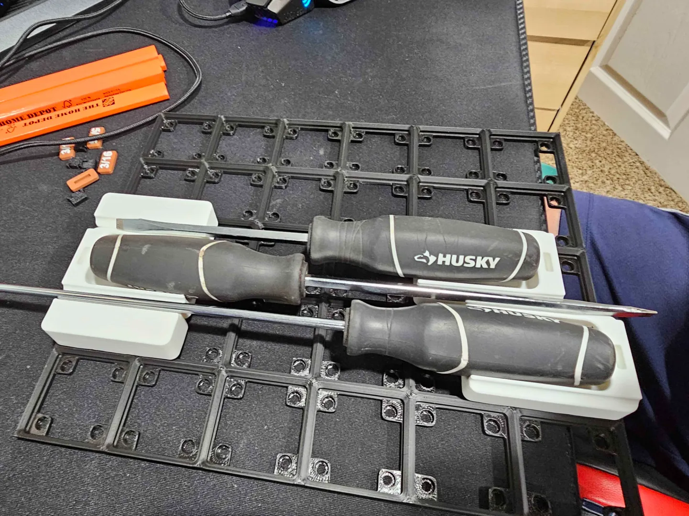</a> 
<b>Fast - ALL Screwdriver v6</b> 
<a href="https://makerworld.com/en/search/models?keyword=Fast%20-%20ALL%20Screwdriver%20v6">Search MakerWorld</a> &middot; <a href="Fast%2B-%2BALL%2BScrewdriver%2Bv6.3mf">Fast+-+ALL+Screwdriver+v6.3mf</a>
</td>
<td width="33%" align="center" valign="top">
<i>no preview</i> 
<b>Fast - ALL Screwdriver v6</b> 
<a href="https://makerworld.com/en/search/models?keyword=Fast%20-%20ALL%20Screwdriver%20v6">Search MakerWorld</a> &middot; <a href="Fast%2B-%2BALL%2BScrewdriver%2Bv6_stls">Repo folder</a>
</td>
<td width="33%" align="center" valign="top">
<a href="ferrule-crimp-tool-gridfinity-tray-model_files">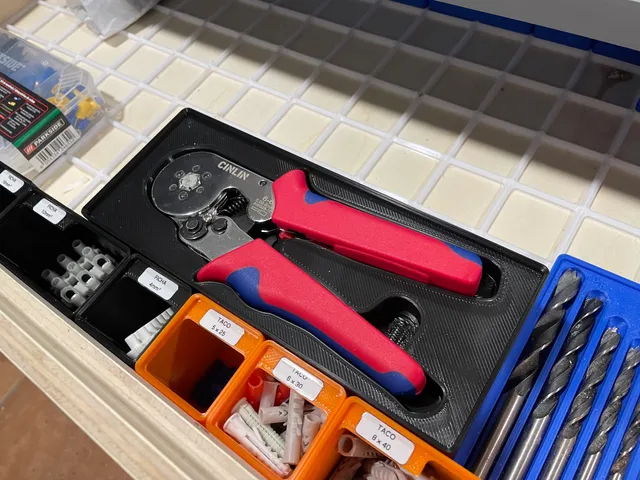</a> 
<b>Ferrule crimp tool gridfinity tray</b> 
by Miguel Camba 
<a href="https://www.printables.com/model/384125-ferrule-crimp-tool-gridfinity-tray">Printables</a> &middot; <a href="ferrule-crimp-tool-gridfinity-tray-model_files">Repo folder</a>
</td>
</tr>
<tr>
<td width="33%" align="center" valign="top">
<a href="grab-and-go-gridfinity-sd-card-holder-model_files">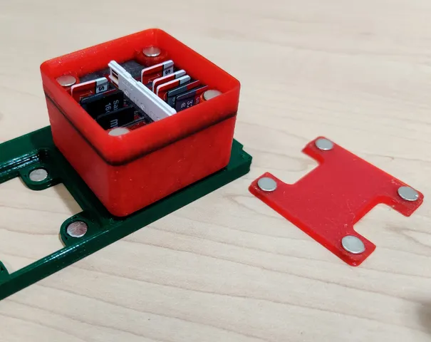</a> 
<b>Grab-and-Go Gridfinity SD card holder</b> 
by Jav.BR 
<a href="https://www.printables.com/model/292285-grab-and-go-gridfinity-sd-card-holder">Printables</a> &middot; <a href="grab-and-go-gridfinity-sd-card-holder-model_files">Repo folder</a>
</td>
<td width="33%" align="center" valign="top">
<a href="gridfinity-griddex-c2032-battery-holder-model_files">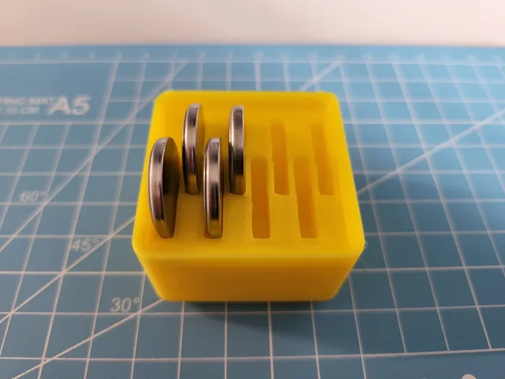</a> 
<b>Gridfinity (Griddex) - C2032 Battery Holder</b> 
by Griddex 
<a href="https://www.printables.com/model/441425-gridfinity-griddex-c2032-battery-holder">Printables</a> &middot; <a href="gridfinity-griddex-c2032-battery-holder-model_files">Repo folder</a>
</td>
<td width="33%" align="center" valign="top">
<a href="gridfinity-raspberry-pi-4-x3-holder-fusion-file-model_files">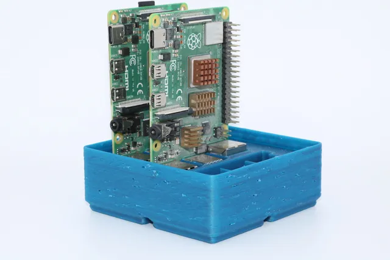</a> 
<b>Gridfinity - Raspberry Pi 4 (x3) holder + Fusion File</b> 
by Micah 
<a href="https://www.printables.com/model/448280-gridfinity-raspberry-pi-4-x3-holder-fusion-file">Printables</a> &middot; <a href="gridfinity-raspberry-pi-4-x3-holder-fusion-file-model_files">Repo folder</a>
</td>
</tr>
<tr>
<td width="33%" align="center" valign="top">
<a href="gridfinity-stackable-battery-dispenser-remix-model_files">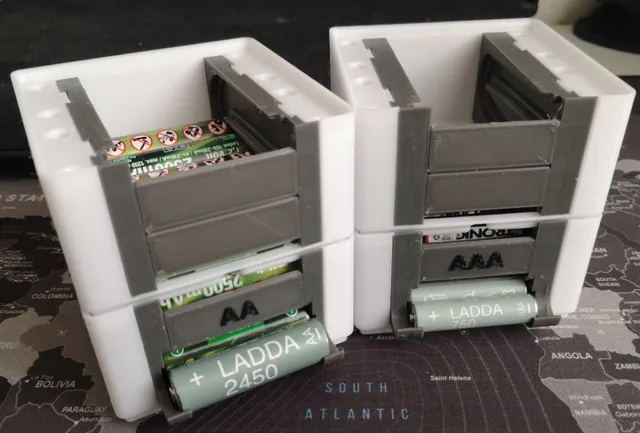</a> 
<b>Gridfinity - Stackable Battery Dispenser (Remix)</b> 
by MrMaKr 
<a href="https://www.printables.com/model/463478-gridfinity-stackable-battery-dispenser-remix">Printables</a> &middot; <a href="gridfinity-stackable-battery-dispenser-remix-model_files">Repo folder</a>
</td>
<td width="33%" align="center" valign="top">
<a href="gridfinity-10-piece-wrench-sorter-model_files">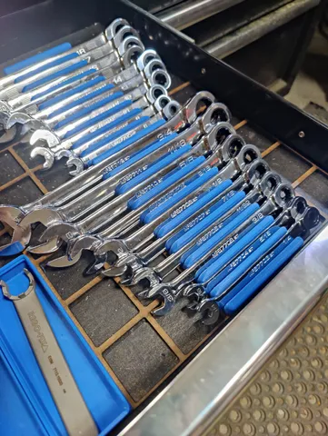</a> 
<b>Gridfinity 10 Piece Wrench Sorter</b> 
by Audacity Micro 
<a href="https://www.printables.com/model/336747-gridfinity-10-piece-wrench-sorter">Printables</a> &middot; <a href="gridfinity-10-piece-wrench-sorter-model_files">Repo folder</a>
</td>
<td width="33%" align="center" valign="top">
<a href="gridfinity-1x4-bondhus-hex-driver-stand-model_files">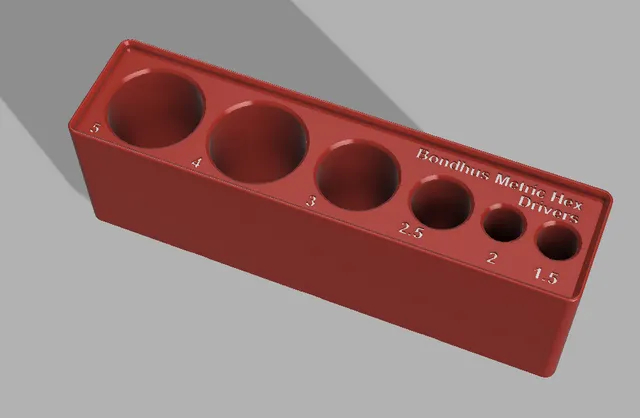</a> 
<b>Gridfinity 1x4 Bondhus Hex Driver Stand Fusion 360</b> 
by ECF 
<a href="https://www.printables.com/model/410938-gridfinity-1x4-bondhus-hex-driver-stand-fusion-360">Printables</a> &middot; <a href="gridfinity-1x4-bondhus-hex-driver-stand-model_files">Repo folder</a>
</td>
</tr>
<tr>
<td width="33%" align="center" valign="top">
<a href="gridfinity-2x2-tactile-spiral-vase-pen-cup-model_files">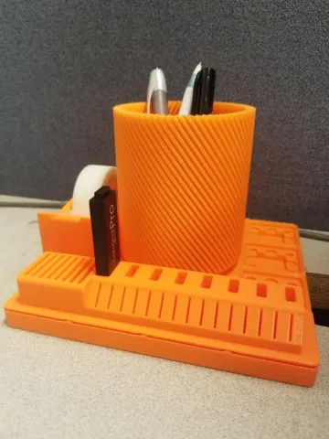</a> 
<b>Gridfinity 2x2 Tactile Spiral Vase Pen Cup</b> 
by cb88 
<a href="https://www.printables.com/model/280602-gridfinity-2x2-tactile-spiral-vase-pen-cup">Printables</a> &middot; <a href="gridfinity-2x2-tactile-spiral-vase-pen-cup-model_files">Repo folder</a>
</td>
<td width="33%" align="center" valign="top">
<a href="gridfinity-4x2-brother-pt-p710bt-label-printer-holder-model_files">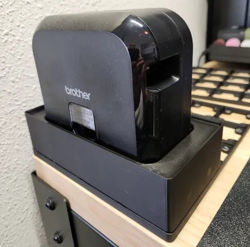</a> 
<b>Gridfinity 4x2 Brother PT-P710BT label printer holder</b> 
by mhwlng 
<a href="https://www.printables.com/model/522046-gridfinity-4x2-brother-pt-p710bt-label-printer-hol">Printables</a> &middot; <a href="gridfinity-4x2-brother-pt-p710bt-label-printer-holder-model_files">Repo folder</a>
</td>
<td width="33%" align="center" valign="top">
<a href="gridfinity-608zz-bearing-holder-model_files">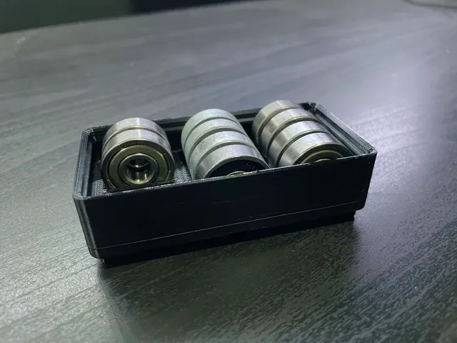</a> 
<b>Gridfinity 608ZZ Bearing Holder</b> 
by BTallack 
<a href="https://www.printables.com/model/277762-gridfinity-608zz-bearing-holder">Printables</a> &middot; <a href="gridfinity-608zz-bearing-holder-model_files">Repo folder</a>
</td>
</tr>
<tr>
<td width="33%" align="center" valign="top">
<a href="gridfinity-aaa-battery-containers-model_files">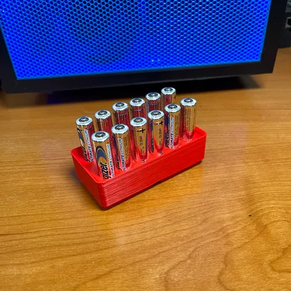</a> 
<b>Gridfinity AAA Battery Containers</b> 
by briancmoses 
<a href="https://www.printables.com/model/219701-gridfinity-aaa-battery-containers">Printables</a> &middot; <a href="gridfinity-aaa-battery-containers-model_files">Repo folder</a>
</td>
<td width="33%" align="center" valign="top">
<a href="gridfinity-adjustable-wrench-4-pc-set-organizer-model_files">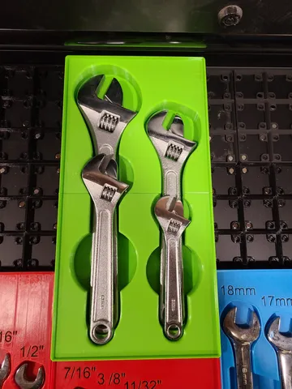</a> 
<b>Gridfinity Adjustable Wrench 4 pc Set Organizer</b> 
by Chase 
<a href="https://www.printables.com/model/469410-gridfinity-adjustable-wrench-4-pc-set-organizer">Printables</a> &middot; <a href="gridfinity-adjustable-wrench-4-pc-set-organizer-model_files">Repo folder</a>
</td>
<td width="33%" align="center" valign="top">
<a href="gridfinity-battery-box-cr2032cr2016-357303sr44-and-a23mn21aaa-slots-model_files">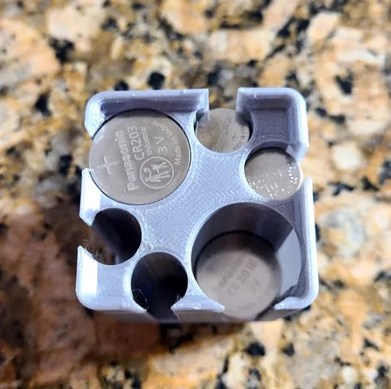</a> 
<b>Gridfinity Battery Box: CR2032/CR2016, 357/303/SR44 and A23/MN21/AAA slots</b> 
by dhiltonp 
<a href="https://www.printables.com/model/208053-gridfinity-battery-box-cr2032cr2016-357303sr44-and">Printables</a> &middot; <a href="gridfinity-battery-box-cr2032cr2016-357303sr44-and-a23mn21aaa-slots-model_files">Repo folder</a>
</td>
</tr>
<tr>
<td width="33%" align="center" valign="top">
<a href="gridfinity-battery-trays-aa-aaa-18650-cr123-9v-21700-model_files">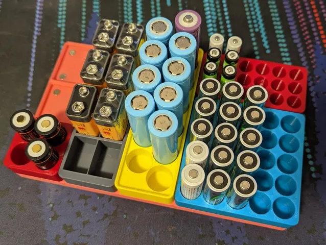</a> 
<b>Gridfinity Battery Trays (AA, AAA, AAAA, 18650, CR123, CR2, 9V, 21700, C, D)</b> 
by Dalkain 
<a href="https://www.printables.com/model/341811-gridfinity-battery-trays-aa-aaa-aaaa-18650-cr123-c">Printables</a> &middot; <a href="gridfinity-battery-trays-aa-aaa-18650-cr123-9v-21700-model_files">Repo folder</a>
</td>
<td width="33%" align="center" valign="top">
<a href="Gridfinity%20Bin%203x2x4%20Elegoo%20Vacuum%20Pump%20v1a.3mf">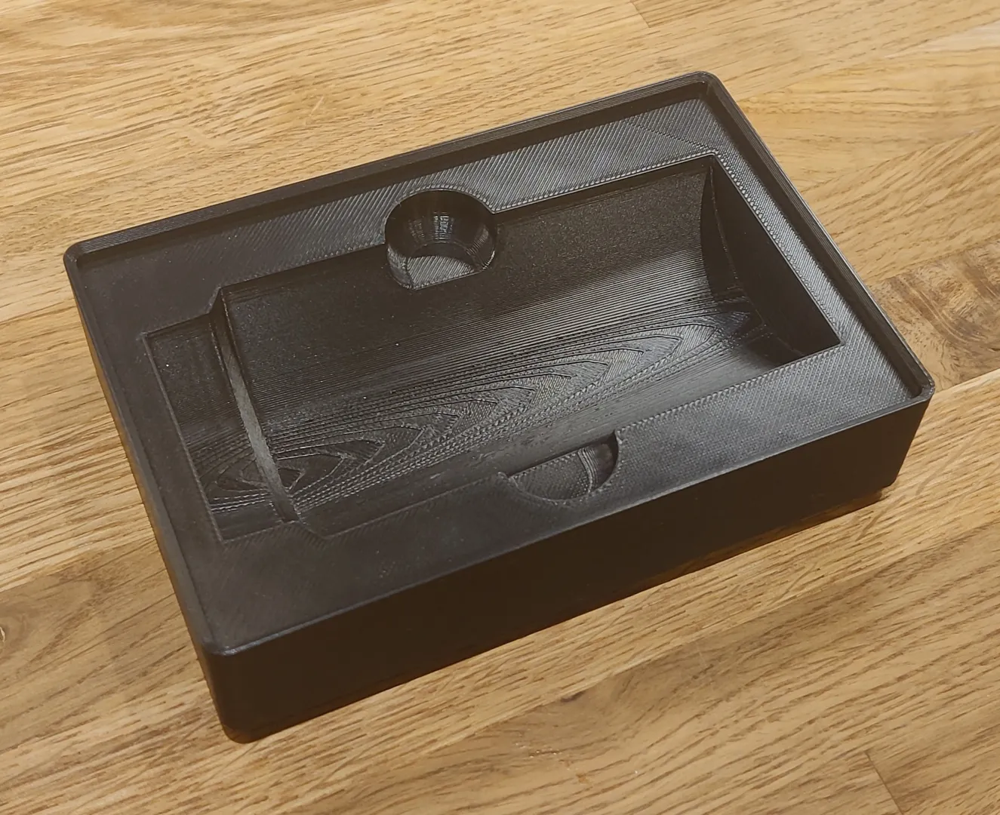</a> 
<b>Gridfinity Bin 3x2x4 Elegoo Vacuum Pump v1a</b> 
Source unknown &middot; <a href="Gridfinity%20Bin%203x2x4%20Elegoo%20Vacuum%20Pump%20v1a.3mf">Gridfinity Bin 3x2x4 Elegoo Vacuum Pump v1a.3mf</a>
</td>
<td width="33%" align="center" valign="top">
<a href="gridfinity-bit-holder-3x1-model_files">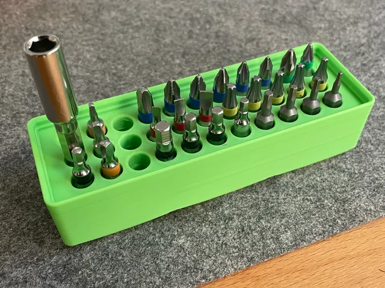</a> 
<b>Gridfinity Bit Holder 3x1</b> 
by Wolfgang Sagichnet 
<a href="https://www.printables.com/model/537829-gridfinity-bit-holder-3x1">Printables</a> &middot; <a href="gridfinity-bit-holder-3x1-model_files">Repo folder</a>
</td>
</tr>
<tr>
<td width="33%" align="center" valign="top">
<a href="gridfinity-breadboard-holder-model_files">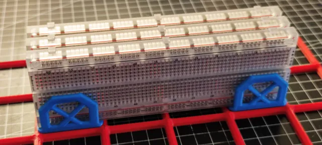</a> 
<b>Gridfinity Breadboard Holder</b> 
by daclasen 
<a href="https://www.printables.com/model/271937-gridfinity-breadboard-holder">Printables</a> &middot; <a href="gridfinity-breadboard-holder-model_files">Repo folder</a>
</td>
<td width="33%" align="center" valign="top">
<a href="gridfinity-brother-p-touch-tz-tze-label-tape-holder-model_files">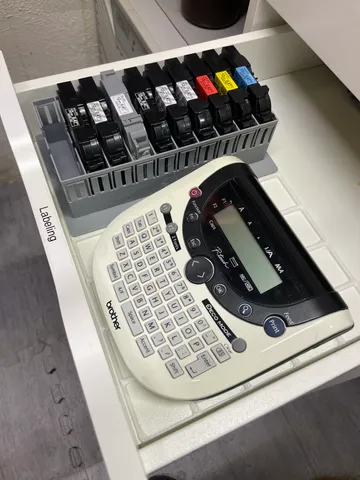</a> 
<b>Gridfinity Brother P-Touch TZ TZe Label Tape Holder</b> 
by Steve Chapman 
<a href="https://www.printables.com/model/281427-gridfinity-brother-p-touch-tz-tze-label-tape-holde">Printables</a> &middot; <a href="gridfinity-brother-p-touch-tz-tze-label-tape-holder-model_files">Repo folder</a>
</td>
<td width="33%" align="center" valign="top">
<a href="gridfinity-cable-holder_stls">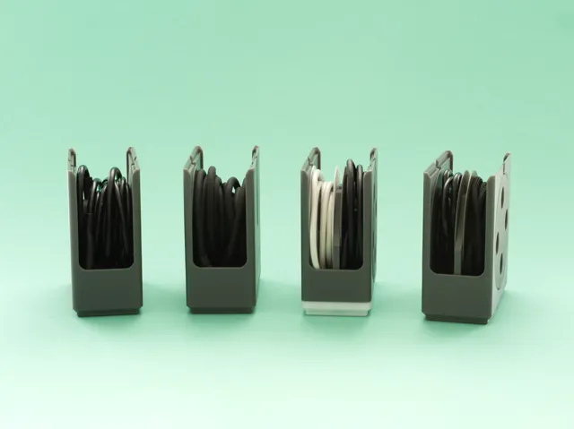</a> 
<b>Gridfinity Cable Holder</b> 
by bimobutila 
<a href="https://makerworld.com/en/models/2469254-gridfinity-cable-holder">MakerWorld</a> &middot; <a href="gridfinity-cable-holder_stls">Repo folder</a>
</td>
</tr>
<tr>
<td width="33%" align="center" valign="top">
<a href="gridfinity-caliper-box-model_files">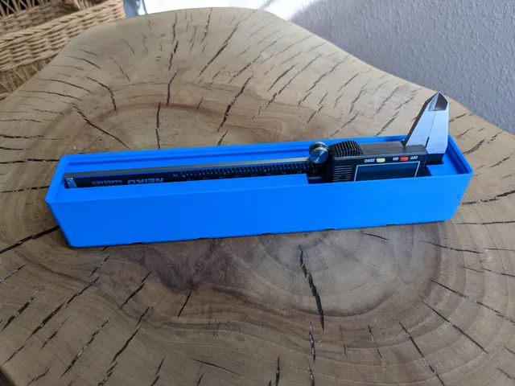</a> 
<b>Gridfinity Caliper box</b> 
by UnoriginalElephant 
<a href="https://www.printables.com/model/299953-gridfinity-caliper-box">Printables</a> &middot; <a href="gridfinity-caliper-box-model_files">Repo folder</a>
</td>
<td width="33%" align="center" valign="top">
<a href="gridfinity-caliper-holder-low-profileextra-storage-model_files">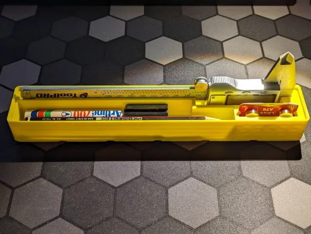</a> 
<b>Gridfinity Caliper Holder - Low profile/Extra Storage</b> 
by Nagel 
<a href="https://www.printables.com/model/567890-gridfinity-caliper-holder-low-profileextra-storage">Printables</a> &middot; <a href="gridfinity-caliper-holder-low-profileextra-storage-model_files">Repo folder</a>
</td>
<td width="33%" align="center" valign="top">
<a href="gridfinity-crimper-stand-model_files">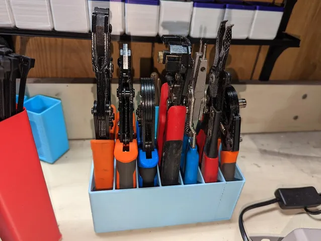</a> 
<b>Gridfinity Crimper Stand</b> 
by Beamsjr 
<a href="https://www.printables.com/model/430863-gridfinity-crimper-stand">Printables</a> &middot; <a href="gridfinity-crimper-stand-model_files">Repo folder</a>
</td>
</tr>
<tr>
<td width="33%" align="center" valign="top">
<a href="gridfinity-deburring-tool-holder-w-low-profile-blade-storage-model_files">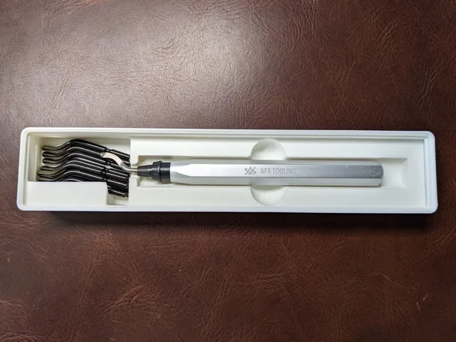</a> 
<b>Gridfinity Deburring Tool Holder w/ Low Profile Blade Storage</b> 
by Yoni 
<a href="https://www.printables.com/model/433238-gridfinity-deburring-tool-holder-w-low-profile-bla">Printables</a> &middot; <a href="gridfinity-deburring-tool-holder-w-low-profile-blade-storage-model_files">Repo folder</a>
</td>
<td width="33%" align="center" valign="top">
<a href="gridfinity-deburring-tool-holder-with-blade-storage-model_files">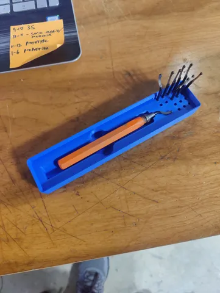</a> 
<b>Gridfinity Deburring Tool Holder with Blade Storage</b> 
by Audacity Micro 
<a href="https://www.printables.com/model/343059-gridfinity-deburring-tool-holder-with-blade-storag">Printables</a> &middot; <a href="gridfinity-deburring-tool-holder-with-blade-storage-model_files">Repo folder</a>
</td>
<td width="33%" align="center" valign="top">
<i>no preview</i> 
<b>Gridfinity Dremel Bit Storage</b> 
<a href="https://www.printables.com/model/502366">Printables</a> &middot; <a href="gridfinity-dremel-bit-storage-model_files">Repo folder</a>
</td>
</tr>
<tr>
<td width="33%" align="center" valign="top">
<a href="gridfinity-dremel-bit-storage-print_files">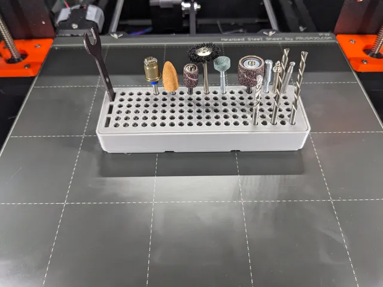</a> 
<b>Gridfinity dremel bit storage</b> 
by Fraham 
<a href="https://www.printables.com/model/375874-gridfinity-dremel-bit-storage">Printables</a> &middot; <a href="gridfinity-dremel-bit-storage-print_files">Repo folder</a>
</td>
<td width="33%" align="center" valign="top">
<a href="gridfinity-engineer-ss-02-stand-model_files">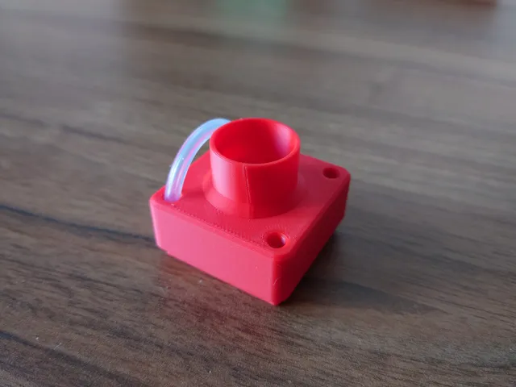</a> 
<b>Gridfinity Engineer SS-02 stand</b> 
by Waschtl 
<a href="https://www.printables.com/model/258113-gridfinity-engineer-ss-02-stand">Printables</a> &middot; <a href="gridfinity-engineer-ss-02-stand-model_files">Repo folder</a>
</td>
<td width="33%" align="center" valign="top">
<a href="gridfinity-esp32-holder-model_files">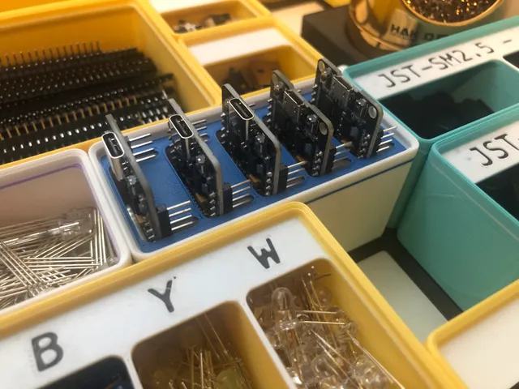</a> 
<b>Gridfinity ESP32 Holder</b> 
by Alexander 
<a href="https://www.printables.com/model/574139-gridfinity-esp32-holder">Printables</a> &middot; <a href="gridfinity-esp32-holder-model_files">Repo folder</a>
</td>
</tr>
<tr>
<td width="33%" align="center" valign="top">
<a href="gridfinity-generic-devboard-holder-model_files">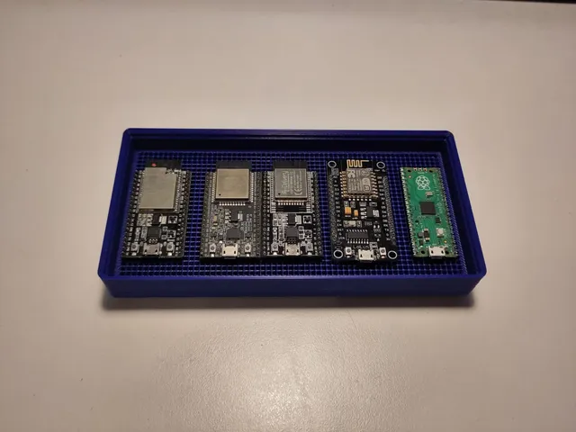</a> 
<b>Gridfinity Generic DevBoard Holder</b> 
by fhessel 
<a href="https://www.printables.com/model/486857-gridfinity-generic-devboard-holder">Printables</a> &middot; <a href="gridfinity-generic-devboard-holder-model_files">Repo folder</a>
</td>
<td width="33%" align="center" valign="top">
 
<b>Gridfinity Generic DevBoard Holder</b> 
by fhessel 
<a href="https://www.printables.com/model/486857-gridfinity-generic-devboard-holder">Printables</a> &middot; <a href="gridfinity-generic-devboard-holder-print_files">Repo folder</a>
</td>
<td width="33%" align="center" valign="top">
<a href="gridfinity-hex-bit-holders-with-larger-hex-holes-model_files">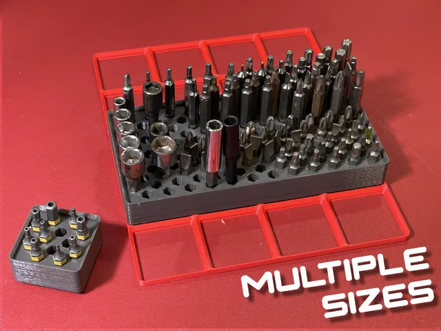</a> 
<b>Gridfinity Hex Bit Holders with Larger Hex Holes</b> 
by Tache 
<a href="https://www.printables.com/model/454375-gridfinity-hex-bit-holders-with-larger-hex-holes">Printables</a> &middot; <a href="gridfinity-hex-bit-holders-with-larger-hex-holes-model_files">Repo folder</a>
</td>
</tr>
<tr>
<td width="33%" align="center" valign="top">
<a href="gridfinity-magnet-dispenser-model_files">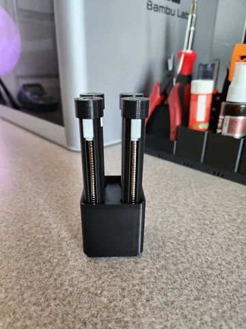</a> 
<b>Gridfinity Magnet Dispenser</b> 
by Carl Belcher 
<a href="https://www.printables.com/model/418731-gridfinity-magnet-dispenser">Printables</a> &middot; <a href="gridfinity-magnet-dispenser-model_files">Repo folder</a>
</td>
<td width="33%" align="center" valign="top">
<a href="gridfinity-magnet-stackable-battery-dispenser-model_files">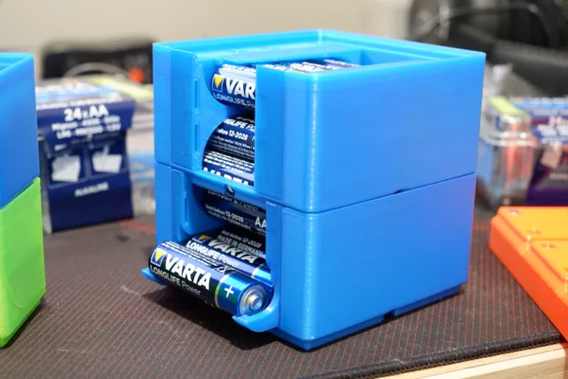</a> 
<b>Gridfinity magnet stackable battery dispenser</b> 
by FruitieX 
<a href="https://www.printables.com/model/249933-gridfinity-magnet-stackable-battery-dispenser">Printables</a> &middot; <a href="gridfinity-magnet-stackable-battery-dispenser-model_files">Repo folder</a>
</td>
<td width="33%" align="center" valign="top">
<a href="gridfinity-micro-sd-card-holder-1x1x3-added-step-file-model_files">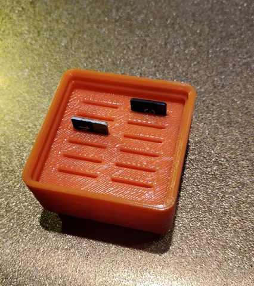</a> 
<b>Gridfinity Micro SD card holder 1x1x3 (added step file)</b> 
by idenny1 
<a href="https://www.printables.com/model/245161-gridfinity-micro-sd-card-holder-1x1x3-added-step-f">Printables</a> &middot; <a href="gridfinity-micro-sd-card-holder-1x1x3-added-step-file-model_files">Repo folder</a>
</td>
</tr>
<tr>
<td width="33%" align="center" valign="top">
<a href="gridfinity-needle-file-tray-model_files">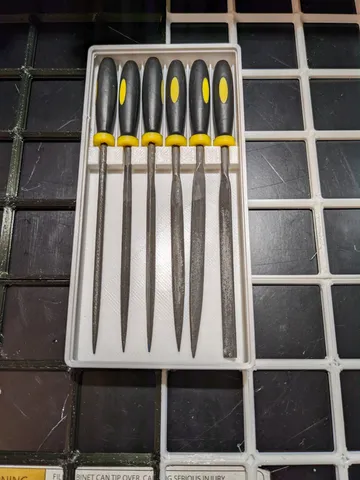</a> 
<b>Gridfinity Needle File Tray</b> 
by UnoriginalElephant 
<a href="https://www.printables.com/model/298086-gridfinity-needle-file-tray">Printables</a> &middot; <a href="gridfinity-needle-file-tray-model_files">Repo folder</a>
</td>
<td width="33%" align="center" valign="top">
<a href="Gridfinity%20Nippers%20Strippers%20Pliers%20Racks">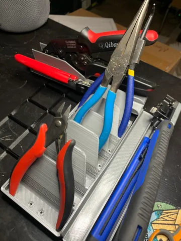</a> 
<b>Gridfinity Nippers + Strippers + Pliers Racks</b> 
by CmdrMoto 
<a href="https://www.printables.com/model/173342-gridfinity-nippers-strippers-pliers-racks">Printables</a> &middot; <a href="Gridfinity%20Nippers%20Strippers%20Pliers%20Racks">Repo folder</a>
</td>
<td width="33%" align="center" valign="top">
<a href="gridfinity-nozzle-holder-model_files">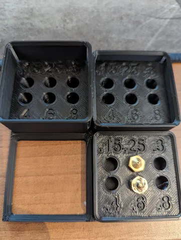</a> 
<b>Gridfinity Nozzle Holder</b> 
by Caiman 
<a href="https://www.printables.com/model/240309-gridfinity-nozzle-holder">Printables</a> &middot; <a href="gridfinity-nozzle-holder-model_files">Repo folder</a>
</td>
</tr>
<tr>
<td width="33%" align="center" valign="top">
<a href="Gridfinity%2BOscillating%2Btool%2Bblades%2Bw_%2Beject%2Blevers">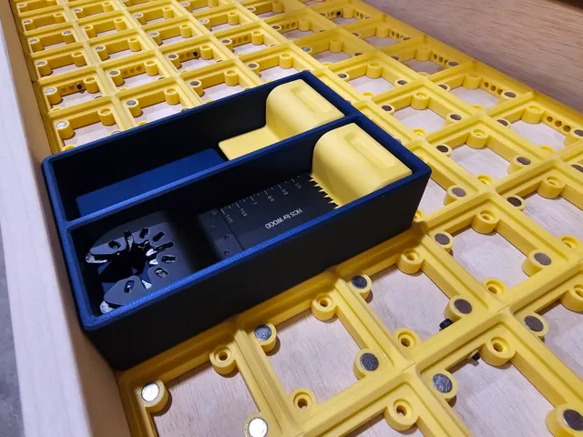</a> 
<b>Gridfinity Oscillating tool blades w/ eject levers</b> 
by Oclure 
<a href="https://makerworld.com/en/models/63887-gridfinity-oscillating-tool-blades-w-eject-levers">MakerWorld</a> &middot; <a href="Gridfinity%2BOscillating%2Btool%2Bblades%2Bw_%2Beject%2Blevers">Repo folder</a>
</td>
<td width="33%" align="center" valign="top">
<i>no preview</i> 
<b>Gridfinity Parametric Bit Holders</b> 
Source unknown &middot; <a href="Gridfinity%20Parametric%20Bit%20Holders">Repo folder</a>
</td>
<td width="33%" align="center" valign="top">
<i>no preview</i> 
<b>Gridfinity Pick Tweezer Racks</b> 
Source unknown &middot; <a href="Gridfinity%20Pick%20Tweezer%20Racks">Repo folder</a>
</td>
</tr>
<tr>
<td width="33%" align="center" valign="top">
<a href="gridfinity-pine-power-base-model_files">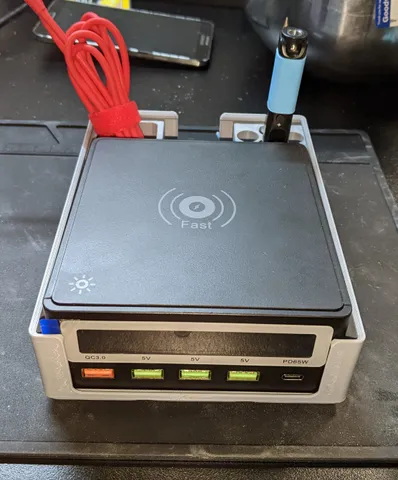</a> 
<b>Gridfinity Pine Power Base</b> 
by Zor Prime 
<a href="https://www.printables.com/model/290193-gridfinity-pine-power-base">Printables</a> &middot; <a href="gridfinity-pine-power-base-model_files">Repo folder</a>
</td>
<td width="33%" align="center" valign="top">
<a href="gridfinity-pinecil-tip-holder-model_files">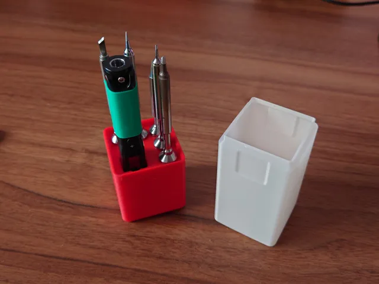</a> 
<b>Gridfinity Pinecil &amp; Tip holder</b> 
by Waschtl 
<a href="https://www.printables.com/model/266923-gridfinity-pinecil-tip-holder">Printables</a> &middot; <a href="gridfinity-pinecil-tip-holder-model_files">Repo folder</a>
</td>
<td width="33%" align="center" valign="top">
<a href="gridfinity-pinecil-ts100-stand-model_files">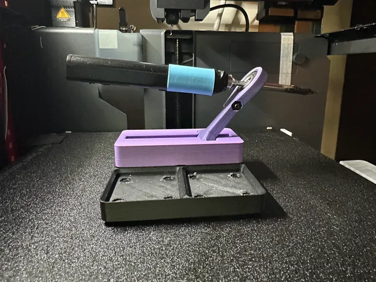</a> 
<b>Gridfinity Pinecil / TS100 Stand</b> 
by Alex Is Making Things 
<a href="https://www.printables.com/model/479749-gridfinity-pinecil-ts100-stand">Printables</a> &middot; <a href="gridfinity-pinecil-ts100-stand-model_files">Repo folder</a>
</td>
</tr>
<tr>
<td width="33%" align="center" valign="top">
<a href="gridfinity-pinecil-9-tip-holder-model_files">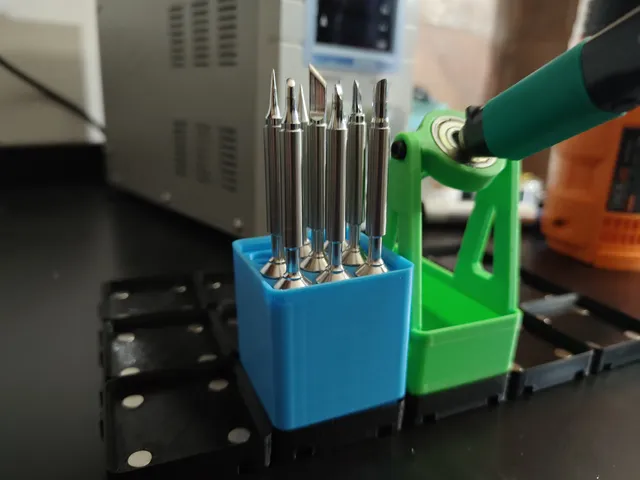</a> 
<b>Gridfinity Pinecil 9 Tip Holder</b> 
by Software2 
<a href="https://www.printables.com/model/435688-gridfinity-pinecil-9-tip-holder">Printables</a> &middot; <a href="gridfinity-pinecil-9-tip-holder-model_files">Repo folder</a>
</td>
<td width="33%" align="center" valign="top">
<a href="gridfinity-pinecil-case-holder-model_files">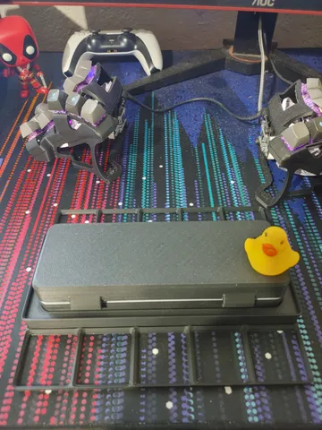</a> 
<b>Gridfinity Pinecil Case Holder</b> 
by beard_of_confusion 
<a href="https://www.printables.com/model/243950-gridfinity-pinecil-case-holder">Printables</a> &middot; <a href="gridfinity-pinecil-case-holder-model_files">Repo folder</a>
</td>
<td width="33%" align="center" valign="top">
<a href="gridfinity-pliers-rack-model_files">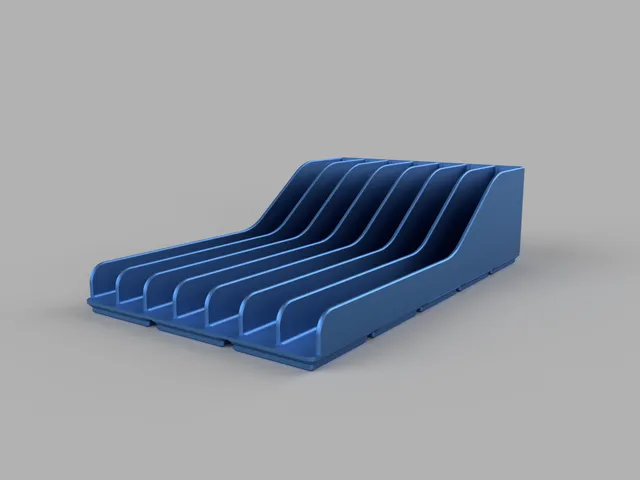</a> 
<b>Gridfinity Pliers Rack</b> 
by Clay 
<a href="https://www.printables.com/model/334247-gridfinity-pliers-rack">Printables</a> &middot; <a href="gridfinity-pliers-rack-model_files">Repo folder</a>
</td>
</tr>
<tr>
<td width="33%" align="center" valign="top">
<a href="gridfinity-pliers-racks-mega-pack-92-different-sizes-model_files">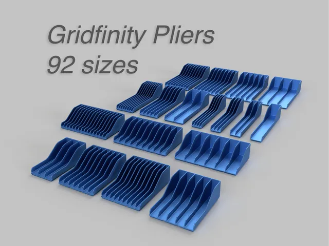</a> 
<b>Gridfinity Pliers Racks Mega Pack (92 different Sizes)</b> 
by Clay 
<a href="https://www.printables.com/model/493770-gridfinity-pliers-racks-mega-pack-92-different-siz">Printables</a> &middot; <a href="gridfinity-pliers-racks-mega-pack-92-different-sizes-model_files">Repo folder</a>
</td>
<td width="33%" align="center" valign="top">
 
<b>Gridfinity Pliers Wrack (Small)</b> 
by SailorJerry 
<a href="https://www.printables.com/model/328889-gridfinity-pliers-wrack-small">Printables</a> &middot; <a href="gridfinity-pliers-wrack-small-model_files">Repo folder</a>
</td>
<td width="33%" align="center" valign="top">
 
<b>Gridfinity pliers/tool rack 70 sizes (with pin)</b> 
by Demig 
<a href="https://makerworld.com/en/models/612167-gridfinity-pliers-tool-rack-70-sizes-with-pin">MakerWorld</a> &middot; <a href="Gridfinity%2Bpliers_tool%2Brack%2B70%2Bsizes%2B(with%2Bpin)">Repo folder</a>
</td>
</tr>
<tr>
<td width="33%" align="center" valign="top">
 
<b>Gridfinity Ratchet Holder - Hyper Tough 1/4 20-Piece - 4x3x3</b> 
by ed3d 
<a href="https://www.printables.com/model/494188-gridfinity-ratchet-holder-hyper-tough-14-20-piece-">Printables</a> &middot; <a href="gridfinity-ratchet-holder-hyper-tough-14-20-piece-4x3x3-model_files">Repo folder</a>
</td>
<td width="33%" align="center" valign="top">
 
<b>Gridfinity Sandpaperholder</b> 
by Another Alex 
<a href="https://www.printables.com/model/773618-gridfinity-sandpaperholder">Printables</a> &middot; <a href="gridfinity-sandpaperholder-model_files">Repo folder</a>
</td>
<td width="33%" align="center" valign="top">
 
<b>Gridfinity Sharpie Storage Block (Tip Down With Clips Version)</b> 
by XanderShade01 
<a href="https://www.printables.com/model/299701-gridfinity-sharpie-storage-block-tip-down-with-cli">Printables</a> &middot; <a href="gridfinity-sharpie-storage-block-tip-down-with-clips-version-model_files">Repo folder</a>
</td>
</tr>
<tr>
<td width="33%" align="center" valign="top">
 
<b>Gridfinity Socket Holders, 1/4&quot; and 3/8&quot;</b> 
by jcj99 
<a href="https://www.printables.com/model/614374-gridfinity-socket-holders-14-and-38">Printables</a> &middot; <a href="gridfinity-socket-holders-14-and-38-model_files">Repo folder</a>
</td>
<td width="33%" align="center" valign="top">
 
<b>Gridfinity Storage For 7 Piece Bondhus Balldriver Set</b> 
by Brenda 
<a href="https://www.printables.com/model/325049-gridfinity-storage-for-7-piece-bondhus-balldriver-">Printables</a> &middot; <a href="gridfinity-storage-for-7-piece-bondhus-balldriver-set-model_files">Repo folder</a>
</td>
<td width="33%" align="center" valign="top">
 
<b>Gridfinity tool holder collection</b> 
by Barebaric 
<a href="https://www.printables.com/model/301673-gridfinity-tool-holder-collection">Printables</a> &middot; <a href="gridfinity-tool-holder-collection-model_files">Repo folder</a>
</td>
</tr>
<tr>
<td width="33%" align="center" valign="top">
 
<b>Gridfinity Toolbox (Parametric)</b> 
by classy 
<a href="https://www.printables.com/model/204907-gridfinity-toolbox-parametric">Printables</a> &middot; <a href="Gridfinity%20Toolbox%20Parametric">Repo folder</a>
</td>
<td width="33%" align="center" valign="top">
 
<b>Gridfinity Universal Wera Screwdriver Inserts</b> 
by Scubafan 
<a href="https://makerworld.com/en/models/475390-gridfinity-universal-wera-screwdriver-inserts">MakerWorld</a> &middot; <a href="Gridfinity%2BUniversal%2BWera%2BScrewdriver%2BInserts">Repo folder</a>
</td>
<td width="33%" align="center" valign="top">
 
<b>Gridfinity Utensil Holder</b> 
by CueBall909 
<a href="https://www.printables.com/model/722107-gridfinity-utensil-holder">Printables</a> &middot; <a href="gridfinity-utensil-holder-model_files">Repo folder</a>
</td>
</tr>
<tr>
<td width="33%" align="center" valign="top">
 
<b>Gridfinity Wera Hex Organiser</b> 
by nickd 
<a href="https://www.printables.com/model/711886-gridfinity-wera-hex-organiser">Printables</a> &middot; <a href="gridfinity-wera-hex-organiser-model_files">Repo folder</a>
</td>
<td width="33%" align="center" valign="top">
 
<b>Gridfinity Wera Kraftform Micro Holder</b> 
<a href="https://www.printables.com/model/452194">Printables</a> &middot; <a href="gridfinity-wera-kraftform-micro-holder-model_files">Repo folder</a>
</td>
<td width="33%" align="center" valign="top">
 
<b>Gridfinity Wera screwdriver holder</b> 
by RWMH 
<a href="https://www.printables.com/model/232947-gridfinity-wera-screwdriver-holder">Printables</a> &middot; <a href="gridfinity-wera-screwdriver-holder-model_files">Repo folder</a>
</td>
</tr>
<tr>
<td width="33%" align="center" valign="top">
 
<b>Gridfinity wide, variable length jumper wire organizer</b> 
by Barebaric 
<a href="https://www.printables.com/model/410775-gridfinity-wide-variable-length-jumper-wire-organi">Printables</a> &middot; <a href="gridfinity-wide-variable-length-jumper-wire-organizer-model_files">Repo folder</a>
</td>
<td width="33%" align="center" valign="top">
 
<b>Gridfinity wire spool holder</b> 
by Kelly Egan 
<a href="https://www.printables.com/model/301311-gridfinity-wire-spool-holder">Printables</a> &middot; <a href="gridfinity-wire-spool-holder-model_files">Repo folder</a>
</td>
<td width="33%" align="center" valign="top">
<i>no preview</i> 
<b>Gridfinity Wrench Holders 1x1–6x6</b> 
<a href="https://makerworld.com/en/search/models?keyword=Gridfinity%20Wrench%20Holders%201x1%E2%80%936x6">Search MakerWorld</a> &middot; <a href="Gridfinity%2BWrench%2BHolders%2B_%2B1x1%E2%80%936x6">Repo folder</a>
</td>
</tr>
<tr>
<td width="33%" align="center" valign="top">
<i>no preview</i> 
<b>Gridfinity Wrench Holders Thicker</b> 
<a href="https://www.printables.com/model/290360">Printables</a> &middot; <a href="gridfinity-wrench-holders-thicker-model_files">Repo folder</a>
</td>
<td width="33%" align="center" valign="top">
 
<b>Gridfinity x SMD Magazine</b> 
by CmdrEmily 
<a href="https://www.printables.com/model/436079-gridfinity-x-smd-magazine">Printables</a> &middot; <a href="gridfinity-x-smd-magazine-model_files">Repo folder</a>
</td>
<td width="33%" align="center" valign="top">
 
<b>gridfinity-neiko-calipers</b> 
Source unknown &middot; <a href="gridfinity-neiko-calipers.3mf">gridfinity-neiko-calipers.3mf</a>
</td>
</tr>
<tr>
<td width="33%" align="center" valign="top">
 
<b>Hinged SD / microSD Card Box - Gridfinity compatible, latching, print-in-place</b> 
by nerdpersonthing 
<a href="https://www.printables.com/model/1006155-hinged-sd-microsd-card-box-gridfinity-compatible-l">Printables</a> &middot; <a href="hinged-sd-microsd-card-box-gridfinity-compatible-latching-print-in-place-model_files">Repo folder</a>
</td>
<td width="33%" align="center" valign="top">
 
<b>Jabra Elite Gridfinity holder</b> 
by Thargor 
<a href="https://www.printables.com/model/462053-jabra-elite-gridfinity-holder">Printables</a> &middot; <a href="jabra-elite-gridfinity-holder-model_files">Repo folder</a>
</td>
<td width="33%" align="center" valign="top">
 
<b>Low Profile Gridfinity Pittsburgh Combination Wrench Set Holder</b> 
by YucA 
<a href="https://www.printables.com/model/466372-low-profile-gridfinity-pittsburgh-combination-wren">Printables</a> &middot; <a href="low-profile-gridfinity-pittsburgh-combination-wrench-set-holder-model_files">Repo folder</a>
</td>
</tr>
<tr>
<td width="33%" align="center" valign="top">
 
<b>Modular chisel rack system</b> 
by A513055 
<a href="https://www.thingiverse.com/thing:4559163">Thingiverse</a> &middot; <a href="Modular_chisel_rack_system_4559163">Repo folder</a>
</td>
<td width="33%" align="center" valign="top">
 
<b>Pinecil organizer with Gridfinity support</b> 
by Kieran E 
<a href="https://www.printables.com/model/525429-pinecil-organizer-with-gridfinity-support">Printables</a> &middot; <a href="pinecil-organizer-with-gridfinity-support-model_files">Repo folder</a>
</td>
<td width="33%" align="center" valign="top">
 
<b>Plier Set Holder Gridfinity (shows Tekton)</b> 
by Dave.the.Borg 
<a href="https://makerworld.com/en/models/1046951-plier-set-holder-gridfinity-shows-tekton">MakerWorld</a> &middot; <a href="Plier%2BSet%2BHolder%2BGridfinity%2B(shows%2BTekton)">Repo folder</a>
</td>
</tr>
<tr>
<td width="33%" align="center" valign="top">
 
<b>solder sucker ss-02 gridfinity</b> 
by LutraVulgaris 
<a href="https://www.printables.com/model/527736-solder-sucker-ss-02-gridfinity">Printables</a> &middot; <a href="solder-sucker-ss-02-gridfinity-model_files">Repo folder</a>
</td>
<td width="33%" align="center" valign="top">
 
<b>Soldering station/ work station for Gridfinity</b> 
by Dan._.KKing 
<a href="https://makerworld.com/en/models/880227-soldering-station-work-station-for-gridfinity">MakerWorld</a> &middot; <a href="Soldering%2Bstation_%2Bwork%2Bstation%2Bfor%2BGridfinity">Repo folder</a>
</td>
<td width="33%" align="center" valign="top">
 
<b>Wire Holder Gridfinity</b> 
by LutraVulgaris 
<a href="https://www.printables.com/model/469616-wire-holder-gridfinity">Printables</a> &middot; <a href="wire-holder-gridfinity-model_files">Repo folder</a>
</td>
</tr>
</table>

Other files in this folder (21)

- [6x Solder Wire Spool Holder 3x2.stl](6x%20Solder%20Wire%20Spool%20Holder%203x2.stl)
- [amazing-gridfinity-m3-bolt-sorter-model_files.zip](amazing-gridfinity-m3-bolt-sorter-model_files.zip)
- [Arduino Uno Holder 2x1.stl](Arduino%20Uno%20Holder%202x1.stl)
- [Brother Label 3x5.stl](Brother%20Label%203x5.stl)
- [byob-gridfinity-screw-sorter-bring-your-own-bins-model_files.zip](byob-gridfinity-screw-sorter-bring-your-own-bins-model_files.zip)
- [Debur Case Gridfinity.stl](Debur%20Case%20Gridfinity.stl)
- [GridFinity - brother-p-touch-tz-tze-label-tape-holder-10x v1.stl](GridFinity%20-%20brother-p-touch-tz-tze-label-tape-holder-10x%20v1.stl)
- [Gridfinity 2x1 10xAA Battery Holder v1.stl](Gridfinity%202x1%2010xAA%20Battery%20Holder%20v1.stl)
- [Gridfinity 4 Raspberry Pi Zero holder.stl](Gridfinity%204%20Raspberry%20Pi%20Zero%20holder.stl)
- [Gridfinity credit cards 2x2-7.3mf](Gridfinity%20credit%20cards%202x2-7.3mf)
- [Gridfinity SD Storage.stl](Gridfinity%20SD%20Storage.stl)
- [gridfinity-5in-sanding-disc-holder.stl](gridfinity-5in-sanding-disc-holder.stl)
- [gridfinitybreadboard-1x2x6-v1.obj](gridfinitybreadboard-1x2x6-v1.obj)
- [Gridfinity_Engineer_SS-02.stl](Gridfinity_Engineer_SS-02.stl)
- [Gridfinity_Logic_Analyzer.stl](Gridfinity_Logic_Analyzer.stl)
- [MX Mouse Storage.stl](MX%20Mouse%20Storage.stl)
- [Pinecil-5-tips.stl](Pinecil-5-tips.stl)
- [Round+Tool+Holding+Inserts+for+Gridfinity+Bins.zip](Round%2BTool%2BHolding%2BInserts%2Bfor%2BGridfinity%2BBins.zip)
- [Vertical Breadboard Holder.stl](Vertical%20Breadboard%20Holder.stl)
- [wera holder - Daave Remix.stl](wera%20holder%20-%20Daave%20Remix.stl)
- [wera-l-key-gridfinity-holders-model_files.zip](wera-l-key-gridfinity-holders-model_files.zip)

## 3d Printing

<table>
<tr>
<td width="33%" align="center" valign="top">
 
<b>Gridfinity Nozzle Holder</b> 
by Caiman 
<a href="https://www.printables.com/model/240309-gridfinity-nozzle-holder">Printables</a> &middot; <a href="3d-printing/gridfinity-nozzle-holder-model_files">Repo folder</a>
</td>
</tr>
</table>

