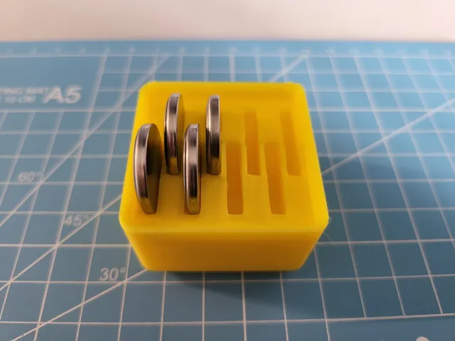
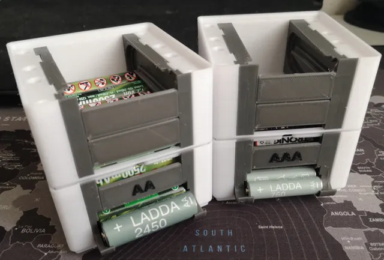
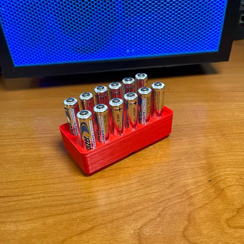
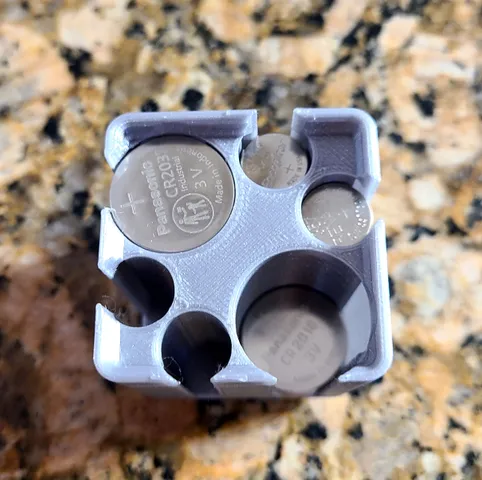
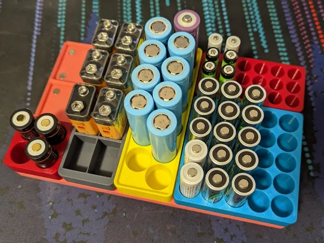
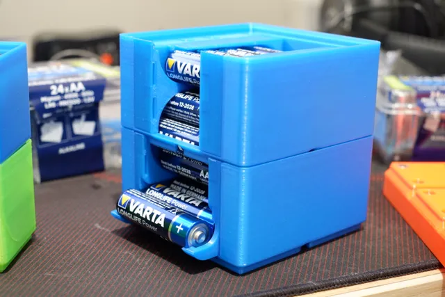

# Batteries

<!-- Generated by scripts/Update-Readmes.ps1 (Linux: scripts/update_readmes.py) - edit scripts/readme-sources.json and rerun instead of editing by hand. -->

[Home](../../../../../README.md) / [Storage](../../../../README.md) / [Systems](../../../README.md) / [Gridfinity](../../README.md) / [Tool Holders](../README.md) / **Batteries**

7 builds &middot; 6 Printables &middot; 1 unknown source

## Batteries

<table>
<tr>
<td width="33%" align="center" valign="top">
 
<b>Gridfinity (Griddex) - C2032 Battery Holder</b> 
by Griddex 
<a href="https://www.printables.com/model/441425-gridfinity-griddex-c2032-battery-holder">Printables</a> &middot; <a href="gridfinity-griddex-c2032-battery-holder-model_files">Repo folder</a>
</td>
<td width="33%" align="center" valign="top">
 
<b>Gridfinity - Stackable Battery Dispenser (Remix)</b> 
by MrMaKr 
<a href="https://www.printables.com/model/463478-gridfinity-stackable-battery-dispenser-remix">Printables</a> &middot; <a href="gridfinity-stackable-battery-dispenser-remix-model_files">Repo folder</a>
</td>
<td width="33%" align="center" valign="top">
 
<b>Gridfinity AAA Battery Containers</b> 
by briancmoses 
<a href="https://www.printables.com/model/219701-gridfinity-aaa-battery-containers">Printables</a> &middot; <a href="gridfinity-aaa-battery-containers-model_files">Repo folder</a>
</td>
</tr>
<tr>
<td width="33%" align="center" valign="top">
 
<b>Gridfinity Battery Box: CR2032/CR2016, 357/303/SR44 and A23/MN21/AAA slots</b> 
by dhiltonp 
<a href="https://www.printables.com/model/208053-gridfinity-battery-box-cr2032cr2016-357303sr44-and">Printables</a> &middot; <a href="gridfinity-battery-box-cr2032cr2016-357303sr44-and-a23mn21aaa-slots-model_files">Repo folder</a>
</td>
<td width="33%" align="center" valign="top">
 
<b>Gridfinity Battery Trays (AA, AAA, AAAA, 18650, CR123, CR2, 9V, 21700, C, D)</b> 
by Dalkain 
<a href="https://www.printables.com/model/341811-gridfinity-battery-trays-aa-aaa-aaaa-18650-cr123-c">Printables</a> &middot; <a href="gridfinity-battery-trays-aa-aaa-18650-cr123-9v-21700-model_files">Repo folder</a>
</td>
<td width="33%" align="center" valign="top">
 
<b>Gridfinity magnet stackable battery dispenser</b> 
by FruitieX 
<a href="https://www.printables.com/model/249933-gridfinity-magnet-stackable-battery-dispenser">Printables</a> &middot; <a href="gridfinity-magnet-stackable-battery-dispenser-model_files">Repo folder</a>
</td>
</tr>
</table>

Other files in this folder (1)

- [Gridfinity 2x1 10xAA Battery Holder v1.stl](Gridfinity%202x1%2010xAA%20Battery%20Holder%20v1.stl)

