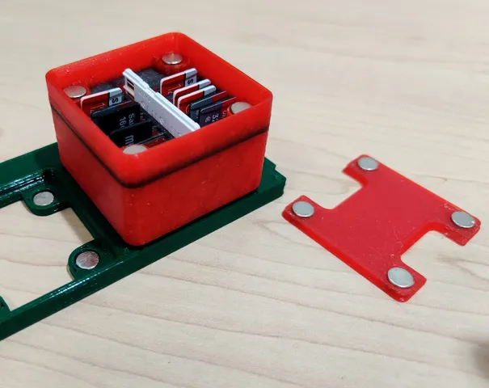
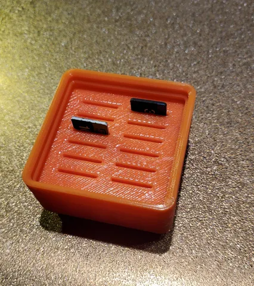
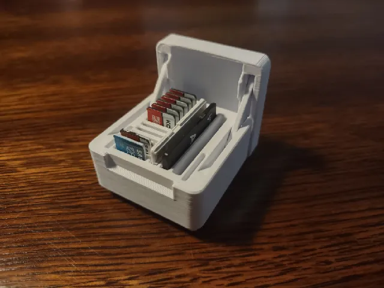

# Computer

<!-- Generated by scripts/Update-Readmes.ps1 (Linux: scripts/update_readmes.py) - edit scripts/readme-sources.json and rerun instead of editing by hand. -->

[Home](../../../../../README.md) / [Storage](../../../../README.md) / [Systems](../../../README.md) / [Gridfinity](../../README.md) / [Tool Holders](../README.md) / **Computer**

5 builds &middot; 3 Printables &middot; 2 unknown source

## Computer

<table>
<tr>
<td width="33%" align="center" valign="top">
 
<b>Grab-and-Go Gridfinity SD card holder</b> 
by Jav.BR 
<a href="https://www.printables.com/model/292285-grab-and-go-gridfinity-sd-card-holder">Printables</a> &middot; <a href="grab-and-go-gridfinity-sd-card-holder-model_files">Repo folder</a>
</td>
<td width="33%" align="center" valign="top">
 
<b>Gridfinity Micro SD card holder 1x1x3 (added step file)</b> 
by idenny1 
<a href="https://www.printables.com/model/245161-gridfinity-micro-sd-card-holder-1x1x3-added-step-f">Printables</a> &middot; <a href="gridfinity-micro-sd-card-holder-1x1x3-added-step-file-model_files">Repo folder</a>
</td>
<td width="33%" align="center" valign="top">
 
<b>Hinged SD / microSD Card Box - Gridfinity compatible, latching, print-in-place</b> 
by nerdpersonthing 
<a href="https://www.printables.com/model/1006155-hinged-sd-microsd-card-box-gridfinity-compatible-l">Printables</a> &middot; <a href="hinged-sd-microsd-card-box-gridfinity-compatible-latching-print-in-place-model_files">Repo folder</a>
</td>
</tr>
</table>

Other files in this folder (2)

- [Gridfinity SD Storage.stl](Gridfinity%20SD%20Storage.stl)
- [MX Mouse Storage.stl](MX%20Mouse%20Storage.stl)

