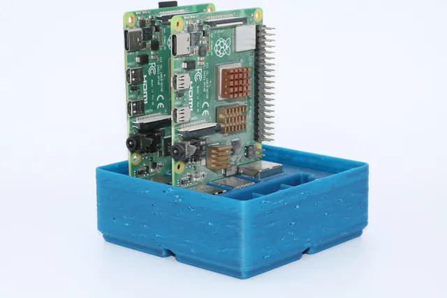
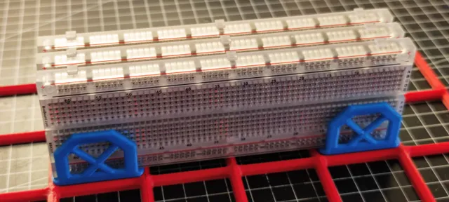
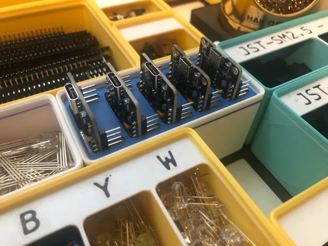
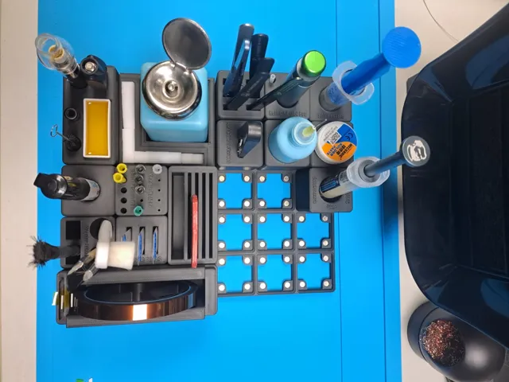
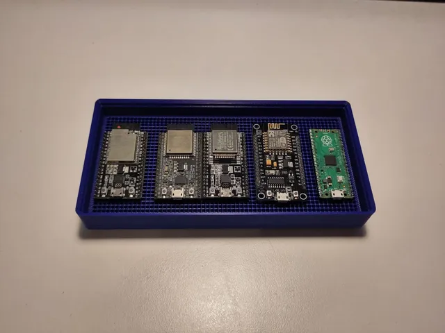
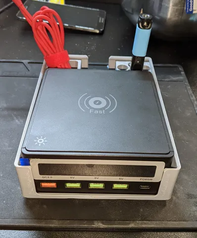
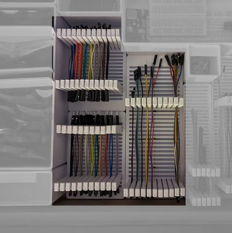

# Electrical

<!-- Generated by scripts/Update-Readmes.ps1 (Linux: scripts/update_readmes.py) - edit scripts/readme-sources.json and rerun instead of editing by hand. -->

[Home](../../../../../README.md) / [Storage](../../../../README.md) / [Systems](../../../README.md) / [Gridfinity](../../README.md) / [Tool Holders](../README.md) / **Electrical**

14 builds &middot; 2 MakerWorld &middot; 7 Printables &middot; 5 unknown source

## Electrical

<table>
<tr>
<td width="33%" align="center" valign="top">
 
<b>Gridfinity - Raspberry Pi 4 (x3) holder + Fusion File</b> 
by Micah 
<a href="https://www.printables.com/model/448280-gridfinity-raspberry-pi-4-x3-holder-fusion-file">Printables</a> &middot; <a href="gridfinity-raspberry-pi-4-x3-holder-fusion-file-model_files">Repo folder</a>
</td>
<td width="33%" align="center" valign="top">
 
<b>Gridfinity Breadboard Holder</b> 
by daclasen 
<a href="https://www.printables.com/model/271937-gridfinity-breadboard-holder">Printables</a> &middot; <a href="gridfinity-breadboard-holder-model_files">Repo folder</a>
</td>
<td width="33%" align="center" valign="top">
 
<b>Gridfinity ESP32 Holder</b> 
by Alexander 
<a href="https://www.printables.com/model/574139-gridfinity-esp32-holder">Printables</a> &middot; <a href="gridfinity-esp32-holder-model_files">Repo folder</a>
</td>
</tr>
<tr>
<td width="33%" align="center" valign="top">
 
<b>Gridfinity for SMD soldering</b> 
by HIGHVOLTAGEBEE 
<a href="https://makerworld.com/en/models/2613508-gridfinity-for-smd-soldering">MakerWorld</a> &middot; <a href="Gridfinity%2Bfor%2BSMD%2Bsoldering">Repo folder</a>
</td>
<td width="33%" align="center" valign="top">
 
<b>Gridfinity Generic DevBoard Holder</b> 
by fhessel 
<a href="https://www.printables.com/model/486857-gridfinity-generic-devboard-holder">Printables</a> &middot; <a href="gridfinity-generic-devboard-holder-model_files">Repo folder</a>
</td>
<td width="33%" align="center" valign="top">
 
<b>Gridfinity Generic DevBoard Holder</b> 
by fhessel 
<a href="https://www.printables.com/model/486857-gridfinity-generic-devboard-holder">Printables</a> &middot; <a href="gridfinity-generic-devboard-holder-print_files">Repo folder</a>
</td>
</tr>
<tr>
<td width="33%" align="center" valign="top">
 
<b>Gridfinity Pine Power Base</b> 
by Zor Prime 
<a href="https://www.printables.com/model/290193-gridfinity-pine-power-base">Printables</a> &middot; <a href="gridfinity-pine-power-base-model_files">Repo folder</a>
</td>
<td width="33%" align="center" valign="top">
 
<b>Gridfinity wide, variable length jumper wire organizer</b> 
by Barebaric 
<a href="https://www.printables.com/model/410775-gridfinity-wide-variable-length-jumper-wire-organi">Printables</a> &middot; <a href="gridfinity-wide-variable-length-jumper-wire-organizer-model_files">Repo folder</a>
</td>
<td width="33%" align="center" valign="top">
<i>no preview</i> 
<b>gridfinity-dev-board-storage-2x2 Base and Bins</b> 
<a href="https://makerworld.com/en/search/models?keyword=gridfinity-dev-board-storage-2x2%20Base%20and%20Bins">Search MakerWorld</a> &middot; <a href="gridfinity-dev-board-storage-2x2%2BBase%2Band%2BBins_stls">Repo folder</a>
</td>
</tr>
</table>

Other files in this folder (5)

- [Arduino Uno Holder 2x1.stl](Arduino%20Uno%20Holder%202x1.stl)
- [Gridfinity 4 Raspberry Pi Zero holder.stl](Gridfinity%204%20Raspberry%20Pi%20Zero%20holder.stl)
- [gridfinitybreadboard-1x2x6-v1.obj](gridfinitybreadboard-1x2x6-v1.obj)
- [Gridfinity_Logic_Analyzer.stl](Gridfinity_Logic_Analyzer.stl)
- [Vertical Breadboard Holder.stl](Vertical%20Breadboard%20Holder.stl)

