# Hand Tools

<!-- Generated by scripts/Update-Readmes.ps1 (Linux: scripts/update_readmes.py) - edit scripts/readme-sources.json and rerun instead of editing by hand. -->

[Home](../../../../../README.md) / [Storage](../../../../README.md) / [Systems](../../../README.md) / [Gridfinity](../../README.md) / [Tool Holders](../README.md) / **Hand Tools**

47 builds &middot; 6 MakerWorld &middot; 31 Printables &middot; 1 Thingiverse &middot; 9 unknown source

## Hand Tools

<table>
<tr>
<td width="33%" align="center" valign="top">
<a href="2-x-2-gridfinity-nippers-rack-model_files">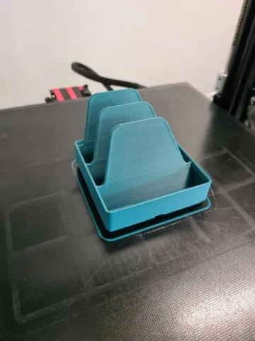</a> 
<b>2 x 2 Gridfinity Nippers Rack</b> 
by mindfest 
<a href="https://www.printables.com/model/237185-2-x-2-gridfinity-nippers-rack">Printables</a> &middot; <a href="2-x-2-gridfinity-nippers-rack-model_files">Repo folder</a>
</td>
<td width="33%" align="center" valign="top">
<a href="caliper-stand-for-gridfinity-model_files">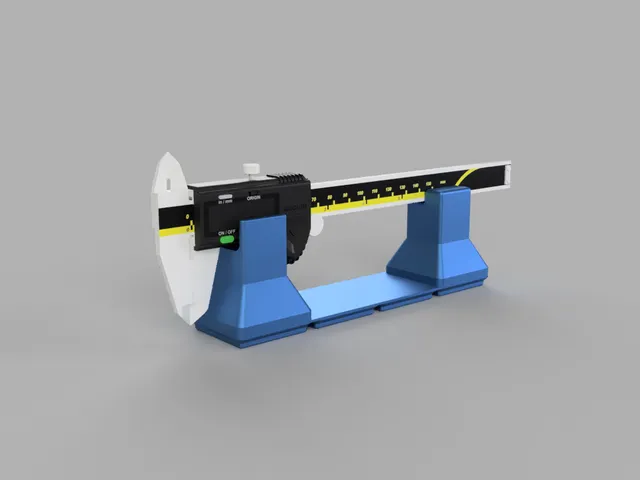</a> 
<b>Caliper Stand for Gridfinity</b> 
by Clay 
<a href="https://www.printables.com/model/335654-caliper-stand-for-gridfinity">Printables</a> &middot; <a href="caliper-stand-for-gridfinity-model_files">Repo folder</a>
</td>
<td width="33%" align="center" valign="top">
<a href="Fast%2B-%2BALL%2BScrewdriver%2Bv6.3mf">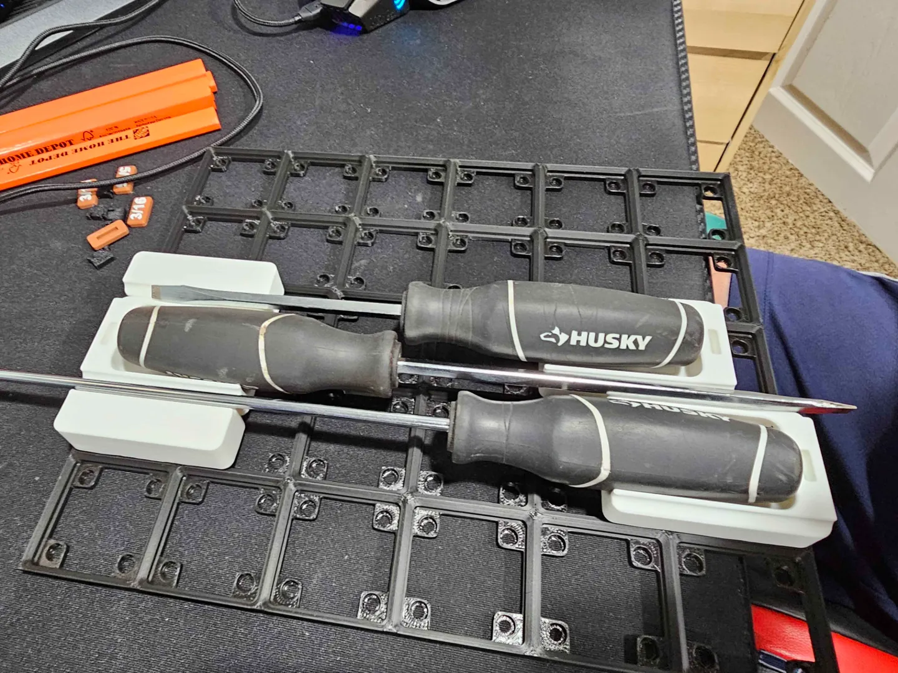</a> 
<b>Fast - ALL Screwdriver v6</b> 
<a href="https://makerworld.com/en/search/models?keyword=Fast%20-%20ALL%20Screwdriver%20v6">Search MakerWorld</a> &middot; <a href="Fast%2B-%2BALL%2BScrewdriver%2Bv6.3mf">Fast+-+ALL+Screwdriver+v6.3mf</a>
</td>
</tr>
<tr>
<td width="33%" align="center" valign="top">
<i>no preview</i> 
<b>Fast - ALL Screwdriver v6</b> 
<a href="https://makerworld.com/en/search/models?keyword=Fast%20-%20ALL%20Screwdriver%20v6">Search MakerWorld</a> &middot; <a href="Fast%2B-%2BALL%2BScrewdriver%2Bv6_stls">Repo folder</a>
</td>
<td width="33%" align="center" valign="top">
<a href="ferrule-crimp-tool-gridfinity-tray-model_files">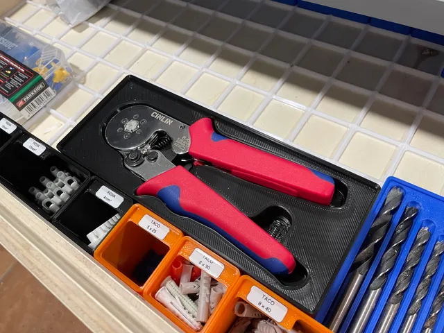</a> 
<b>Ferrule crimp tool gridfinity tray</b> 
by Miguel Camba 
<a href="https://www.printables.com/model/384125-ferrule-crimp-tool-gridfinity-tray">Printables</a> &middot; <a href="ferrule-crimp-tool-gridfinity-tray-model_files">Repo folder</a>
</td>
<td width="33%" align="center" valign="top">
<a href="gridfinity-10-piece-wrench-sorter-model_files">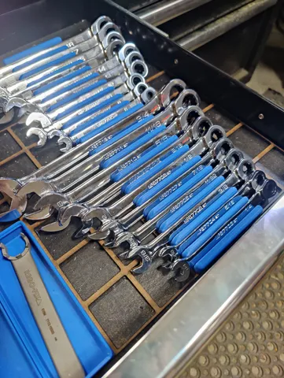</a> 
<b>Gridfinity 10 Piece Wrench Sorter</b> 
by Audacity Micro 
<a href="https://www.printables.com/model/336747-gridfinity-10-piece-wrench-sorter">Printables</a> &middot; <a href="gridfinity-10-piece-wrench-sorter-model_files">Repo folder</a>
</td>
</tr>
<tr>
<td width="33%" align="center" valign="top">
<a href="gridfinity-1x4-bondhus-hex-driver-stand-model_files">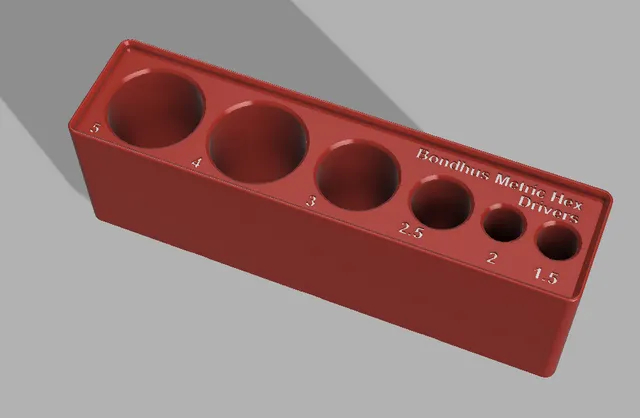</a> 
<b>Gridfinity 1x4 Bondhus Hex Driver Stand Fusion 360</b> 
by ECF 
<a href="https://www.printables.com/model/410938-gridfinity-1x4-bondhus-hex-driver-stand-fusion-360">Printables</a> &middot; <a href="gridfinity-1x4-bondhus-hex-driver-stand-model_files">Repo folder</a>
</td>
<td width="33%" align="center" valign="top">
<a href="gridfinity-adjustable-wrench-4-pc-set-organizer-model_files">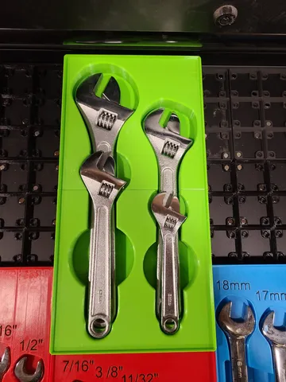</a> 
<b>Gridfinity Adjustable Wrench 4 pc Set Organizer</b> 
by Chase 
<a href="https://www.printables.com/model/469410-gridfinity-adjustable-wrench-4-pc-set-organizer">Printables</a> &middot; <a href="gridfinity-adjustable-wrench-4-pc-set-organizer-model_files">Repo folder</a>
</td>
<td width="33%" align="center" valign="top">
<a href="gridfinity-bit-holder-3x1-model_files">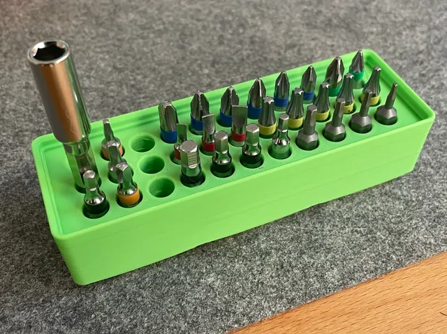</a> 
<b>Gridfinity Bit Holder 3x1</b> 
by Wolfgang Sagichnet 
<a href="https://www.printables.com/model/537829-gridfinity-bit-holder-3x1">Printables</a> &middot; <a href="gridfinity-bit-holder-3x1-model_files">Repo folder</a>
</td>
</tr>
<tr>
<td width="33%" align="center" valign="top">
<a href="gridfinity-caliper-box-model_files">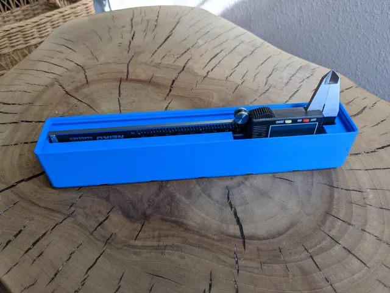</a> 
<b>Gridfinity Caliper box</b> 
by UnoriginalElephant 
<a href="https://www.printables.com/model/299953-gridfinity-caliper-box">Printables</a> &middot; <a href="gridfinity-caliper-box-model_files">Repo folder</a>
</td>
<td width="33%" align="center" valign="top">
<a href="gridfinity-caliper-holder-low-profileextra-storage-model_files">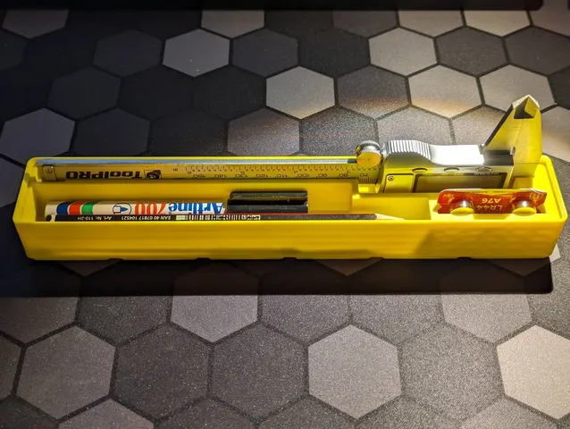</a> 
<b>Gridfinity Caliper Holder - Low profile/Extra Storage</b> 
by Nagel 
<a href="https://www.printables.com/model/567890-gridfinity-caliper-holder-low-profileextra-storage">Printables</a> &middot; <a href="gridfinity-caliper-holder-low-profileextra-storage-model_files">Repo folder</a>
</td>
<td width="33%" align="center" valign="top">
<a href="gridfinity-crimper-stand-model_files">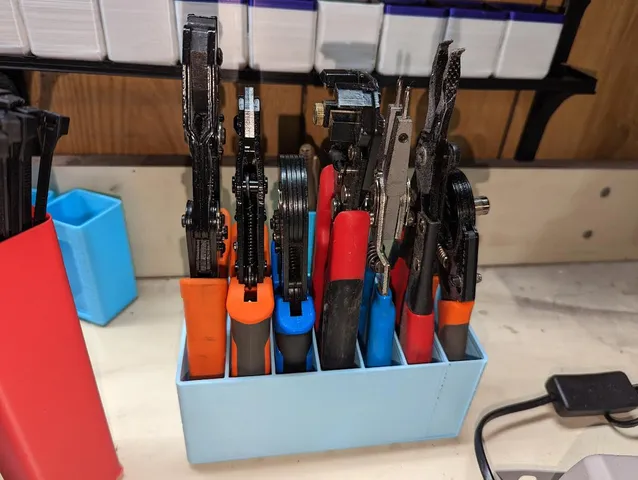</a> 
<b>Gridfinity Crimper Stand</b> 
by Beamsjr 
<a href="https://www.printables.com/model/430863-gridfinity-crimper-stand">Printables</a> &middot; <a href="gridfinity-crimper-stand-model_files">Repo folder</a>
</td>
</tr>
<tr>
<td width="33%" align="center" valign="top">
<a href="gridfinity-deburring-tool-holder-w-low-profile-blade-storage-model_files">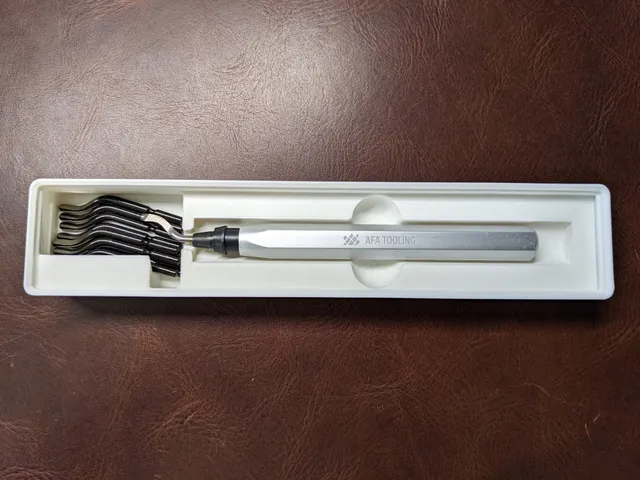</a> 
<b>Gridfinity Deburring Tool Holder w/ Low Profile Blade Storage</b> 
by Yoni 
<a href="https://www.printables.com/model/433238-gridfinity-deburring-tool-holder-w-low-profile-bla">Printables</a> &middot; <a href="gridfinity-deburring-tool-holder-w-low-profile-blade-storage-model_files">Repo folder</a>
</td>
<td width="33%" align="center" valign="top">
<a href="gridfinity-deburring-tool-holder-with-blade-storage-model_files">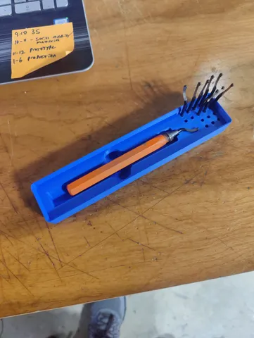</a> 
<b>Gridfinity Deburring Tool Holder with Blade Storage</b> 
by Audacity Micro 
<a href="https://www.printables.com/model/343059-gridfinity-deburring-tool-holder-with-blade-storag">Printables</a> &middot; <a href="gridfinity-deburring-tool-holder-with-blade-storage-model_files">Repo folder</a>
</td>
<td width="33%" align="center" valign="top">
<i>no preview</i> 
<b>Gridfinity Dremel Bit Storage</b> 
<a href="https://www.printables.com/model/502366">Printables</a> &middot; <a href="gridfinity-dremel-bit-storage-model_files">Repo folder</a>
</td>
</tr>
<tr>
<td width="33%" align="center" valign="top">
<a href="gridfinity-dremel-bit-storage-print_files">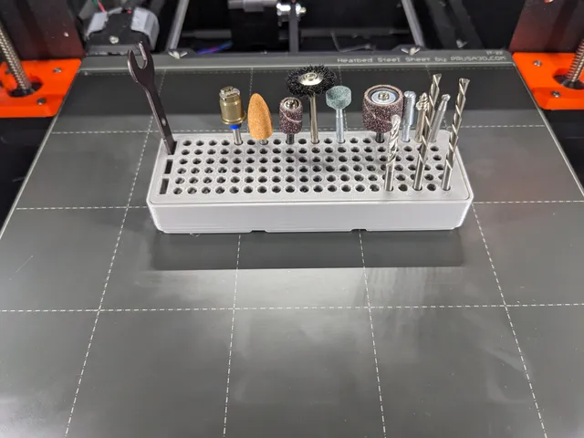</a> 
<b>Gridfinity dremel bit storage</b> 
by Fraham 
<a href="https://www.printables.com/model/375874-gridfinity-dremel-bit-storage">Printables</a> &middot; <a href="gridfinity-dremel-bit-storage-print_files">Repo folder</a>
</td>
<td width="33%" align="center" valign="top">
<a href="gridfinity-hex-bit-holders-with-larger-hex-holes-model_files">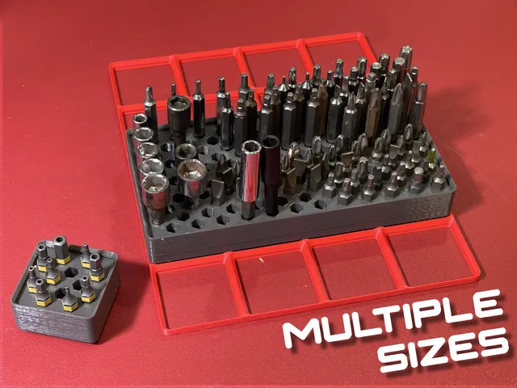</a> 
<b>Gridfinity Hex Bit Holders with Larger Hex Holes</b> 
by Tache 
<a href="https://www.printables.com/model/454375-gridfinity-hex-bit-holders-with-larger-hex-holes">Printables</a> &middot; <a href="gridfinity-hex-bit-holders-with-larger-hex-holes-model_files">Repo folder</a>
</td>
<td width="33%" align="center" valign="top">
<a href="gridfinity-needle-file-tray-model_files">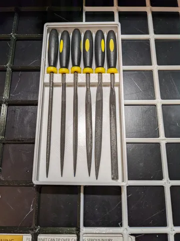</a> 
<b>Gridfinity Needle File Tray</b> 
by UnoriginalElephant 
<a href="https://www.printables.com/model/298086-gridfinity-needle-file-tray">Printables</a> &middot; <a href="gridfinity-needle-file-tray-model_files">Repo folder</a>
</td>
</tr>
<tr>
<td width="33%" align="center" valign="top">
<a href="Gridfinity%20Nippers%20Strippers%20Pliers%20Racks">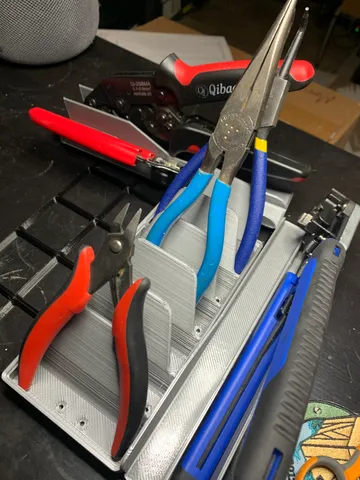</a> 
<b>Gridfinity Nippers + Strippers + Pliers Racks</b> 
by CmdrMoto 
<a href="https://www.printables.com/model/173342-gridfinity-nippers-strippers-pliers-racks">Printables</a> &middot; <a href="Gridfinity%20Nippers%20Strippers%20Pliers%20Racks">Repo folder</a>
</td>
<td width="33%" align="center" valign="top">
<i>no preview</i> 
<b>Gridfinity Parametric Bit Holders</b> 
Source unknown &middot; <a href="Gridfinity%20Parametric%20Bit%20Holders">Repo folder</a>
</td>
<td width="33%" align="center" valign="top">
<i>no preview</i> 
<b>Gridfinity Pick Tweezer Racks</b> 
Source unknown &middot; <a href="Gridfinity%20Pick%20Tweezer%20Racks">Repo folder</a>
</td>
</tr>
<tr>
<td width="33%" align="center" valign="top">
<a href="gridfinity-pliers-rack-model_files">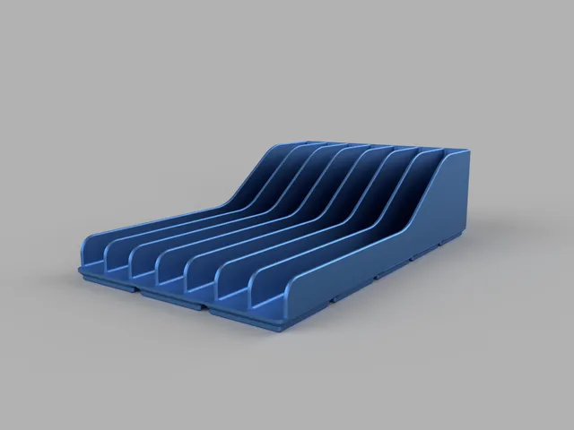</a> 
<b>Gridfinity Pliers Rack</b> 
by Clay 
<a href="https://www.printables.com/model/334247-gridfinity-pliers-rack">Printables</a> &middot; <a href="gridfinity-pliers-rack-model_files">Repo folder</a>
</td>
<td width="33%" align="center" valign="top">
<a href="gridfinity-pliers-racks-mega-pack-92-different-sizes-model_files">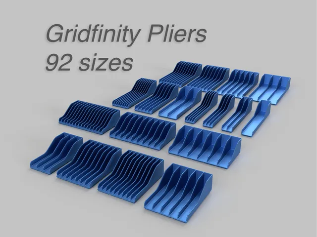</a> 
<b>Gridfinity Pliers Racks Mega Pack (92 different Sizes)</b> 
by Clay 
<a href="https://www.printables.com/model/493770-gridfinity-pliers-racks-mega-pack-92-different-siz">Printables</a> &middot; <a href="gridfinity-pliers-racks-mega-pack-92-different-sizes-model_files">Repo folder</a>
</td>
<td width="33%" align="center" valign="top">
<a href="gridfinity-pliers-wrack-small-model_files">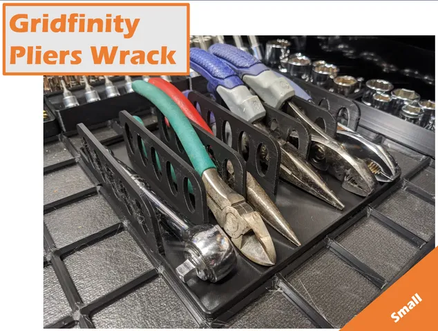</a> 
<b>Gridfinity Pliers Wrack (Small)</b> 
by SailorJerry 
<a href="https://www.printables.com/model/328889-gridfinity-pliers-wrack-small">Printables</a> &middot; <a href="gridfinity-pliers-wrack-small-model_files">Repo folder</a>
</td>
</tr>
<tr>
<td width="33%" align="center" valign="top">
<a href="Gridfinity%2Bpliers_tool%2Brack%2B70%2Bsizes%2B(with%2Bpin)">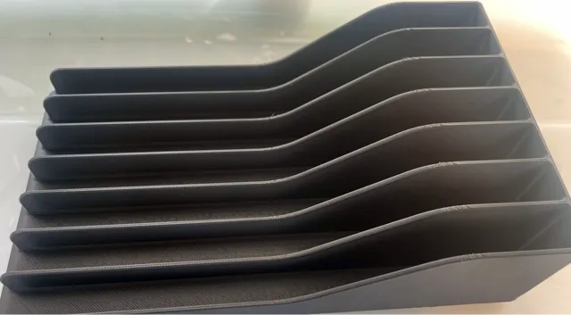</a> 
<b>Gridfinity pliers/tool rack 70 sizes (with pin)</b> 
by Demig 
<a href="https://makerworld.com/en/models/612167-gridfinity-pliers-tool-rack-70-sizes-with-pin">MakerWorld</a> &middot; <a href="Gridfinity%2Bpliers_tool%2Brack%2B70%2Bsizes%2B(with%2Bpin)">Repo folder</a>
</td>
<td width="33%" align="center" valign="top">
<a href="gridfinity-ratchet-holder-hyper-tough-14-20-piece-4x3x3-model_files">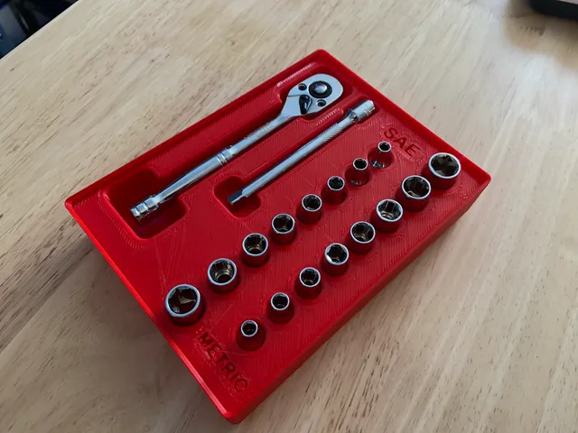</a> 
<b>Gridfinity Ratchet Holder - Hyper Tough 1/4 20-Piece - 4x3x3</b> 
by ed3d 
<a href="https://www.printables.com/model/494188-gridfinity-ratchet-holder-hyper-tough-14-20-piece-">Printables</a> &middot; <a href="gridfinity-ratchet-holder-hyper-tough-14-20-piece-4x3x3-model_files">Repo folder</a>
</td>
<td width="33%" align="center" valign="top">
<a href="gridfinity-sandpaperholder-model_files">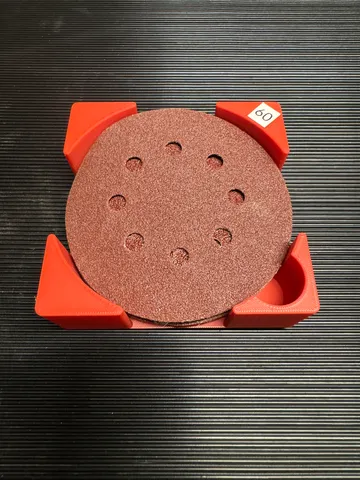</a> 
<b>Gridfinity Sandpaperholder</b> 
by Another Alex 
<a href="https://www.printables.com/model/773618-gridfinity-sandpaperholder">Printables</a> &middot; <a href="gridfinity-sandpaperholder-model_files">Repo folder</a>
</td>
</tr>
<tr>
<td width="33%" align="center" valign="top">
<a href="gridfinity-socket-holders-14-and-38-model_files">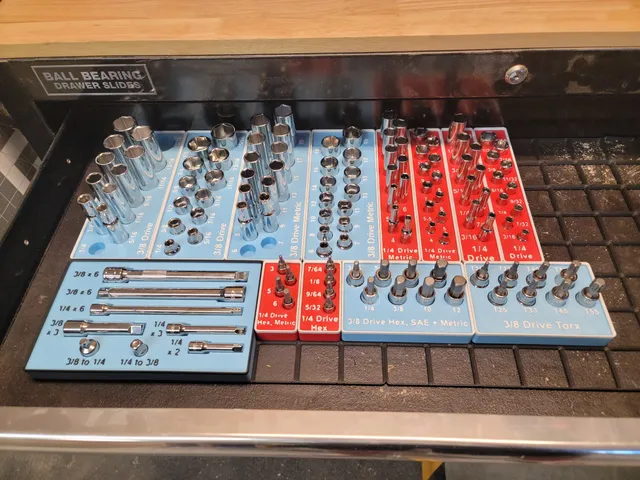</a> 
<b>Gridfinity Socket Holders, 1/4&quot; and 3/8&quot;</b> 
by jcj99 
<a href="https://www.printables.com/model/614374-gridfinity-socket-holders-14-and-38">Printables</a> &middot; <a href="gridfinity-socket-holders-14-and-38-model_files">Repo folder</a>
</td>
<td width="33%" align="center" valign="top">
<a href="gridfinity-storage-for-7-piece-bondhus-balldriver-set-model_files">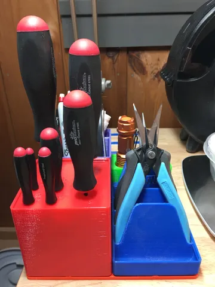</a> 
<b>Gridfinity Storage For 7 Piece Bondhus Balldriver Set</b> 
by Brenda 
<a href="https://www.printables.com/model/325049-gridfinity-storage-for-7-piece-bondhus-balldriver-">Printables</a> &middot; <a href="gridfinity-storage-for-7-piece-bondhus-balldriver-set-model_files">Repo folder</a>
</td>
<td width="33%" align="center" valign="top">
<a href="gridfinity-tool-holder-collection-model_files">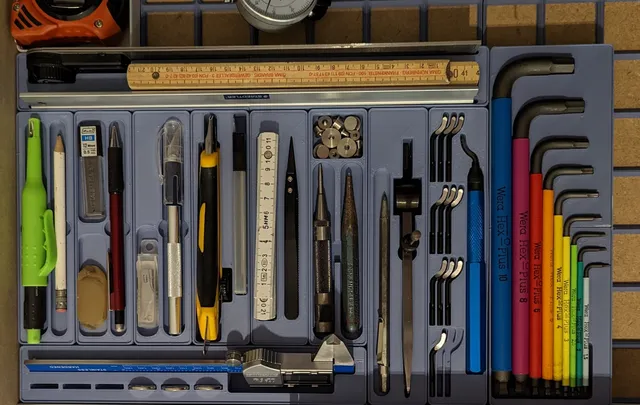</a> 
<b>Gridfinity tool holder collection</b> 
by Barebaric 
<a href="https://www.printables.com/model/301673-gridfinity-tool-holder-collection">Printables</a> &middot; <a href="gridfinity-tool-holder-collection-model_files">Repo folder</a>
</td>
</tr>
<tr>
<td width="33%" align="center" valign="top">
<a href="Gridfinity%20Toolbox%20Parametric">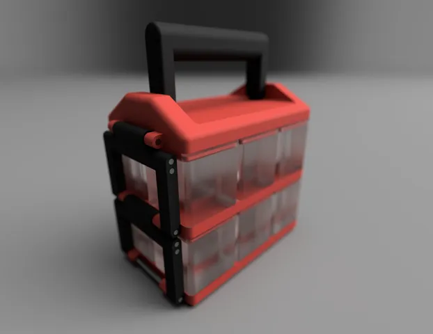</a> 
<b>Gridfinity Toolbox (Parametric)</b> 
by classy 
<a href="https://www.printables.com/model/204907-gridfinity-toolbox-parametric">Printables</a> &middot; <a href="Gridfinity%20Toolbox%20Parametric">Repo folder</a>
</td>
<td width="33%" align="center" valign="top">
<a href="Gridfinity%2BUniversal%2BWera%2BScrewdriver%2BInserts">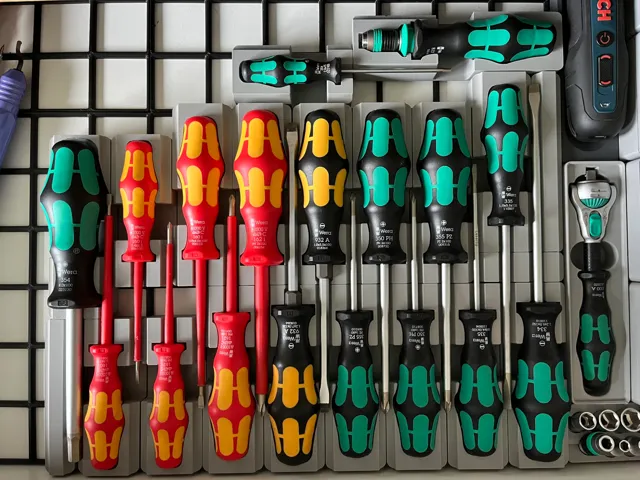</a> 
<b>Gridfinity Universal Wera Screwdriver Inserts</b> 
by Scubafan 
<a href="https://makerworld.com/en/models/475390-gridfinity-universal-wera-screwdriver-inserts">MakerWorld</a> &middot; <a href="Gridfinity%2BUniversal%2BWera%2BScrewdriver%2BInserts">Repo folder</a>
</td>
<td width="33%" align="center" valign="top">
<a href="gridfinity-wera-hex-organiser-model_files">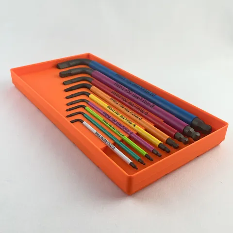</a> 
<b>Gridfinity Wera Hex Organiser</b> 
by nickd 
<a href="https://www.printables.com/model/711886-gridfinity-wera-hex-organiser">Printables</a> &middot; <a href="gridfinity-wera-hex-organiser-model_files">Repo folder</a>
</td>
</tr>
<tr>
<td width="33%" align="center" valign="top">
<a href="gridfinity-wera-kraftform-micro-holder-model_files">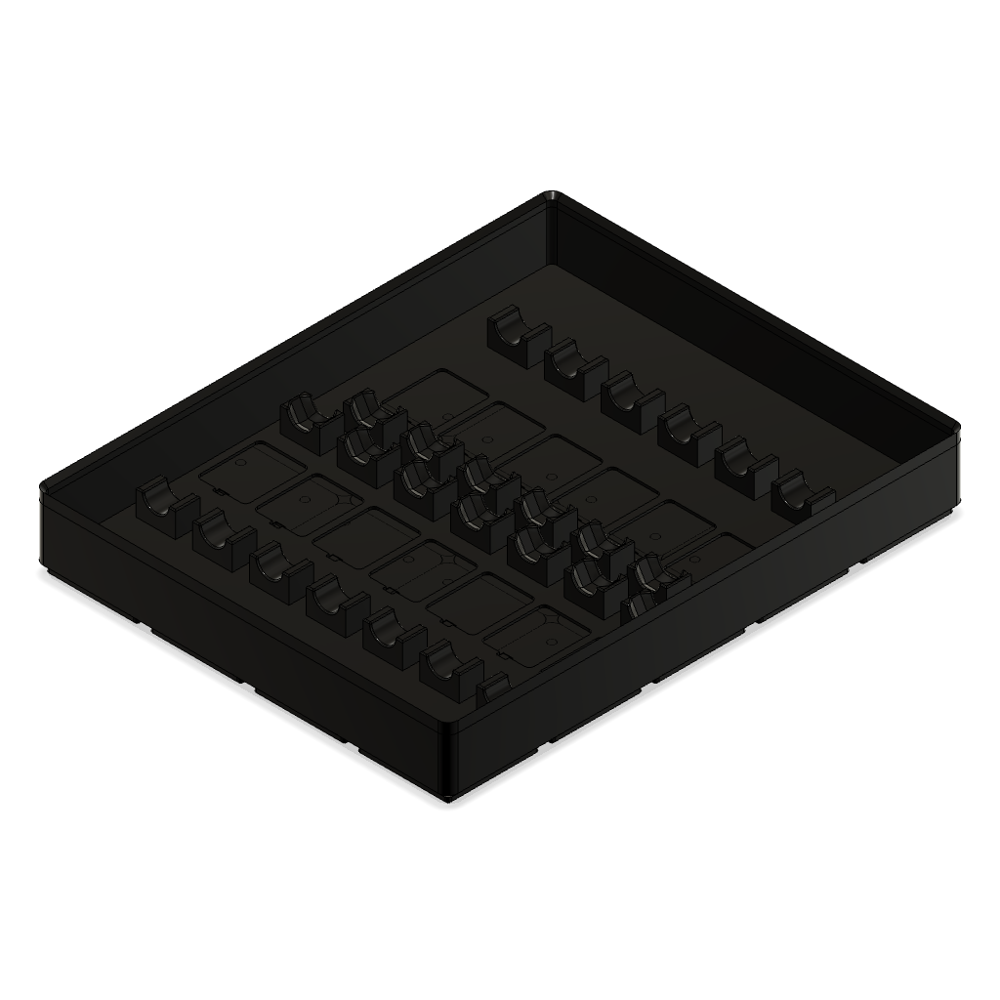</a> 
<b>Gridfinity Wera Kraftform Micro Holder</b> 
<a href="https://www.printables.com/model/452194">Printables</a> &middot; <a href="gridfinity-wera-kraftform-micro-holder-model_files">Repo folder</a>
</td>
<td width="33%" align="center" valign="top">
<a href="gridfinity-wera-screwdriver-holder-model_files">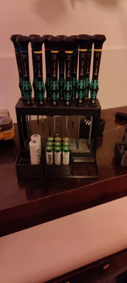</a> 
<b>Gridfinity Wera screwdriver holder</b> 
by RWMH 
<a href="https://www.printables.com/model/232947-gridfinity-wera-screwdriver-holder">Printables</a> &middot; <a href="gridfinity-wera-screwdriver-holder-model_files">Repo folder</a>
</td>
<td width="33%" align="center" valign="top">
<i>no preview</i> 
<b>Gridfinity Wrench Holders Thicker</b> 
<a href="https://www.printables.com/model/290360">Printables</a> &middot; <a href="gridfinity-wrench-holders-thicker-model_files">Repo folder</a>
</td>
</tr>
<tr>
<td width="33%" align="center" valign="top">
<a href="gridfinity-neiko-calipers.3mf">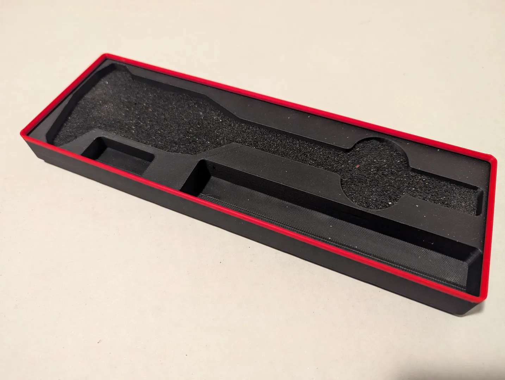</a> 
<b>gridfinity-neiko-calipers</b> 
Source unknown &middot; <a href="gridfinity-neiko-calipers.3mf">gridfinity-neiko-calipers.3mf</a>
</td>
<td width="33%" align="center" valign="top">
<a href="low-profile-gridfinity-pittsburgh-combination-wrench-set-holder-model_files">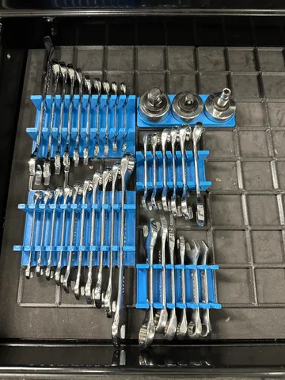</a> 
<b>Low Profile Gridfinity Pittsburgh Combination Wrench Set Holder</b> 
by YucA 
<a href="https://www.printables.com/model/466372-low-profile-gridfinity-pittsburgh-combination-wren">Printables</a> &middot; <a href="low-profile-gridfinity-pittsburgh-combination-wrench-set-holder-model_files">Repo folder</a>
</td>
<td width="33%" align="center" valign="top">
<a href="Modular_chisel_rack_system_4559163">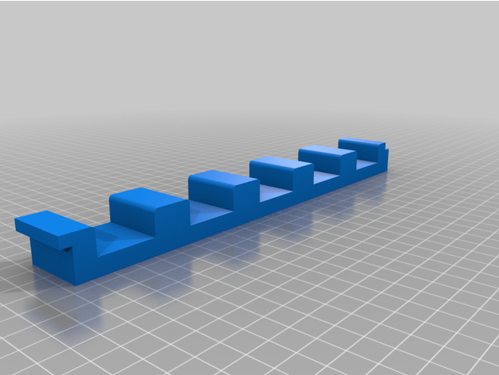</a> 
<b>Modular chisel rack system</b> 
by A513055 
<a href="https://www.thingiverse.com/thing:4559163">Thingiverse</a> &middot; <a href="Modular_chisel_rack_system_4559163">Repo folder</a>
</td>
</tr>
<tr>
<td width="33%" align="center" valign="top">
<a href="Plier%2BSet%2BHolder%2BGridfinity%2B(shows%2BTekton)">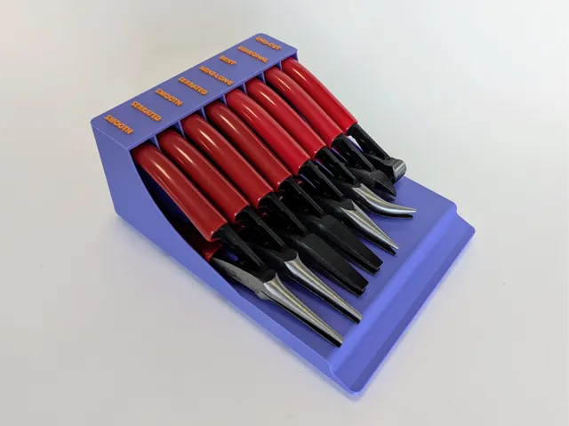</a> 
<b>Plier Set Holder Gridfinity (shows Tekton)</b> 
by Dave.the.Borg 
<a href="https://makerworld.com/en/models/1046951-plier-set-holder-gridfinity-shows-tekton">MakerWorld</a> &middot; <a href="Plier%2BSet%2BHolder%2BGridfinity%2B(shows%2BTekton)">Repo folder</a>
</td>
</tr>
</table>

Other files in this folder (7)

- [amazing-gridfinity-m3-bolt-sorter-model_files.zip](amazing-gridfinity-m3-bolt-sorter-model_files.zip)
- [byob-gridfinity-screw-sorter-bring-your-own-bins-model_files.zip](byob-gridfinity-screw-sorter-bring-your-own-bins-model_files.zip)
- [Debur Case Gridfinity.stl](Debur%20Case%20Gridfinity.stl)
- [gridfinity-5in-sanding-disc-holder.stl](gridfinity-5in-sanding-disc-holder.stl)
- [Round+Tool+Holding+Inserts+for+Gridfinity+Bins.zip](Round%2BTool%2BHolding%2BInserts%2Bfor%2BGridfinity%2BBins.zip)
- [wera holder - Daave Remix.stl](wera%20holder%20-%20Daave%20Remix.stl)
- [wera-l-key-gridfinity-holders-model_files.zip](wera-l-key-gridfinity-holders-model_files.zip)

