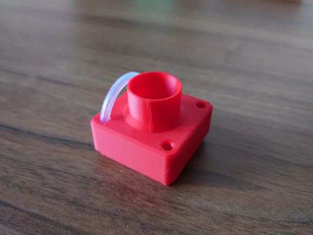
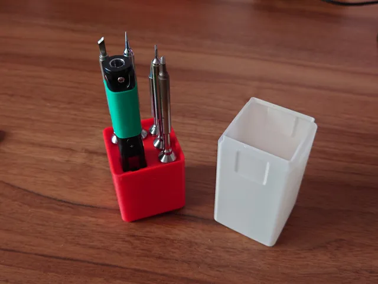
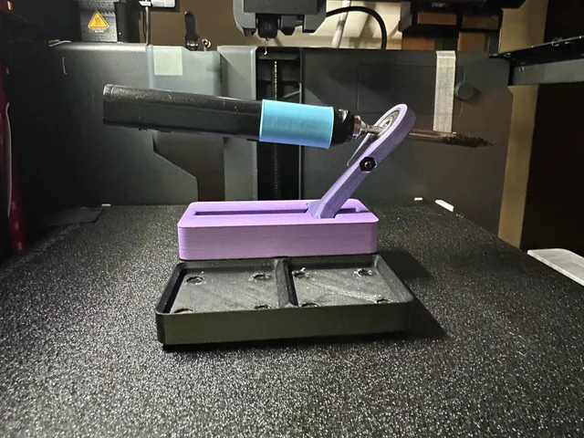
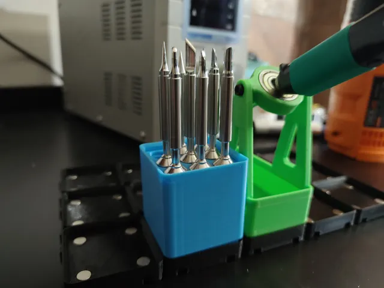
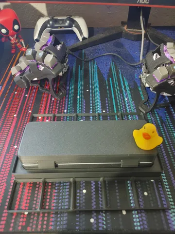
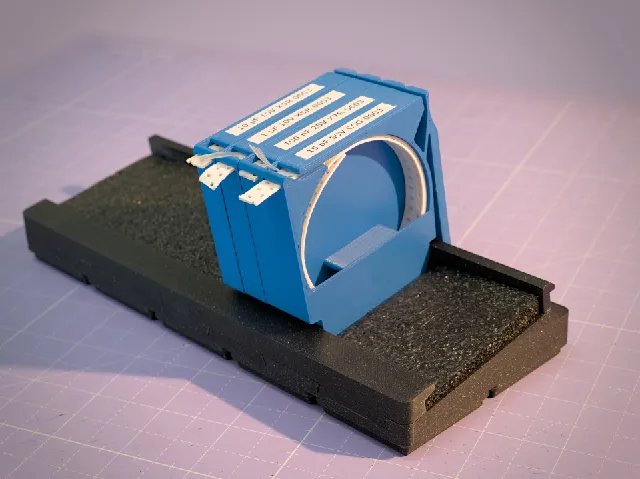
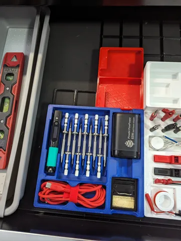
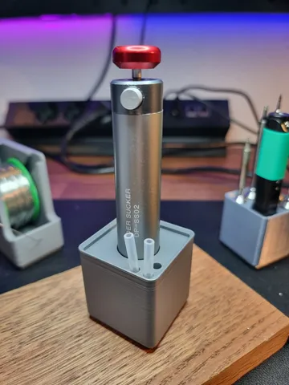

# Soldering

<!-- Generated by scripts/Update-Readmes.ps1 (Linux: scripts/update_readmes.py) - edit scripts/readme-sources.json and rerun instead of editing by hand. -->

[Home](../../../../../README.md) / [Storage](../../../../README.md) / [Systems](../../../README.md) / [Gridfinity](../../README.md) / [Tool Holders](../README.md) / **Soldering**

11 builds &middot; 8 Printables &middot; 3 unknown source

## Soldering

<table>
<tr>
<td width="33%" align="center" valign="top">
 
<b>Gridfinity Engineer SS-02 stand</b> 
by Waschtl 
<a href="https://www.printables.com/model/258113-gridfinity-engineer-ss-02-stand">Printables</a> &middot; <a href="gridfinity-engineer-ss-02-stand-model_files">Repo folder</a>
</td>
<td width="33%" align="center" valign="top">
 
<b>Gridfinity Pinecil &amp; Tip holder</b> 
by Waschtl 
<a href="https://www.printables.com/model/266923-gridfinity-pinecil-tip-holder">Printables</a> &middot; <a href="gridfinity-pinecil-tip-holder-model_files">Repo folder</a>
</td>
<td width="33%" align="center" valign="top">
 
<b>Gridfinity Pinecil / TS100 Stand</b> 
by Alex Is Making Things 
<a href="https://www.printables.com/model/479749-gridfinity-pinecil-ts100-stand">Printables</a> &middot; <a href="gridfinity-pinecil-ts100-stand-model_files">Repo folder</a>
</td>
</tr>
<tr>
<td width="33%" align="center" valign="top">
 
<b>Gridfinity Pinecil 9 Tip Holder</b> 
by Software2 
<a href="https://www.printables.com/model/435688-gridfinity-pinecil-9-tip-holder">Printables</a> &middot; <a href="gridfinity-pinecil-9-tip-holder-model_files">Repo folder</a>
</td>
<td width="33%" align="center" valign="top">
 
<b>Gridfinity Pinecil Case Holder</b> 
by beard_of_confusion 
<a href="https://www.printables.com/model/243950-gridfinity-pinecil-case-holder">Printables</a> &middot; <a href="gridfinity-pinecil-case-holder-model_files">Repo folder</a>
</td>
<td width="33%" align="center" valign="top">
 
<b>Gridfinity x SMD Magazine</b> 
by CmdrEmily 
<a href="https://www.printables.com/model/436079-gridfinity-x-smd-magazine">Printables</a> &middot; <a href="gridfinity-x-smd-magazine-model_files">Repo folder</a>
</td>
</tr>
<tr>
<td width="33%" align="center" valign="top">
 
<b>Pinecil organizer with Gridfinity support</b> 
by Kieran E 
<a href="https://www.printables.com/model/525429-pinecil-organizer-with-gridfinity-support">Printables</a> &middot; <a href="pinecil-organizer-with-gridfinity-support-model_files">Repo folder</a>
</td>
<td width="33%" align="center" valign="top">
 
<b>solder sucker ss-02 gridfinity</b> 
by LutraVulgaris 
<a href="https://www.printables.com/model/527736-solder-sucker-ss-02-gridfinity">Printables</a> &middot; <a href="solder-sucker-ss-02-gridfinity-model_files">Repo folder</a>
</td>
</tr>
</table>

Other files in this folder (3)

- [6x Solder Wire Spool Holder 3x2.stl](6x%20Solder%20Wire%20Spool%20Holder%203x2.stl)
- [Gridfinity_Engineer_SS-02.stl](Gridfinity_Engineer_SS-02.stl)
- [Pinecil-5-tips.stl](Pinecil-5-tips.stl)

