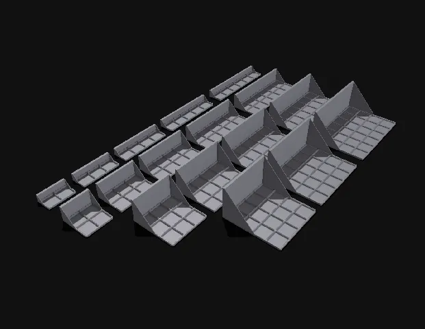
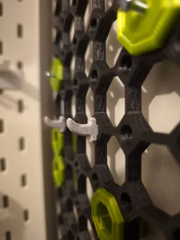
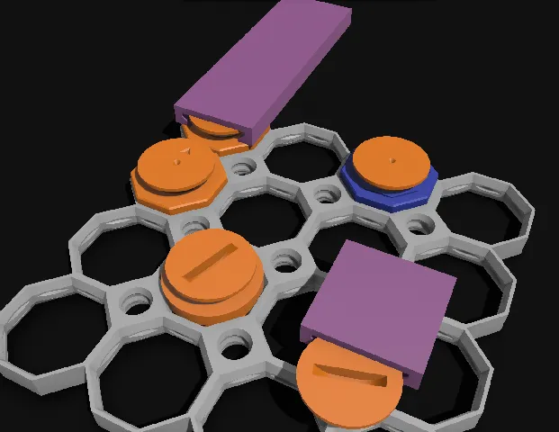
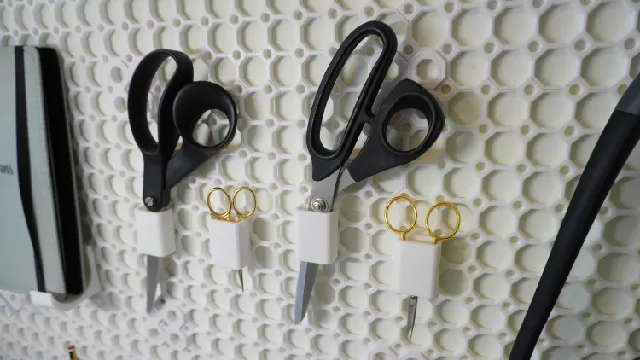
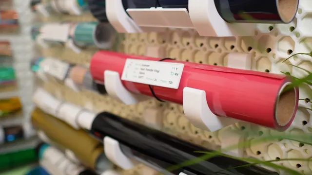

# Multiboard

<!-- Generated by scripts/Update-Readmes.ps1 (Linux: scripts/update_readmes.py) - edit scripts/readme-sources.json and rerun instead of editing by hand. -->

[Home](../../../README.md) / [Storage](../../README.md) / [Systems](../README.md) / **Multiboard**

7 builds &middot; 5 Printables &middot; 2 unknown source

## Multiboard

<table>
<tr>
<td width="33%" align="center" valign="top">
 
<b>Multiboard gridfinify shelves</b> 
by David D 
<a href="https://www.printables.com/model/710796-multiboard-gridfinify-shelves">Printables</a> &middot; <a href="multiboard-gridfinify-shelves-model_files">Repo folder</a>
</td>
<td width="33%" align="center" valign="top">
 
<b>Multiboard Hook Pin</b> 
by Kunzite 
<a href="https://www.printables.com/model/749809-multiboard-hook-pin">Printables</a> &middot; <a href="multiboard-hook-pin-model_files">Repo folder</a>
</td>
<td width="33%" align="center" valign="top">
 
<b>Raised Multiconnect - generic connector for multiboard v2</b> 
by David D 
<a href="https://www.printables.com/model/1074671-raised-multiconnect-generic-connector-for-multiboa">Printables</a> &middot; <a href="multiconnect-generic-connector-for-multiboard-v2-model_files">Repo folder</a>
</td>
</tr>
<tr>
<td width="33%" align="center" valign="top">
 
<b>Scissors Holder for Multiboard</b> 
by Hands on Katie 
<a href="https://www.printables.com/model/902055-scissors-holder-for-multiboard">Printables</a> &middot; <a href="scissors-holder-for-multiboard-model_files">Repo folder</a>
</td>
<td width="33%" align="center" valign="top">
 
<b>Set of Hooks for Multiboard (Multiple Sizes)</b> 
by Hands on Katie 
<a href="https://www.printables.com/model/906926-set-of-hooks-for-multiboard-multiple-sizes">Printables</a> &middot; <a href="set-of-hooks-for-multiboard-multiple-sizes-model_files">Repo folder</a>
</td>
<td width="33%" align="center" valign="top">
<i>no preview</i> 
<b>Snaps</b> 
Source unknown &middot; <a href="snaps">Repo folder</a>
</td>
</tr>
<tr>
<td width="33%" align="center" valign="top">
<i>no preview</i> 
<b>Tiles</b> 
Source unknown &middot; <a href="tiles">Repo folder</a>
</td>
</tr>
</table>

