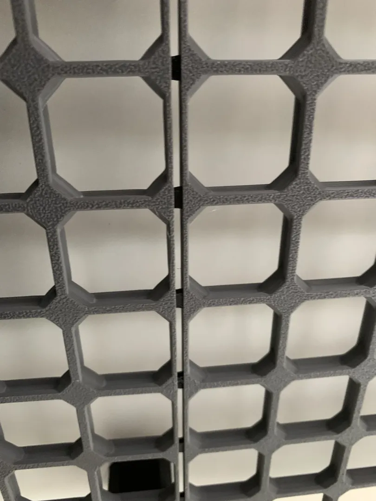
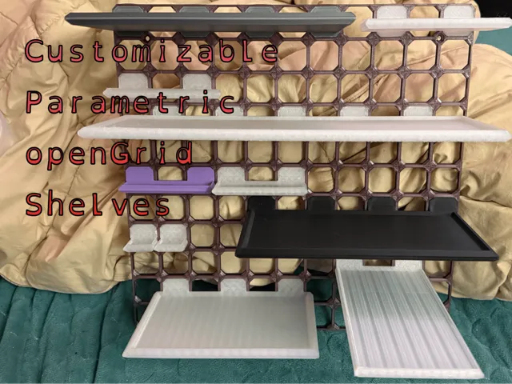
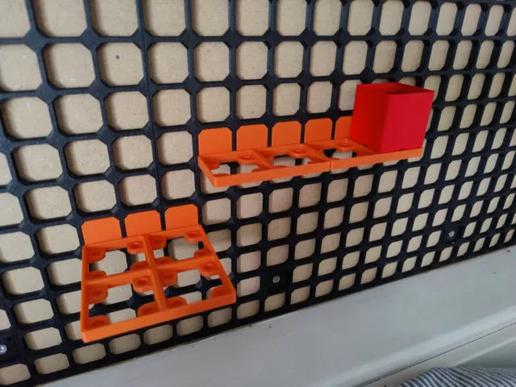
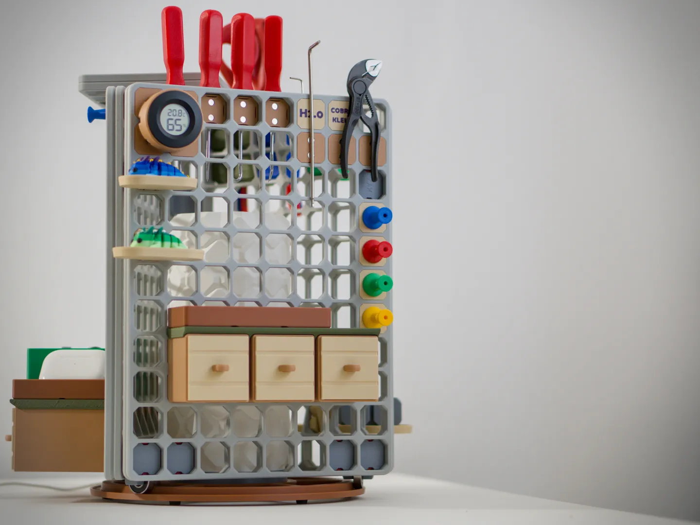
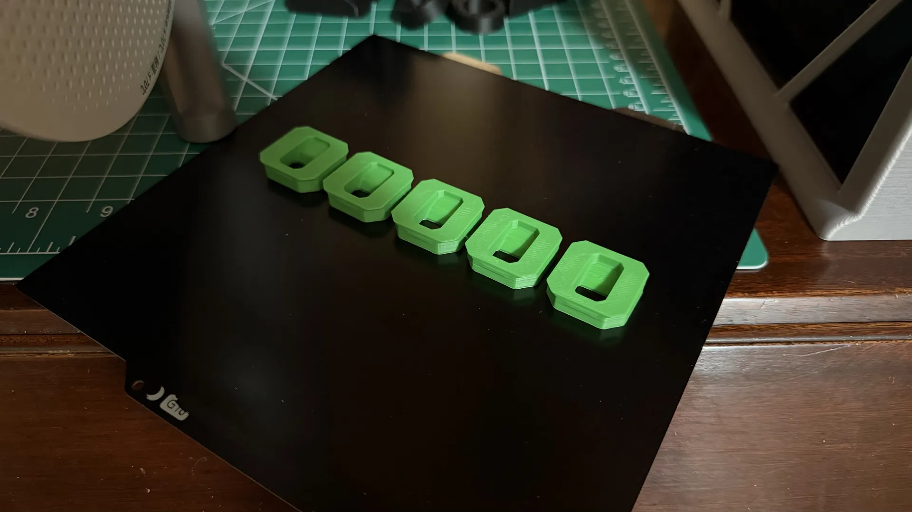
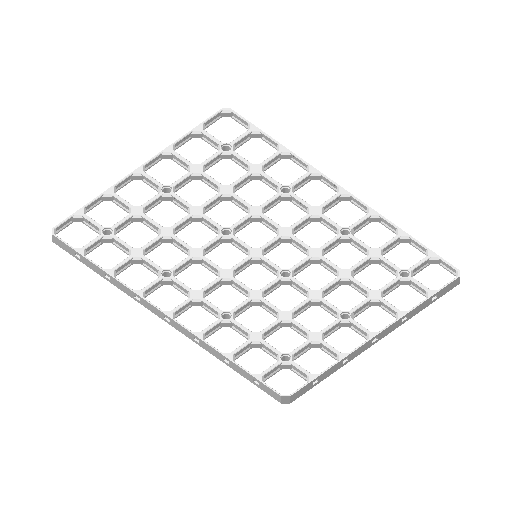
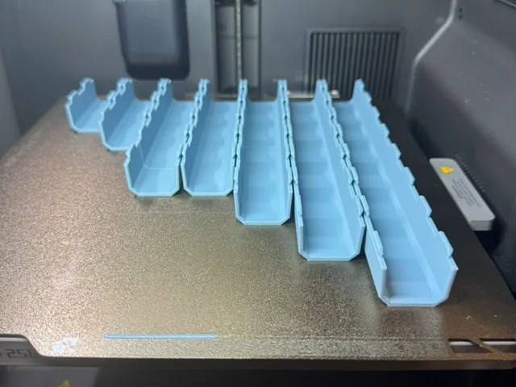
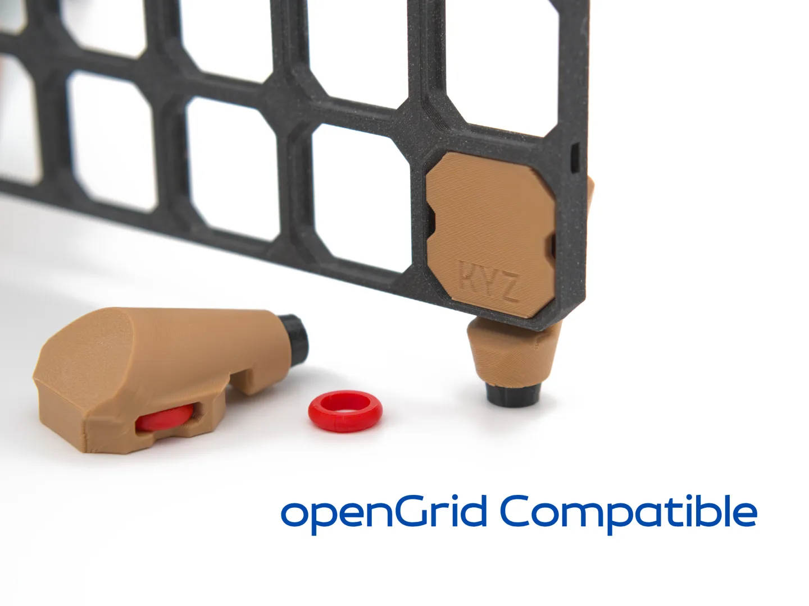
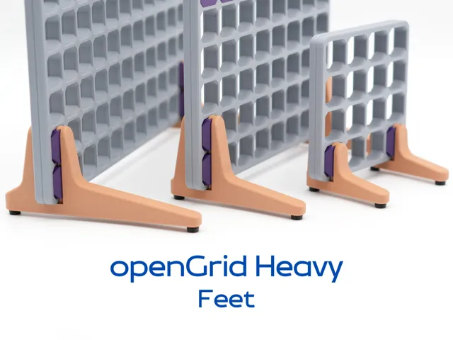

# Opengrid

<!-- Generated by scripts/Update-Readmes.ps1 (Linux: scripts/update_readmes.py) - edit scripts/readme-sources.json and rerun instead of editing by hand. -->

[Home](../../../README.md) / [Storage](../../README.md) / [Systems](../README.md) / **Opengrid**

11 builds &middot; 7 MakerWorld &middot; 4 unknown source &middot; 6 collections (30 more builds)

## Collections

- [Cable Organization](cable-organization/README.md) - 13 builds
- [Collections](collections/README.md) - 4 builds
- [Connectors](connectors/README.md) - 2 builds
- [Grids](grids/README.md) - 4 builds
- [Kyz Tool Tower](kyz-tool-tower/README.md) - 3 builds
- [Snaps](snaps/README.md) - 4 builds

## Contents

- [Collections](#collections)
- [Opengrid](#opengrid) (8)
- [Channels](#channels) (1)
- [Feet](#feet) (2)

## Opengrid

<table>
<tr>
<td width="33%" align="center" valign="top">
 
<b>ConnectorClampingToolx2</b> 
Source unknown &middot; <a href="ConnectorClampingToolx2.3mf">ConnectorClampingToolx2.3mf</a>
</td>
<td width="33%" align="center" valign="top">
 
<b>Customizable openGrid Shelves</b> 
by Mikey Ward 
<a href="https://makerworld.com/en/models/1507711-customizable-opengrid-shelves">MakerWorld</a> &middot; <a href="Customizable%2BopenGrid%2BShelves">Repo folder</a>
</td>
<td width="33%" align="center" valign="top">
 
<b>Gridfinity shelf for openGrid</b> 
by Jan 
<a href="https://makerworld.com/en/models/1452662-gridfinity-shelf-for-opengrid">MakerWorld</a> &middot; <a href="Gridfinity%2Bshelf%2Bfor%2BopenGrid">Repo folder</a>
</td>
</tr>
<tr>
<td width="33%" align="center" valign="top">
<i>no preview</i> 
<b>KYZ oG Dovetail Fittings</b> 
<a href="https://makerworld.com/en/search/models?keyword=KYZ%20oG%20Dovetail%20Fittings">Search MakerWorld</a> &middot; <a href="KYZ%2BoG%2BDovetail%2BFittings_stls">Repo folder</a>
</td>
<td width="33%" align="center" valign="top">
<i>no preview</i> 
<b>KYZ oG Vase Mode Round Cups - Standard</b> 
<a href="https://makerworld.com/en/search/models?keyword=KYZ%20oG%20Vase%20Mode%20Round%20Cups%20-%20Standard">Search MakerWorld</a> &middot; <a href="KYZ%2BoG%2BVase%2BMode%2BRound%2BCups%2B-%2BStandard_stls">Repo folder</a>
</td>
<td width="33%" align="center" valign="top">
 
<b>KYZ Tool Tower</b> 
<a href="https://makerworld.com/en/search/models?keyword=KYZ%20Tool%20Tower">Search MakerWorld</a> &middot; <a href="KYZ%2BTool%2BTower.3mf">KYZ+Tool+Tower.3mf</a>
</td>
</tr>
<tr>
<td width="33%" align="center" valign="top">
 
<b>Mounts</b> 
Source unknown &middot; <a href="mounts">Repo folder</a>
</td>
<td width="33%" align="center" valign="top">
 
<b>Personalized</b> 
Source unknown &middot; <a href="personalized">Repo folder</a>
</td>
</tr>
</table>

## Channels

<table>
<tr>
<td width="33%" align="center" valign="top">
 
<b>Opengrid Flared Underware Channels All Lengths</b> 
by WaffleWorks 
<a href="https://makerworld.com/en/models/2223087-opengrid-flared-underware-channels-all-lengths">MakerWorld</a> &middot; <a href="channels/Opengrid%2BFlared%2BUnderware%2BChannels%2BAll%2BLengths">Repo folder</a>
</td>
</tr>
</table>

## Feet

<table>
<tr>
<td width="33%" align="center" valign="top">
 
<b>OG_Edge_Feet</b> 
Source unknown &middot; <a href="feet/OG_Edge_Feet.3mf">OG_Edge_Feet.3mf</a>
</td>
<td width="33%" align="center" valign="top">
 
<b>openGrid Heavy - Feet</b> 
by KYZ Design 
<a href="https://makerworld.com/en/models/1806063-opengrid-heavy-feet">MakerWorld</a> &middot; <a href="feet/openGrid%2BHeavy%2B-%2BFeet">Repo folder</a>
</td>
</tr>
</table>

