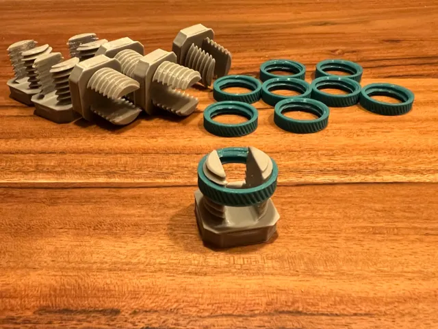
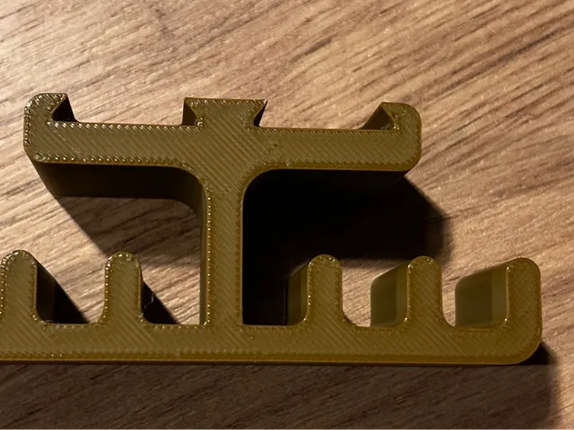
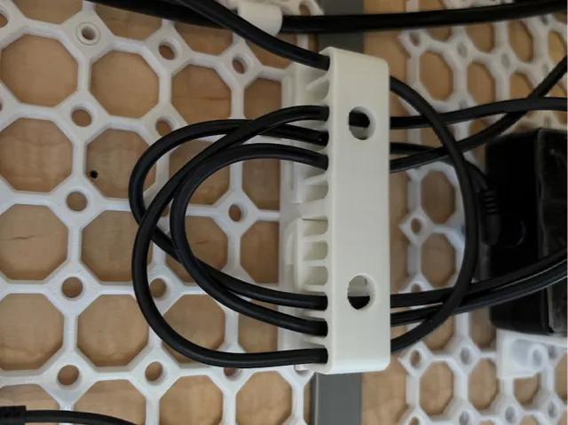
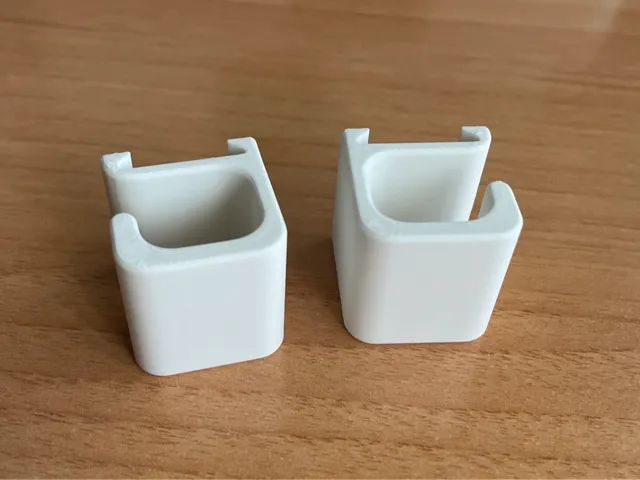
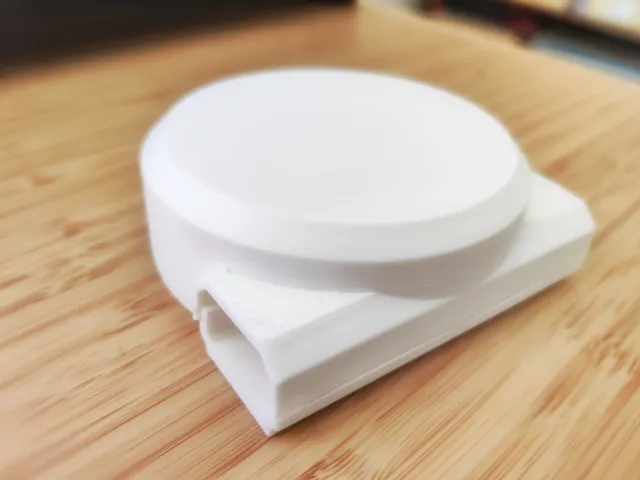
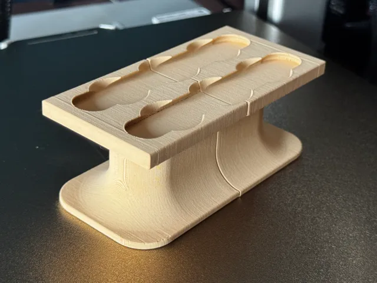
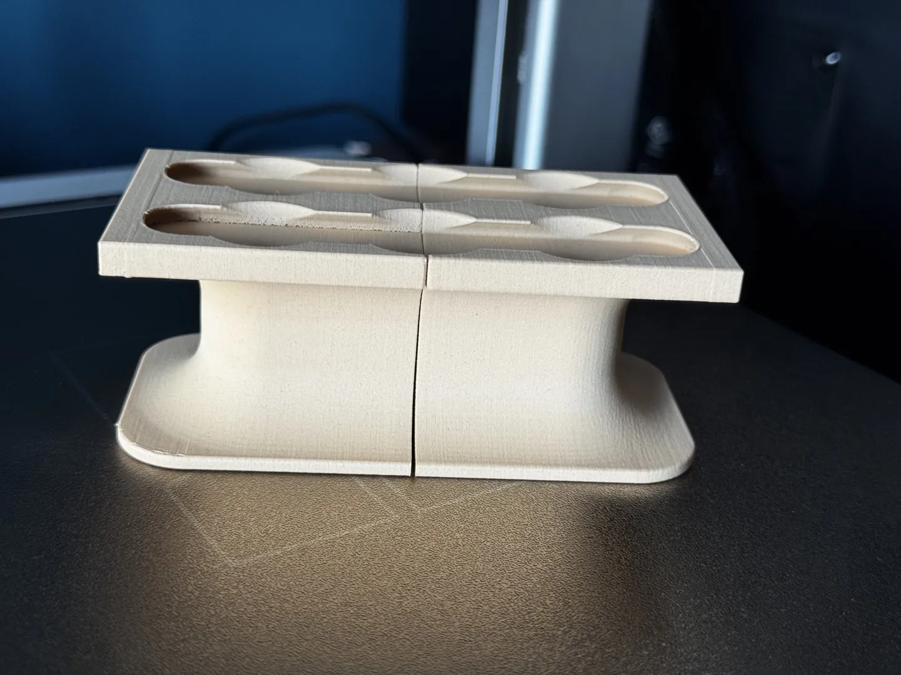

# Cable Organization

<!-- Generated by scripts/Update-Readmes.ps1 (Linux: scripts/update_readmes.py) - edit scripts/readme-sources.json and rerun instead of editing by hand. -->

[Home](../../../../README.md) / [Storage](../../../README.md) / [Systems](../../README.md) / [Opengrid](../README.md) / **Cable Organization**

13 builds &middot; 11 MakerWorld &middot; 2 unknown source

## Cable Organization

<table>
<tr>
<td width="33%" align="center" valign="top">
 
<b>Cable Clamp for OpenGrid / Underware</b> 
by Tim 
<a href="https://makerworld.com/en/models/1870669-cable-clamp-for-opengrid-underware">MakerWorld</a> &middot; <a href="Cable%2BClamp%2Bfor%2BOpenGrid%2B_%2BUnderware">Repo folder</a>
</td>
<td width="33%" align="center" valign="top">
 
<b>Cable holder for opengrid [Parametric]</b> 
by loki29pl 
<a href="https://makerworld.com/en/models/1988855-cable-holder-for-opengrid-parametric">MakerWorld</a> &middot; <a href="Cable%2Bholder%2Bfor%2Bopengrid%2B%5BParametric%5D">Repo folder</a>
</td>
<td width="33%" align="center" valign="top">
<i>no preview</i> 
<b>OpenGrid Multiconnect 2x1 cable holder</b> 
<a href="https://makerworld.com/en/search/models?keyword=OpenGrid%20Multiconnect%202x1%20cable%20holder">Search MakerWorld</a> &middot; <a href="OpenGrid%2BMulticonnect%2B2x1%2Bcable%2Bholder_stls">Repo folder</a>
</td>
</tr>
<tr>
<td width="33%" align="center" valign="top">
<i>no preview</i> 
<b>PowerCableSpool</b> 
<a href="https://makerworld.com/en/search/models?keyword=PowerCableSpool">Search MakerWorld</a> &middot; <a href="PowerCableSpool_stls">Repo folder</a>
</td>
<td width="33%" align="center" valign="top">
 
<b>Rails for cables for underware/multiboard</b> 
by 駄目ｇ 
<a href="https://makerworld.com/en/models/852842-rails-for-cables-for-underware-multiboard">MakerWorld</a> &middot; <a href="Rails%2Bfor%2Bcables%2Bfor%2Bunderware_multiboard">Repo folder</a>
</td>
<td width="33%" align="center" valign="top">
<i>no preview</i> 
<b>Underware - Cable collection tower</b> 
<a href="https://makerworld.com/en/search/models?keyword=Underware%20-%20Cable%20collection%20tower">Search MakerWorld</a> &middot; <a href="Underware%2B-%2BCable%2Bcollection%2Btower">Repo folder</a>
</td>
</tr>
<tr>
<td width="33%" align="center" valign="top">
 
<b>Underware 2.0 - Simple Cable Hook</b> 
by Jdecmac 
<a href="https://makerworld.com/en/models/1517274-underware-2-0-simple-cable-hook">MakerWorld</a> &middot; <a href="Underware%2B2.0%2B-%2BSimple%2BCable%2BHook">Repo folder</a>
</td>
<td width="33%" align="center" valign="top">
 
<b>Underware Cable Spool</b> 
by JoshPrints 
<a href="https://makerworld.com/en/models/1419947-underware-cable-spool">MakerWorld</a> &middot; <a href="Underware%2BCable%2BSpool_stls">Repo folder</a>
</td>
<td width="33%" align="center" valign="top">
<i>no preview</i> 
<b>Underware Cable Spool Long</b> 
<a href="https://makerworld.com/en/search/models?keyword=Underware%20Cable%20Spool%20Long">Search MakerWorld</a> &middot; <a href="underware-cable-spool-long_stls">Repo folder</a>
</td>
</tr>
<tr>
<td width="33%" align="center" valign="top">
<i>no preview</i> 
<b>Underware Large Cable Hook Reversed</b> 
<a href="https://makerworld.com/en/search/models?keyword=Underware%20Large%20Cable%20Hook%20Reversed">Search MakerWorld</a> &middot; <a href="underware-large-cable-hook-reversed_stls">Repo folder</a>
</td>
<td width="33%" align="center" valign="top">
 
<b>Underware OpenGrid/Multiconnect cable spool</b> 
by shir 
<a href="https://makerworld.com/en/models/1802568-underware-opengrid-multiconnect-cable-spool">MakerWorld</a> &middot; <a href="Underware%2BOpenGrid_Multiconnect%2Bcable%2Bspool">Repo folder</a>
</td>
<td width="33%" align="center" valign="top">
 
<b>underware-cord-spool-2x1</b> 
Source unknown &middot; <a href="underware-cord-spool-2x1.3mf">underware-cord-spool-2x1.3mf</a>
</td>
</tr>
<tr>
<td width="33%" align="center" valign="top">
 
<b>underware-cord-spool-2x2</b> 
Source unknown &middot; <a href="underware-cord-spool-2x2.3mf">underware-cord-spool-2x2.3mf</a>
</td>
</tr>
</table>

