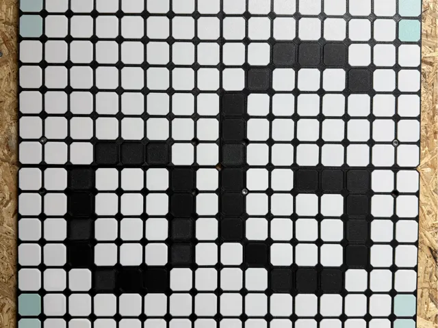
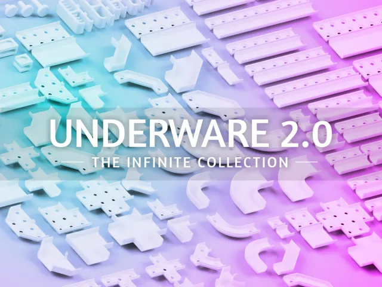
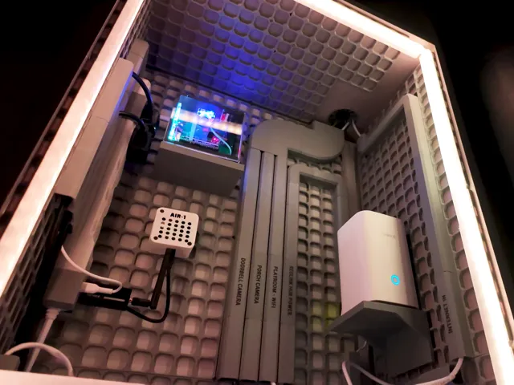

# Collections

<!-- Generated by scripts/Update-Readmes.ps1 (Linux: scripts/update_readmes.py) - edit scripts/readme-sources.json and rerun instead of editing by hand. -->

[Home](../../../../README.md) / [Storage](../../../README.md) / [Systems](../../README.md) / [Opengrid](../README.md) / **Collections**

4 builds &middot; 4 MakerWorld

## Collections

<table>
<tr>
<td width="33%" align="center" valign="top">
 
<b>openGrid - Wall/Desk mounting framework/ecosystem</b> 
by David D 
<a href="https://makerworld.com/en/models/1179191-opengrid-wall-desk-mounting-framework-ecosystem">MakerWorld</a> &middot; <a href="openGrid%2B-%2BWall_Desk%2Bmounting%2Bframework_ecosystem">Repo folder</a>
</td>
<td width="33%" align="center" valign="top">
 
<b>Underware 2.0 - Infinite Cable Management!</b> 
by BlackjackDuck - Hands on Katie Guild Member 
<a href="https://makerworld.com/en/models/783010-underware-2-0-infinite-cable-management">MakerWorld</a> &middot; <a href="Underware%2B2.0%2B-%2BInfinite%2BCable%2BManagement!">Repo folder</a>
</td>
<td width="33%" align="center" valign="top">
<i>no preview</i> 
<b>Underware for openGrid Customizer - BETA</b> 
<a href="https://makerworld.com/en/search/models?keyword=Underware%20for%20openGrid%20Customizer%20-%20BETA">Search MakerWorld</a> &middot; <a href="Underware%2Bfor%2BopenGrid%2BCustomizer%2B-%2BBETA">Repo folder</a>
</td>
</tr>
<tr>
<td width="33%" align="center" valign="top">
 
<b>Underware Starter Channel Pack for openGrid</b> 
by Hands on Katie 
<a href="https://makerworld.com/en/models/2354388-underware-starter-channel-pack-for-opengrid">MakerWorld</a> &middot; <a href="Underware%2BStarter%2BChannel%2BPack%2Bfor%2BopenGrid">Repo folder</a>
</td>
</tr>
</table>

