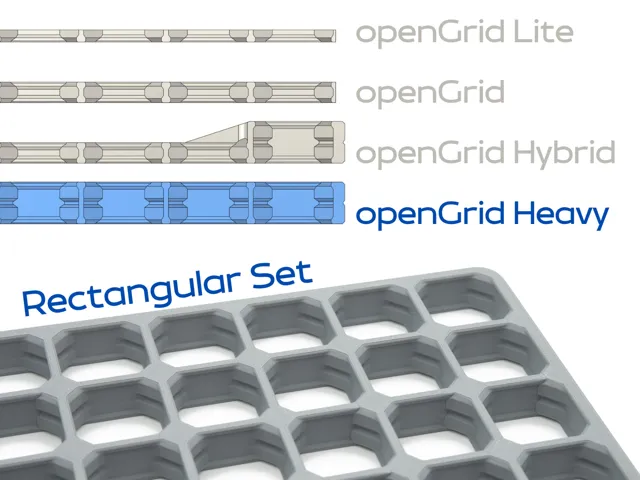
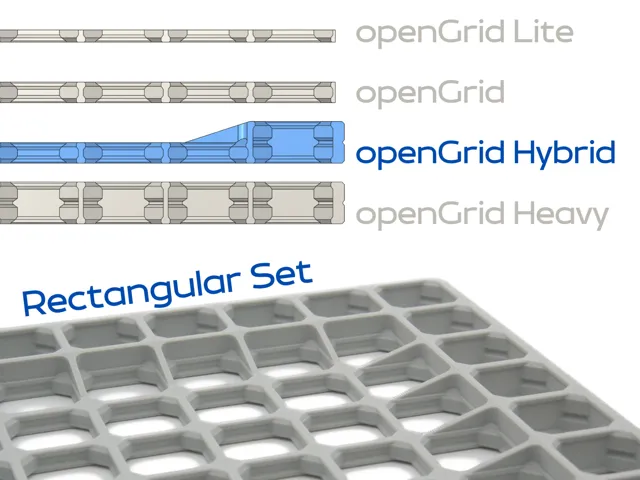

# Grids

<!-- Generated by scripts/Update-Readmes.ps1 (Linux: scripts/update_readmes.py) - edit scripts/readme-sources.json and rerun instead of editing by hand. -->

[Home](../../../../README.md) / [Storage](../../../README.md) / [Systems](../../README.md) / [Opengrid](../README.md) / **Grids**

4 builds &middot; 3 MakerWorld &middot; 1 unknown source

## Grids

<table>
<tr>
<td width="33%" align="center" valign="top">
 
<b>OG Hybrid - Medium Sizes</b> 
<a href="https://makerworld.com/en/search/models?keyword=OG%20Hybrid%20-%20Medium%20Sizes">Search MakerWorld</a> &middot; <a href="OG%2BHybrid%2B-%2BMedium%2BSizes.3mf">OG+Hybrid+-+Medium+Sizes.3mf</a>
</td>
<td width="33%" align="center" valign="top">
 
<b>OG_Heavy_Tri_-_Medium_Sizes</b> 
Source unknown &middot; <a href="OG_Heavy_Tri_-_Medium_Sizes.3mf">OG_Heavy_Tri_-_Medium_Sizes.3mf</a>
</td>
<td width="33%" align="center" valign="top">
 
<b>openGrid Heavy - 91 Sizes</b> 
by KYZ Design 
<a href="https://makerworld.com/en/models/1805977-opengrid-heavy-91-sizes">MakerWorld</a> &middot; <a href="openGrid%2BHeavy%2B-%2B91%2BSizes">Repo folder</a>
</td>
</tr>
<tr>
<td width="33%" align="center" valign="top">
 
<b>openGrid Hybrid - 28 Sizes</b> 
by KYZ Design 
<a href="https://makerworld.com/en/models/1863562-opengrid-hybrid-28-sizes">MakerWorld</a> &middot; <a href="openGrid%2BHybrid%2B-%2B28%2BSizes">Repo folder</a>
</td>
</tr>
</table>

