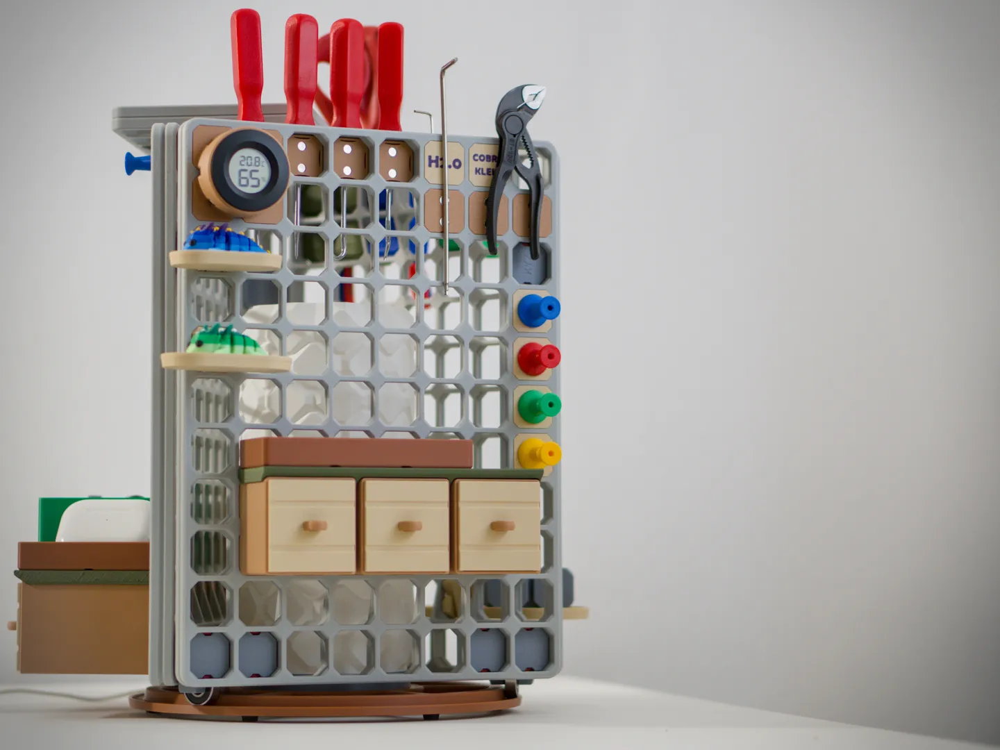

# Kyz Tool Tower

<!-- Generated by scripts/Update-Readmes.ps1 (Linux: scripts/update_readmes.py) - edit scripts/readme-sources.json and rerun instead of editing by hand. -->

[Home](../../../../README.md) / [Storage](../../../README.md) / [Systems](../../README.md) / [Opengrid](../README.md) / **Kyz Tool Tower**

3 builds &middot; 3 MakerWorld

## Kyz Tool Tower

<table>
<tr>
<td width="33%" align="center" valign="top">
<i>no preview</i> 
<b>KYZ oG Dovetail Fittings</b> 
<a href="https://makerworld.com/en/search/models?keyword=KYZ%20oG%20Dovetail%20Fittings">Search MakerWorld</a> &middot; <a href="KYZ%2BoG%2BDovetail%2BFittings_stls">Repo folder</a>
</td>
<td width="33%" align="center" valign="top">
<i>no preview</i> 
<b>KYZ oG Vase Mode Round Cups - Standard</b> 
<a href="https://makerworld.com/en/search/models?keyword=KYZ%20oG%20Vase%20Mode%20Round%20Cups%20-%20Standard">Search MakerWorld</a> &middot; <a href="KYZ%2BoG%2BVase%2BMode%2BRound%2BCups%2B-%2BStandard_stls">Repo folder</a>
</td>
<td width="33%" align="center" valign="top">
 
<b>KYZ Tool Tower</b> 
<a href="https://makerworld.com/en/search/models?keyword=KYZ%20Tool%20Tower">Search MakerWorld</a> &middot; <a href="KYZ%2BTool%2BTower.3mf">KYZ+Tool+Tower.3mf</a>
</td>
</tr>
</table>

