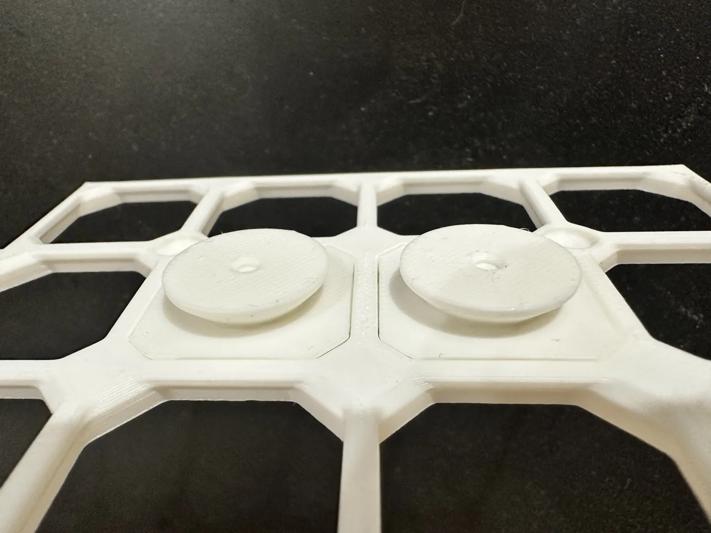
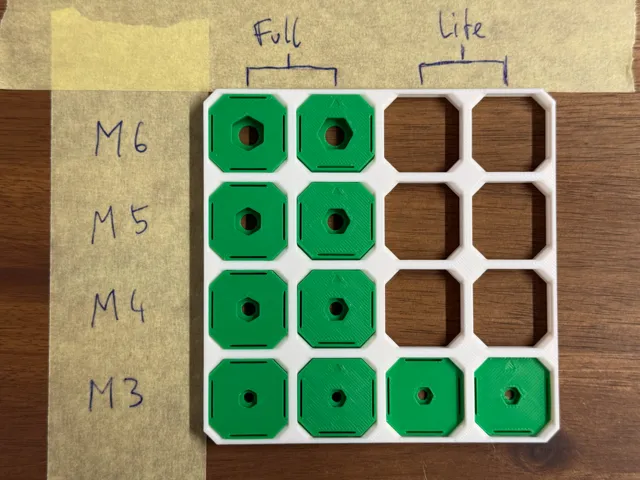
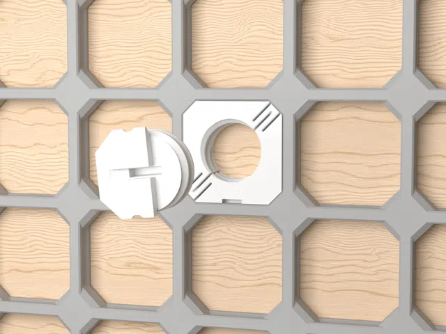
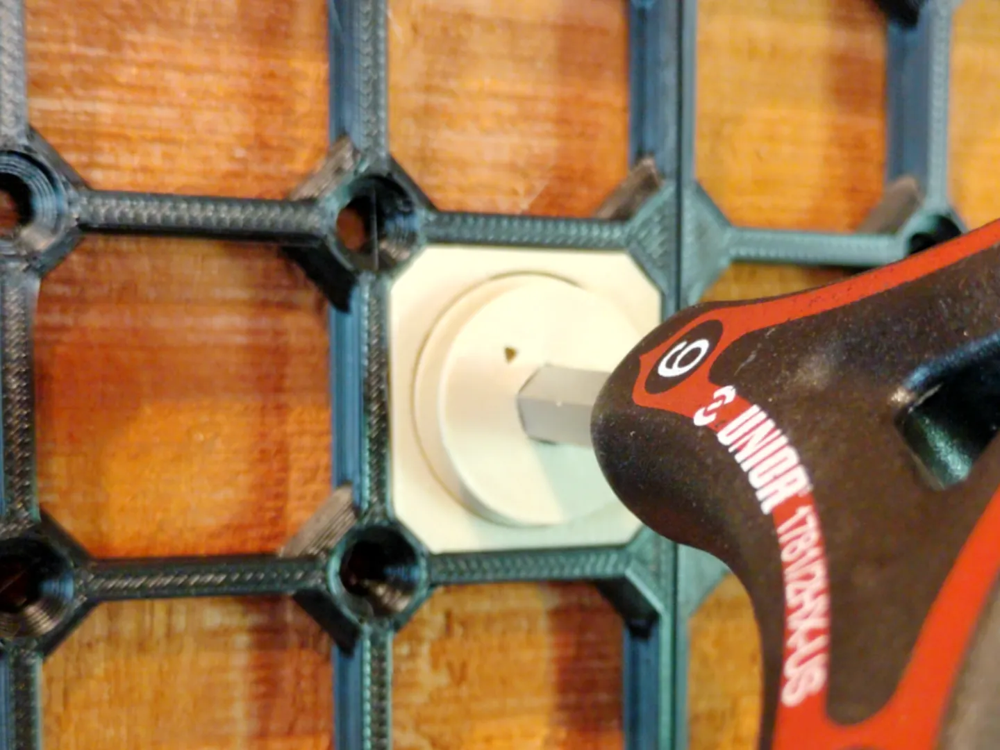

# Snaps

<!-- Generated by scripts/Update-Readmes.ps1 (Linux: scripts/update_readmes.py) - edit scripts/readme-sources.json and rerun instead of editing by hand. -->

[Home](../../../../README.md) / [Storage](../../../README.md) / [Systems](../../README.md) / [Opengrid](../README.md) / **Snaps**

4 builds &middot; 4 MakerWorld

## Snaps

<table>
<tr>
<td width="33%" align="center" valign="top">
 
<b>lite opengrid directional snap V2</b> 
<a href="https://makerworld.com/en/search/models?keyword=lite%20opengrid%20directional%20snap%20V2">Search MakerWorld</a> &middot; <a href="lite%2Bopengrid%2Bdirectional%2Bsnap%2BV2.3mf">lite+opengrid+directional+snap+V2.3mf</a>
</td>
<td width="33%" align="center" valign="top">
 
<b>openGrid - Metric Screw Snaps</b> 
by David D 
<a href="https://makerworld.com/en/models/1179230-opengrid-metric-screw-snaps">MakerWorld</a> &middot; <a href="openGrid%2B-%2BMetric%2BScrew%2BSnaps">Repo folder</a>
</td>
<td width="33%" align="center" valign="top">
 
<b>openGrid - Self-Expanding Snap</b> 
by mitufy 
<a href="https://makerworld.com/en/models/1412027-opengrid-self-expanding-snap">MakerWorld</a> &middot; <a href="openGrid%2B-%2BSelf-Expanding%2BSnap">Repo folder</a>
</td>
</tr>
<tr>
<td width="33%" align="center" valign="top">
 
<b>opengrid-multipoint lock snap - 6mm hex</b> 
<a href="https://makerworld.com/en/search/models?keyword=opengrid-multipoint%20lock%20snap%20-%206mm%20hex">Search MakerWorld</a> &middot; <a href="opengrid-multipoint%2Block%2Bsnap%2B-%2B6mm%2Bhex.3mf">opengrid-multipoint+lock+snap+-+6mm+hex.3mf</a>
</td>
</tr>
</table>

