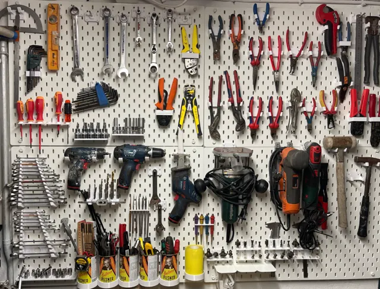
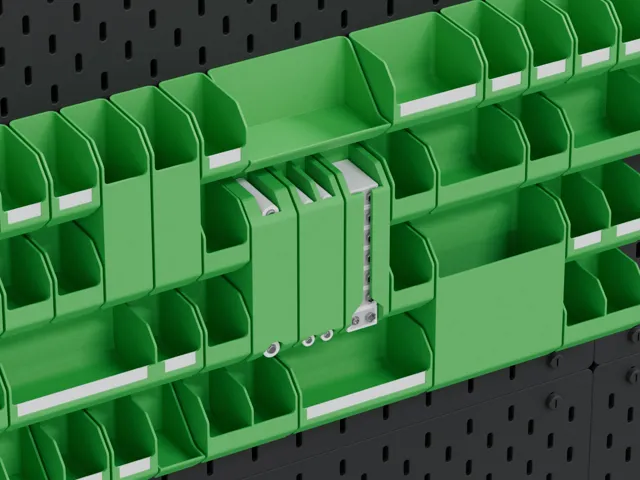
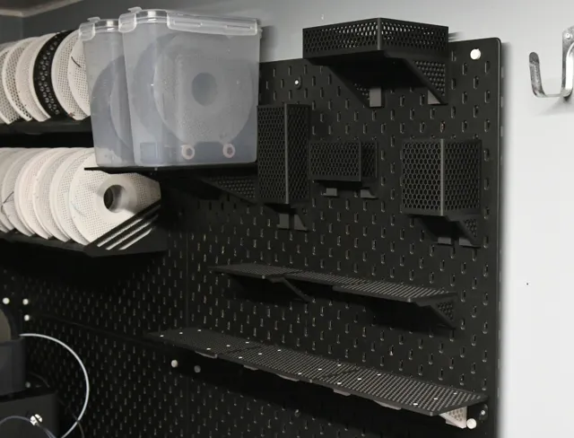
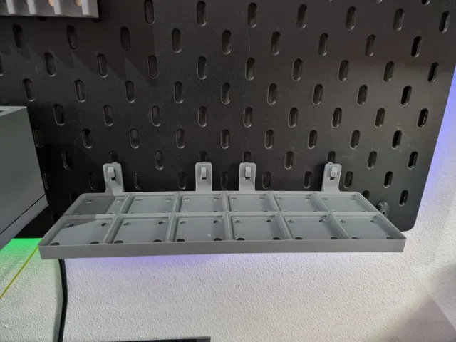
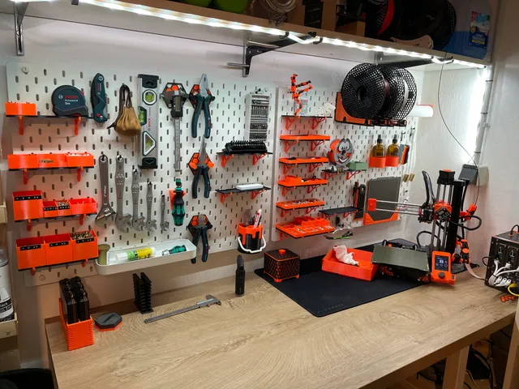
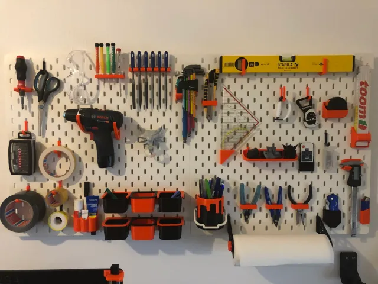
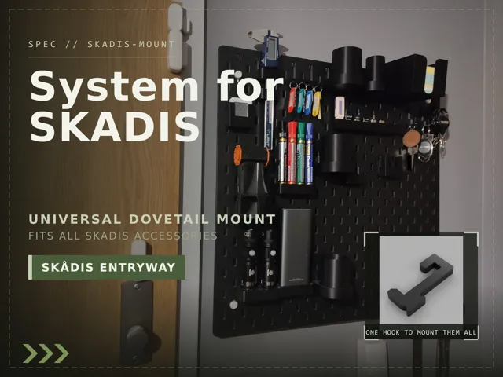
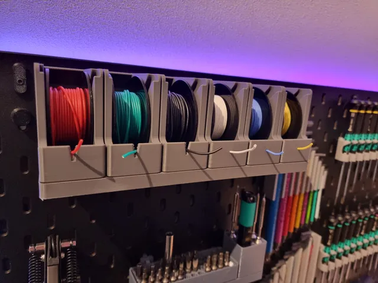

# Skadis Pegboard

<!-- Generated by scripts/Update-Readmes.ps1 (Linux: scripts/update_readmes.py) - edit scripts/readme-sources.json and rerun instead of editing by hand. -->

[Home](../../../README.md) / [Storage](../../README.md) / [Systems](../README.md) / **Skadis Pegboard**

12 builds &middot; 7 MakerWorld &middot; 5 Printables &middot; 3 collections (11 more builds)

## Collections

- [Bins](bins/README.md) - 5 builds
- [Pegboard](pegboard/README.md) - 4 builds
- [Tool Holders](tool-holders/README.md) - 2 builds

## Skadis Pegboard

<table>
<tr>
<td width="33%" align="center" valign="top">
 
<b>Epic IKEA Sk&#229;dis garage collection, set of 40!</b> 
by walleriusDesign 
<a href="https://makerworld.com/en/models/708229-an-epic-ikea-skadis-garage-collection-a-set-of-for">MakerWorld</a> &middot; <a href="Epic%2BIKEA%2BSk%C3%A5dis%2Bgarage%2Bcollection%2C%2Bset%2Bof%2B40!">Repo folder</a>
</td>
<td width="33%" align="center" valign="top">
 
<b>IKEA Skadis Basics - Snap Lock Hooks</b> 
by AdamKozakGrafika 
<a href="https://makerworld.com/en/models/3204025-ikea-skadis-basics-snap-lock-hooks">MakerWorld</a> &middot; <a href="IKEA%2BSkadis%2BBasics%2B-%2BSnap%2BLock%2BHooks">Repo folder</a>
</td>
<td width="33%" align="center" valign="top">
 
<b>IKEA SKADIS Organizer System</b> 
by Nupol 
<a href="https://makerworld.com/en/models/1911945-ikea-skadis-organizer-system">MakerWorld</a> &middot; <a href="IKEA%2BSKADIS%2BOrganizer%2BSystem">Repo folder</a>
</td>
</tr>
<tr>
<td width="33%" align="center" valign="top">
 
<b>Modular and Customizable Shelf for Ikea Skadis</b> 
by historicc 
<a href="https://makerworld.com/en/models/1016430-modular-and-customizable-shelf-for-ikea-skadis">MakerWorld</a> &middot; <a href="Modular%2Band%2BCustomizable%2BShelf%2Bfor%2BIkea%2BSkadis">Repo folder</a>
</td>
<td width="33%" align="center" valign="top">
<i>no preview</i> 
<b>Secret</b> 
<a href="https://makerworld.com/en/search/models?keyword=Secret">Search MakerWorld</a> &middot; <a href="secret_stls">Repo folder</a>
</td>
<td width="33%" align="center" valign="top">
<i>no preview</i> 
<b>SKADIS Add-Ons Parametric Bins and Shelves</b> 
<a href="https://makerworld.com/en/search/models?keyword=SKADIS%20Add-Ons%20Parametric%20Bins%20and%20Shelves">Search MakerWorld</a> &middot; <a href="SKADIS%2BAdd-Ons_%2BParametric%2BBins%2Band%2BShelves">Repo folder</a>
</td>
</tr>
<tr>
<td width="33%" align="center" valign="top">
 
<b>skadis gridfinity shelf</b> 
by LutraVulgaris 
<a href="https://www.printables.com/model/484295-skadis-gridfinity-shelf">Printables</a> &middot; <a href="skadis-gridfinity-shelf-model_files">Repo folder</a>
</td>
<td width="33%" align="center" valign="top">
 
<b>Skadis Hook Collection</b> 
by Carlo 
<a href="https://www.printables.com/model/228414-skadis-hook-collection">Printables</a> &middot; <a href="skadis-hook-collection-model_files">Repo folder</a>
</td>
<td width="33%" align="center" valign="top">
 
<b>Skadis Mount Collection</b> 
by Printuin 
<a href="https://www.printables.com/model/147771-skadis-mount-collection">Printables</a> &middot; <a href="skadis-mount-collection-model_files">Repo folder</a>
</td>
</tr>
<tr>
<td width="33%" align="center" valign="top">
 
<b>Skadis Mount Collection</b> 
by Printuin 
<a href="https://www.printables.com/model/147771-skadis-mount-collection">Printables</a> &middot; <a href="skadis-mount-collection-print_files">Repo folder</a>
</td>
<td width="33%" align="center" valign="top">
 
<b>SKADIS Pegboard Entryway Organizer System </b> 
by Nemo 
<a href="https://makerworld.com/en/models/3161459-skadis-pegboard-entryway-organizer-system">MakerWorld</a> &middot; <a href="SKADIS%2BPegboard%2BEntryway%2BOrganizer%2BSystem%2B">Repo folder</a>
</td>
<td width="33%" align="center" valign="top">
 
<b>Wire Holder Gridfinity</b> 
by LutraVulgaris 
<a href="https://www.printables.com/model/469616-wire-holder-gridfinity">Printables</a> &middot; <a href="wire-holder-gridfinity-model_files">Repo folder</a>
</td>
</tr>
</table>

