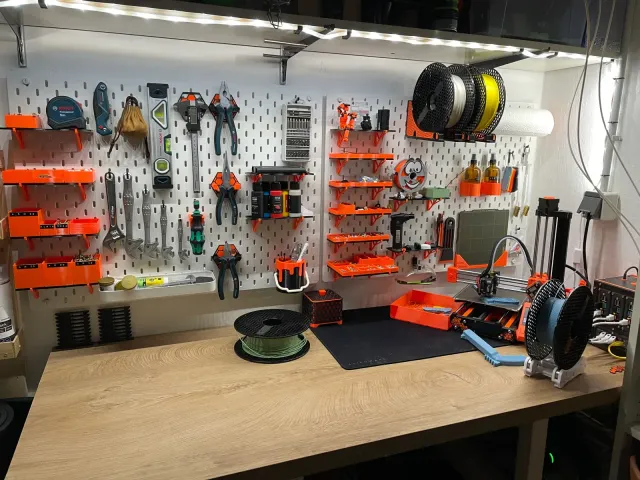
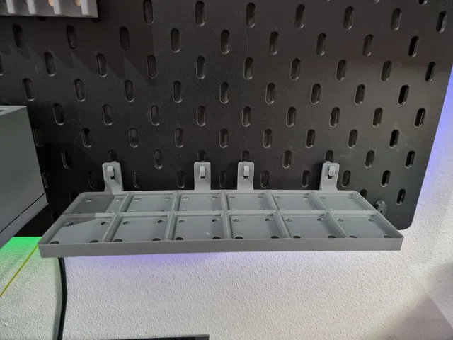
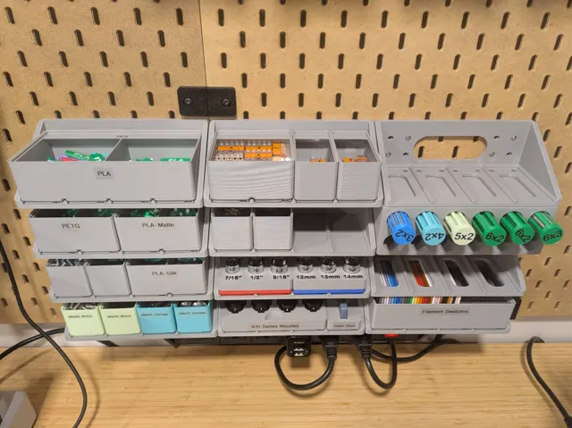

# Bins

<!-- Generated by scripts/Update-Readmes.ps1 (Linux: scripts/update_readmes.py) - edit scripts/readme-sources.json and rerun instead of editing by hand. -->

[Home](../../../../README.md) / [Storage](../../../README.md) / [Systems](../../README.md) / [Skadis Pegboard](../README.md) / **Bins**

5 builds &middot; 3 MakerWorld &middot; 2 Printables

## Bins

<table>
<tr>
<td width="33%" align="center" valign="top">
<i>no preview</i> 
<b>IKEA Skadis Angled Bins</b> 
<a href="https://makerworld.com/en/search/models?keyword=IKEA%20Skadis%20Angled%20Bins">Search MakerWorld</a> &middot; <a href="IKEA%2BSkadis%2BAngled%2BBins_stls">Repo folder</a>
</td>
<td width="33%" align="center" valign="top">
<i>no preview</i> 
<b>SKADIS Add-Ons Parametric Bins and Shelves</b> 
<a href="https://makerworld.com/en/search/models?keyword=SKADIS%20Add-Ons%20Parametric%20Bins%20and%20Shelves">Search MakerWorld</a> &middot; <a href="SKADIS%2BAdd-Ons_%2BParametric%2BBins%2Band%2BShelves">Repo folder</a>
</td>
<td width="33%" align="center" valign="top">
 
<b>Skadis Box collection &quot;no frills&quot; (with Grids)</b> 
by Carlo 
<a href="https://www.printables.com/model/277480-skadis-box-collection-no-frills-with-grids">Printables</a> &middot; <a href="skadis-box-collection-no-frills-with-grids-model_files">Repo folder</a>
</td>
</tr>
<tr>
<td width="33%" align="center" valign="top">
 
<b>skadis gridfinity shelf</b> 
by LutraVulgaris 
<a href="https://www.printables.com/model/484295-skadis-gridfinity-shelf">Printables</a> &middot; <a href="skadis-gridfinity-shelf-model_files">Repo folder</a>
</td>
<td width="33%" align="center" valign="top">
 
<b>Skadis Gridfinity Slider Drawers</b> 
by impwerx 
<a href="https://makerworld.com/en/models/1451199-skadis-gridfinity-slider-drawers">MakerWorld</a> &middot; <a href="Skadis%2BGridfinity%2BSlider%2BDrawers">Repo folder</a>
</td>
</tr>
</table>

