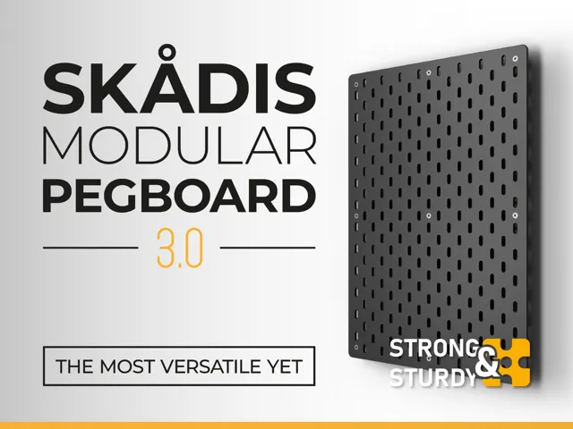
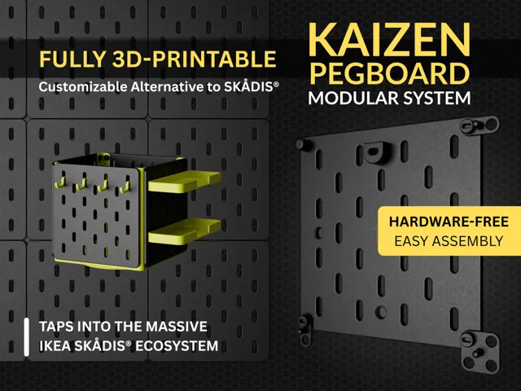
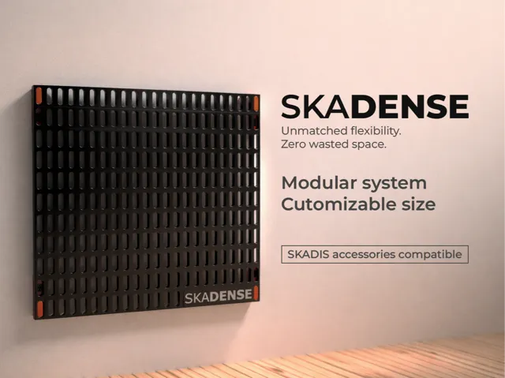

# Pegboard

<!-- Generated by scripts/Update-Readmes.ps1 (Linux: scripts/update_readmes.py) - edit scripts/readme-sources.json and rerun instead of editing by hand. -->

[Home](../../../../README.md) / [Storage](../../../README.md) / [Systems](../../README.md) / [Skadis Pegboard](../README.md) / **Pegboard**

4 builds &middot; 4 MakerWorld

## Pegboard

<table>
<tr>
<td width="33%" align="center" valign="top">
 
<b>IKEA Skadis modular pegboard 3.0</b> 
by AdamKozakGrafika 
<a href="https://makerworld.com/en/models/2572477-ikea-skadis-modular-pegboard-3-0">MakerWorld</a> &middot; <a href="IKEA%2BSkadis%2Bmodular%2Bpegboard%2B3.0">Repo folder</a>
</td>
<td width="33%" align="center" valign="top">
 
<b>KAIZEN PEGBOARD Modular System - SK&#197;DIS compatible</b> 
by Pavan 
<a href="https://makerworld.com/en/models/1750905-kaizen-pegboard-modular-system-skadis-compatible">MakerWorld</a> &middot; <a href="KAIZEN%2BPEGBOARD%2BModular%2BSystem%2B-%2BSK%C3%85DIS%2Bcompatible">Repo folder</a>
</td>
<td width="33%" align="center" valign="top">
 
<b>SKADENSE – High-Density SKADIS Pegboard</b> 
by AJM 
<a href="https://makerworld.com/en/models/2734833-skadense-high-density-skadis-pegboard">MakerWorld</a> &middot; <a href="SKADENSE%2B%E2%80%93%2BHigh-Density%2BSKADIS%2BPegboard">Repo folder</a>
</td>
</tr>
<tr>
<td width="33%" align="center" valign="top">
<i>no preview</i> 
<b>Skadis Modular Board 240x240 Voronoi</b> 
<a href="https://makerworld.com/en/search/models?keyword=Skadis%20Modular%20Board%20240x240%20Voronoi">Search MakerWorld</a> &middot; <a href="skadis_modular_board_240x240_voronoi_stls">Repo folder</a>
</td>
</tr>
</table>

