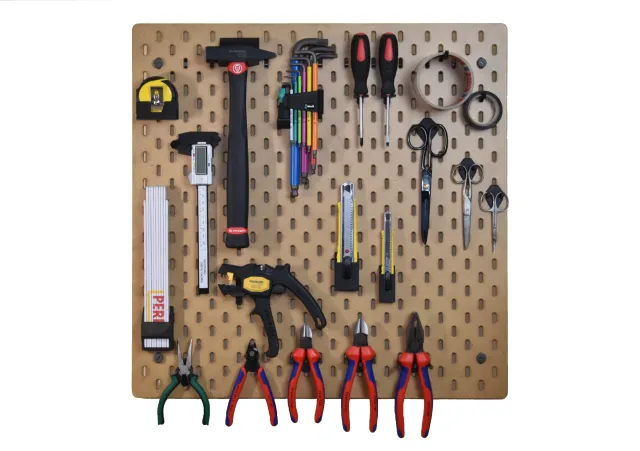
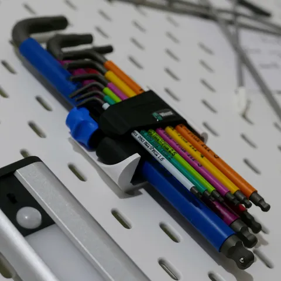

# Tool Holders

<!-- Generated by scripts/Update-Readmes.ps1 (Linux: scripts/update_readmes.py) - edit scripts/readme-sources.json and rerun instead of editing by hand. -->

[Home](../../../../README.md) / [Storage](../../../README.md) / [Systems](../../README.md) / [Skadis Pegboard](../README.md) / **Tool Holders**

2 builds &middot; 2 Printables

## Tool Holders

<table>
<tr>
<td width="33%" align="center" valign="top">
 
<b>Skadis Tool Mount Collection</b> 
by Jonas Pedrotti 
<a href="https://www.printables.com/model/57792-skadis-tool-mount-collection">Printables</a> &middot; <a href="skadis-tool-mount-collection-model_files">Repo folder</a>
</td>
<td width="33%" align="center" valign="top">
 
<b>Wera Hex-Plus Skadis mount</b> 
by nmattia 
<a href="https://www.printables.com/model/611131-wera-hex-plus-skadis-mount">Printables</a> &middot; <a href="wera-hex-plus-skadis-mount-model_files">Repo folder</a>
</td>
</tr>
</table>

