# Tool Holders

<!-- Generated by scripts/Update-Readmes.ps1 (Linux: scripts/update_readmes.py) - edit scripts/readme-sources.json and rerun instead of editing by hand. -->

[Home](../../README.md) / [Storage](../README.md) / **Tool Holders**

24 builds &middot; 4 MakerWorld &middot; 2 Printables &middot; 11 Thingiverse &middot; 7 unknown source &middot; 1 collections (2 more builds)

## Collections

- [Toolbox Wrench Organizer](toolbox-wrench-organizer/README.md) - 2 builds

## Tool Holders

<table>
<tr>
<td width="33%" align="center" valign="top">
<a href="10x_Tweezer_Holder">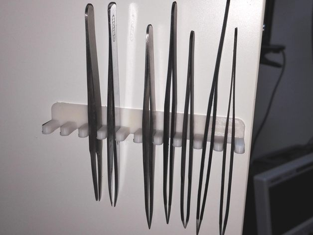</a> 
<b>10x Tweezer Holder</b> 
by MasterFX 
<a href="https://www.thingiverse.com/thing:1715977">Thingiverse</a> &middot; <a href="10x_Tweezer_Holder">Repo folder</a>
</td>
<td width="33%" align="center" valign="top">
<a href="Customizable_Hex_Bit_Holder">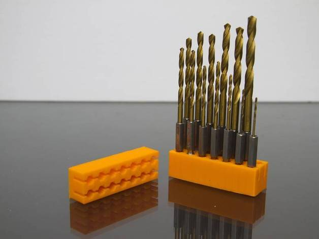</a> 
<b>Customizable Hex Bit Holder</b> 
by xchg_dot_ca 
<a href="https://www.thingiverse.com/thing:726700">Thingiverse</a> &middot; <a href="Customizable_Hex_Bit_Holder">Repo folder</a>
</td>
<td width="33%" align="center" valign="top">
<a href="french_cleat_hex_bit_holder">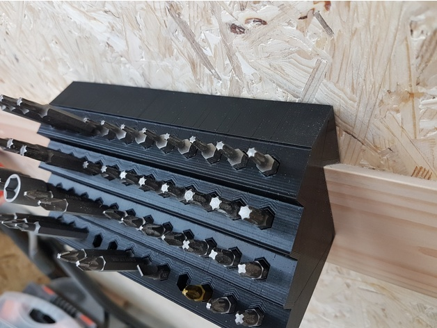</a> 
<b>french cleat hex bit holder</b> 
by taddyr 
<a href="https://www.thingiverse.com/thing:2967241">Thingiverse</a> &middot; <a href="french_cleat_hex_bit_holder">Repo folder</a>
</td>
</tr>
<tr>
<td width="33%" align="center" valign="top">
<a href="Gridfinity%2B2x6x9%2BWera%2Ballen%2Bkey%2Bholder%2Bv1.3mf">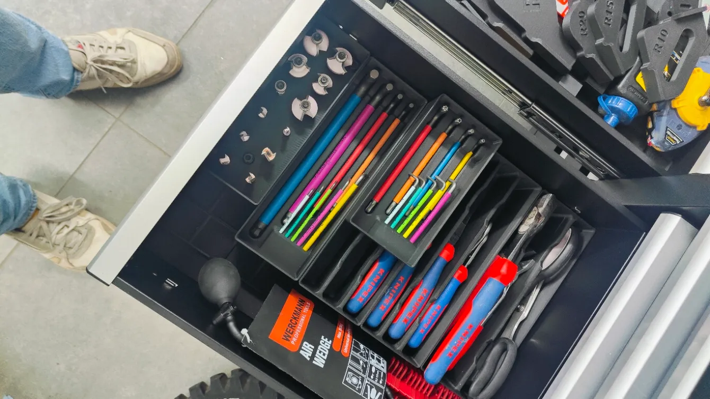</a> 
<b>Gridfinity 2x6x9 Wera allen key holder v1</b> 
<a href="https://makerworld.com/en/search/models?keyword=Gridfinity%202x6x9%20Wera%20allen%20key%20holder%20v1">Search MakerWorld</a> &middot; <a href="Gridfinity%2B2x6x9%2BWera%2Ballen%2Bkey%2Bholder%2Bv1.3mf">Gridfinity+2x6x9+Wera+allen+key+holder+v1.3mf</a>
</td>
<td width="33%" align="center" valign="top">
<a href="Gridfinity%2Bholder%2Bfor%2BElegoo%2BVacuum%2BAuto%2BPump.3mf">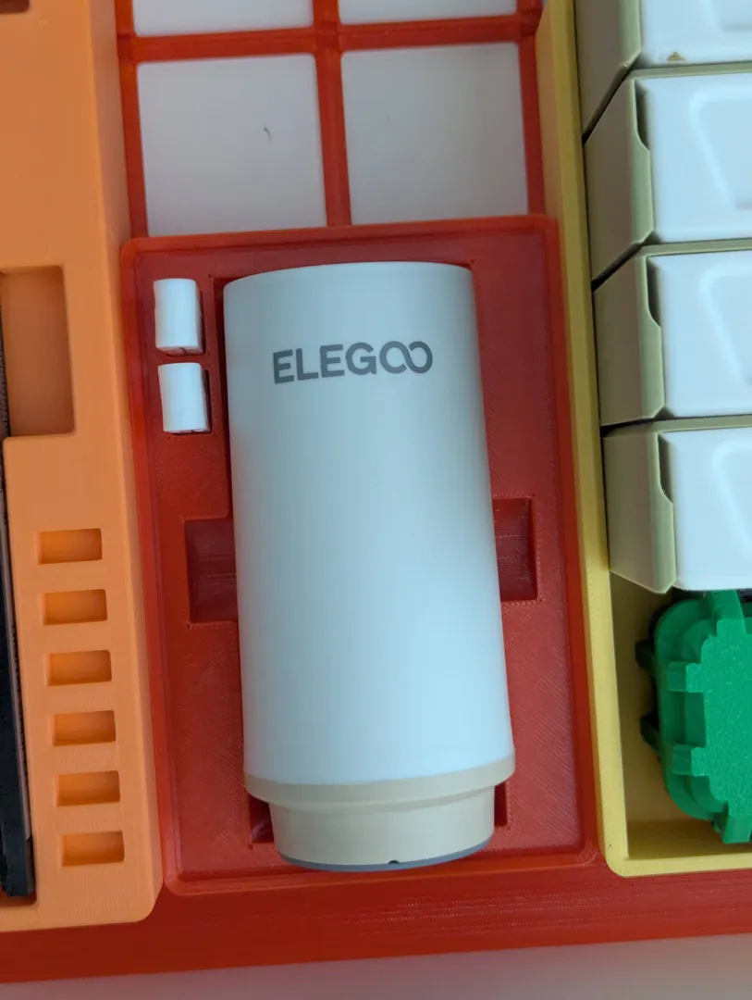</a> 
<b>Gridfinity holder for Elegoo Vacuum Auto Pump</b> 
<a href="https://makerworld.com/en/search/models?keyword=Gridfinity%20holder%20for%20Elegoo%20Vacuum%20Auto%20Pump">Search MakerWorld</a> &middot; <a href="Gridfinity%2Bholder%2Bfor%2BElegoo%2BVacuum%2BAuto%2BPump.3mf">Gridfinity+holder+for+Elegoo+Vacuum+Auto+Pump.3mf</a>
</td>
<td width="33%" align="center" valign="top">
<a href="Hex_Bit_Holder_for_Metal_Pegboard_Wall_Control">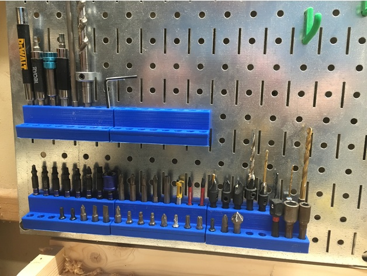</a> 
<b>Hex Bit Holder for Metal Pegboard (Wall Control)</b> 
by Boz 
<a href="https://www.thingiverse.com/thing:2511938">Thingiverse</a> &middot; <a href="Hex_Bit_Holder_for_Metal_Pegboard_Wall_Control">Repo folder</a>
</td>
</tr>
<tr>
<td width="33%" align="center" valign="top">
<i>no preview</i> 
<b>Hooks for pegboard(8mm hole, 30mm spacing)</b> 
Source unknown &middot; <a href="Hooks_for_pegboard(8mm_hole%2C_30mm_spacing)">Repo folder</a>
</td>
<td width="33%" align="center" valign="top">
<a href="logitech-k400k400r-vertical-wall-mount-model_files">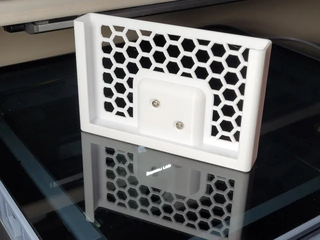</a> 
<b>Logitech K400+/K400R Vertical Wall Mount</b> 
by RevHazlett 
<a href="https://www.printables.com/model/658788-logitech-k400k400r-vertical-wall-mount">Printables</a> &middot; <a href="logitech-k400k400r-vertical-wall-mount-model_files">Repo folder</a>
</td>
<td width="33%" align="center" valign="top">
<a href="Pegboard_drill_indices">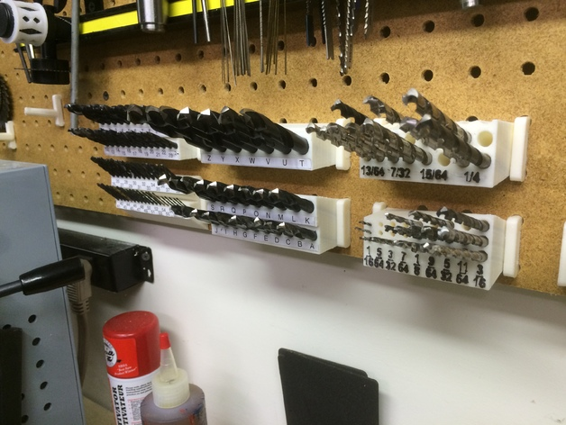</a> 
<b>Pegboard drill indices</b> 
by ckirby 
<a href="https://www.thingiverse.com/thing:1003471">Thingiverse</a> &middot; <a href="Pegboard_drill_indices">Repo folder</a>
</td>
</tr>
<tr>
<td width="33%" align="center" valign="top">
<i>no preview</i> 
<b>Pegboard Hex Bit holder</b> 
Source unknown &middot; <a href="Pegboard_Hex_Bit_holder">Repo folder</a>
</td>
<td width="33%" align="center" valign="top">
<a href="Pegstr_-_Pegboard_Wizard">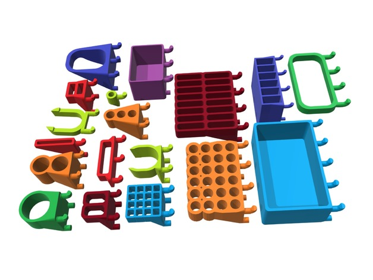</a> 
<b>Pegstr - Pegboard Wizard</b> 
by mgx 
<a href="https://www.thingiverse.com/thing:537516">Thingiverse</a> &middot; <a href="Pegstr_-_Pegboard_Wizard">Repo folder</a>
</td>
<td width="33%" align="center" valign="top">
<a href="Screwdriver_bit_wall_mount">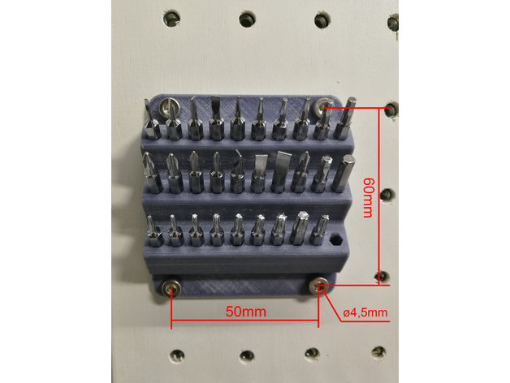</a> 
<b>Screwdriver bit wall mount</b> 
by SaKes 
<a href="https://www.thingiverse.com/thing:2499257">Thingiverse</a> &middot; <a href="Screwdriver_bit_wall_mount">Repo folder</a>
</td>
</tr>
<tr>
<td width="33%" align="center" valign="top">
<a href="Screwdriver_stand">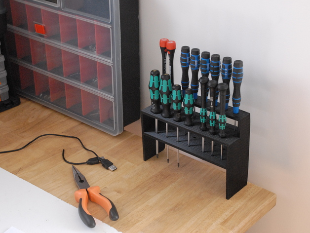</a> 
<b>Screwdriver stand</b> 
by Nivek11 
<a href="https://www.thingiverse.com/thing:1701814">Thingiverse</a> &middot; <a href="Screwdriver_stand">Repo folder</a>
</td>
<td width="33%" align="center" valign="top">
<a href="The_Ultimate_box_maker">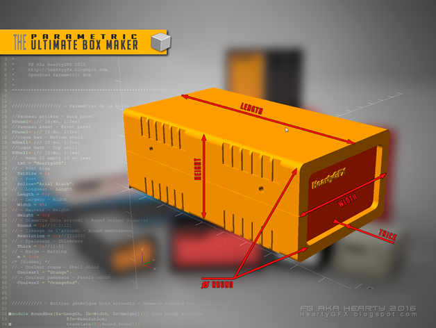</a> 
<b>The Ultimate box maker</b> 
by Heartman 
<a href="https://www.thingiverse.com/thing:1264391">Thingiverse</a> &middot; <a href="The_Ultimate_box_maker">Repo folder</a>
</td>
<td width="33%" align="center" valign="top">
<a href="tool-box-parametric-model_files">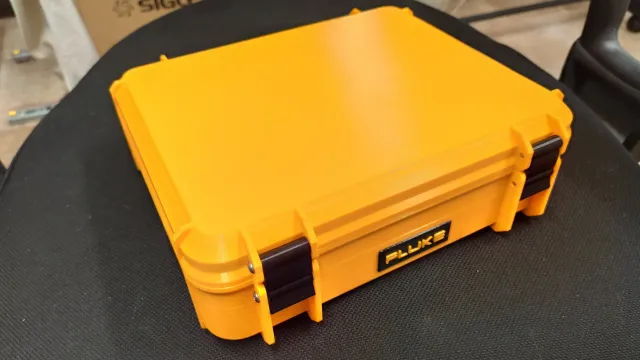</a> 
<b>Tool box parametric</b> 
by Yanev 
<a href="https://www.printables.com/model/39729-tool-box-parametric">Printables</a> &middot; <a href="tool-box-parametric-model_files">Repo folder</a>
</td>
</tr>
<tr>
<td width="33%" align="center" valign="top">
<a href="Tool_brackets_for_workshop_wall">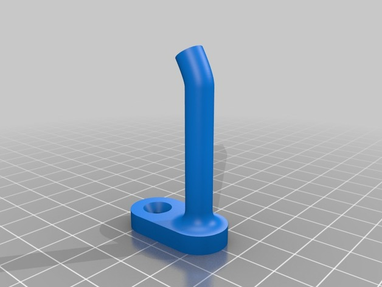</a> 
<b>Tool brackets for workshop wall</b> 
by danekshea 
<a href="https://www.thingiverse.com/thing:2259904">Thingiverse</a> &middot; <a href="Tool_brackets_for_workshop_wall">Repo folder</a>
</td>
<td width="33%" align="center" valign="top">
<a href="Tools_modular_desktop_stand_TweezerPlierScrewdriver_V_2.0">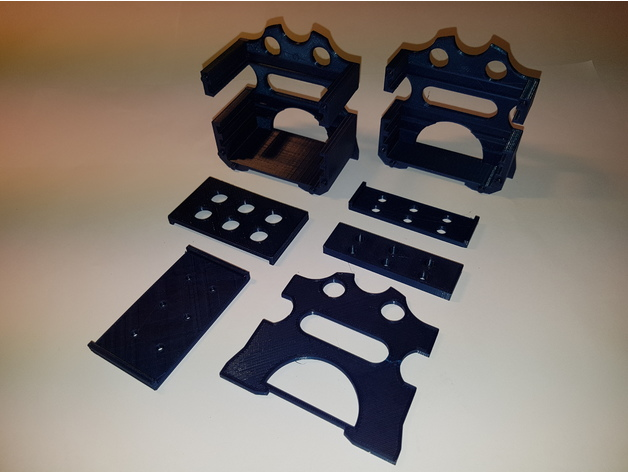</a> 
<b>Tools modular desktop stand (Tweezer;Plier;Screwdriver) V 2.0</b> 
by ICTAvatar 
<a href="https://www.thingiverse.com/thing:2522638">Thingiverse</a> &middot; <a href="Tools_modular_desktop_stand_TweezerPlierScrewdriver_V_2.0">Repo folder</a>
</td>
<td width="33%" align="center" valign="top">
<a href="Wera%2Ballen%2Bwrench%2Bholder.3mf">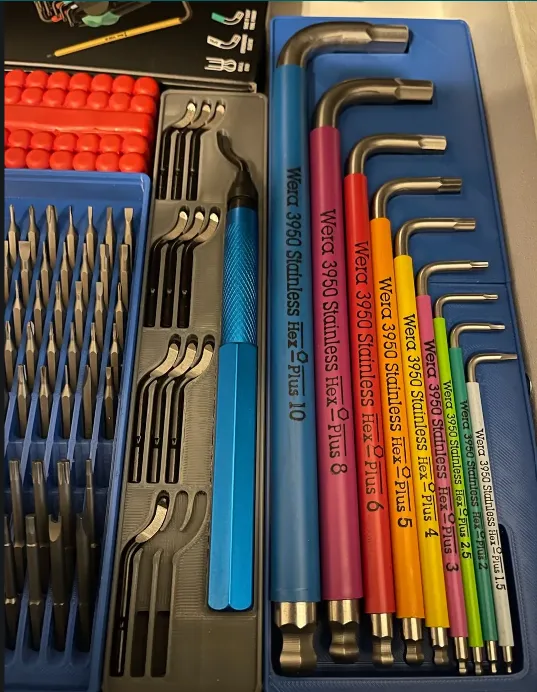</a> 
<b>Wera allen wrench holder</b> 
<a href="https://makerworld.com/en/search/models?keyword=Wera%20allen%20wrench%20holder">Search MakerWorld</a> &middot; <a href="Wera%2Ballen%2Bwrench%2Bholder.3mf">Wera+allen+wrench+holder.3mf</a>
</td>
</tr>
</table>

Other files in this folder (6)

- [Crimper+Tray_stls.zip](Crimper%2BTray_stls.zip)
- [DeWalt Battery Holder - Square Bottom - 4847364.zip](DeWalt%20Battery%20Holder%20-%20Square%20Bottom%20-%204847364.zip)
- [Dewalt Battery Holder.zip](Dewalt%20Battery%20Holder.zip)
- [Dewalt battery mount with logo - 3760975.zip](Dewalt%20battery%20mount%20with%20logo%20-%203760975.zip)
- [DeWalt Tool Holder - 3658795.zip](DeWalt%20Tool%20Holder%20-%203658795.zip)
- [dewalt-tool-hanger-model_files.zip](dewalt-tool-hanger-model_files.zip)

