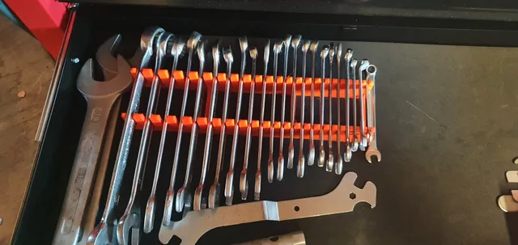

# Toolbox Wrench Organizer

<!-- Generated by scripts/Update-Readmes.ps1 (Linux: scripts/update_readmes.py) - edit scripts/readme-sources.json and rerun instead of editing by hand. -->

[Home](../../../README.md) / [Storage](../../README.md) / [Tool Holders](../README.md) / **Toolbox Wrench Organizer**

2 builds &middot; 2 Printables

## Toolbox Wrench Organizer

<table>
<tr>
<td width="33%" align="center" valign="top">
 
<b>wrench holder (wrench organizer)</b> 
by Parsupo 
<a href="https://www.printables.com/model/225579-wrench-holder-wrench-organizer">Printables</a> &middot; <a href="wrench-holder-wrench-organizer-model_files">Repo folder</a>
</td>
<td width="33%" align="center" valign="top">
 
<b>wrench holder (wrench organizer)</b> 
by Parsupo 
<a href="https://www.printables.com/model/225579-wrench-holder-wrench-organizer">Printables</a> &middot; <a href="wrench-holder-wrench-organizer-print_files">Repo folder</a>
</td>
</tr>
</table>

