# Tools

<!-- Generated by scripts/Update-Readmes.ps1 - edit scripts/readme-sources.json and rerun instead of editing by hand. -->

63 builds &middot; 18 MakerWorld &middot; 10 Printables &middot; 23 Thingiverse &middot; 12 unknown source

## Contents

- [Tools](#tools) (7)
- [Clamps](#clamps) (6)
- [Hand Tools](#hand-tools) (6)
- [Hand Tools / Drivers](#hand-tools--drivers) (7)
- [Hardware](#hardware) (3)
- [Machining](#machining) (11)
- [Woodworking](#woodworking) (6)
- [Woodworking / Connectors](#woodworking--connectors) (13)
- [Woodworking / Sanding Tools](#woodworking--sanding-tools) (4)

## Tools

<table>
<tr>
<td width="33%" align="center" valign="top">
<a href="daisy_m1_m10.3mf">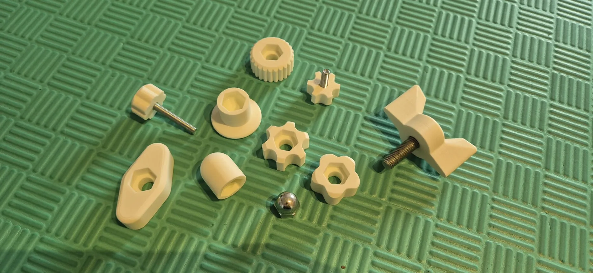</a> 
<b>daisy_m1_m10</b> 
Source unknown &middot; <a href="daisy_m1_m10.3mf">daisy_m1_m10.3mf</a>
</td>
<td width="33%" align="center" valign="top">
<a href="Digital%2BCaliper%2BHole%2BDepth%2BAdaptor">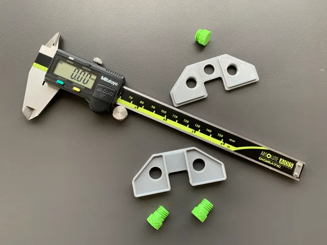</a> 
<b>Digital Caliper Hole Depth Adaptor</b> 
by DatumCAD 
<a href="https://makerworld.com/en/models/209096-digital-caliper-hole-depth-adaptor">MakerWorld</a> &middot; <a href="Digital%2BCaliper%2BHole%2BDepth%2BAdaptor">Repo folder</a>
</td>
<td width="33%" align="center" valign="top">
<i>no preview</i> 
<b>French Cleat Holders</b> 
<a href="https://makerworld.com/en/search/models?keyword=French%20Cleat%20Holders">Search MakerWorld</a> &middot; <a href="French%2BCleat%2BHolders%2B">Repo folder</a>
</td>
</tr>
<tr>
<td width="33%" align="center" valign="top">
<a href="masking%2Btape%2Bapplicator">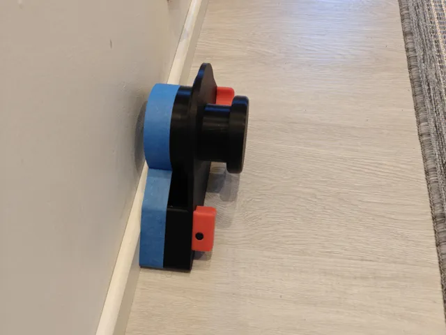</a> 
<b>masking tape applicator</b> 
by MIO 
<a href="https://makerworld.com/en/models/2720308-masking-tape-applicator">MakerWorld</a> &middot; <a href="masking%2Btape%2Bapplicator">Repo folder</a>
</td>
<td width="33%" align="center" valign="top">
<a href="Parametric%2BSpacer%2BGenerator%2B%E2%80%94%2BM3%2Bto%2BM10">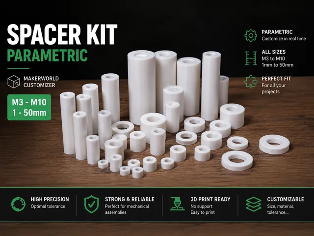</a> 
<b>Parametric Spacer Generator — M3 to M10</b> 
by 3D ultimate 
<a href="https://makerworld.com/en/models/2775247-parametric-spacer-generator-m3-to-m10">MakerWorld</a> &middot; <a href="Parametric%2BSpacer%2BGenerator%2B%E2%80%94%2BM3%2Bto%2BM10">Repo folder</a>
</td>
<td width="33%" align="center" valign="top">
<a href="Plywood%2BDolly.%2BUp%2Bto%2B19mm%2Bsheets_">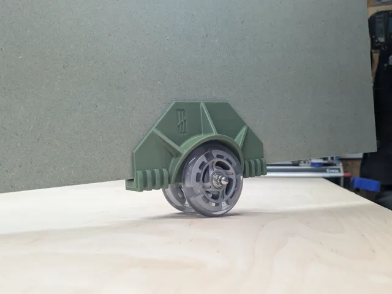</a> 
<b>Plywood Dolly. Up to 19mm sheets.</b> 
by modest.workshop 
<a href="https://makerworld.com/en/models/2558230-plywood-dolly-up-to-19mm-sheets">MakerWorld</a> &middot; <a href="Plywood%2BDolly.%2BUp%2Bto%2B19mm%2Bsheets_">Repo folder</a>
</td>
</tr>
<tr>
<td width="33%" align="center" valign="top">
<i>no preview</i> 
<b>Quarter Sheet 90 Outside Corner Sander</b> 
<a href="https://makerworld.com/en/search/models?keyword=Quarter%20Sheet%2090%20Outside%20Corner%20Sander">Search MakerWorld</a> &middot; <a href="quarter%2Bsheet%2B90%2Boutside%2Bcorner%2Bsander_stls">Repo folder</a>
</td>
</tr>
</table>

## Clamps

<table>
<tr>
<td width="33%" align="center" valign="top">
<a href="clamps/bench-mountable-4-jaw-3-jaw-2-jaw-vise-with-swappable-jaws-100-printable-model_files">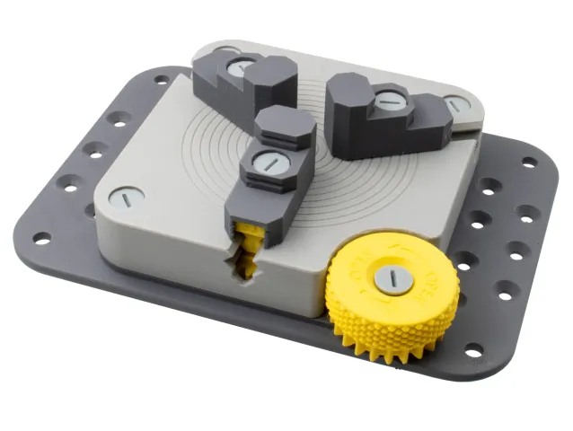</a> 
<b>Bench Mountable 4-Jaw / 3-Jaw / 2-Jaw Vise with Swappable Jaws - 100% Printable!</b> 
by Sneaks 
<a href="https://www.printables.com/model/281912-bench-mountable-4-jaw-3-jaw-2-jaw-vise-with-swappa">Printables</a> &middot; <a href="clamps/bench-mountable-4-jaw-3-jaw-2-jaw-vise-with-swappable-jaws-100-printable-model_files">Repo folder</a>
</td>
<td width="33%" align="center" valign="top">
<a href="clamps/Corner%2BClamp.3mf">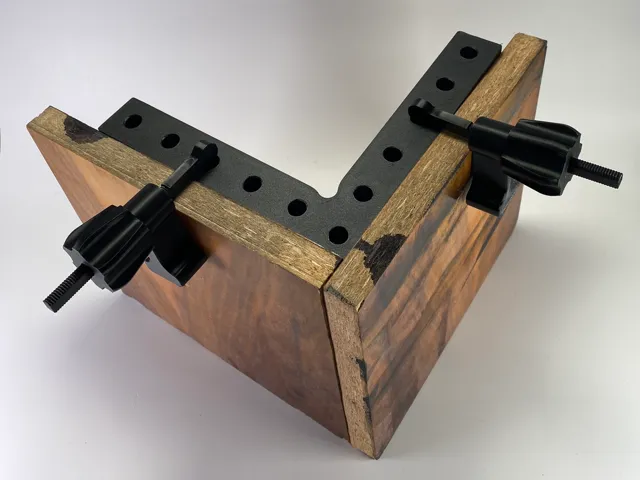</a> 
<b>Corner clamp</b> 
by zzzzzzzx 
<a href="https://makerworld.com/en/models/1212578-corner-clamp">MakerWorld</a> &middot; <a href="clamps/Corner%2BClamp.3mf">Corner+Clamp.3mf</a>
</td>
<td width="33%" align="center" valign="top">
<a href="clamps/Corner_clamp_713236">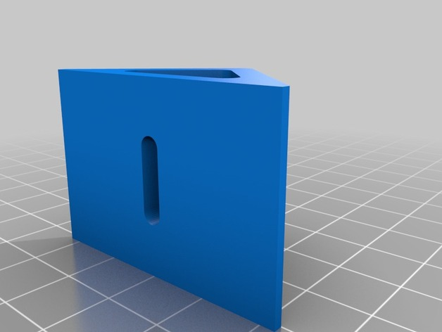</a> 
<b>Corner clamp</b> 
by oikos 
<a href="https://www.thingiverse.com/thing:713236">Thingiverse</a> &middot; <a href="clamps/Corner_clamp_713236">Repo folder</a>
</td>
</tr>
<tr>
<td width="33%" align="center" valign="top">
<a href="clamps/Corner%2BClamp%2Bfor%2BWoodworking">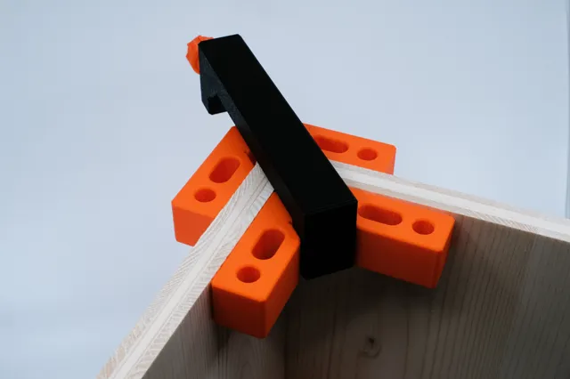</a> 
<b>Corner Clamp for Woodworking</b> 
by Sakul 
<a href="https://makerworld.com/en/models/176297-corner-clamp-for-woodworking">MakerWorld</a> &middot; <a href="clamps/Corner%2BClamp%2Bfor%2BWoodworking">Repo folder</a>
</td>
<td width="33%" align="center" valign="top">
<a href="clamps/Fractal_Vise_4904044">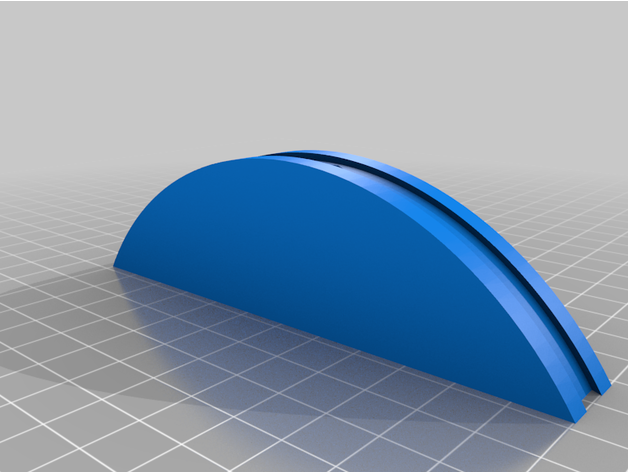</a> 
<b>Fractal Vise</b> 
by TeachingTech 
<a href="https://www.thingiverse.com/thing:4904044">Thingiverse</a> &middot; <a href="clamps/Fractal_Vise_4904044">Repo folder</a>
</td>
<td width="33%" align="center" valign="top">
<a href="clamps/wood-gripper-corner-clamp-model_files">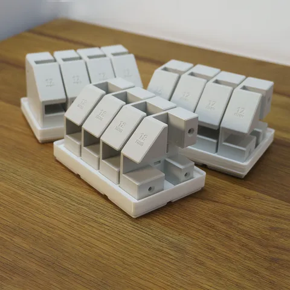</a> 
<b>Wood Gripper Corner Clamp</b> 
by Hands on Katie 
<a href="https://www.printables.com/model/777534-wood-gripper-corner-clamp">Printables</a> &middot; <a href="clamps/wood-gripper-corner-clamp-model_files">Repo folder</a>
</td>
</tr>
</table>

## Hand Tools

<table>
<tr>
<td width="33%" align="center" valign="top">
<a href="hand-tools/Center_Finder_For_Edges_Set">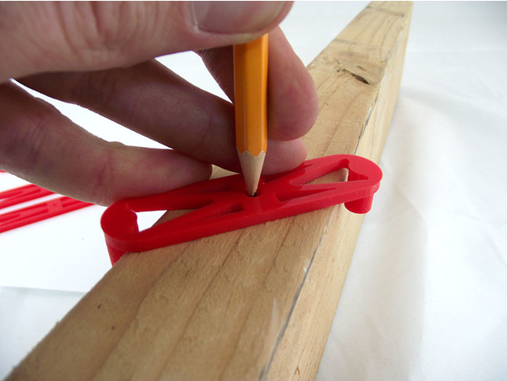</a> 
<b>Center Finder For Edges Set</b> 
by TikiLuke 
<a href="https://www.thingiverse.com/thing:2199356">Thingiverse</a> &middot; <a href="hand-tools/Center_Finder_For_Edges_Set">Repo folder</a>
</td>
<td width="33%" align="center" valign="top">
<a href="hand-tools/cross_tweezer">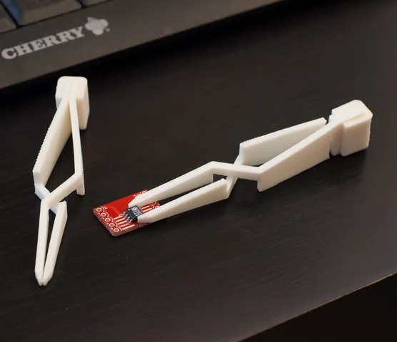</a> 
<b>cross tweezer</b> 
by joo 
<a href="https://www.printables.com/model/157012-cross-tweezer">Printables</a> &middot; <a href="hand-tools/cross_tweezer">Repo folder</a>
</td>
<td width="33%" align="center" valign="top">
<i>no preview</i> 
<b>Milling-Box-master</b> 
Source unknown &middot; <a href="hand-tools/Milling-Box-master">Repo folder</a>
</td>
</tr>
<tr>
<td width="33%" align="center" valign="top">
<a href="hand-tools/Modular_Mounting_System_2194278">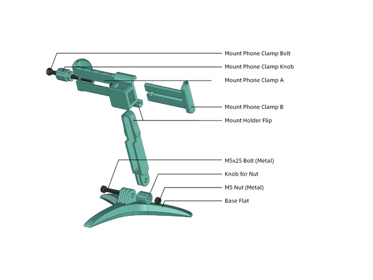</a> 
<b>Modular Mounting System</b> 
by HeyVye 
<a href="https://www.thingiverse.com/thing:2194278">Thingiverse</a> &middot; <a href="hand-tools/Modular_Mounting_System_2194278">Repo folder</a>
</td>
<td width="33%" align="center" valign="top">
<a href="hand-tools/NUT_JOB__Nut_Bolt_Washer_and_Threaded_Rod_Factory">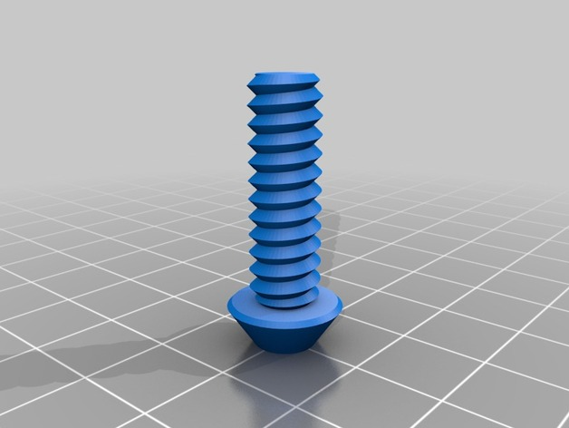</a> 
<b>NUT JOB | Nut, Bolt, Washer and Threaded Rod Factory</b> 
by mike_mattala 
<a href="https://www.thingiverse.com/thing:193647">Thingiverse</a> &middot; <a href="hand-tools/NUT_JOB__Nut_Bolt_Washer_and_Threaded_Rod_Factory">Repo folder</a>
</td>
<td width="33%" align="center" valign="top">
<a href="hand-tools/Rod_and_Tube_Cutter_for_Dremel_3323294">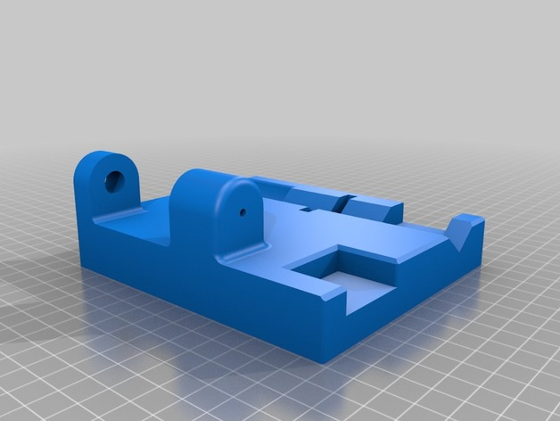</a> 
<b>Rod and Tube Cutter for Dremel</b> 
by GreaseMonkey88 
<a href="https://www.thingiverse.com/thing:3323294">Thingiverse</a> &middot; <a href="hand-tools/Rod_and_Tube_Cutter_for_Dremel_3323294">Repo folder</a>
</td>
</tr>
</table>

## Hand Tools / Drivers

<table>
<tr>
<td width="33%" align="center" valign="top">
<a href="hand-tools/drivers/10mm_potentiometer_bolt_tool">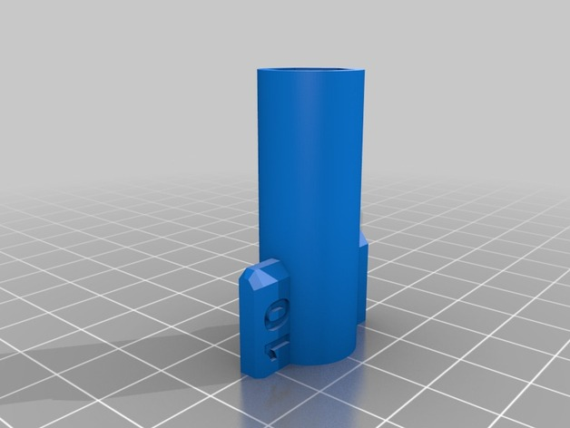</a> 
<b>10mm potentiometer bolt tool - NO Scratching Panel -</b> 
by marcelodamian 
<a href="https://www.thingiverse.com/thing:1111852">Thingiverse</a> &middot; <a href="hand-tools/drivers/10mm_potentiometer_bolt_tool">Repo folder</a>
</td>
<td width="33%" align="center" valign="top">
<i>no preview</i> 
<b>6 mm Jack bolt tool</b> 
Source unknown &middot; <a href="hand-tools/drivers/6_mm_Jack_bolt_tool">Repo folder</a>
</td>
<td width="33%" align="center" valign="top">
<a href="hand-tools/drivers/Arbitrary_hex_Allen_key_holder">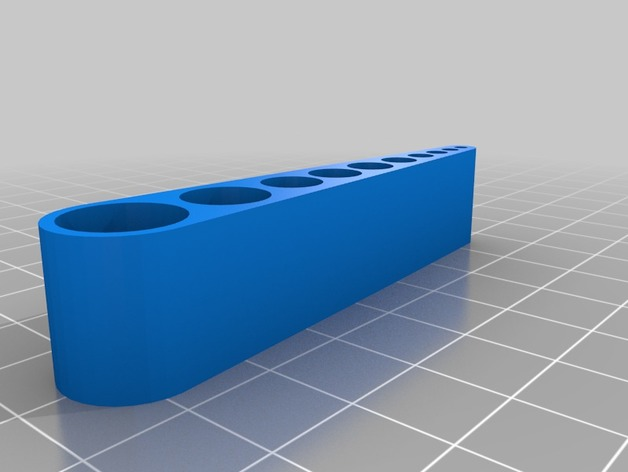</a> 
<b>Arbitrary hex (Allen) key holder</b> 
by threedaymonk 
<a href="https://www.thingiverse.com/thing:2988075">Thingiverse</a> &middot; <a href="hand-tools/drivers/Arbitrary_hex_Allen_key_holder">Repo folder</a>
</td>
</tr>
</table>

Other files in this folder (4)

- [Compact_Screwdriver.stl](hand-tools/drivers/Compact_Screwdriver.stl)
- [Compact_Screwdriver_4mm_bit.stl](hand-tools/drivers/Compact_Screwdriver_4mm_bit.stl)
- [knurled-handle-for-cylinder-head-screw-model_files.zip](hand-tools/drivers/knurled-handle-for-cylinder-head-screw-model_files.zip)
- [Tap wrench M5 M6 M8 - 5260969.zip](hand-tools/drivers/Tap%20wrench%20M5%20M6%20M8%20-%205260969.zip)

## Hardware

<table>
<tr>
<td width="33%" align="center" valign="top">
<i>no preview</i> 
<b>All M3-M8</b> 
<a href="https://makerworld.com/en/search/models?keyword=All%20M3-M8">Search MakerWorld</a> &middot; <a href="hardware/All%2BM3-M8_stls">Repo folder</a>
</td>
<td width="33%" align="center" valign="top">
 
<b>Knurled Nuts</b> 
by ngprint 
<a href="https://makerworld.com/en/models/404343-knurled-nuts">MakerWorld</a> &middot; <a href="hardware/Knurled-nuts">Repo folder</a>
</td>
<td width="33%" align="center" valign="top">
<a href="hardware/Wing-nuts">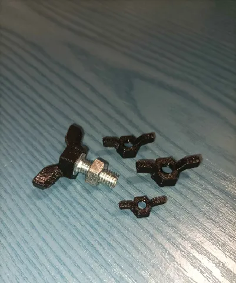</a> 
<b>Wing nuts</b> 
by CoinCorrector 
<a href="https://www.printables.com/model/1192118-wing-nuts">Printables</a> &middot; <a href="hardware/Wing-nuts">Repo folder</a>
</td>
</tr>
</table>

## Machining

<table>
<tr>
<td width="33%" align="center" valign="top">
<i>no preview</i> 
<b>3D Printed Laser Cut, Lil-CNC Mill ACv2</b> 
Source unknown &middot; <a href="machining/3D_Printed___Laser_Cut%2C_Lil-CNC_Mill_ACv2">Repo folder</a>
</td>
<td width="33%" align="center" valign="top">
<a href="machining/DREMEL_Drill_Press__Very_strong_and_precise___4148260">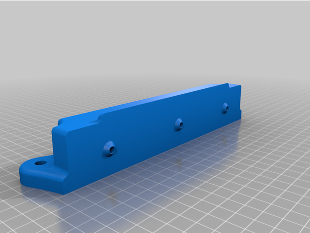</a> 
<b>DREMEL Drill Press (Very strong and precise)</b> 
by 3Deddy 
<a href="https://www.thingiverse.com/thing:4148260">Thingiverse</a> &middot; <a href="machining/DREMEL_Drill_Press__Very_strong_and_precise___4148260">Repo folder</a>
</td>
<td width="33%" align="center" valign="top">
<a href="machining/Gollum_-_MiniCNC">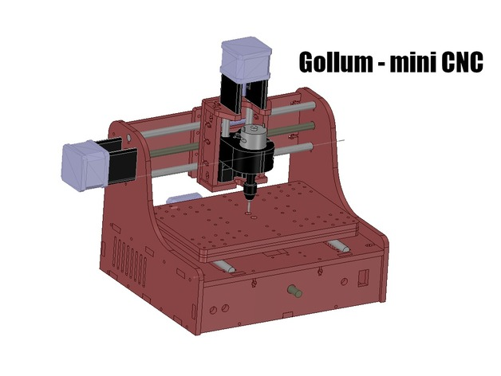</a> 
<b>Gollum - MiniCNC</b> 
by cyryllo 
<a href="https://www.thingiverse.com/thing:2551625">Thingiverse</a> &middot; <a href="machining/Gollum_-_MiniCNC">Repo folder</a>
</td>
</tr>
<tr>
<td width="33%" align="center" valign="top">
<i>no preview</i> 
<b>Mini Sanding And Sharpening Machine</b> 
<a href="https://www.printables.com/model/719862">Printables</a> &middot; <a href="machining/mini-sanding-and-sharpening-machine-model_files">Repo folder</a>
</td>
<td width="33%" align="center" valign="top">
<a href="machining/powerful-useful-3d-mini-saw-model_files">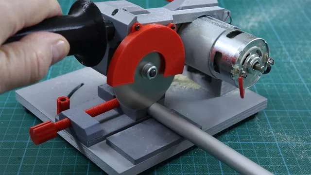</a> 
<b>Powerful &amp; Useful 3D Mini Saw</b> 
by RCMakerLab 
<a href="https://www.printables.com/model/719964-powerful-useful-3d-mini-saw">Printables</a> &middot; <a href="machining/powerful-useful-3d-mini-saw-model_files">Repo folder</a>
</td>
<td width="33%" align="center" valign="top">
<a href="machining/RS-CNC__the_new_model_of_R-CNC">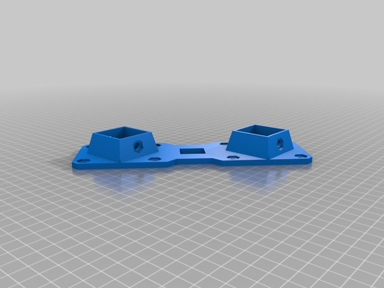</a> 
<b>RS-CNC , the new model of R-CNC</b> 
by RoMaker 
<a href="https://www.thingiverse.com/thing:3010914">Thingiverse</a> &middot; <a href="machining/RS-CNC__the_new_model_of_R-CNC">Repo folder</a>
</td>
</tr>
<tr>
<td width="33%" align="center" valign="top">
<a href="machining/Table_SAW">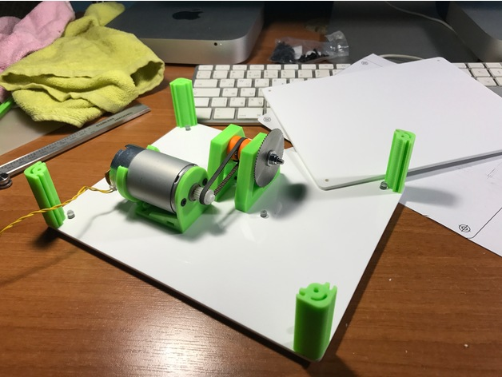</a> 
<b>Table SAW</b> 
by Perinski 
<a href="https://www.thingiverse.com/thing:3044200">Thingiverse</a> &middot; <a href="machining/Table_SAW">Repo folder</a>
</td>
<td width="33%" align="center" valign="top">
<a href="machining/table-saw-for-dremel-model_files">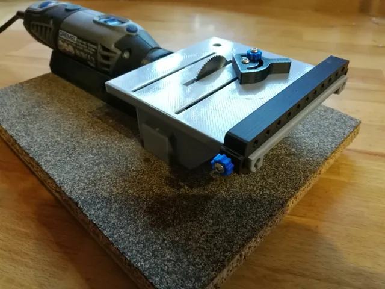</a> 
<b>Table saw for Dremel</b> 
by Fearless 
<a href="https://www.printables.com/model/708684-table-saw-for-dremel">Printables</a> &middot; <a href="machining/table-saw-for-dremel-model_files">Repo folder</a>
</td>
<td width="33%" align="center" valign="top">
<a href="machining/Table_saw_for_Dremel_4000_with_drill_bracket_Fixed_">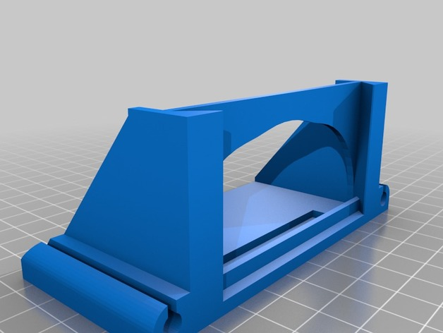</a> 
<b>Table saw for Dremel 4000 (with drill bracket Fixed)</b> 
by oikos 
<a href="https://www.thingiverse.com/thing:670704">Thingiverse</a> &middot; <a href="machining/Table_saw_for_Dremel_4000_with_drill_bracket_Fixed_">Repo folder</a>
</td>
</tr>
<tr>
<td width="33%" align="center" valign="top">
<a href="machining/Vertical%2BMilling%2BMachine.3mf">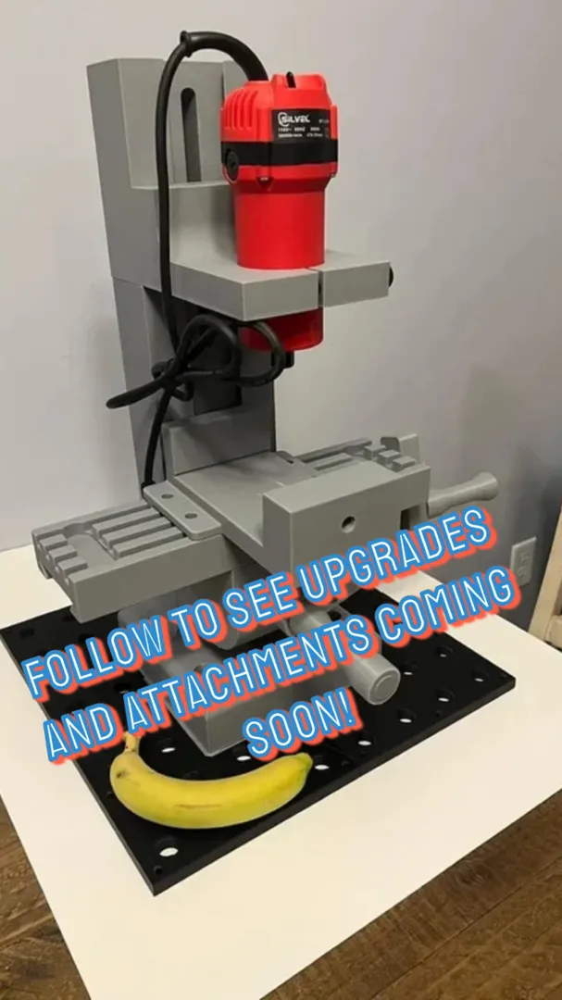</a> 
<b>Vertical Milling Machine</b> 
<a href="https://makerworld.com/en/search/models?keyword=Vertical%20Milling%20Machine">Search MakerWorld</a> &middot; <a href="machining/Vertical%2BMilling%2BMachine.3mf">Vertical+Milling+Machine.3mf</a>
</td>
<td width="33%" align="center" valign="top">
<i>no preview</i> 
<b>Very Useful Mini Table Saw V20</b> 
<a href="https://www.printables.com/model/736387">Printables</a> &middot; <a href="machining/very-useful-mini-table-saw-v20-model_files">Repo folder</a>
</td>
</tr>
</table>

## Woodworking

<table>
<tr>
<td width="33%" align="center" valign="top">
<a href="woodworking/CORNER_PROFILES_5918127">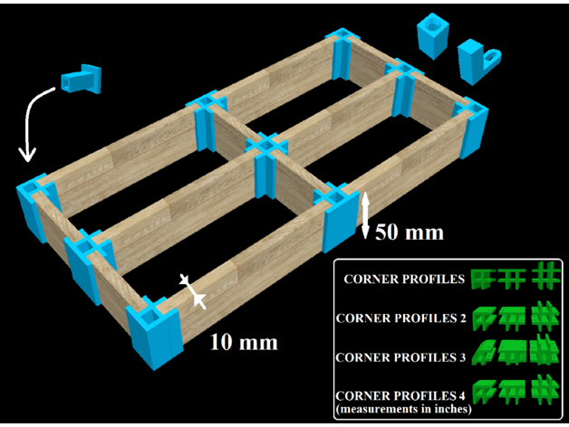</a> 
<b>CORNER PROFILES</b> 
by SlyWorks 
<a href="https://www.thingiverse.com/thing:5918127">Thingiverse</a> &middot; <a href="woodworking/CORNER_PROFILES_5918127">Repo folder</a>
</td>
<td width="33%" align="center" valign="top">
<a href="woodworking/Customizable_Sanding_Stick">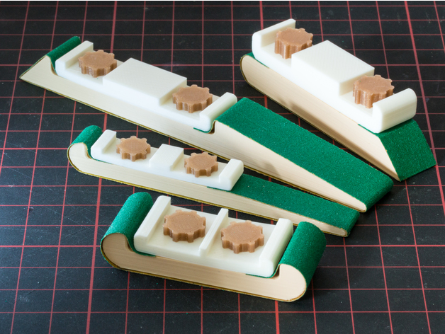</a> 
<b>Customizable Sanding Stick</b> 
by mightynozzle 
<a href="https://www.thingiverse.com/thing:2404850">Thingiverse</a> &middot; <a href="woodworking/Customizable_Sanding_Stick">Repo folder</a>
</td>
<td width="33%" align="center" valign="top">
<a href="woodworking/perky-peaks-painting-pyramids-with-custom-gridfinity-holder-model_files">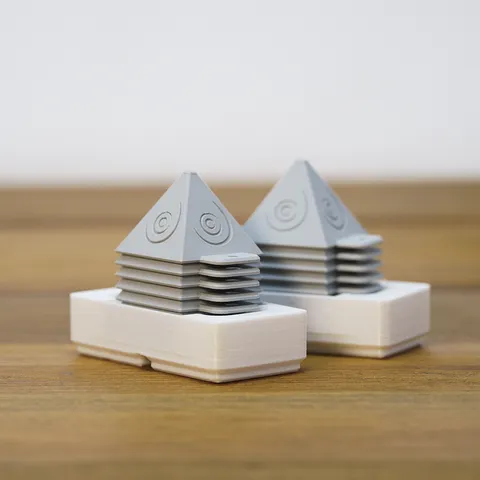</a> 
<b>Perky Peaks Painting Pyramids with Custom Gridfinity Holder</b> 
by Hands on Katie 
<a href="https://www.printables.com/model/777429-perky-peaks-painting-pyramids-with-custom-gridfini">Printables</a> &middot; <a href="woodworking/perky-peaks-painting-pyramids-with-custom-gridfinity-holder-model_files">Repo folder</a>
</td>
</tr>
<tr>
<td width="33%" align="center" valign="top">
<a href="woodworking/pocket-hole-jig-model_files">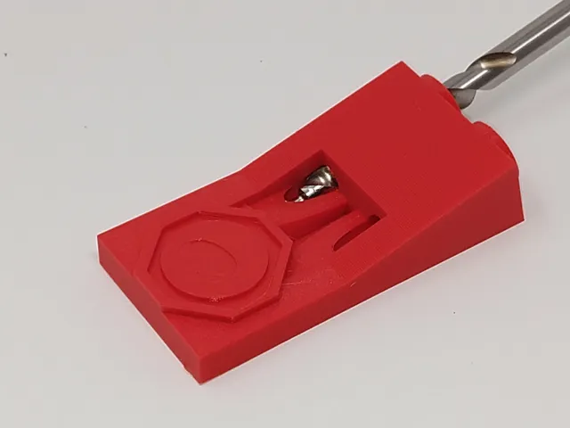</a> 
<b>Pocket hole jig</b> 
by Henry 
<a href="https://www.printables.com/model/96193-pocket-hole-jig">Printables</a> &middot; <a href="woodworking/pocket-hole-jig-model_files">Repo folder</a>
</td>
<td width="33%" align="center" valign="top">
<i>no preview</i> 
<b>Sawhorse-master</b> 
Source unknown &middot; <a href="woodworking/Sawhorse-master">Repo folder</a>
</td>
</tr>
</table>

Other files in this folder (1)

- [Blade Honing Guide - 6664571.zip](woodworking/Blade%20Honing%20Guide%20-%206664571.zip)

## Woodworking / Connectors

<table>
<tr>
<td width="33%" align="center" valign="top">
<a href="woodworking/connectors/90%2Bdegree%2Bcorner%2Bassembly%2Bguides%2B-%2BMETRIC%2B6mm-25mm">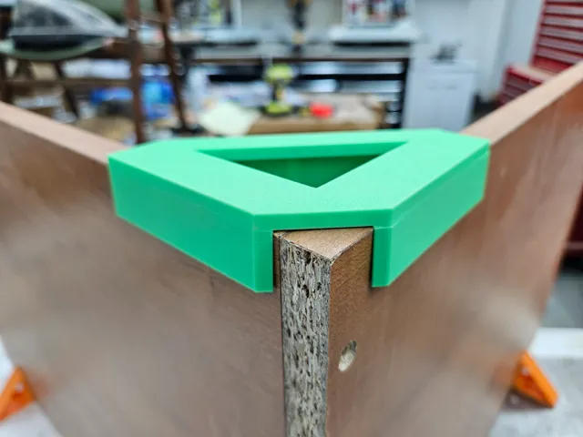</a> 
<b>90 degree corner assembly guides - METRIC 6mm-25mm</b> 
by Darren 3d print 
<a href="https://makerworld.com/en/models/913240-90-degree-corner-assembly-guides-metric-6mm-25mm">MakerWorld</a> &middot; <a href="woodworking/connectors/90%2Bdegree%2Bcorner%2Bassembly%2Bguides%2B-%2BMETRIC%2B6mm-25mm">Repo folder</a>
</td>
<td width="33%" align="center" valign="top">
<a href="woodworking/connectors/Joints_to_make_DIY_furniture_2400175">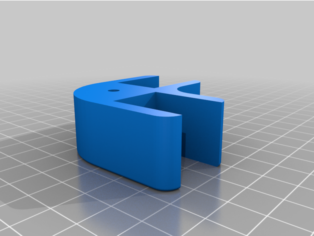</a> 
<b>Joints to make DIY furniture</b> 
by martcs 
<a href="https://www.thingiverse.com/thing:2400175">Thingiverse</a> &middot; <a href="woodworking/connectors/Joints_to_make_DIY_furniture_2400175">Repo folder</a>
</td>
<td width="33%" align="center" valign="top">
<a href="woodworking/connectors/Joints_to_make_DIY_furniture">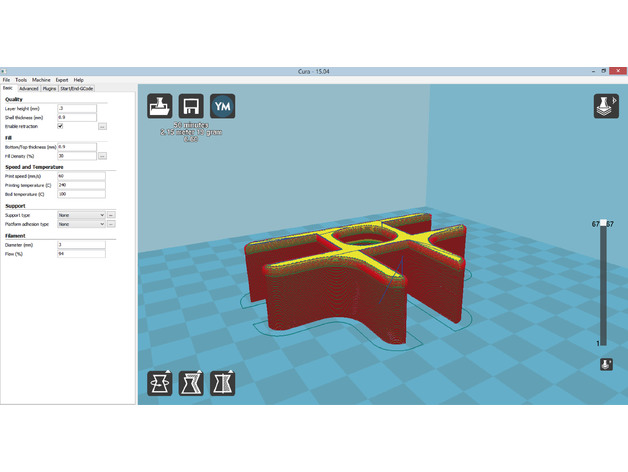</a> 
<b>Joints to make DIY furniture</b> 
by martcaset 
<a href="https://www.thingiverse.com/thing:2400175">Thingiverse</a> &middot; <a href="woodworking/connectors/Joints_to_make_DIY_furniture">Repo folder</a>
</td>
</tr>
<tr>
<td width="33%" align="center" valign="top">
<i>no preview</i> 
<b>Modular Furniture Joint</b> 
Source unknown &middot; <a href="woodworking/connectors/Modular_Furniture_Joint">Repo folder</a>
</td>
<td width="33%" align="center" valign="top">
 
<b>Modular shelf</b> 
<a href="https://makerworld.com/en/search/models?keyword=Modular%20shelf">Search MakerWorld</a> &middot; <a href="woodworking/connectors/Modular%2Bshelf">Repo folder</a>
</td>
<td width="33%" align="center" valign="top">
 
<b>Moidules - Create your own custom made shelving system at home!</b> 
by Moidules 
<a href="https://www.thingiverse.com/thing:681835">Thingiverse</a> &middot; <a href="woodworking/connectors/Moidules_-_Create_your_own_custom_made_shelving_system_at_home__681835">Repo folder</a>
</td>
</tr>
<tr>
<td width="33%" align="center" valign="top">
<a href="woodworking/connectors/Parametric%2BPinch%2B3D%2Bjoint%2B-%2BGeometric%2Bversion">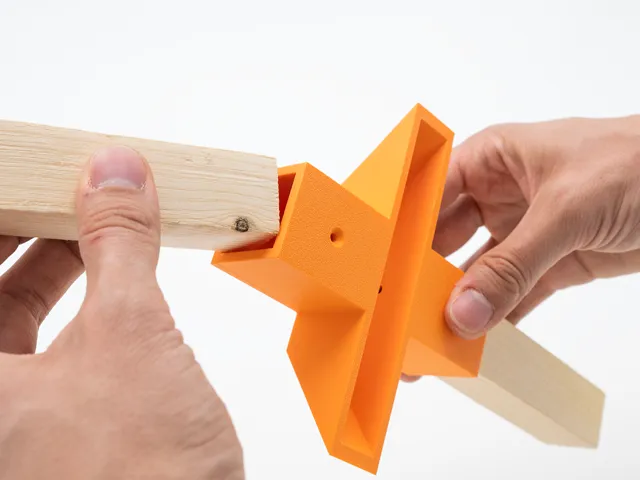</a> 
<b>Parametric Pinch 3D joint - Geometric version</b> 
by Unico Dadudi 
<a href="https://makerworld.com/en/models/2630102-parametric-pinch-3d-joint-geometric-version">MakerWorld</a> &middot; <a href="woodworking/connectors/Parametric%2BPinch%2B3D%2Bjoint%2B-%2BGeometric%2Bversion">Repo folder</a>
</td>
<td width="33%" align="center" valign="top">
<a href="woodworking/connectors/PVC_pipe_construction_set__ver_2_932732">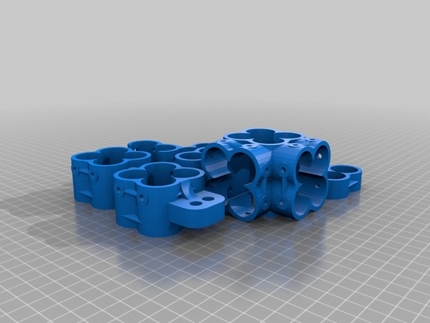</a> 
<b>PVC pipe construction set, ver.2</b> 
by DonaldJ 
<a href="https://www.thingiverse.com/thing:932732">Thingiverse</a> &middot; <a href="woodworking/connectors/PVC_pipe_construction_set__ver_2_932732">Repo folder</a>
</td>
<td width="33%" align="center" valign="top">
<a href="woodworking/connectors/Set_of_moidules_for_1_2_inch_board__Option_with_screw_holes__736398">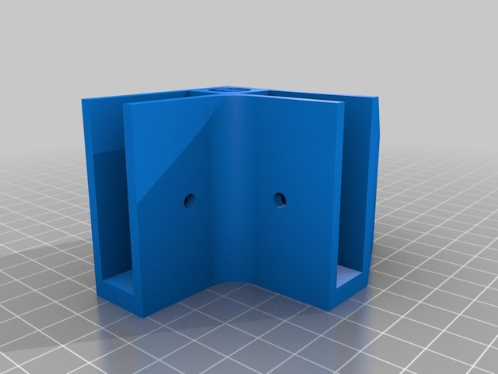</a> 
<b>Set of moidules for 1/2 inch board. Option with screw holes!</b> 
by Moidules 
<a href="https://www.thingiverse.com/thing:736398">Thingiverse</a> &middot; <a href="woodworking/connectors/Set_of_moidules_for_1_2_inch_board__Option_with_screw_holes__736398">Repo folder</a>
</td>
</tr>
<tr>
<td width="33%" align="center" valign="top">
<a href="woodworking/connectors/Set_of_moidules_for_1_4_inch_board__736403">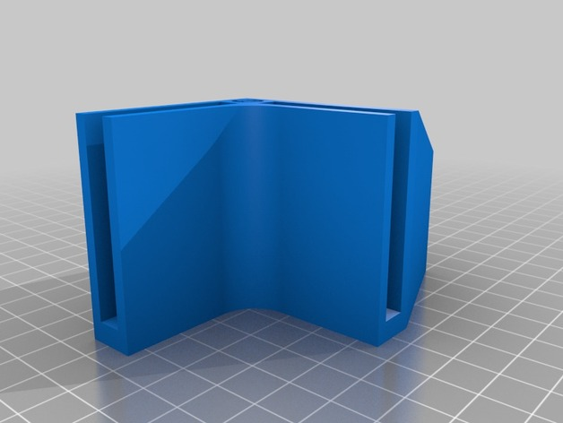</a> 
<b>Set of moidules for 1/4 inch board.</b> 
by Moidules 
<a href="https://www.thingiverse.com/thing:736403">Thingiverse</a> &middot; <a href="woodworking/connectors/Set_of_moidules_for_1_4_inch_board__736403">Repo folder</a>
</td>
<td width="33%" align="center" valign="top">
<a href="woodworking/connectors/Set_of_Moidules_for_12mm_board__Option_with_screw_holes__725671">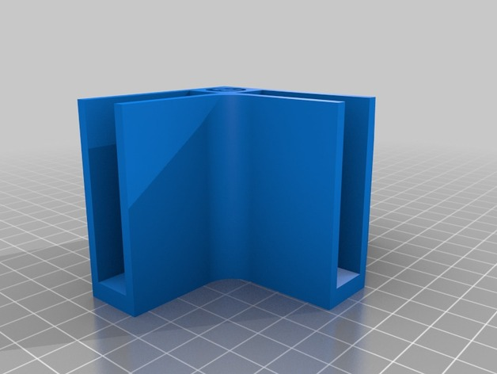</a> 
<b>Set of Moidules for 12mm board. Option with screw holes!</b> 
by Moidules 
<a href="https://www.thingiverse.com/thing:725671">Thingiverse</a> &middot; <a href="woodworking/connectors/Set_of_Moidules_for_12mm_board__Option_with_screw_holes__725671">Repo folder</a>
</td>
<td width="33%" align="center" valign="top">
<a href="woodworking/connectors/Shelving%2Bbracket%2Bsystem">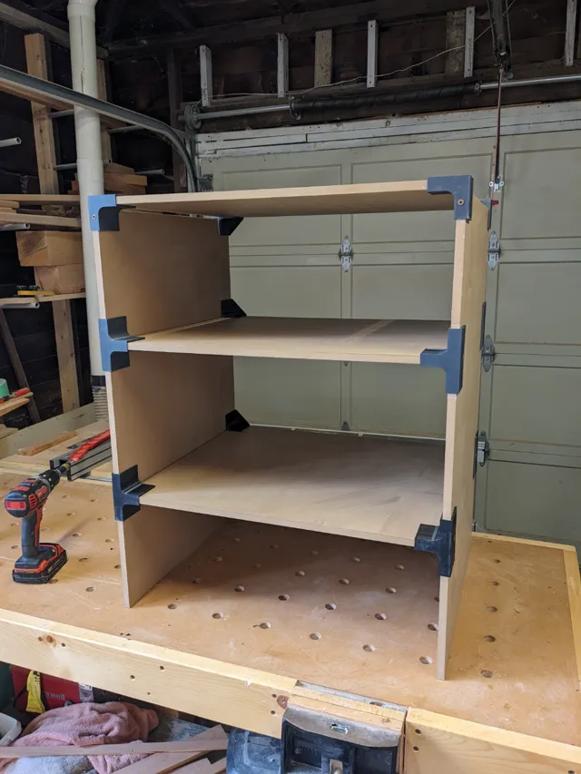</a> 
<b>Shelving bracket system</b> 
by OxSox 
<a href="https://makerworld.com/en/models/206120-shelving-bracket-system">MakerWorld</a> &middot; <a href="woodworking/connectors/Shelving%2Bbracket%2Bsystem">Repo folder</a>
</td>
</tr>
</table>

Other files in this folder (1)

- [plate-connector-90-degree-90-grad-plattenverbinder-winkel-schrank-model_files.zip](woodworking/connectors/plate-connector-90-degree-90-grad-plattenverbinder-winkel-schrank-model_files.zip)

## Woodworking / Sanding Tools

<table>
<tr>
<td width="33%" align="center" valign="top">
 
<b>Customizable Sanding Stick</b> 
by mightynozzle 
<a href="https://www.thingiverse.com/thing:2404850">Thingiverse</a> &middot; <a href="woodworking/sanding-tools/Customizable_Sanding_Stick">Repo folder</a>
</td>
<td width="33%" align="center" valign="top">
<i>no preview</i> 
<b>RAZE NANO ARC</b> 
<a href="https://makerworld.com/en/search/models?keyword=RAZE%20NANO%20ARC">Search MakerWorld</a> &middot; <a href="woodworking/sanding-tools/RAZE_NANO_ARC_stls">Repo folder</a>
</td>
<td width="33%" align="center" valign="top">
<i>no preview</i> 
<b>RAZE NANO DOME</b> 
<a href="https://makerworld.com/en/search/models?keyword=RAZE%20NANO%20DOME">Search MakerWorld</a> &middot; <a href="woodworking/sanding-tools/RAZE_NANO_DOME_stls">Repo folder</a>
</td>
</tr>
<tr>
<td width="33%" align="center" valign="top">
<i>no preview</i> 
<b>RAZE NANO SPEAR</b> 
<a href="https://makerworld.com/en/search/models?keyword=RAZE%20NANO%20SPEAR">Search MakerWorld</a> &middot; <a href="woodworking/sanding-tools/RAZE_NANO_SPEAR_stls">Repo folder</a>
</td>
</tr>
</table>

