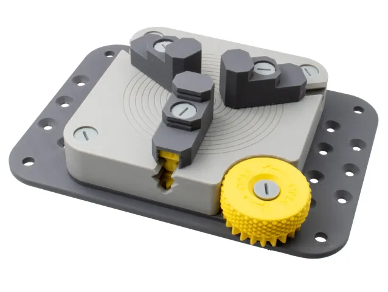
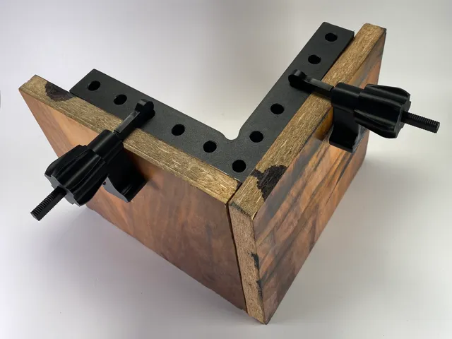
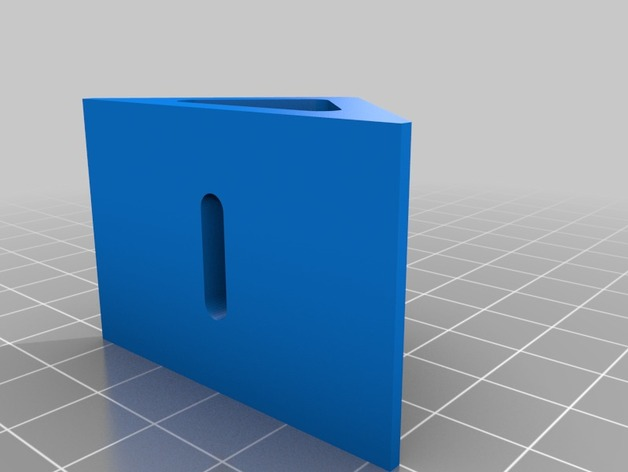
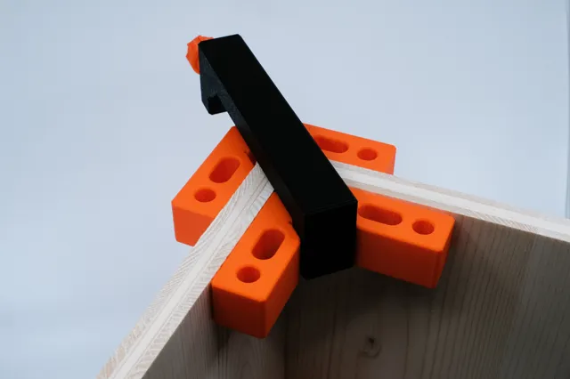
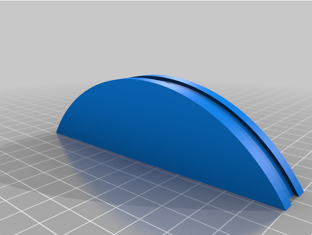
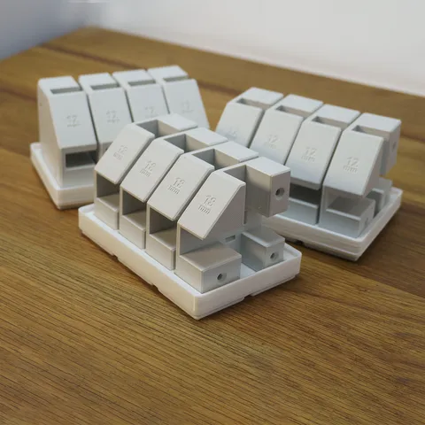

# Clamps

<!-- Generated by scripts/Update-Readmes.ps1 (Linux: scripts/update_readmes.py) - edit scripts/readme-sources.json and rerun instead of editing by hand. -->

[Home](../../README.md) / [Tools](../README.md) / **Clamps**

6 builds &middot; 2 MakerWorld &middot; 2 Printables &middot; 2 Thingiverse

## Clamps

<table>
<tr>
<td width="33%" align="center" valign="top">
 
<b>Bench Mountable 4-Jaw / 3-Jaw / 2-Jaw Vise with Swappable Jaws - 100% Printable!</b> 
by Sneaks 
<a href="https://www.printables.com/model/281912-bench-mountable-4-jaw-3-jaw-2-jaw-vise-with-swappa">Printables</a> &middot; <a href="bench-mountable-4-jaw-3-jaw-2-jaw-vise-with-swappable-jaws-100-printable-model_files">Repo folder</a>
</td>
<td width="33%" align="center" valign="top">
 
<b>Corner clamp</b> 
by zzzzzzzx 
<a href="https://makerworld.com/en/models/1212578-corner-clamp">MakerWorld</a> &middot; <a href="Corner%2BClamp.3mf">Corner+Clamp.3mf</a>
</td>
<td width="33%" align="center" valign="top">
 
<b>Corner clamp</b> 
by oikos 
<a href="https://www.thingiverse.com/thing:713236">Thingiverse</a> &middot; <a href="Corner_clamp_713236">Repo folder</a>
</td>
</tr>
<tr>
<td width="33%" align="center" valign="top">
 
<b>Corner Clamp for Woodworking</b> 
by Sakul 
<a href="https://makerworld.com/en/models/176297-corner-clamp-for-woodworking">MakerWorld</a> &middot; <a href="Corner%2BClamp%2Bfor%2BWoodworking">Repo folder</a>
</td>
<td width="33%" align="center" valign="top">
 
<b>Fractal Vise</b> 
by TeachingTech 
<a href="https://www.thingiverse.com/thing:4904044">Thingiverse</a> &middot; <a href="Fractal_Vise_4904044">Repo folder</a>
</td>
<td width="33%" align="center" valign="top">
 
<b>Wood Gripper Corner Clamp</b> 
by Hands on Katie 
<a href="https://www.printables.com/model/777534-wood-gripper-corner-clamp">Printables</a> &middot; <a href="wood-gripper-corner-clamp-model_files">Repo folder</a>
</td>
</tr>
</table>

