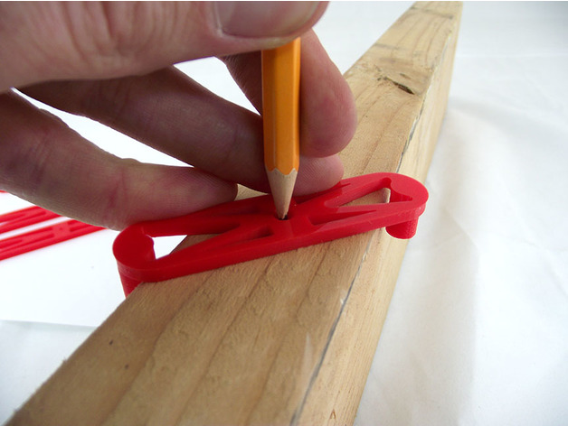
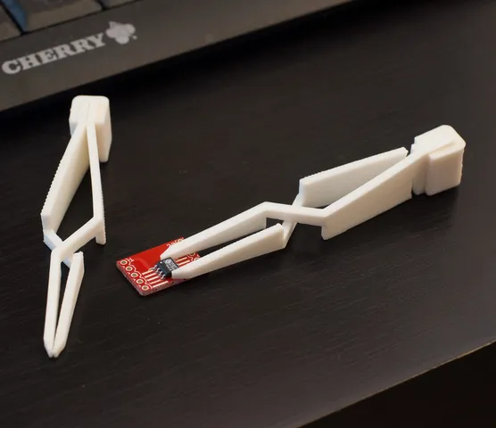
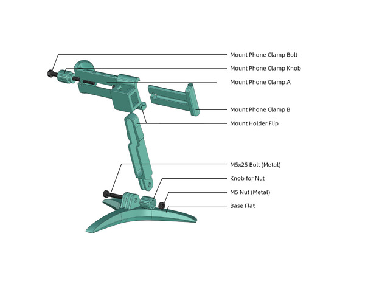
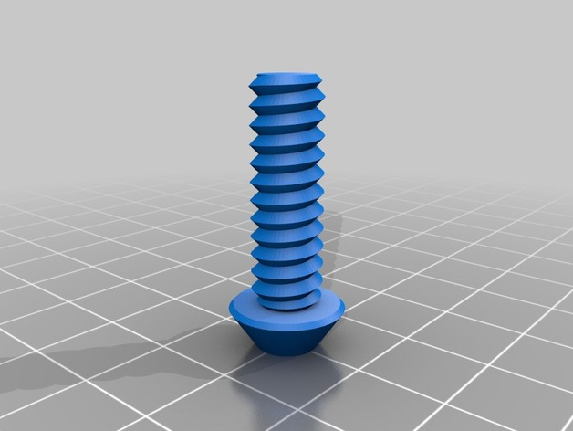
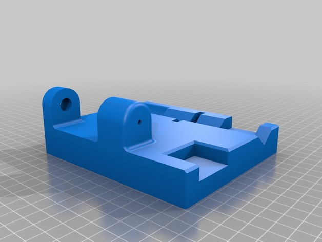

# Hand Tools

<!-- Generated by scripts/Update-Readmes.ps1 (Linux: scripts/update_readmes.py) - edit scripts/readme-sources.json and rerun instead of editing by hand. -->

[Home](../../README.md) / [Tools](../README.md) / **Hand Tools**

6 builds &middot; 1 Printables &middot; 4 Thingiverse &middot; 1 unknown source &middot; 1 collections (7 more builds)

## Collections

- [Drivers](drivers/README.md) - 7 builds

## Hand Tools

<table>
<tr>
<td width="33%" align="center" valign="top">
 
<b>Center Finder For Edges Set</b> 
by TikiLuke 
<a href="https://www.thingiverse.com/thing:2199356">Thingiverse</a> &middot; <a href="Center_Finder_For_Edges_Set">Repo folder</a>
</td>
<td width="33%" align="center" valign="top">
 
<b>cross tweezer</b> 
by joo 
<a href="https://www.printables.com/model/157012-cross-tweezer">Printables</a> &middot; <a href="cross_tweezer">Repo folder</a>
</td>
<td width="33%" align="center" valign="top">
<i>no preview</i> 
<b>Milling-Box-master</b> 
Source unknown &middot; <a href="Milling-Box-master">Repo folder</a>
</td>
</tr>
<tr>
<td width="33%" align="center" valign="top">
 
<b>Modular Mounting System</b> 
by HeyVye 
<a href="https://www.thingiverse.com/thing:2194278">Thingiverse</a> &middot; <a href="Modular_Mounting_System_2194278">Repo folder</a>
</td>
<td width="33%" align="center" valign="top">
 
<b>NUT JOB | Nut, Bolt, Washer and Threaded Rod Factory</b> 
by mike_mattala 
<a href="https://www.thingiverse.com/thing:193647">Thingiverse</a> &middot; <a href="NUT_JOB__Nut_Bolt_Washer_and_Threaded_Rod_Factory">Repo folder</a>
</td>
<td width="33%" align="center" valign="top">
 
<b>Rod and Tube Cutter for Dremel</b> 
by GreaseMonkey88 
<a href="https://www.thingiverse.com/thing:3323294">Thingiverse</a> &middot; <a href="Rod_and_Tube_Cutter_for_Dremel_3323294">Repo folder</a>
</td>
</tr>
</table>

