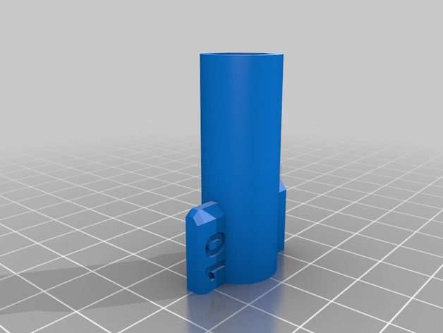
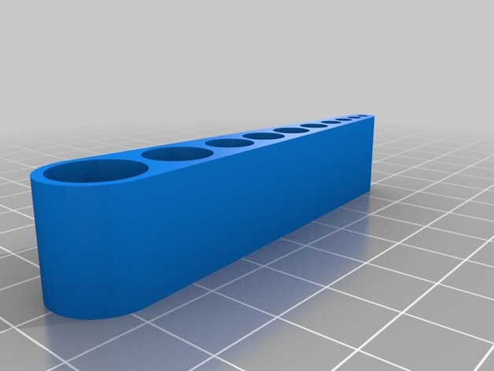

# Drivers

<!-- Generated by scripts/Update-Readmes.ps1 (Linux: scripts/update_readmes.py) - edit scripts/readme-sources.json and rerun instead of editing by hand. -->

[Home](../../../README.md) / [Tools](../../README.md) / [Hand Tools](../README.md) / **Drivers**

7 builds &middot; 2 Thingiverse &middot; 5 unknown source

## Drivers

<table>
<tr>
<td width="33%" align="center" valign="top">
 
<b>10mm potentiometer bolt tool - NO Scratching Panel -</b> 
by marcelodamian 
<a href="https://www.thingiverse.com/thing:1111852">Thingiverse</a> &middot; <a href="10mm_potentiometer_bolt_tool">Repo folder</a>
</td>
<td width="33%" align="center" valign="top">
<i>no preview</i> 
<b>6 mm Jack bolt tool</b> 
Source unknown &middot; <a href="6_mm_Jack_bolt_tool">Repo folder</a>
</td>
<td width="33%" align="center" valign="top">
 
<b>Arbitrary hex (Allen) key holder</b> 
by threedaymonk 
<a href="https://www.thingiverse.com/thing:2988075">Thingiverse</a> &middot; <a href="Arbitrary_hex_Allen_key_holder">Repo folder</a>
</td>
</tr>
</table>

Other files in this folder (4)

- [Compact_Screwdriver.stl](Compact_Screwdriver.stl)
- [Compact_Screwdriver_4mm_bit.stl](Compact_Screwdriver_4mm_bit.stl)
- [knurled-handle-for-cylinder-head-screw-model_files.zip](knurled-handle-for-cylinder-head-screw-model_files.zip)
- [Tap wrench M5 M6 M8 - 5260969.zip](Tap%20wrench%20M5%20M6%20M8%20-%205260969.zip)

