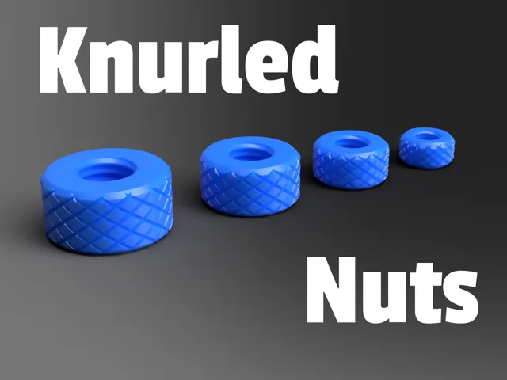
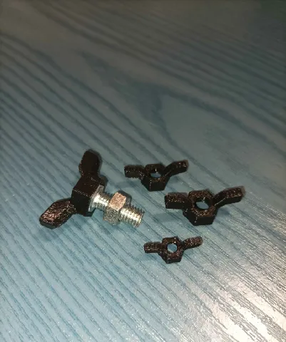

# Hardware

<!-- Generated by scripts/Update-Readmes.ps1 (Linux: scripts/update_readmes.py) - edit scripts/readme-sources.json and rerun instead of editing by hand. -->

[Home](../../README.md) / [Tools](../README.md) / **Hardware**

3 builds &middot; 2 MakerWorld &middot; 1 Printables

## Hardware

<table>
<tr>
<td width="33%" align="center" valign="top">
<i>no preview</i> 
<b>All M3-M8</b> 
<a href="https://makerworld.com/en/search/models?keyword=All%20M3-M8">Search MakerWorld</a> &middot; <a href="All%2BM3-M8_stls">Repo folder</a>
</td>
<td width="33%" align="center" valign="top">
 
<b>Knurled Nuts</b> 
by ngprint 
<a href="https://makerworld.com/en/models/404343-knurled-nuts">MakerWorld</a> &middot; <a href="Knurled-nuts">Repo folder</a>
</td>
<td width="33%" align="center" valign="top">
 
<b>Wing nuts</b> 
by CoinCorrector 
<a href="https://www.printables.com/model/1192118-wing-nuts">Printables</a> &middot; <a href="Wing-nuts">Repo folder</a>
</td>
</tr>
</table>

