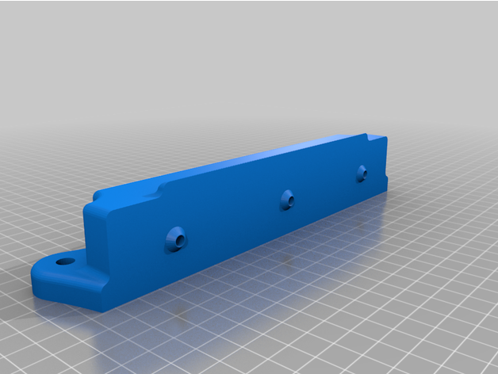
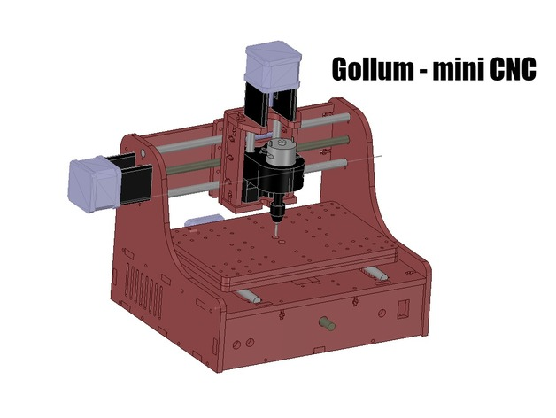
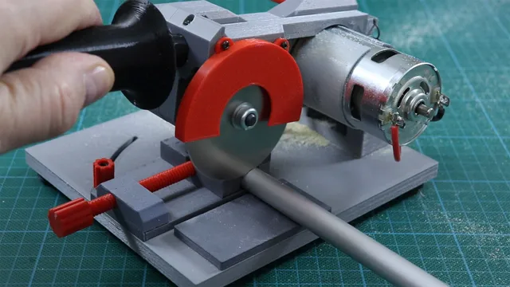
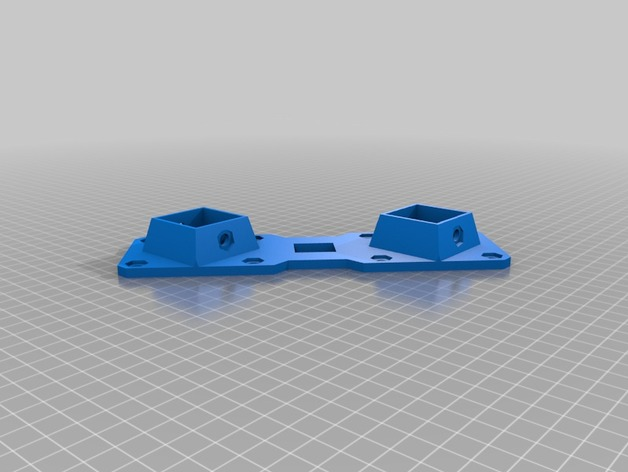
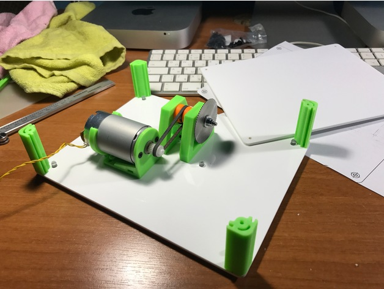
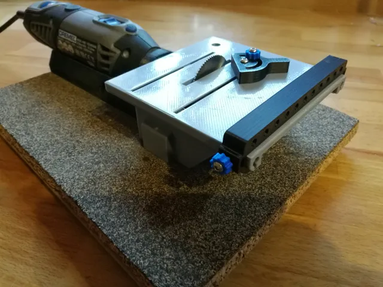
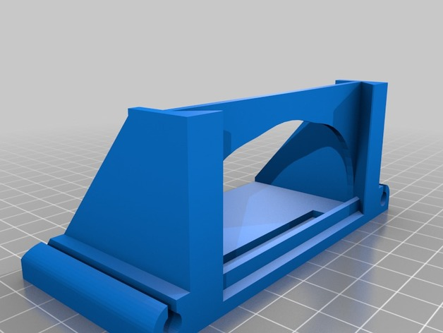
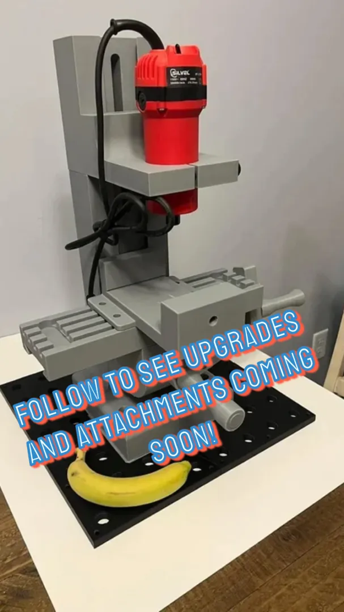

# Machining

<!-- Generated by scripts/Update-Readmes.ps1 (Linux: scripts/update_readmes.py) - edit scripts/readme-sources.json and rerun instead of editing by hand. -->

[Home](../../README.md) / [Tools](../README.md) / **Machining**

11 builds &middot; 1 MakerWorld &middot; 4 Printables &middot; 5 Thingiverse &middot; 1 unknown source

## Machining

<table>
<tr>
<td width="33%" align="center" valign="top">
<i>no preview</i> 
<b>3D Printed Laser Cut, Lil-CNC Mill ACv2</b> 
Source unknown &middot; <a href="3D_Printed___Laser_Cut%2C_Lil-CNC_Mill_ACv2">Repo folder</a>
</td>
<td width="33%" align="center" valign="top">
 
<b>DREMEL Drill Press (Very strong and precise)</b> 
by 3Deddy 
<a href="https://www.thingiverse.com/thing:4148260">Thingiverse</a> &middot; <a href="DREMEL_Drill_Press__Very_strong_and_precise___4148260">Repo folder</a>
</td>
<td width="33%" align="center" valign="top">
 
<b>Gollum - MiniCNC</b> 
by cyryllo 
<a href="https://www.thingiverse.com/thing:2551625">Thingiverse</a> &middot; <a href="Gollum_-_MiniCNC">Repo folder</a>
</td>
</tr>
<tr>
<td width="33%" align="center" valign="top">
<i>no preview</i> 
<b>Mini Sanding And Sharpening Machine</b> 
<a href="https://www.printables.com/model/719862">Printables</a> &middot; <a href="mini-sanding-and-sharpening-machine-model_files">Repo folder</a>
</td>
<td width="33%" align="center" valign="top">
 
<b>Powerful &amp; Useful 3D Mini Saw</b> 
by RCMakerLab 
<a href="https://www.printables.com/model/719964-powerful-useful-3d-mini-saw">Printables</a> &middot; <a href="powerful-useful-3d-mini-saw-model_files">Repo folder</a>
</td>
<td width="33%" align="center" valign="top">
 
<b>RS-CNC , the new model of R-CNC</b> 
by RoMaker 
<a href="https://www.thingiverse.com/thing:3010914">Thingiverse</a> &middot; <a href="RS-CNC__the_new_model_of_R-CNC">Repo folder</a>
</td>
</tr>
<tr>
<td width="33%" align="center" valign="top">
 
<b>Table SAW</b> 
by Perinski 
<a href="https://www.thingiverse.com/thing:3044200">Thingiverse</a> &middot; <a href="Table_SAW">Repo folder</a>
</td>
<td width="33%" align="center" valign="top">
 
<b>Table saw for Dremel</b> 
by Fearless 
<a href="https://www.printables.com/model/708684-table-saw-for-dremel">Printables</a> &middot; <a href="table-saw-for-dremel-model_files">Repo folder</a>
</td>
<td width="33%" align="center" valign="top">
 
<b>Table saw for Dremel 4000 (with drill bracket Fixed)</b> 
by oikos 
<a href="https://www.thingiverse.com/thing:670704">Thingiverse</a> &middot; <a href="Table_saw_for_Dremel_4000_with_drill_bracket_Fixed_">Repo folder</a>
</td>
</tr>
<tr>
<td width="33%" align="center" valign="top">
 
<b>Vertical Milling Machine</b> 
<a href="https://makerworld.com/en/search/models?keyword=Vertical%20Milling%20Machine">Search MakerWorld</a> &middot; <a href="Vertical%2BMilling%2BMachine.3mf">Vertical+Milling+Machine.3mf</a>
</td>
<td width="33%" align="center" valign="top">
<i>no preview</i> 
<b>Very Useful Mini Table Saw V20</b> 
<a href="https://www.printables.com/model/736387">Printables</a> &middot; <a href="very-useful-mini-table-saw-v20-model_files">Repo folder</a>
</td>
</tr>
</table>

