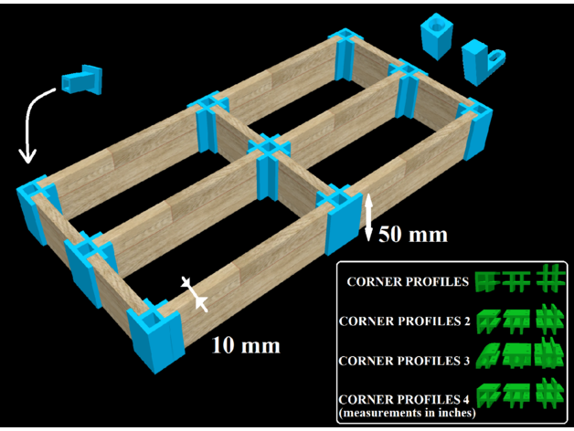
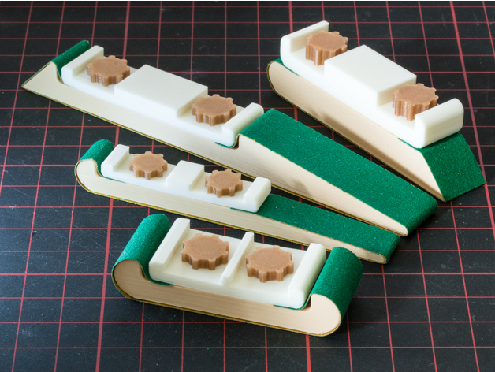
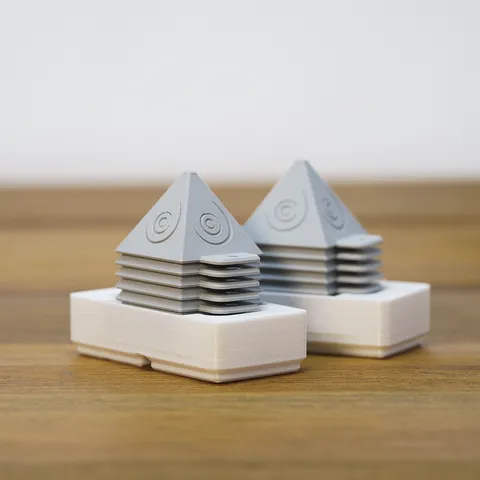
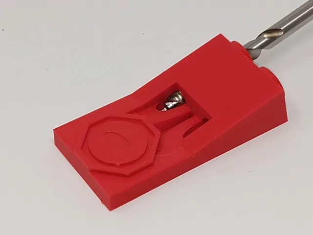

# Woodworking

<!-- Generated by scripts/Update-Readmes.ps1 (Linux: scripts/update_readmes.py) - edit scripts/readme-sources.json and rerun instead of editing by hand. -->

[Home](../../README.md) / [Tools](../README.md) / **Woodworking**

6 builds &middot; 2 Printables &middot; 2 Thingiverse &middot; 2 unknown source &middot; 2 collections (17 more builds)

## Collections

- [Connectors](connectors/README.md) - 13 builds
- [Sanding Tools](sanding-tools/README.md) - 4 builds

## Woodworking

<table>
<tr>
<td width="33%" align="center" valign="top">
 
<b>CORNER PROFILES</b> 
by SlyWorks 
<a href="https://www.thingiverse.com/thing:5918127">Thingiverse</a> &middot; <a href="CORNER_PROFILES_5918127">Repo folder</a>
</td>
<td width="33%" align="center" valign="top">
 
<b>Customizable Sanding Stick</b> 
by mightynozzle 
<a href="https://www.thingiverse.com/thing:2404850">Thingiverse</a> &middot; <a href="Customizable_Sanding_Stick">Repo folder</a>
</td>
<td width="33%" align="center" valign="top">
 
<b>Perky Peaks Painting Pyramids with Custom Gridfinity Holder</b> 
by Hands on Katie 
<a href="https://www.printables.com/model/777429-perky-peaks-painting-pyramids-with-custom-gridfini">Printables</a> &middot; <a href="perky-peaks-painting-pyramids-with-custom-gridfinity-holder-model_files">Repo folder</a>
</td>
</tr>
<tr>
<td width="33%" align="center" valign="top">
 
<b>Pocket hole jig</b> 
by Henry 
<a href="https://www.printables.com/model/96193-pocket-hole-jig">Printables</a> &middot; <a href="pocket-hole-jig-model_files">Repo folder</a>
</td>
<td width="33%" align="center" valign="top">
<i>no preview</i> 
<b>Sawhorse-master</b> 
Source unknown &middot; <a href="Sawhorse-master">Repo folder</a>
</td>
</tr>
</table>

Other files in this folder (1)

- [Blade Honing Guide - 6664571.zip](Blade%20Honing%20Guide%20-%206664571.zip)

