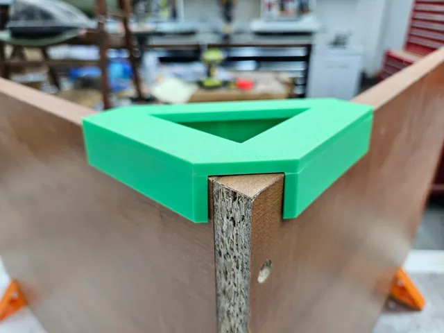
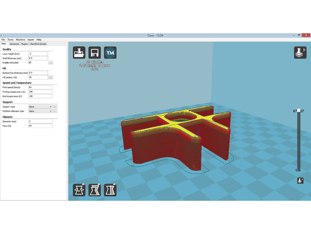
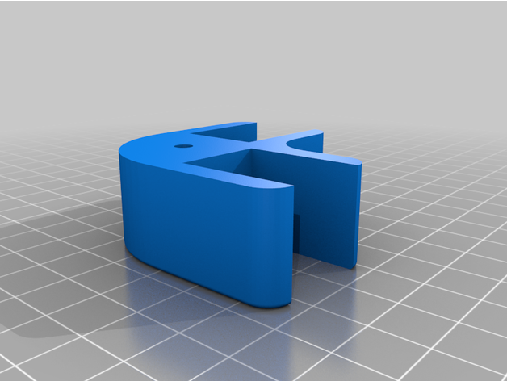
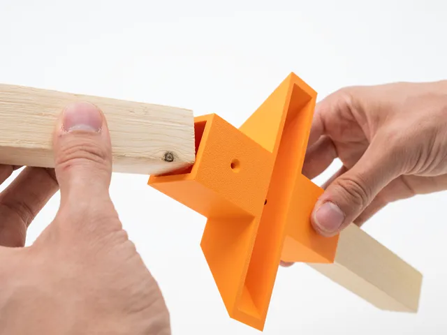
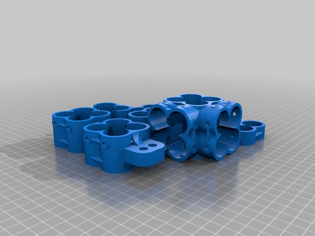
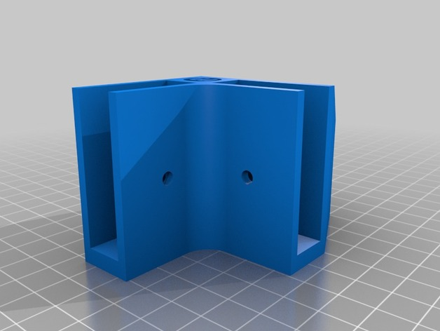
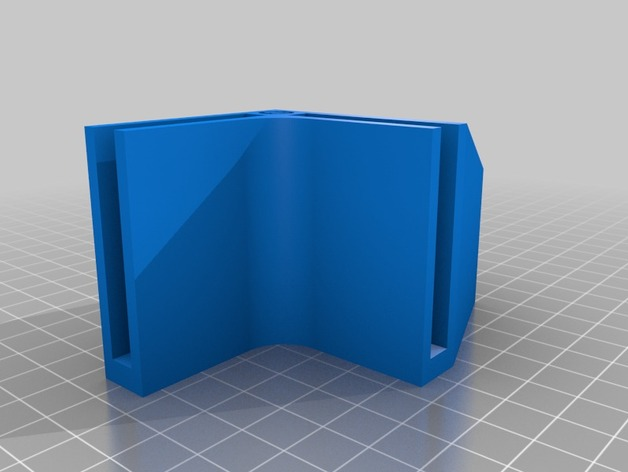
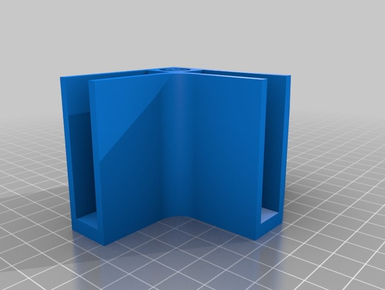
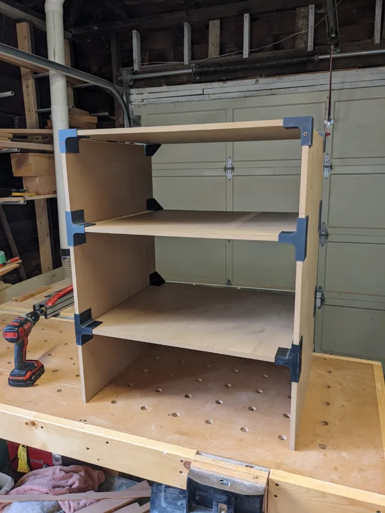

# Connectors

<!-- Generated by scripts/Update-Readmes.ps1 (Linux: scripts/update_readmes.py) - edit scripts/readme-sources.json and rerun instead of editing by hand. -->

[Home](../../../README.md) / [Tools](../../README.md) / [Woodworking](../README.md) / **Connectors**

13 builds &middot; 4 MakerWorld &middot; 7 Thingiverse &middot; 2 unknown source

## Connectors

<table>
<tr>
<td width="33%" align="center" valign="top">
 
<b>90 degree corner assembly guides - METRIC 6mm-25mm</b> 
by Darren 3d print 
<a href="https://makerworld.com/en/models/913240-90-degree-corner-assembly-guides-metric-6mm-25mm">MakerWorld</a> &middot; <a href="90%2Bdegree%2Bcorner%2Bassembly%2Bguides%2B-%2BMETRIC%2B6mm-25mm">Repo folder</a>
</td>
<td width="33%" align="center" valign="top">
 
<b>Joints to make DIY furniture</b> 
by martcaset 
<a href="https://www.thingiverse.com/thing:2400175">Thingiverse</a> &middot; <a href="Joints_to_make_DIY_furniture">Repo folder</a>
</td>
<td width="33%" align="center" valign="top">
 
<b>Joints to make DIY furniture</b> 
by martcs 
<a href="https://www.thingiverse.com/thing:2400175">Thingiverse</a> &middot; <a href="Joints_to_make_DIY_furniture_2400175">Repo folder</a>
</td>
</tr>
<tr>
<td width="33%" align="center" valign="top">
<i>no preview</i> 
<b>Modular Furniture Joint</b> 
Source unknown &middot; <a href="Modular_Furniture_Joint">Repo folder</a>
</td>
<td width="33%" align="center" valign="top">
 
<b>Modular shelf</b> 
<a href="https://makerworld.com/en/search/models?keyword=Modular%20shelf">Search MakerWorld</a> &middot; <a href="Modular%2Bshelf">Repo folder</a>
</td>
<td width="33%" align="center" valign="top">
 
<b>Moidules - Create your own custom made shelving system at home!</b> 
by Moidules 
<a href="https://www.thingiverse.com/thing:681835">Thingiverse</a> &middot; <a href="Moidules_-_Create_your_own_custom_made_shelving_system_at_home__681835">Repo folder</a>
</td>
</tr>
<tr>
<td width="33%" align="center" valign="top">
 
<b>Parametric Pinch 3D joint - Geometric version</b> 
by Unico Dadudi 
<a href="https://makerworld.com/en/models/2630102-parametric-pinch-3d-joint-geometric-version">MakerWorld</a> &middot; <a href="Parametric%2BPinch%2B3D%2Bjoint%2B-%2BGeometric%2Bversion">Repo folder</a>
</td>
<td width="33%" align="center" valign="top">
 
<b>PVC pipe construction set, ver.2</b> 
by DonaldJ 
<a href="https://www.thingiverse.com/thing:932732">Thingiverse</a> &middot; <a href="PVC_pipe_construction_set__ver_2_932732">Repo folder</a>
</td>
<td width="33%" align="center" valign="top">
 
<b>Set of moidules for 1/2 inch board. Option with screw holes!</b> 
by Moidules 
<a href="https://www.thingiverse.com/thing:736398">Thingiverse</a> &middot; <a href="Set_of_moidules_for_1_2_inch_board__Option_with_screw_holes__736398">Repo folder</a>
</td>
</tr>
<tr>
<td width="33%" align="center" valign="top">
 
<b>Set of moidules for 1/4 inch board.</b> 
by Moidules 
<a href="https://www.thingiverse.com/thing:736403">Thingiverse</a> &middot; <a href="Set_of_moidules_for_1_4_inch_board__736403">Repo folder</a>
</td>
<td width="33%" align="center" valign="top">
 
<b>Set of Moidules for 12mm board. Option with screw holes!</b> 
by Moidules 
<a href="https://www.thingiverse.com/thing:725671">Thingiverse</a> &middot; <a href="Set_of_Moidules_for_12mm_board__Option_with_screw_holes__725671">Repo folder</a>
</td>
<td width="33%" align="center" valign="top">
 
<b>Shelving bracket system</b> 
by OxSox 
<a href="https://makerworld.com/en/models/206120-shelving-bracket-system">MakerWorld</a> &middot; <a href="Shelving%2Bbracket%2Bsystem">Repo folder</a>
</td>
</tr>
</table>

Other files in this folder (1)

- [plate-connector-90-degree-90-grad-plattenverbinder-winkel-schrank-model_files.zip](plate-connector-90-degree-90-grad-plattenverbinder-winkel-schrank-model_files.zip)

