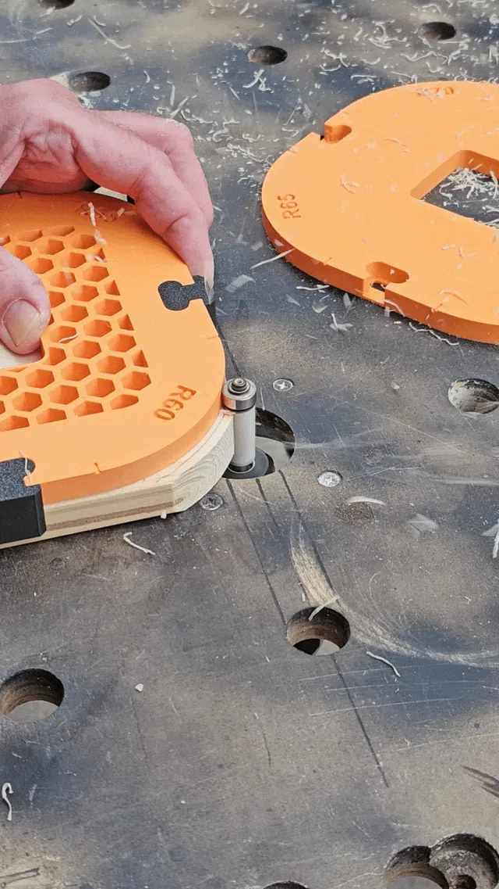
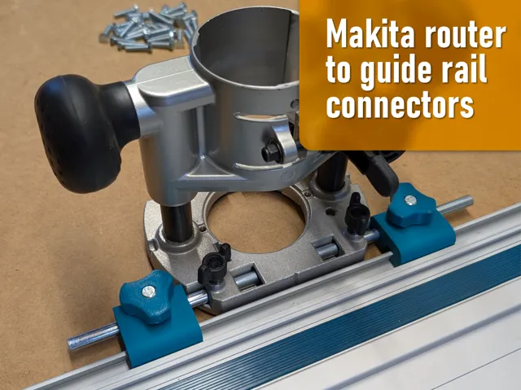
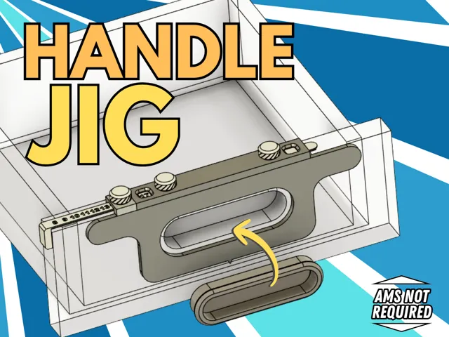
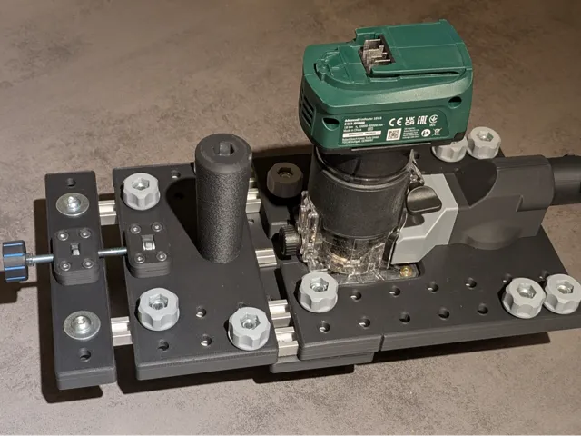

# Router

<!-- Generated by scripts/Update-Readmes.ps1 (Linux: scripts/update_readmes.py) - edit scripts/readme-sources.json and rerun instead of editing by hand. -->

[Home](../../../README.md) / [Tools](../../README.md) / [Woodworking](../README.md) / **Router**

4 builds &middot; 4 MakerWorld

## Router

<table>
<tr>
<td width="33%" align="center" valign="top">
 
<b>Corner Radius Jig for Router Mid Size</b> 
by pomguy 
<a href="https://makerworld.com/en/models/2804328-corner-radius-jig-for-router-mid-size">MakerWorld</a> &middot; <a href="Corner%2BRadius%2BJig%2Bfor%2BRouter%2BMid%2BSize">Repo folder</a>
</td>
<td width="33%" align="center" valign="top">
 
<b>CUSTOMISABLE Router to Makita Rail connector</b> 
by graffoo 
<a href="https://makerworld.com/en/models/894197-customisable-router-to-makita-rail-connector">MakerWorld</a> &middot; <a href="CUSTOMISABLE%2BRouter%2Bto%2BMakita%2BRail%2Bconnector">Repo folder</a>
</td>
<td width="33%" align="center" valign="top">
 
<b>Maniglie incassate per mobili + dima fresatrice</b> 
by White Ghost Shop 
<a href="https://makerworld.com/en/models/1602553-recessed-cabinet-handles-router-jig">MakerWorld</a> &middot; <a href="Maniglie%2Bincassate%2Bper%2Bmobili%2B%2B%2Bdima%2Bfresatrice">Repo folder</a>
</td>
</tr>
<tr>
<td width="33%" align="center" valign="top">
 
<b>multi-jig for Makita / Bosch / Dewalt trim router</b> 
by maot1985 
<a href="https://makerworld.com/en/models/1081863-multi-jig-for-makita-bosch-dewalt-trim-routers">MakerWorld</a> &middot; <a href="multi-jig%2Bfor%2BMakita%2B_%2BBosch%2B_%2BDewalt%2Btrim%2Brouter">Repo folder</a>
</td>
</tr>
</table>

