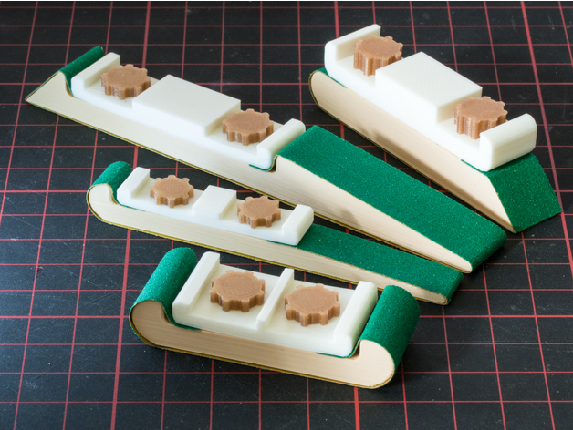

# Sanding Tools

<!-- Generated by scripts/Update-Readmes.ps1 (Linux: scripts/update_readmes.py) - edit scripts/readme-sources.json and rerun instead of editing by hand. -->

[Home](../../../README.md) / [Tools](../../README.md) / [Woodworking](../README.md) / **Sanding Tools**

4 builds &middot; 3 MakerWorld &middot; 1 Thingiverse

## Sanding Tools

<table>
<tr>
<td width="33%" align="center" valign="top">
 
<b>Customizable Sanding Stick</b> 
by mightynozzle 
<a href="https://www.thingiverse.com/thing:2404850">Thingiverse</a> &middot; <a href="Customizable_Sanding_Stick">Repo folder</a>
</td>
<td width="33%" align="center" valign="top">
<i>no preview</i> 
<b>RAZE NANO ARC</b> 
<a href="https://makerworld.com/en/search/models?keyword=RAZE%20NANO%20ARC">Search MakerWorld</a> &middot; <a href="RAZE_NANO_ARC_stls">Repo folder</a>
</td>
<td width="33%" align="center" valign="top">
<i>no preview</i> 
<b>RAZE NANO DOME</b> 
<a href="https://makerworld.com/en/search/models?keyword=RAZE%20NANO%20DOME">Search MakerWorld</a> &middot; <a href="RAZE_NANO_DOME_stls">Repo folder</a>
</td>
</tr>
<tr>
<td width="33%" align="center" valign="top">
<i>no preview</i> 
<b>RAZE NANO SPEAR</b> 
<a href="https://makerworld.com/en/search/models?keyword=RAZE%20NANO%20SPEAR">Search MakerWorld</a> &middot; <a href="RAZE_NANO_SPEAR_stls">Repo folder</a>
</td>
</tr>
</table>

