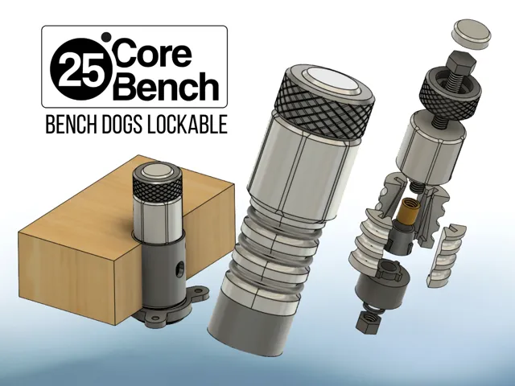
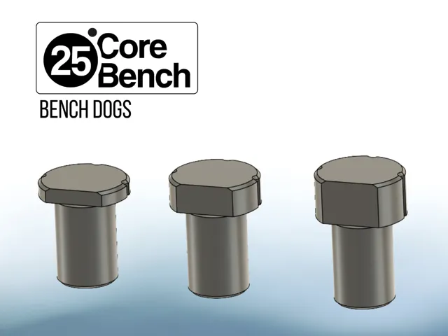
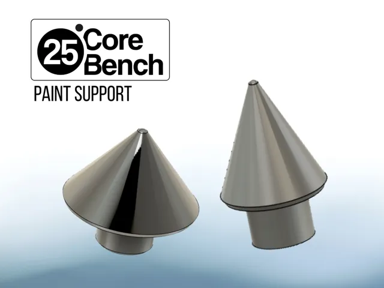
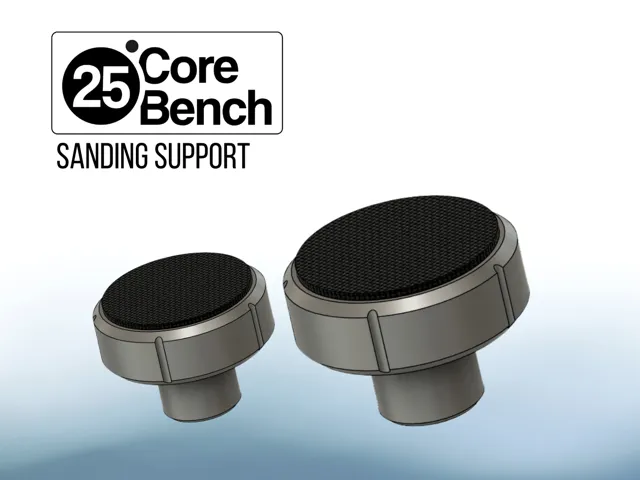
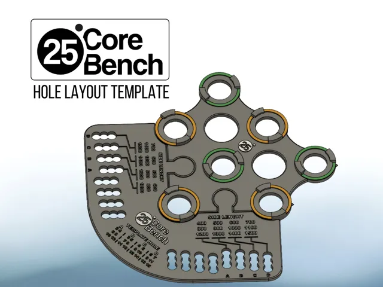
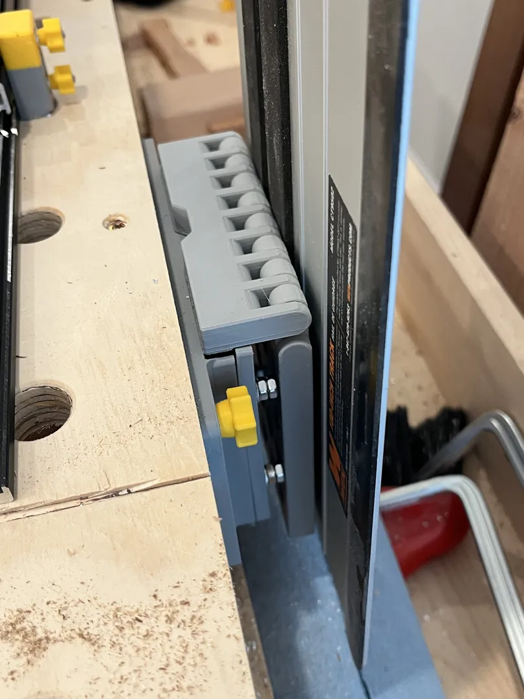

# Workbench

<!-- Generated by scripts/Update-Readmes.ps1 (Linux: scripts/update_readmes.py) - edit scripts/readme-sources.json and rerun instead of editing by hand. -->

[Home](../../../README.md) / [Tools](../../README.md) / [Woodworking](../README.md) / **Workbench**

10 builds &middot; 9 MakerWorld &middot; 1 unknown source

## Workbench

<table>
<tr>
<td width="33%" align="center" valign="top">
 
<b>25 CoreBench - Bench Dog Lockable</b> 
by White Ghost Shop 
<a href="https://makerworld.com/en/models/1858743-25-corebench-bench-dog-lockable">MakerWorld</a> &middot; <a href="25%2BCoreBench%2B-%2BBench%2BDog%2BLockable">Repo folder</a>
</td>
<td width="33%" align="center" valign="top">
 
<b>25 CoreBench - Benchdogs</b> 
by White Ghost Shop 
<a href="https://makerworld.com/en/models/1858727-25-corebench-benchdogs">MakerWorld</a> &middot; <a href="25%2BCoreBench%2B-%2BBenchdogs">Repo folder</a>
</td>
<td width="33%" align="center" valign="top">
 
<b>25 CoreBench - Hold Down</b> 
by White Ghost Shop 
<a href="https://makerworld.com/en/models/1858722-25-corebench-hold-down">MakerWorld</a> &middot; <a href="25%2BCoreBench%2B-%2BHold%2BDown">Repo folder</a>
</td>
</tr>
<tr>
<td width="33%" align="center" valign="top">
 
<b>25 CoreBench - Paint support</b> 
by White Ghost Shop 
<a href="https://makerworld.com/en/models/1858733-25-corebench-paint-support">MakerWorld</a> &middot; <a href="25%2BCoreBench%2B-%2BPaint%2Bsupport">Repo folder</a>
</td>
<td width="33%" align="center" valign="top">
 
<b>25 CoreBench - Sanding support</b> 
by White Ghost Shop 
<a href="https://makerworld.com/en/models/1858736-25-corebench-sanding-support">MakerWorld</a> &middot; <a href="25%2BCoreBench%2B-%2BSanding%2Bsupport">Repo folder</a>
</td>
<td width="33%" align="center" valign="top">
 
<b>25 CoreBench - Standard Block</b> 
by White Ghost Shop 
<a href="https://makerworld.com/en/models/1858696-25-corebench-standard-block">MakerWorld</a> &middot; <a href="25%2BCoreBench%2B-%2BStandard%2BBlock">Repo folder</a>
</td>
</tr>
<tr>
<td width="33%" align="center" valign="top">
 
<b>25 CoreBench - Template Hole</b> 
by White Ghost Shop 
<a href="https://makerworld.com/en/models/1858662-25-corebench-template-hole">MakerWorld</a> &middot; <a href="25%2BCoreBench%2B-%2BTemplate%2BHole">Repo folder</a>
</td>
<td width="33%" align="center" valign="top">
<i>no preview</i> 
<b>Flip Stop 2040 T Profile</b> 
<a href="https://makerworld.com/en/search/models?keyword=Flip%20Stop%202040%20T%20Profile">Search MakerWorld</a> &middot; <a href="Flip%2BStop%2B2040%2BT%2BProfile_stls">Repo folder</a>
</td>
<td width="33%" align="center" valign="top">
<i>no preview</i> 
<b>Sawhorse-master</b> 
Source unknown &middot; <a href="Sawhorse-master">Repo folder</a>
</td>
</tr>
<tr>
<td width="33%" align="center" valign="top">
 
<b>Track Saw Guide Rail Hinge for MFT</b> 
by user_1936561950 
<a href="https://makerworld.com/en/models/2749082-track-saw-guide-rail-hinge-for-mft">MakerWorld</a> &middot; <a href="trackHinge_stls">Repo folder</a>
</td>
</tr>
</table>

