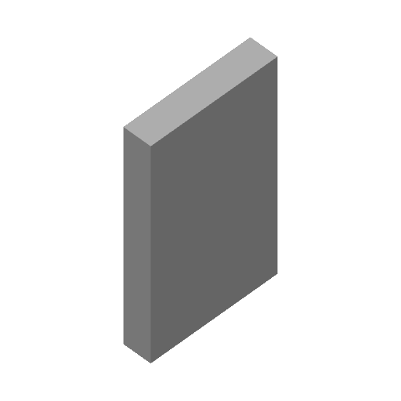
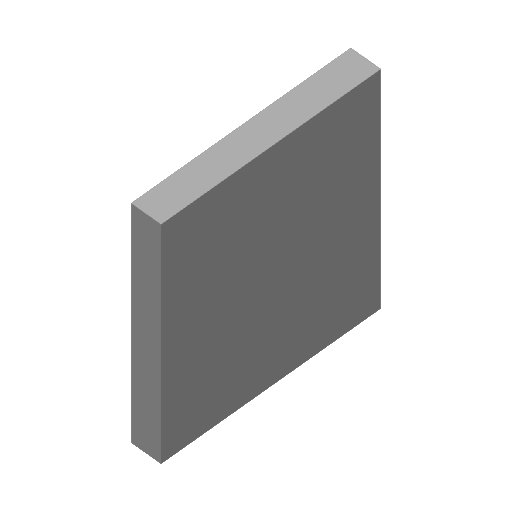
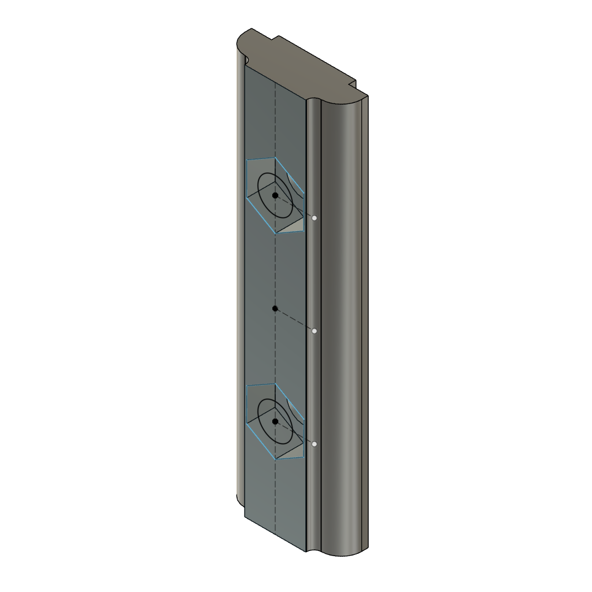
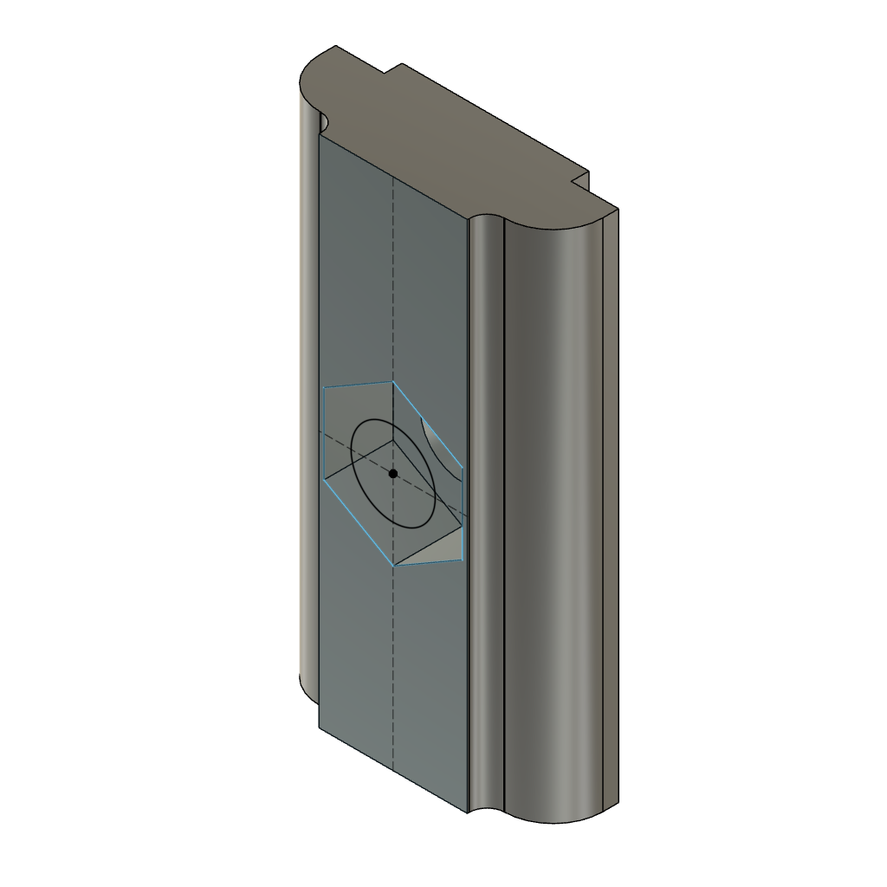

# Unsorted

<!-- Generated by scripts/Update-Readmes.ps1 (Linux: scripts/update_readmes.py) - edit scripts/readme-sources.json and rerun instead of editing by hand. -->

[Home](../README.md) / **Unsorted**

10 builds &middot; 2 Thingiverse &middot; 8 unknown source

## Unsorted

<table>
<tr>
<td width="33%" align="center" valign="top">
 
<b>1x4x6</b> 
Source unknown &middot; <a href="1x4x6.3mf">1x4x6.3mf</a>
</td>
<td width="33%" align="center" valign="top">
 
<b>1x6x6</b> 
Source unknown &middot; <a href="1x6x6.3mf">1x6x6.3mf</a>
</td>
<td width="33%" align="center" valign="top">
 
<b>Back Horn Speaker V2.0 BL2 - Bluetooth, Active, Passive</b> 
by guppyk 
<a href="https://www.thingiverse.com/thing:4668173">Thingiverse</a> &middot; <a href="Back_Horn_Speaker_V2_0_BL2_-_Bluetooth__Active__Passive_4668173">Repo folder</a>
</td>
</tr>
<tr>
<td width="33%" align="center" valign="top">
 
<b>Earbud holder</b> 
by sneakypoo 
<a href="https://www.thingiverse.com/thing:36321">Thingiverse</a> &middot; <a href="Earbud_holder">Repo folder</a>
</td>
<td width="33%" align="center" valign="top">
 
<b>Long T-Nut</b> 
Source unknown &middot; <a href="Long%20T-Nut.3mf">Long T-Nut.3mf</a>
</td>
<td width="33%" align="center" valign="top">
 
<b>T-nut</b> 
Source unknown &middot; <a href="T-nut.3mf">T-nut.3mf</a>
</td>
</tr>
</table>

Other files in this folder (4)

- [AMSClampNut-Small.stl](AMSClampNut-Small.stl)
- [AMSClampScrew-Small.stl](AMSClampScrew-Small.stl)
- [Large Command Hook.stl](Large%20Command%20Hook.stl)
- [Tetrahedron.stl](Tetrahedron.stl)

